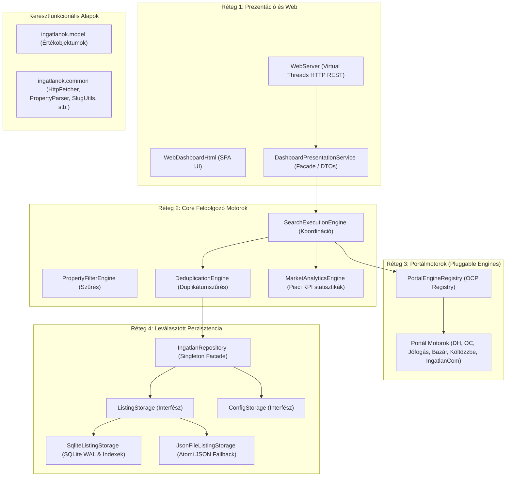

# Mélytervező Architekt Skill (Deep Systems & Software Architect)

Ez a skill a projekt mélyreható szoftver- és rendszertervezési döntéseit, komponens-felelősségeit, tervezési mintáit és architekturális szabályait rögzíti az **ingatlan-kereso** alkalmazáshoz.

---

## 1. Architektúra Alapelvek és Filozófia

### 1.1 Clean Architecture és Réteg-izoláció (4 Rétegű Rendszer)
Az alkalmazás szigorúan rétegzett és laza csatolású (`Loose Coupling`, `High Cohesion`):

1. **Model / Domain réteg (`ingatlanok.model`):**
   - Gazdag értékobjektumok (`PriceInfo`, `PropertyDetails`, `IngatlanItem`, `SearchCriteria`, `SearchResult`, `PortalSource`).
   - Nem tartalmazhat semmilyen I/O műveletet, Jsoup vagy külső HTTP függőséget.
2. **Common / Segédeszköz réteg (`ingatlanok.common`):**
   - Állapotmentes, szálbiztos segédosztályok (`HttpFetcher`, `PropertyParser`, `SlugUtils`, `CityUtils`, `BrowserUtils`, `AppLogger`).
3. **Core feldolgozó motorok (`ingatlanok.core`):**
   - Tiszta üzleti és párhuzamosítási logika: `PropertyFilterEngine`, `DeduplicationEngine`, `MarketAnalyticsEngine`, `SearchExecutionEngine`.
   - Független a konkrét hálózati scraping technológiától és a konkrét tárolási formátumtól.
4. **Portálmotorok és külső csatolók (`ingatlanok.portal`, `ingatlanok.scraper`):**
   - Pluggable Portal Engine architektúra (`PortalEngine`, `PortalEngineRegistry`, `PortalDescriptor`).
   - Minden portál független motorba szervezve (`dh`, `oc`, `jofogas`, `ingatlanbazar`, `koltozzbe`, `ingatlancom`).
   - Zero-Crash elv: egyetlen portál hálózati vagy DOM hibája sem ránthatja le az orchestratort.
5. **Leválasztott perzisztencia (`ingatlanok.persistence`):**
   - `ListingStorage` és `ConfigStorage` interfészekre épülő modularitás.
   - Relációs beágyazott SQLite (`SqliteListingStorage`, `SqliteConfigStorage`, WAL mód, B-Tree indexek).
   - Atomi JSON tároló fallback (`JsonFileListingStorage`, `JsonConfigStorage`, `.tmp` + `ATOMIC_MOVE`).
   - `IngatlanRepository` egységes, thread-safe Singleton Facade a felsőbb rétegek felé.
6. **Prezentáció és beágyazott Web réteg (`ingatlanok.presentation`, `ingatlanok.web`):**
   - `DashboardPresentationService`: Facade DTO aggregáció (KPI statisztikák, portál állapotok).
   - `WebServer`: Beágyazott Sun HTTP kiszolgáló Java 21 Virtual Threads alapon, CORS/CSP védelemmel, REST végpontokkal.
   - `WebDashboardHtml`: Zéró külső függőségű, offline is működő Single Page Application (SPA).

---

## 2. Döntési és Tervezési Minták

### 2.1 Java 21 Virtual Threads és Strukturált Konkurencia
* Használj `Executors.newVirtualThreadPerTaskExecutor()`-t minden I/O-intenzív feladatra (web scraping, HTTP API kérések, hálózati műveletek).
* Kerüld a `synchronized` blokkokon belüli blokkoló hálózati és I/O műveleteket (Carrier Thread pinning megelőzése); helyette használj `ReentrantLock`-ot, `ReentrantReadWriteLock`-ot vagy nem blokkoló adatstruktúrákat (`ConcurrentHashMap`, `CompletableFuture`).

### 2.2 Pluggable Portal Engine Minta (Open/Closed Principle)
Új portál integrálásakor:
1. Hozz létre egy dedikált csomagot az `ingatlanok.portal.<portalnev>` alatt.
2. Implementáld a `PortalEngine` interfészt egyedi `PortalDescriptor`-ral (név, szín, keresőlink, támogatott típusok).
3. Regisztráld az új motort a `PortalEngineRegistry`-ben.
4. Tervezz be robusztus hibakezelést és 0-crash viselkedést (`PortalScrapeStatus.SUCCESS`, `BOT_PROTECTED`, `ERROR`).

### 2.3 Konténerizációs és Mikroszolgáltatás Tervezési Elvek
* **Kétfázisú multi-stage build:** Maven fordítás a build stage-ben, minimalizált és karcsúsított Eclipse Temurin 21 Alpine JRE a futtatási stage-ben.
* **Non-root felhasználó:** Az alkalmazás soha ne fusson `root` jogosultságokkal a konténerben (dedikált `appuser` UID 10001).
* **Stateless futtatókörnyezet & Kötet izoláció:**
  - Lemez perzisztencia elkülönítve a `/app/data` (SQLite DB / JSON) és `/app/logs` köteteken.
  - Kliensoldali böngészőlap-nyitás (Zero-Server-Desktop-Call), így fej nélküli szerver/konténer környezetben is hiba nélkül működik a keresés és a lapmegnyitás.
* **Környezeti konfiguráció:** `SERVER_HOST` és `SERVER_PORT` környezeti változókkal való rugalmas paraméterezhetőség.

---

## 3. Architektúra Döntési Munkafolyamat (ADR Workflow)

Amikor jelentős rendszermódosítást tervezel:
1. **Kontextus és Probléma feltárása:** Miért nem alkalmas a jelenlegi megoldás?
2. **Alternatívák elemzése:** Legalább 2-3 opció kidolgozása pro/kontra táblázattal (teljesítmény, karbantarthatóság, függőségek, komplexitás).
3. **Döntési javaslat:** Választott stratégia és annak indoklása.
4. **Következmények (Trade-offs):** Milyen kompromisszumokkal jár a döntés?
5. **ADR dokumentáció:** Használd a [Kapcsolódó ADR sablont](./references/architecture-decision-record-template.md).

---

## 4. Architektúra Ellenőrző Lista (Architect's Checklist)

- [ ] **Függőségi irány:** A belső rétegek (Domain/Core) nem függenek külső rétegektől (Web/UI/Scraper)?
- [ ] **0-Crash garancia:** Hálózati hiba vagy DOM változás esetén az alkalmazás stabil marad?
- [ ] **Szálbiztosság:** A megosztott állapotok thread-safe tárolókban (`ConcurrentHashMap`, `AtomicBoolean`, `ReentrantReadWriteLock`) vannak?
- [ ] **Erőforrás-gazdálkodás:** Minden `InputStream`, `OutputStream`, HTTP kapcsolat, DB `Connection`/`Statement`/`ResultSet` és Process le van zárva (`try-with-resources`)?
- [ ] **Konténer-kompatibilitás:** Nincs feltételezve natív asztali GUI vagy xdg-open a szerver oldalon?
- [ ] **Tesztelhetőség:** Az üzleti logika és a portálmotorok függetlenül egységtesztelhetőek mock adatokkal?
