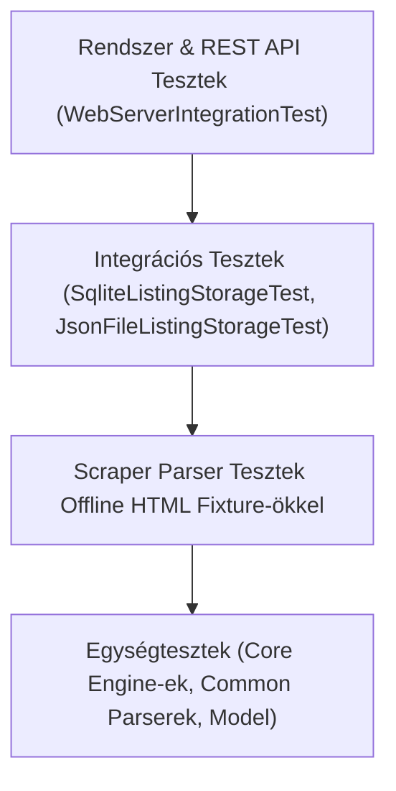

# Minőségbiztosítási és Tesztmérnök Skill (QA & Test Automation Engineer)

Ez a skill a szoftverminőség, a tesztelési piramis, a regressziómegelőzés, az offline fixture mockolás és a kódlefedettség (JaCoCo) irányelveit rögzíti az **ingatlan-kereso** alkalmazáshoz.

---

## 1. Tesztelési Piramis és Alapelvek

A rendszer magas megbízhatóságát és gyors CI futását szigorúan rétegzett és determinisztikus tesztkészlet garantálja.



### 1.1 Determinista és Hálózatmentes Tesztelés
* **Soha ne végezz élő hálózati scrapinget az automatizált tesztekben!**
* A külső weboldalak (dh.hu, oc.hu, stb.) állapota, internetkimaradás vagy sebességkorlátozás soha nem okozhatja a `mvn test` elhasalását.
* Minden scraper parser tesztet előre rögzített, offline HTML vagy JSON fixture fájlokon kell futtatni (`src/test/resources/`).

---

## 2. Tesztrétegek és Implementációs Minták

### 2.1 Core és Segédeszköz Egységtesztek (`src/test/java/ingatlanok/common/`, `core/`)
* **Fókusz:** Szélsőértékek, érvénytelen bemenetek, formázási hibák, nulla és negatív értékek kezelése.
* **Kulcstesztosztályok:**
  - `PropertyParserTest`: Árak (M Ft, Ft, ezer Ft), alapterületek ($m^2$), szobaszámok kinyerése és tisztítása.
  - `PropertyFilterEngineTest`: Ár- és mérethatárok, típusok, megtekintett szűrés.
  - `MarketAnalyticsEngineTest`: Átlagár, m² fajlagos ár és eloszlás aggregációk számítási pontossága.
  - `DeduplicationEngineTest`: O(1) hash és URL duplikátum-felismerés.

### 2.2 Scraper Parser Tesztek Offline Fixture-ökkel (`src/test/java/ingatlanok/portal/`)
* Minden portálmotorhoz tartozzon dedikált teszt, amely egy elmentett valós HTML vagy JSON válaszból parsingol:
  ```java
  Document doc = Jsoup.parse(new File("src/test/resources/fixtures/dh_search_sample.html"), "UTF-8");
  List<IngatlanItem> items = parser.parseListingCards(doc);
  assertFalse(items.isEmpty());
  assertEquals("Debrecen", items.get(0).getCity());
  ```

### 2.3 Perzisztencia Integrációs Tesztek (`src/test/java/ingatlanok/persistence/`)
* **SQLite Tesztelés:** In-memory `:memory:` kapcsolatok vagy izolált ideiglenes fájlok (`@TempDir Path tempDir`) használatával.
* **ACID és Rollback ellenőrzés:** Tranzakciós batch mentés és duplikátum integritás ellenőrzése.
* **Atomi JSON csere tesztelése:** Hibás írás esetén a korábbi fájl sértetlenségének ellenőrzése.

### 2.4 Beágyazott Szerver REST API Tesztek (`src/test/java/ingatlanok/web/`)
* `WebServerIntegrationTest`: Dinamikus ephemeral port (port `0`) lefoglalása, valódi Virtual Thread alapú HTTP kérések küldése a REST végpontokra (`GET /api/config`, `POST /api/search`, `GET /api/items`).

---

## 3. Kódlefedettség (JaCoCo) és CI Minőségi Kapuk

* **Célkitűzés:** Legalább **80%+ kódlefedettség** fenntartása az egész alkalmazásban.
* **CI Ellenőrzés:** Minden pull request esetén a `ci.yml` futtatja a `mvn test package` lépést és JaCoCo riportot generál.
* **Regresszió Tilalom:** Új funkció vagy hibajavítás nem kerülhet a kódbázisba megfelelő JUnit 5 tesztlefedettség nélkül.

A részletes teszteset mintákat és a fixture kezelési útmutatót a [Tesztelési Stratégia és Fixture Referenciában](./references/testing-strategy-and-fixtures.md) találod.

---

## 4. QA Tesztmérnök Ellenőrző Lista

- [ ] **100% Offline lefutás:** A tesztcsomag lefut hálózati kapcsolat nélkül (repülőgép üzemmódban) is?
- [ ] **Kódlefedettség:** A módosított osztályok lefedettsége eléri vagy meghaladja a 80%-ot?
- [ ] **Szélsőérték tesztek:** Null, üres string, negatív számok és extrém nagy értékek le vannak tesztelve?
- [ ] **TempDir izoláció:** A fájl- és adatbázis tesztek nem hagynak szemetet a projekt könyvtáraiban?
- [ ] **Tiszta asssertions:** A tesztek egyértelmű, informatív hibaüzeneteket adnak bukás esetén?
- [ ] **Gyors futás:** A teljes tesztcsomag lefut 10-15 másodpercen belül?
