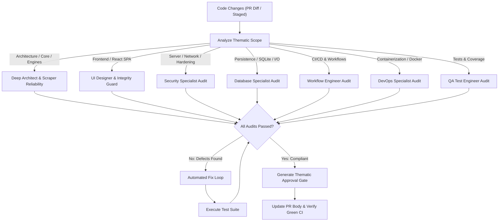

# Review and Fix Multi-Agent Quality Assurance Skill

This skill coordinates the specialist review and approval workflow across all domains for **ingatlan-kereso**.

---

## 1. Review and Approval Workflow



---

## 2. Thematic Approval Matrix

| Domain / Modified Files | Responsible Agent | Verification Criteria |
| :--- | :--- | :--- |
| `core/*`, `service/*`, `Main.java` | **`deep-architect`** | Clean Architecture layer isolation, 0-crash principle, non-blocking Virtual Threads. |
| `portal/*`, `scraper/*` | **`scraper-reliability-engineer`** | Pluggable portal OCP compliance, robust parsing, graceful bot fallback (`BOT_PROTECTED`). |
| `frontend/*`, `src/main/resources/static/` | **`ui-designer`** / **`ui-integrity-guard`** | React 19 SPA responsiveness, Vitest passes, bundle integrity (`node --check`), zero runtime errors. |
| `web/WebServer.java`, security configs | **`security-specialist`** | Localhost binding, CSP/nosniff headers, XSS sanitization, safe subprocess execution. |
| `persistence/*`, `data/*` | **`database-specialist`** | Thread-safety, SQLite WAL mode, B-Tree indexes, atomic JSON fallbacks, O(1) deduplication. |
| `Dockerfile`, `docker-compose.yml` | **`devops-specialist`** | Multi-stage build, non-root user (UID 10001), named persistent volumes (`ingatlan_data`, `ingatlan_logs`). |
| `.github/workflows/*` | **`workflow-engineer`** | Least-privilege permissions, concurrency cancellation, job timeouts, shell injection prevention. |
| `src/test/*`, JaCoCo | **`qa-test-engineer`** | 80%+ test coverage maintained, offline fixture mocking, deterministic test runs. |

---

## 3. Thematic Agent Approval Gate Template

Place this template at the very top of the Pull Request description:

```markdown
### 🛡️ Thematic Agent Approval Gate
- [x] Architecture (`deep-architect`): [OK] – Clean Architecture boundaries and 0-crash principle fully maintained.
- [x] UI/UX (`ui-designer`): [N/A] – No frontend components modified.
- [x] UI Integrity (`ui-integrity-guard`): [OK] – Frontend build and headless smoke tests pass without errors.
- [x] Security (`security-specialist`): [OK] – Least-privilege permissions and security headers intact.
- [x] Database (`database-specialist`): [OK] – SQLite WAL mode and atomic persistence verified.
- [x] Workflow/CI (`workflow-engineer`): [OK] – Pipeline concurrency, timeouts, and green merge gate verified.
- [x] DevOps (`devops-specialist`): [N/A] – Containerization files unchanged.
- [x] Scraper Reliability (`scraper-reliability-engineer`): [N/A] – Portal engines unchanged.
- [x] QA/Testing (`qa-test-engineer`): [OK] – All automated tests pass deterministically.
```

---

## 4. Strict Green Merge Gate & Fix Loop

1. **ONLY MERGE WHEN ALL CHECKS ARE GREEN:**
   - Java CI (build, unit/integration tests, frontend build & Vitest, headless smoke test) must be green.
   - PR Guard (title format, branch convention, description, Thematic Gate) must be green.
   - No checks may be pending, skipped, or failed.
2. **Immediate Fix Loop on Failure:**
   - Diagnose root cause from workflow failure logs (`gh run view --log-failed`).
   - Implement targeted fix in code, tests, or workflow configuration.
   - Commit changes with a descriptive Conventional Commits message (`fix: ...`) and push.
   - Re-evaluate until 100% of pipeline checks pass.
