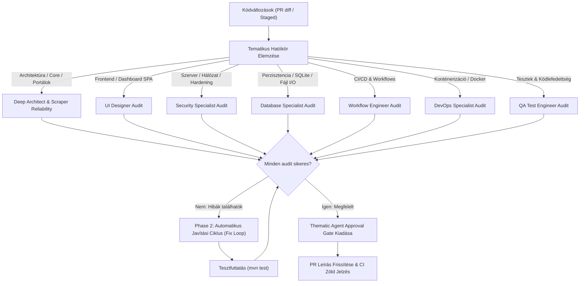

# Review and Fix Multi-Agent Minőségbiztosítási Skill

Ez a skill a [`.gemini/commands/review-and-fix.toml`](file:///e:/github/ingatlan-kereso/.gemini/commands/review-and-fix.toml) parancs mintájára épül, és összehangolja a specializált tematikus agentek review és jóváhagyási folyamatát.

---

## 1. Működési Folyamat



---

## 2. Tematikus Jóváhagyási Szabályok (Thematic Approval Rules)

Minden PR-t kizárólag akkor engedünk át, ha az érintett szakterület dedikált ágense jóváhagyja:

| Érintett Komponens / Fájl | Felelős Agent(ek) | Főbb Ellenőrzési Feltételek |
| :--- | :--- | :--- |
| `core/*`, `service/*`, `Main.java` | **`deep-architect`** | Clean Architecture réteg-izoláció, 0-crash elv, Virtual Threads helyes használata, Carrier Thread pinning mentesség. |
| `portal/*`, `scraper/*` | **`scraper-reliability-engineer`** / **`deep-architect`** | Pluggable Portal Engine OCP megfelelőség, robusztus DOM/API parsing, bot-védelem graceful kezelése (`BOT_PROTECTED`), 0-crash garancia. |
| `web/WebDashboardHtml.java`, CSS, JS | **`ui-designer`** / **`ui-integrity-guard`** | Zéró külső függőség, reszponzív nézet (360px-2560px), azonnali visszajelzés flicker nélkül, design tokenek követése, shimmering skeletonok, napló betekintő. JavaScript szintaktikai épség (`node --check`), multiline escape integritás, DOM ID és eseménykezelő szinkron, kritikus vezérlők megléte. |
| `web/WebServer.java`, `SidecarCliExecutor.java`, `BrowserUtils.java` | **`security-specialist`** | `127.0.0.1` localhost binding, `405 Method Not Allowed`, CSP/nosniff fejlécek, Path Traversal prevenció, XSS escaping, safe process execution. |
| `persistence/*`, `IngatlanRepository.java`, `data/*` | **`database-specialist`** | Thread-safe kollekciók, SQLite WAL mód és indexek, tranzakciós batch mentés, atomi JSON mentés (`.tmp` + `ATOMIC_MOVE`), O(1) duplikátumszűrés. |
| `Dockerfile`, `docker-compose.yml` | **`devops-specialist`** / **`security-specialist`** | Multi-stage build (Temurin Alpine JRE), non-root felhasználó (`appuser:10001`), perzisztens kötetek csatolása (`./data`, `./logs`), `SERVER_HOST` / `SERVER_PORT` konfigurálhatóság. |
| `.github/workflows/*`, `.githooks/*` | **`workflow-engineer`** | Minimális jogosultságok (`permissions`), shell injection védelem, GHCR publish szabályok, gyorstárazás (`cache`), concurrency és PR kapu integritás. |
| `src/test/*`, JaCoCo | **`qa-test-engineer`** | Legalább 80%+ kódlefedettség fenntartása, offline Jsoup és WireMock fixture-ök, regressziómentes integrációs tesztek. |

---

## 3. Thematic Agent Approval Gate Blokk Sablon

Amikor a vizsgálat sikeresen lezárult, a PR leírásának legfelső blokkjaként kötelező beilleszteni az alábbi formátumot a CI PR Guard követelményeinek megfelelően.
**Követelmény:** 
- Az ágensek nem hagyhatják üresen vagy pusztán jelölőnégyzettel az eredményt.
- Kötelező **pontosan egy tömör mondatban megindokolni**, hogy az adott szakértői terület miért lett **`[OK]`** (jóváhagyva), **`[NOK]`** (elutasítva/javítandó), vagy **`[N/A]`** (relevancia hiánya).

```markdown
### 🛡️ Thematic Agent Approval Gate
- [x] Architecture (`deep-architect`): [OK] – A Clean Architecture réteghatárok és a 0-crash elv maradéktalanul érvényesül.
- [x] UI/UX (`ui-designer`): [N/A] – A változtatás nem érinti a webes dashboard felületét vagy stílusait.
- [x] Security (`security-specialist`): [OK] – A bemenet-validáció és a szerverbiztonsági fejlécek sértetlenek.
- [x] Database (`database-specialist`): [OK] – A szálbiztos tárolás és az atomi perzisztencia garantált.
- [x] Workflow/CI (`workflow-engineer`): [OK] – A GitHub Actions munkafolyamatok és a PR guard szabályok rendben vannak.
- [x] DevOps (`devops-specialist`): [N/A] – Konténerizációs vagy futtatási fájlok nem módosultak.
- [x] Scraper Reliability (`scraper-reliability-engineer`): [N/A] – Web scraping és portálmotorok nem érintettek.
- [x] QA/Testing (`qa-test-engineer`): [OK] – Minden automatizált teszt hibátlanul lefut.
```

Probléma / elutasítás esetén:
`- [ ] <Téma> (<agent-id>): [NOK] – [1 mondatos szakmai indoklás a hiányosságról]`

---

## 4. Szigorú PR Javítási Ciklus Zöld CI-ig (Strict Fix Loop Until Green CI)

- **Zéró tolerancia elbukott CI-re:** Ha bármilyen CI pipeline, guard vagy teszt elbukik a Pull Requesten, a fejlesztést végző ágens nem zárhatja le a munkát 'kész'-ként.
- **Azonnali Fix Loop indítása:**
  1. Hiba elemzése a CI logok alapján (`gh run view --log-failed`).
  2. Dedikált `fix:` commit létrehozása és pusholása a PR ágra.
  3. Ellenőrzés megismétlése mindaddig, amíg minden pipeline ellenőrzés maradéktalanul **100%-ban zöld** nem lesz.
- Tilos a PR-t jóváhagyottnak vagy befejezettnek tekinteni piros vagy még futó CI pipeline mellett.


