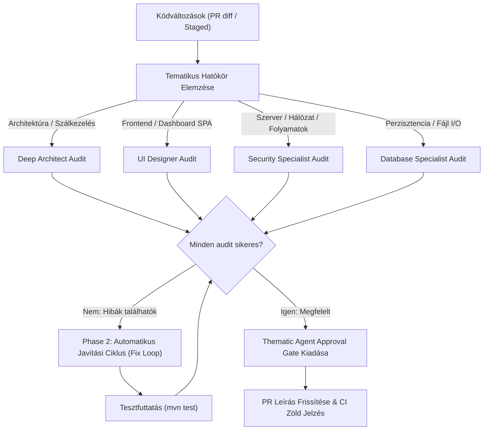

# Review and Fix Multi-Agent Minőségbiztosítási Skill

Ez a skill a [`.gemini/commands/review-and-fix.toml`](file:///e:/github/ingatlan-kereso/.gemini/commands/review-and-fix.toml) parancs mintájára épül, és összehangolja a specializált tematikus agentek review és jóváhagyási folyamatát.

---

## 1. Működési Folyamat



---

## 2. Tematikus Jóváhagyási Szabályok (Thematic Approval Rules)

Minden PR-t kizárólag akkor engedünk át, ha az érintett szakterület dedikált ágense jóváhagyja:

| Érintett Komponens / Fájl | Felelős Agent | Főbb Ellenőrzési Feltételek |
| :--- | :--- | :--- |
| `service/*`, `scraper/*`, `Main.java` | **`deep-architect`** | Clean Architecture réteg-izoláció, 0-crash elv, Virtual Threads helyes használata, Carrier Thread pinning mentesség. |
| `web/WebDashboardHtml.java`, CSS, JS | **`ui-designer`** | Zéró külső függőség, reszponzív nézet (360px-2560px), azonnali visszajelzés flicker nélkül, design tokenek követése. |
| `web/WebServer.java`, `SidecarCliExecutor.java`, `BrowserUtils.java` | **`security-specialist`** | `127.0.0.1` localhost binding, `405 Method Not Allowed`, CSP/nosniff fejlécek, Path Traversal prevenció, XSS escaping, safe process execution. |
| `persistence/*`, `IngatlanRepository.java`, `data/*` | **`database-specialist`** | Thread-safe kollekciók, `ReentrantReadWriteLock`, atomi fájlírás (`.tmp` + `ATOMIC_MOVE`), O(1) duplikátumszűrés, visszafelé kompatibilis séma. |
| `.github/workflows/*`, `.githooks/*` | **`workflow-engineer`** | Minimális jogosultságok (`permissions`), shell injection védelem, gyorstárazás (`cache`), concurrency és PR kapu integritás. |

---

## 3. Thematic Agent Approval Gate Blokk Sablon

Amikor a vizsgálat sikeresen lezárult, a PR leírásába kötelező beilleszteni az alábbi blokkot:

```markdown
### 🛡️ Thematic Agent Approval Gate
- [x] Architecture Review: Approved by Deep Architect Agent (`deep-architect`)
- [x] UI/UX Review: Approved by UI Designer Agent (`ui-designer`)
- [x] Security Review: Approved by Security Specialist Agent (`security-specialist`)
- [x] Database Review: Approved by Database Specialist Agent (`database-specialist`)
- [x] Workflow/CI Review: Approved by Workflow Engineer Agent (`workflow-engineer`)
```

Amennyiben egy PR egy adott témakört nem érint, a státusz:
`- [x] <Téma> Review: N/A (nem érintett)`
