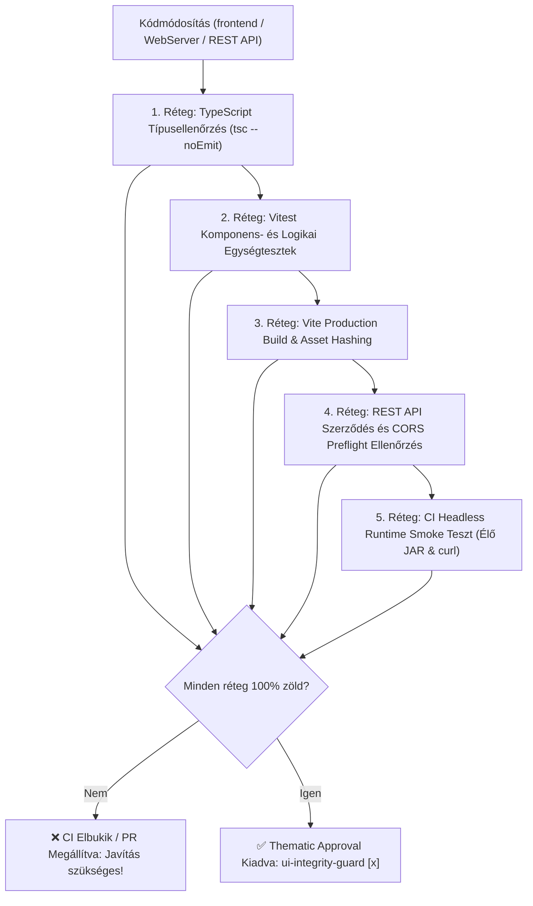

# UI Integrity Guard & Application Stability Skill

Ez a skill az **ingatlan-kereso** alkalmazás beágyazott webes felhasználói felületének (Single Page Application - SPA), JavaScript motorjának, DOM kötéseinek és a REST API végpontok szerződésének szigorú, automatizált és manuális integritás-ellenőrzését szabályozza.

---

## 1. Architektúra és Minőségi Kapuk (Modern Decoupled React 19 SPA)

A korábbi monolitikus Java szövegblokkos felületet (`WebDashboardHtml.java`) felváltotta egy önálló, modern, típusbiztos React 19 + TypeScript + Vite SPA a `frontend/` mappában.
* **A védelem célja:** Olyan automatizált, többszintű minőségbiztosítási kapu garantálása, amely meggátolja a runtime hibák, hibás DOM állapotok és API szerződés-törések élesbe kerülését.

---

## 2. Integritási Ellenőrzési Folyamat



---

## 3. A Guard 5 Alapvető Ellenőrzési Szabálya

### 3.1 Java Text Block Escape Szabályzat (Zero Unescaped Multiline Strings)
* Java szövegblokkokban (`"""..."""`) lévő JavaScript kódban a standard string literálok (`'...'` és `"..."`) **SOHA** nem tartalmazhatnak nyers sortörést.
* Ha sortörést szeretnél beilleszteni (pl. `split` vagy `join`), kötelező a **dupla backslash**: `join('\\n')` vagy `split('\\n')`!
* Template literálok (backtick `` `...` ``) használhatók többsoros sztringekhez, de ha dinamikus kifejezést tartalmaznak, a zárójelekre ügyelni kell.

### 3.2 Külső Node.js V8 Szintaxisellenőrzés (`node --check`)
* Minden módosítás után a generált HTML-ből kinyert JavaScript kódot át kell engedni a V8 motor `node --check <script.js>` ellenőrzésén.
* A `WebDashboardHtmlIntegrityTest` automatikusan futtatja, ha a `node` elérhető.
* A GitHub Actions CI futtatókörnyezetben (`ci.yml`) kötelező a `setup-node@v4` lépés jelenléte.

### 3.3 DOM Element ID Integritás (JS <-> HTML Szinkron)
* A JavaScriptben hivatkozott minden egyes DOM azonosítónak (`document.getElementById('xyz')`) léteznie kell a HTML markupban `id="xyz"` attribútummal.
* Tilos olyan DOM ID-t átnevezni a HTML-ben, amelyet a JavaScript használ, és fordítva.
* A kritikus vezérlők megléte kötelező:
  - Keresés gomb: `submit-btn`, `btn-text`, `btn-spinner`
  - Településválasztó: `city-search-input`, `city-chips-box`, `selected-chips-container`, `city-dropdown`, `city-dropdown-list`, `city-input`
  - Gyorssablonok: `city-presets-bar`
  - Szűrők és stepperek: `min-price-input`, `max-price-input`, `min-area-input`, `max-area-input`, `type-select`
  - Kapcsolók: `auto-open-toggle`, `exclude-viewed-toggle`, `sort-select`
  - Modális ablakok: `modal-logs`, `logs-terminal`, `btn-copy-logs`, `modal-diagnostics`, `diagnostics-modal-body`

### 3.4 API Szerződés és Végpont Ellenőrzés
* A JavaScriptben hívott `fetch('/api/...')` végpontoknak meg kell egyezniük a `WebServer.java` által regisztrált context útvonalakkal (`/api/config`, `/api/portals`, `/api/cities`, `/api/history`, stb.).
* Végpont módosítása esetén mind a frontend hívásokat, mind a szerver handlereket szinkronban kell frissíteni.

### 3.5 Headless Runtime Smoke Tesztelés
* Az alkalmazás elkészült JAR csomagját el kell indítani teszt porton a CI pipeline-ban.
* Ellenőrizni kell:
  1. A szerver sikeresen válaszol-e HTTP 200 kóddal a `/` végpontra.
  2. A letöltött HTML mérete érvényes-e (> 5 KB).
  3. A szerver által kiszolgált élő HTML scriptje átmegy-e a `node --check` parancson.
  4. Az `/api/config`, `/api/portals` és `/api/cities` végpontok érvényes JSON adattal válaszolnak-e.

---

## 4. Thematic Agent Approval Gate Bejegyzés

Ha egy Pull Request érinti a felhasználói felületet, a PR leírás elején kötelező elhelyezni az alábbi jóváhagyási sort:

```markdown
- [x] 🛡️ **UI Integrity Guard Agent (`ui-integrity-guard`)**: Frontend szintaxis, escape-elési integritás (node --check) és DOM ID konzisztencia jóváhagyva.
```
