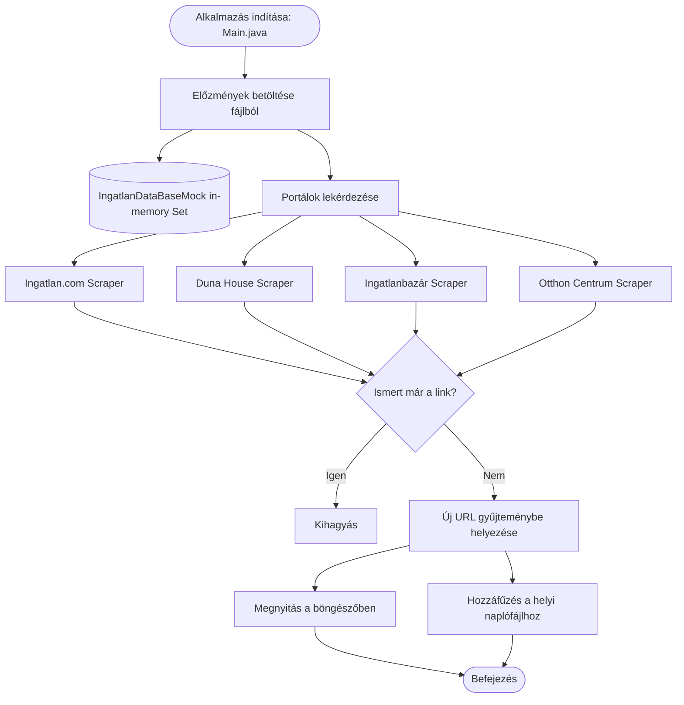

# Ingatlan Kereső (Real Estate Scraper & Monitor)

[](https://www.oracle.com/java/)
[](https://maven.apache.org/)
[](LICENSE)

Egy Java-alapú asztali segédprogram magyar ingatlanhirdetési portálok automatizált figyelésére és az új találatok közvetlen értesítésére.

---

## 📌 Áttekintés (TL;DR)

Az **ingatlan-kereso** célja a megadott keresési paramétereknek megfelelő debreceni ingatlanhirdetések folyamatos monitorozása. A szoftver periodikusan lekérdezi a támogatott portálokat, kiszűri a már korábban látott hirdetéseket, az új linkeket automatikusan megnyitja a böngészőben, valamint egy helyi szöveges fájlba naplózza őket a későbbi visszakereshetőség érdekében.

---

## 🚀 Főbb Funkciók

* **Többportálos adatgyűjtés:** Párhuzamosítható lekérdezések a legnépszerűbb magyar ingatlanoldalakról.
* **HTML Parsing (Jsoup):** Intelligens találatszám-számítás és oldallapozás a hirdetéskártyák kivonatolásához.
* **Duplikátumszűrés:** Memóriabeli (`Set`) és fájl alapú nyilvántartás az ismételt megnyitások elkerülésére.
* **Azonnali értesítés:** Az új ingatlanhirdetések közvetlen felnyitása a felhasználó alapértelmezett böngészőjében.
* **Audit naplózás:** Futási időbélyeg és új URL-ek hozzáfűzése a lokális naplófájlhoz (`2017_06_06.txt`).

---

## 🌐 Támogatott Portálok

| Portál | Domain | Implementáció |
| :--- | :--- | :--- |
| **Ingatlan.com** | `ingatlan.com` | `ingatlanok.service.impl.IngatlanCom` |
| **Duna House** | `dh.hu` | `ingatlanok.service.impl.DunaHause` |
| **Ingatlanbazár** | `ingatlanbazar.hu` | `ingatlanok.service.impl.IngatlanBazar` |
| **Otthon Centrum** | `oc.hu` | `ingatlanok.service.impl.OtthonCentrum` |

---

## 🛠 Technológiai Stack és Követelmények

* **Java JDK:** 1.8 vagy újabb (ajánlott: Java 17 / 21)
* **Build eszköz:** Apache Maven 3.6+
* **Főbb könyvtárak:**
  * [Jsoup 1.10.3](https://jsoup.org/) – HTML letöltés, DOM parszer és CSS szelektorok
  * [Commons IO 2.5](https://commons.apache.org/proper/commons-io/) – Fájlkezelési segédosztályok
  * [Exec Maven Plugin 1.6.0](https://www.mojohaus.org/exec-maven-plugin/) – Parancssori futtatás Mavenből

---

## 🏗 Architektúra és Működési Folyamat



### Projekt Struktúra

```text
ingatlan-kereso/
├── pom.xml                                      # Maven konfiguráció és függőségek
├── README.md                                    # Projekt dokumentáció
├── gemini.md                                    # Rendszer- és architektúra kontextus
├── LICENSE                                      # GNU General Public License v3
└── src/main/java/
    ├── Main.java                                # Fő belépési pont
    └── ingatlanok/
        ├── helper/
        │   └── IngatlanHelper.java              # Fájlkezelés és böngésző hívások
        ├── persistence/
        │   └── IngatlanDataBaseMock.java        # In-memory duplikátumszűrő halmaz
        └── service/
            ├── Ingatlan.java                    # Scraper interfész
            └── impl/
                ├── IngatlanStart.java           # Jsoup bázisosztály
                ├── IngatlanCom.java             # ingatlan.com scraper
                ├── DunaHause.java               # dh.hu scraper
                ├── IngatlanBazar.java           # ingatlanbazar.hu scraper
                └── OtthonCentrum.java           # oc.hu scraper
```

---

## 💻 Telepítés és Futtatás

### 1. Repository klónozása
```bash
git clone https://github.com/Luxeonn/ingatlan-kereso.git
cd ingatlan-kereso
```

### 2. Projekt fordítása
```bash
mvn clean compile
```

### 3. Futtatás Maven segítségével
```bash
mvn exec:java
```

### 4. JAR csomag készítése
```bash
mvn clean package
```

---

## ⚠️ Ismert Korlátok és Technikai Adósságok

1. **Weboldal struktúra változások:** A forráskódban lévő CSS szelektorok a 2017-es weboldal elrendezésekre készültek. A modern portálok struktúrája és botvédelme (pl. Cloudflare, Datadome) miatt a szelektorok frissítésre vagy Playwright/Selenium alapú integrációra szorulhatnak.
2. **Keresési feltételek beégetése:** A keresési URL-ek (Debrecen, ársáv, négyzetméter) közvetlenül a forráskódban vannak rögzítve konfigurációs fájl helyett.
3. **Platformfüggőség:** Az URL-ek megnyitása jelenleg a Windows-specifikus `rundll32 url.dll,FileProtocolHandler` hívásra épül a standard `java.awt.Desktop` helyett.

---

## 🗺 Jövőbeli Fejlesztési Irányok (Roadmap)

- [ ] **Külső konfigurációkezelés:** Keresési paraméterek és fájlútvonalak áthelyezése `application.properties` vagy YAML fájlba.
- [ ] **Cross-platform böngészőnyitás:** `java.awt.Desktop.getDesktop().browse(uri)` használata.
- [ ] **Modern adatperzisztencia:** Szöveges fájl lecserélése beágyazott SQLite vagy H2 adatbázisra.
- [ ] **Értesítési csatornák:** Telegram bot vagy Discord webhook integráció az azonnali push értesítésekhez.
- [ ] **Keretrendszer & Függőségfrissítés:** Java 21 LTS és Jsoup 1.18+ verziókra frissítés.

---

## 🤝 Verziókezelési Irányelvek

A projekt szigorú Pull Request alapú munkafolyamatot követ:
* Közvetlenül a `master` / `main` ágra commitolni nem megengedett.
* Minden új fejlesztést külön ágon (`feature/...`, `docs/...`, `fix/...`) kell elvégezni, és Pull Requesten keresztül mergelni.

---

## 📄 Licenc és Szerző

* **Szerző:** Pusinszky Viktor (2017)
* **Licenc:** [GNU General Public License v3.0](LICENSE)
