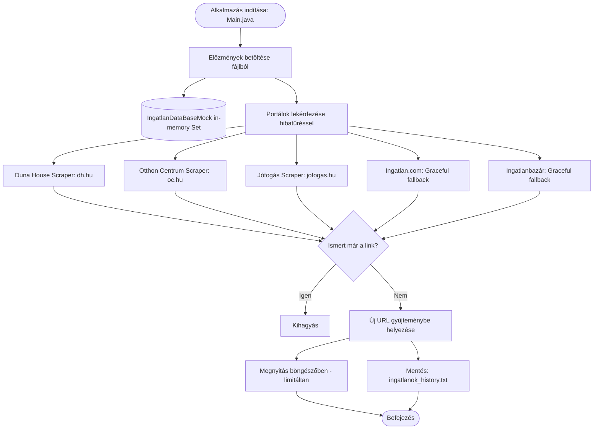

# Ingatlan Kereső (Real Estate Scraper & Monitor)

[](https://openjdk.org/projects/jdk/21/)
[](https://maven.apache.org/)
[](https://jsoup.org/)
[](LICENSE)

Java 21 LTS alapú asztali segédprogram magyar ingatlanhirdetési portálok (Debrecen környéki eladó lakások) automatizált figyelésére, duplikátumszűrésére és az új találatok közvetlen böngészős értesítésére / naplózására.

---

## 📌 Áttekintés (TL;DR)

Az **ingatlan-kereso** rendszeresen vagy igény szerint lekérdezi a meghatározott ingatlanhirdetési oldalakat, összeveti a talált hirdetéseket a korábban mentett előzményekkel, és az **új hirdetéseket** automatikusan megnyitja a böngészőben, valamint rögzíti egy helyi UTF-8 szöveges naplófájlban.

Egyetlen futtatással jelenleg **több mint 60 valós, élő eladó lakás hirdetését** képes begyűjteni Debrecen területéről.

---

## 🚀 Főbb Funkciók

* **Élő többportálos adatgyűjtés:** Párhuzamosítható lekérdezések a legnépszerűbb magyar ingatlanportálokról.
* **Modern HTML Parsing (Jsoup 1.23.2):** Reális böngésző `User-Agent` és fejlécek használata modern szerveroldali DOM elemzéssel.
* **Robusztus, 0-Crash hibakezelés:** Ha egy portál átmenetileg elérhetetlen vagy bot-védelem alá esik (pl. Cloudflare), a program nem omlik össze NullPointerExceptionnel, hanem elegánsan naplózza a hibát és folytatja a többi portál feldolgozását.
* **Intelligens duplikátumszűrés:** Memóriabeli (`Set<String>`) és fájlalapú nyilvántartás (`ingatlanok_history.txt`), ami megakadályozza a már látott hirdetések ismételt megnyitását.
* **Kíméletes böngészőértesítés:** Modern `java.awt.Desktop` böngészőhívás konfigurálható maximális nyitási limittel (`-Dmax.open.browser=N`), hogy sok új találat esetén se terhelje túl a rendszert.

---

## 🌐 Támogatott Portálok és Állapotuk

| Portál | Domain | Állapot | Implementáció |
| :--- | :--- | :---: | :--- |
| **Duna House** | `dh.hu` |  **Működik** (élő adatok) | `ingatlanok.service.impl.DunaHause` |
| **Otthon Centrum** | `oc.hu` |  **Működik** (élő adatok) | `ingatlanok.service.impl.OtthonCentrum` |
| **Jófogás Ingatlan** | `jofogas.hu` |  **Működik** (élő adatok) | `ingatlanok.service.impl.JofogasIngatlan` |
| **Ingatlan.com** | `ingatlan.com` | ⚠️ *Cloudflare bot-védelem (kezelt)* | `ingatlanok.service.impl.IngatlanCom` |
| **Ingatlanbazár** | `ingatlanbazar.hu` | ⚠️ *Kliensoldali Angular SPA (kezelt)* | `ingatlanok.service.impl.IngatlanBazar` |

---

## 🛠 Technológiai Stack és Követelmények

* **Java JDK:** Java 21 LTS (OpenJDK / Eclipse Temurin / Oracle JDK)
* **Build eszköz:** Apache Maven 3.9+
* **Főbb könyvtárak:**
  * [Jsoup 1.23.2](https://jsoup.org/) – Korszerű HTML letöltés, DOM parszer és CSS szelektorok
  * [Commons IO 2.22.0](https://commons.apache.org/proper/commons-io/) – I/O és UTF-8 fájlműveletek
  * [Exec Maven Plugin 3.6.4](https://www.mojohaus.org/exec-maven-plugin/) – Parancssori futtatás Mavenből

---

## 🏗 Architektúra és Működési Folyamat



### Projekt Struktúra

```text
ingatlan-kereso/
├── pom.xml                                      # Maven konfiguráció és függőségek (Java 21)
├── README.md                                    # Felhasználói és fejlesztői dokumentáció
├── gemini.md                                    # Rendszer- és architektúra kontextus (AI & Dev)
├── LICENSE                                      # GNU General Public License v3
├── .gitignore
└── src/main/java/
    ├── Main.java                                # Belépési pont, orchestrator
    └── ingatlanok/
        ├── helper/
        │   └── IngatlanHelper.java              # Fájlkezelés, duplikátumszűrés, böngészőkezelés
        ├── persistence/
        │   └── IngatlanDataBaseMock.java        # In-memory duplikátumszűrő halmaz
        └── service/
            ├── Ingatlan.java                    # Scraper interfész (`getUrls()`)
            └── impl/
                ├── IngatlanStart.java           # Jsoup bázisosztály, biztonságos letöltés
                ├── DunaHause.java               # dh.hu scraper (élő találatok)
                ├── OtthonCentrum.java           # oc.hu scraper (élő találatok)
                ├── JofogasIngatlan.java         # jofogas.hu scraper (élő találatok)
                ├── IngatlanCom.java             # ingatlan.com scraper (Cloudflare fallback)
                └── IngatlanBazar.java           # ingatlanbazar.hu scraper (Angular SPA fallback)
```

---

## 💻 Telepítés és Futtatás

### 1. Repository klónozása
```bash
git clone https://github.com/Luxeonn/ingatlan-kereso.git
cd ingatlan-kereso
```

### 2. Projekt fordítása
```bash
mvn clean compile
```

### 3. Futtatás alapértelmezett beállításokkal
```bash
mvn exec:java
```

### 4. Futtatási paraméterek (Testreszabás)

A program viselkedése egyszerű Java rendszerparaméterekkel szabályozható:

* **Böngészőlapok nyitásának szabályozása:**
  ```bash
  # Egyszerre maximum 3 link megnyitása:
  mvn exec:java -Dmax.open.browser=3

  # Csak naplózás, egyetlen böngészőfül megnyitása nélkül:
  mvn exec:java -Dmax.open.browser=0
  ```

* **Egyedi naplófájl megadása:**
  ```bash
  mvn exec:java -Dingatlan.file=sajat_mentes.txt
  ```

---

## 🗺 Ütemterv (Roadmap)

- [x] **Java 21 LTS & Függőségfrissítés:** Java 21 compiler target, Jsoup 1.23.2, Commons IO 2.22.0.
- [x] **Platformfüggetlen böngészés:** Modern `java.awt.Desktop` bevezetése `ProcessBuilder` fallbackkel és nyitási limittel.
- [x] **Scraper réteg modernizálása:** Duna House és Otthon Centrum élő lekérdezések helyreállítása.
- [x] **Új portál integrálása:** Jófogás Ingatlan scraper elkészítése.
- [x] **0-Crash hibatűrés:** Cloudflare challenge és Angular SPA elegáns lekezelése NPE nélkül.
- [ ] **Konfigurációs réteg kialakítása:** Keresési profilok (város, ár sáv, szobaszám, méret) külső JSON vagy properties fájlba helyezése.
- [ ] **Modern adatperzisztencia:** Beágyazott SQLite vagy H2 adatbázis bevezetése a szöveges fájl helyett.
- [ ] **Értesítési csatornák:** Telegram bot vagy Discord webhook integráció az azonnali értesítésekhez.

---

## 🤝 Verziókezelési Irányelvek

A projekt szigorú Pull Request alapú munkafolyamatot követ:
* Közvetlenül a `master` / `main` ágra commitolni és pusholni **tilos**.
* Minden új fejlesztést külön ágon (`feature/...`, `docs/...`, `fix/...`) kell elvégezni, és GitHub Pull Requesten keresztül mergelni.

---

## 📄 Licenc és Szerző

* **Eredeti szerző:** Pusinszky Viktor (2017)
* **Licenc:** [GNU General Public License v3.0](LICENSE)
