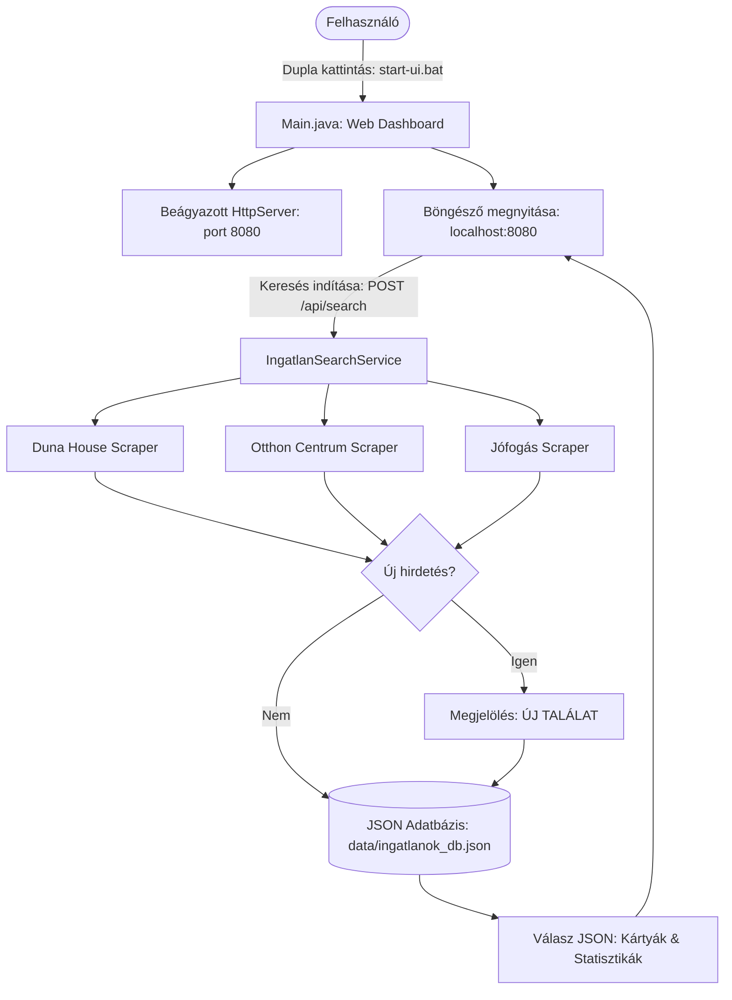

# Ingatlan Kereső (Real Estate Scraper & Monitor)

[](https://openjdk.org/projects/jdk/21/)
[](https://maven.apache.org/)
[](https://jsoup.org/)
[](LICENSE)

Java 21 LTS alapú asztali segédprogram magyar ingatlanhirdetési portálok (Debrecen környéki eladó lakások) automatizált figyelésére, duplikátumszűrésére és az új találatok közvetlen böngészős értesítésére / naplózására.

---

## 📌 Áttekintés (TL;DR)

Az **ingatlan-kereso** egy Java 21 LTS alapú, modern webes felülettel és beágyazott HTTP REST szerverrel ellátott hazai ingatlanfigyelő rendszer.
Segítségével egyetlen kattintással vagy parancs kiadásával elindul a helyi webes vezérlőpult (`http://localhost:8080`), ahol testreszabhatók a keresési szűrők (település, lakás/ház, aktív weboldalak), követhetők az élő találatok, és vizuális hirdetéskártyákon böngészhetők a legfrissebb hirdetések.

* **Elérhető egykattintásos indító:** Dupla kattintás a `start-ui.bat` fájlra, és automatikusan megnyílik a böngésző.
* **Támogatott portálok:** Duna House (`dh.hu`), Otthon Centrum (`oc.hu`), Jófogás Ingatlan (`jofogas.hu`).
* **Kinyert adatok:** Cím, ár, szobaszám, alapterület, település és közvetlen linkek.
* **0-Crash hibakezelés:** Cloudflare és Angular SPA fallback kezelés, Graceful kivételkezelés.

---

## 🚀 Főbb Funkciók

* **Modern Web Dashboard (SPA):** Beépített, villámgyors egyoldalas felület sötét/világos móddal (Dark/Light toggle), azonnali gépelés közbeni gyorskeresővel és reszponzív kártyarácsal.
* **Egykattintásos asztali indítás:** `start-ui.bat` és `start-ui.ps1` fájlokkal azonnal elindítható a szerver és megnyílik az alapértelmezett böngésző.
* **Dinamikus keresési szűrők:** Település megadása (nem csak Debrecen!), lakás/ház típusválasztó, valamint forrásoldalak külön ki- és bekapcsolhatósága.
* **Vizuális hirdetéskártyák:** Portál színkódok, árkiemelés, szoba- és méretadatok, valamint feltűnő zöld **✨ ÚJ TALÁLAT** matrica a friss hirdetéseken.
* **Strukturált JSON Adatbázis:** A találatok és beállítások a `data/ingatlanok_db.json` fájlban tárolódnak, automatikus előzmény-visszanézési lehetőséggel és duplikátumszűréssel.
* **Állítható böngészős viselkedés:** Kapcsoló az új találatok füleken történő azonnali megnyitásához, illetve egy gomb az összes új találat egyidejű megnyitásához.
* **Fejlett Java 21 Stack:** Beépített `HttpServer` Java 21 Virtual Threads (`Executors.newVirtualThreadPerTaskExecutor()`) alapú aszinkron kiszolgálással.

---

## 🌐 Támogatott Portálok és Állapotuk

| Portál | Domain | Állapot | Implementáció |
| :--- | :--- | :---: | :--- |
| **Duna House** | `dh.hu` |  **Működik** (élő adatok) | `ingatlanok.service.impl.DunaHause` |
| **Otthon Centrum** | `oc.hu` |  **Működik** (élő adatok) | `ingatlanok.service.impl.OtthonCentrum` |
| **Jófogás Ingatlan** | `jofogas.hu` |  **Működik** (élő adatok) | `ingatlanok.service.impl.JofogasIngatlan` |
| **Ingatlan.com** | `ingatlan.com` | ⚠️ *Cloudflare bot-védelem (kezelt)* | `ingatlanok.service.impl.IngatlanCom` |
| **Ingatlanbazár** | `ingatlanbazar.hu` | ⚠️ *Kliensoldali Angular SPA (kezelt)* | `ingatlanok.service.impl.IngatlanBazar` |

---

## 🛠 Technológiai Stack és Követelmények

* **Java JDK:** Java 21 LTS (OpenJDK / Eclipse Temurin / Oracle JDK / JetBrains JBR)
* **Build eszköz:** Apache Maven 3.9+
* **Főbb könyvtárak:**
  * [Jsoup 1.23.2](https://jsoup.org/) – Web scraping, HTML letöltés és DOM elemzés
  * [Gson 2.11.0](https://github.com/google/gson) – JSON adatbázis és REST API szerializáció
  * [Commons IO 2.22.0](https://commons.apache.org/proper/commons-io/) – Fájlműveletek és UTF-8 I/O
  * [Exec Maven Plugin 3.6.4](https://www.mojohaus.org/exec-maven-plugin/) – Parancssori futtatás Mavenből

---

## 🏗 Architektúra és Működési Folyamat



### Projekt Struktúra

```text
ingatlan-kereso/
├── pom.xml                                      # Maven konfiguráció és függőségek (Java 21, Gson, Jsoup)
├── README.md                                    # Felhasználói és fejlesztői dokumentáció
├── gemini.md                                    # Rendszer- és architektúra kontextus (AI & Dev)
├── start-ui.bat                                 # Egykattintásos indító Windowsra
├── start-ui.ps1                                 # PowerShell indító script
├── data/                                        # Helyi adatbázis mappa (.gitignore alatt)
│   ├── ingatlanok_db.json                       # Hirdetési előzmények és kinyert metaadatok
│   └── last_config.json                         # Utolsó mentett keresési szűrők
└── src/main/java/
    ├── Main.java                                # Belépési pont (Web Dashboard & CLI fallback)
    └── ingatlanok/
        ├── helper/
        │   └── IngatlanHelper.java              # Böngészőkezelés, kompatibilitási fájlműveletek
        ├── model/
        │   ├── IngatlanItem.java                # Hirdetés adatmodell (cím, ár, méret, url, stádium)
        │   ├── SearchCriteria.java              # Keresési paraméterek (város, típus, portálok)
        │   └── SearchResult.java                # Összesített találati eredmény modell
        ├── persistence/
        │   ├── IngatlanRepository.java          # Fájlalapú JSON adatbázis és beállításkezelő
        │   └── IngatlanDataBaseMock.java        # Visszafelé kompatibilitási réteg
        ├── service/
        │   ├── Ingatlan.java                    # Scraper interfész (`search` és `getUrls`)
        │   ├── IngatlanSearchService.java       # Keresést vezérlő orchestrator szolgáltatás
        │   └── impl/
        │       ├── IngatlanStart.java           # Jsoup bázisosztály, biztonságos letöltés
        │       ├── DunaHause.java               # dh.hu scraper (részletes adatokkal)
        │       ├── OtthonCentrum.java           # oc.hu scraper (részletes adatokkal)
        │       ├── JofogasIngatlan.java         # jofogas.hu scraper (részletes adatokkal)
        │       ├── IngatlanCom.java             # ingatlan.com scraper (Cloudflare fallback)
        │       └── IngatlanBazar.java           # ingatlanbazar.hu scraper (Angular SPA fallback)
        └── web/
            ├── WebServer.java                   # Beágyazott REST API szerver (Virtual Threads)
            └── WebDashboardHtml.java            # Modern reszponzív SPA HTML/CSS/JS felület
```

---

## 💻 Használat és Indítás

### 1. Indítás egyetlen kattintással (Legkönnyebb mód)
Kattints duplán a gyökérkönyvtárban lévő **`start-ui.bat`** fájlra!
A rendszer elindítja a webszervert és automatikusan megnyitja a böngészőt a `http://localhost:8080` címen.

### 2. Indítás parancssorból
```bash
# Webes felület indítása (alapértelmezett):
mvn exec:java

# Vagy PowerShellből:
./start-ui.ps1
```

### 3. Hagyományos Parancssori (CLI) futtatás
Ha böngésző és felület nélkül, pusztán a háttérben szeretnéd futtatni a keresést:
```bash
mvn exec:java "-Dexec.args=--cli"
```

---

## 🗺 Ütemterv (Roadmap)

- [x] **Java 21 LTS & Függőségfrissítés:** Java 21 compiler target, Jsoup 1.23.2, Commons IO 2.22.0.
- [x] **Modern Web Dashboard:** Letisztult egyoldalas felület sötét/világos móddal és hirdetéskártyákkal.
- [x] **Dinamikus Keresési Szűrők:** Település, típus, és forrásoldalak kiválasztása felületről.
- [x] **Strukturált JSON Perzisztencia:** Hirdetés metaadatok és beállítások fájlalapú tárolása.
- [x] **Egykattintásos indítás Windowsra:** `start-ui.bat` és `start-ui.ps1`.
- [x] **Scraper réteg gazdagítása:** Részletes adatok (ár, szobák, m2) kinyerése a kártyákról.
- [ ] **Értesítési csatornák:** Telegram bot vagy Discord webhook integráció az azonnali értesítésekhez.

---

## 🤝 Verziókezelési Irányelvek

A projekt szigorú, GitFlow-ihlette és automatizált Pull Request alapú munkafolyamatot követ:
* **Fő ágak (`main` és `develop`):**
  * `main`: A stabil, kiadásra kész főág. Közvetlen commit és push szigorúan TILOS.
  * `develop`: A folyamatos integrációs ág. Az új fejlesztések ide érkeznek PR-en keresztül. Közvetlen commit és push szintén TILOS.
* **Munkavégző ágak és elnevezésük:** Minden feladatot a `develop` ágból indított új ágon kell végezni, típusprefixummal:
  * `feature/...` – új funkció, fejlesztés
  * `fix/...` – hibajavítás
  * `docs/...` – dokumentáció
  * `refactor/...` – kódrefaktorálás
  * `chore/...` – karbantartás, CI/CD konfiguráció
* **Automatikus GitHub Actions CI & Védelem:**
  * **Java CI (`ci.yml`):** Java 21 build és JUnit tesztfuttatás minden PR és push esetén.
  * **PR & Branch Guard (`pr-guard.yml`):** PR elnevezési konvenció (Conventional Commits), ágnév-struktúra és leírás validálás.
  * **Dependabot (`dependabot.yml`):** Heti Maven és GitHub Actions függőségfrissítés-ellenőrzés a `develop` ágra célozva.
  * **Helyi védelem (`.githooks/pre-push`):** Megakadályozza a véletlen közvetlen push-t `main` és `develop` ágakra (`git config core.hooksPath .githooks`).
* **Mindig új commit:** Minden változtatáshoz különálló, leíró üzenetű commit tartozik; a korábbi commitok push utáni felülírása tilos.
* **Angol nyelvű PR címek:** A Pull Requestek neve angol nyelvű, Conventional Commits formátumú (`feat:`, `fix:`, `docs:`, stb.).
* **Kötelező GitHub Címkék (Labels):** Minden PR-t megfelelő címkével kell megnyitni (`enhancement`, `bug`, `documentation`, `dependencies`).
* **Beszédes magyar összefoglaló:** A PR leírásában és az átadásban részletes, beszédes magyar összefoglaló szerepel (cél, technikai változtatások, hatások, tesztek).


---

## 📄 Licenc és Szerző

* **Eredeti szerző:** Pusinszky Viktor (2017)
* **Licenc:** [GNU General Public License v3.0](LICENSE)
