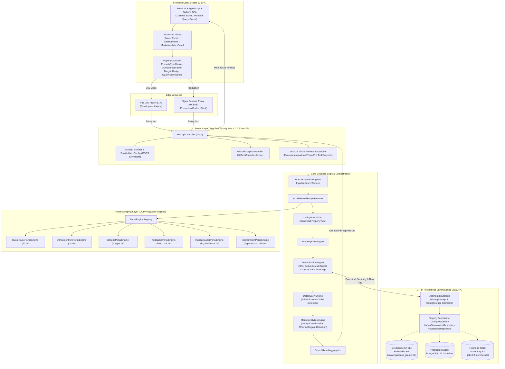

# Ingatlan Kereső — Central System Architecture Reference

**Version**: 1.1.0  
**Status**: Authoritative Reference Specification  
**Tech Stack Baseline**: Java 25 LTS, Spring Boot 4.1.1, Spring Data JPA, Hibernate, Embedded H2 / PostgreSQL 17, React 19, TypeScript 5.9, Tailwind CSS v4, Vite 8.3, Nginx, Docker Compose.

---

## 1. System Vision & High-Level Architecture

**ingatlan-kereso** is a resilient real estate monitoring, market intelligence, and decision-support engine for the Hungarian property market. It aggregates listings across major national portals, normalizes heterogeneous property types into a canonical enum, deduplicates cross-portal listings into canonical physical properties using multi-signal heuristics, tracks time-series price movements and status observations, computes per-square-meter statistical medians, filters out data quality anomalies, and presents an interactive user experience via an autonomous React 19 Single Page Application (SPA).

### 1.1 Architectural Flow



---

## 2. 4-Layer Separation & Component Boundaries

The codebase strictly enforces unidirectional dependencies across four decoupled architectural layers. Reverse dependency imports (layer inversion) are strictly prohibited:

```text
[Layer 1: Presentation & Web]
    │  - presentation: DashboardPresentationService, DTOs (ListingDto, DashboardResponseDto, MarketStatsDto,
    │                  MarketSegmentStatsDto, PriceDropItemDto, ListingObservationDto, PortalStatusDto)
    │  - web: RestApiController, GlobalExceptionHandler
    │  - config: GlobalCorsFilter, SpaWebMvcConfig, CoreEngineConfig
    ▼
[Layer 2: Core Domain & Business Logic]
    │  - core: SearchExecutionEngine, ParallelPortalScrapeExecutor, SearchResultAggregator,
    │          PropertyFilterEngine, DeduplicationEngine, MarketAnalyticsEngine,
    │          ListingNormalizer, DataQualityEngine
    │  - model: IngatlanItem, PriceInfo, PropertyDetails, PortalSource, SearchCriteria, SearchResult,
    │           PropertyType, Property, SourceListing, ListingObservation,
    │           DataQualityScore, QualityCheckResult, QualitySeverity, QualityTier
    │  - service: IngatlanSearchService
    ▼
[Layer 3: Pluggable Portal Engines (Open/Closed Principle)]
    │  - portal: PortalEngine, PortalDescriptor, PortalEngineRegistry, PortalSupport
    │  - portal.{dh, oc, jofogas, koltozzbe, ingatlanbazar, ingatlancom}
    │  - scraper: PortalScrapeResult, PortalScrapeStatus, SidecarCliExecutor
    ▼
[Layer 4: Decoupled Persistence & 3-Tier Storage]
       - persistence: ListingStorage, ConfigStorage, JpaIngatlanStorage, InMemoryListingStorage, IngatlanRepository
       - persistence.entity: PropertyEntity, ListingObservationEntity, PriceHistoryEntity, StatusLogEntity, ConfigEntity
       - persistence.repository: PropertyRepository, ListingObservationRepository, ConfigRepository, StatusLogRepository
       - persistence.mapper: JpaEntityMapper
       - persistence.service: ListingFilterService, PriceHistoryTracker, StatusLogTracker
```

### Layer Boundary Invariants:
1. **Layer 1 never enters Layer 2, 3, or 4**: Neither `core`, `portal`, nor `persistence` may import `@RestController`, `HttpServletRequest`, or web-specific types.
2. **Core delegates to Storage Interfaces**: Layer 2 interacts with persistence exclusively through `ListingStorage` and `ConfigStorage` interfaces, never raw SQL, Hibernate sessions, or Spring Data repositories directly.
3. **Open/Closed Portal Engines**: New property portals are introduced by implementing `PortalEngine` and registering in `PortalEngineRegistry` without modifying `SearchExecutionEngine`.
4. **Leaf Utilities (`common`)**: Pure helpers (`HttpFetcher`, `PropertyParser`, `SlugUtils`, `CityUtils`, `AppLogger`) have zero dependencies on business logic or storage.

---

## 3. Backend Architecture (Java 25 LTS & Spring Boot 4.1.1)

### 3.1 Pure Headless REST API
Spring Boot operates in 100% headless mode. Monolithic static asset serving is disabled in `application.yml`:
```yaml
spring:
  web:
    resources:
      add-mappings: false
```
The backend exclusively processes and emits JSON. The browser client is served independently.

### 3.2 REST API Endpoint Catalog

| Endpoint | HTTP Method | Request Body / Query Params | Response Type | Description |
| :--- | :---: | :--- | :--- | :--- |
| `/api/status` | `GET` | None | `Map<String, Object>` | Health check, total listings count, last run timestamp, tracked cities. |
| `/api/portals` | `GET` | None | `List<PortalDescriptor>` | Active portal metadata, engine status, and saved listing counts. |
| `/api/cities` | `GET` | None | `Map<String, Object>` | Predefined Hungarian cities, regional presets, tracked cities. |
| `/api/config` | `GET` | None | `SearchCriteria` | Retrieves last saved search criteria. |
| `/api/config` | `POST` | `SearchCriteria` (JSON) | `{"success": true}` | Persists user search criteria. |
| `/api/history` | `GET` | `city`, `portal`, `minPrice`, `maxPrice`, `minArea`, `maxArea`, `minRooms`, `maxRooms`, `excludeViewed`, `onlyDiscounted`, `sortBy`, `limit`, `offset` | `List<ListingDto>` | Multi-criteria filtered, paginated property search across database. |
| `/api/properties/price-history` | `GET` | `id` or `url` param | `List<PriceHistoryEntry>` | Price change history log for a specific property. |
| `/api/properties/{id}/price-history` | `GET` | `id` path variable | `List<PriceHistoryEntry>` | Path-variable variant for property price history. |
| `/api/properties/status-log` | `GET` | `id` or `url` param | `List<StatusLogEntry>` | Discovery and status audit trail for a property. |
| `/api/properties/{id}/status-log` | `GET` | `id` path variable | `List<StatusLogEntry>` | Path-variable variant for property status log. |
| `/api/properties/observations` | `GET` | `id` or `url` param | `List<ListingObservationDto>` | Time-series listing observation history snapshots. |
| `/api/properties/{id}/observations` | `GET` | `id` path variable | `List<ListingObservationDto>` | Path-variable variant for observation history. |
| `/api/properties/discounted` | `GET` | `city` (optional) | `List<IngatlanItem>` | All properties with recorded negative price deltas. |
| `/api/search` | `POST` | `SearchCriteria` (optional) | `DashboardResponseDto` | Executes parallel scraping, normalization, deduplication, quality scoring, analytics, and returns aggregated results. |
| `/api/open-urls` | `POST` | `List<String>` (URLs) | `{"success": true, "count": N}` | Marks listings as viewed; optionally opens in desktop browser if configured. |
| `/api/items/viewed` | `POST` | `{"url": "..."}` | `{"success": true, "marked": bool}` | Marks a single listing as viewed. |
| `/api/history/clear` | `POST` | `city` (optional body/query) | `{"success": true}` | Clears history for a specific city or entire database. |

### 3.3 Concurrency Model: Java 25 Virtual Threads
High-throughput parallel I/O is achieved without carrier thread saturation:
- Spring Boot web container uses Virtual Threads: `spring.threads.virtual.enabled=true`.
- Parallel scraping runs via `Executors.newVirtualThreadPerTaskExecutor()` in `ParallelPortalScrapeExecutor`.
- All network fetches have an explicit 15-second timeout (`Future.get(15, TimeUnit.SECONDS)`). Carrier threads are never blocked by slow network sockets.

### 3.4 0-Crash Resilience & Global Exception Handling
- `GlobalExceptionHandler` (`@RestControllerAdvice`) intercepts all uncaught exceptions, converting them into structured JSON error payloads with ISO timestamps, HTTP status codes, error messages, and request paths.
- Portal scrapers wrap network and parsing failures inside `PortalScrapeResult.failure(...)`. A failure on one portal never terminates other active scrapers or aborts the search process.

---

## 4. 3-Tier Domain & Persistence Architecture

### 4.1 Three-Tier Domain Model Hierarchy

```text
[ Property ] (Canonical physical property entity)
     │
     └─── (1:N) [ SourceListing ] (Specific portal listing: dh.hu, oc.hu, etc.)
                      │
                      └─── (1:N) [ ListingObservation ] (Time-series periodic observation snapshot)
```

1. **`Property` (Physical Property)**:
   - Canonical identifier / dedup fingerprint.
   - Normalized city, canonical property type (`PropertyType`), living area ($m^2$), room count, street/coordinates.
   - Aggregations: calculated minimum active price (`minActivePriceHuf`), first and last observed timestamps.
2. **`SourceListing` (Portal Source Listing)**:
   - Portal identifier (`portalId`), external listing ID, URL, title, cover image.
   - Lifecycle timestamps: `firstSeenAt`, `lastSeenAt`.
   - Current status: `ACTIVE`, `INACTIVE`.
3. **`ListingObservation` (Time-Series State Snapshot)**:
   - Timestamp (`observedAt`).
   - Price in HUF, price per $m^2$, price delta.
   - Status transition event: `NEW`, `UNCHANGED`, `PRICE_CHANGED`, `RELISTED`.

### 4.2 Storage Abstraction
Persistence is abstracted behind two clean interfaces in `ingatlanok.persistence`:
- `ListingStorage`: Querying, saving, deduplicating, recording observations, price history tracking, status logging, and lifecycle operations.
- `ConfigStorage`: Persistence of user `SearchCriteria`.

`JpaIngatlanStorage` implements both contracts using standard Spring Data JPA repositories (`PropertyRepository`, `ListingObservationRepository`, `StatusLogRepository`).

### 4.3 Dual-Mode Persistence Strategy

| Mode | Environment | Datasource URL | DDL Policy | Purpose |
| :--- | :--- | :--- | :--- | :--- |
| **Development & CLI** | Local machine / Developer workstation | `jdbc:h2:file:./data/ingatlanok_jpa;AUTO_SERVER=TRUE;DB_CLOSE_DELAY=-1` | `update` | Zero-configuration local development. Persists to `data/ingatlanok_jpa.mv.db`. Auto-server allows external H2 console access. |
| **Production** | Multi-container Docker Compose | `jdbc:postgresql://db:5432/${POSTGRES_DB:-ingatlandb}` | `update` | Robust, enterprise-grade concurrent storage on PostgreSQL 17 Alpine container with persistent named volume `postgres_data`. |
| **Hermetic Testing** | Offline JUnit 5 test runs (`./gradlew check`) | `jdbc:h2:mem:testdb;DB_CLOSE_DELAY=-1;DB_CLOSE_ON_EXIT=FALSE` | `create-drop` | 100% ephemeral, isolated, deterministic in-memory database with zero disk pollution. |

---

## 5. Core Business Logic Engines

### 5.1 Canonical Property Type Normalization (`ListingNormalizer`)
Heterogeneous portal categories and unstructured listing titles are deterministically mapped to the canonical `PropertyType` enum:
- `LAKAS`: Apartments, brick flats, panel flats, studios.
- `HAZ`: Detached houses, family homes, twin houses, row houses, farmsteads (*tanya*), vacation houses (*nyaraló*).
- `TELEK`: Building plots, residential land, agricultural land (*telek*, *építési telek*).
- `GARAZS`: Garages, underground parking spots, carports (*beálló*).
- `IPARI_KERESKEDELMI`: Offices, warehouses, retail shops, commercial premises.
- `EGYEB_ISMERETLEN`: Safe fallback for unclassified or ambiguous listings.

**Normalization Invariants**:
- Unicode and Hungarian accented word-boundary safety (`(?iuU)` flag).
- Accessory precedence: Accessories (e.g. *"lakás garázzsal"* or *"ház parkolóval"*) are classified by the main living property type, using negative lookahead `(?!val|vel)`.

### 5.2 Multi-Signal Cross-Portal Deduplication (`DeduplicationEngine`)
Matches identical physical properties advertised across different portals via a 3-stage pipeline:
1. **$O(1)$ URL Deduplication**: Identical URLs are immediately merged.
2. **Multi-Signal Clustering**:
   - Location: Exact normalized city match.
   - Property Type: Exact canonical `PropertyType` match.
   - Floor Area: Strict tolerance band ($\pm 5\%$).
   - Room Count: Strict tolerance ($\pm 0.5$ rooms).
   - Price Sanity Corridor: Proximity within $\pm 20\%$.
   - Conflict Protection: Conflicting room counts or significantly divergent areas are never merged.
3. **Grouped Card Consolidation**: Multi-source clusters are unified into an `IngatlanItem` containing the lowest active market price (`minActivePriceHuf`), with all individual source listings preserved in `sourceListings`.

### 5.3 Active-Market Median Analytics & Bargain Hunter (`MarketAnalyticsEngine`)
- **Median $Ft/m^2$ (Primary Metric)**: Computed strictly on deduplicated canonical properties. Outliers and distorted listings are eliminated.
- **Strict Area Segregation**: Living area $Ft/m^2$ (`LAKAS`, `HAZ`) and plot/land area $Ft/m^2$ (`TELEK`) are strictly partitioned and never conflated.
- **Sample Size Threshold**: Minimum 5 valid listings required. If sample count $< 5$, the engine indicates `insufficientData = true` rather than presenting misleading statistics.
- **Bargain Detection ("Alkalmi vétel")**:
  - Identifies active listings priced $\ge 20\%$ below the reference median for their city and property type.
  - Generates interactive popover metadata: current $Ft/m^2$, benchmark median, percentage discount, and sample count.

### 5.4 Rule-Based Data Quality Engine (`DataQualityEngine`)
Evaluates every listing on a 0–100 quality scale using 10 deterministic rules:
- **Critical Checks**: Realistic price limits ($1M \le \text{price} \le 5B\text{ HUF}$), floor area bounds ($10 \le \text{area} \le 2000\text{ }m^2$), presence of normalized city and canonical type.
- **Plausibility Checks**: Realistic unit price ($100k \le Ft/m^2 \le 4M\text{ HUF}$), room count to area proportion sanity.
- **Anomaly Detection**: Sudden extreme price changes ($> 50\%$) between consecutive observations.
- **Statistical Outlier Protection**: Listings scoring $< 70$ points are automatically quarantined and excluded from `MarketAnalyticsEngine` median calculations to prevent distortion.

---

## 6. Frontend Architecture (React 19 SPA)

### 6.1 Client Technology Stack
- **Framework**: React 19.0.0 (Functional components, React Hooks).
- **Language**: TypeScript 5.9.3 (Strict type checking, `noEmit: true`).
- **Styling**: Tailwind CSS v4.3.3 with PostCSS and custom dark/light theme tokens.
- **Icons & Charts**: `lucide-react` (1.16.0), `recharts` (2.15.1).
- **Build Tool**: Vite 8.3.4 with `@vitejs/plugin-react` and `vite-plugin-compression2` (Gzip pre-compression).
- **Testing**: Vitest 5.0.4 with JSDOM and Playwright 1.64.1 for E2E.

### 6.2 Decoupled View Components
The UI is decomposed into distinct, single-responsibility panel views, avoiding monolithic "god components":
- `SearchPanel`: Search parameters, city presets, property type tabs, and price/area steppers.
- `ListingsPanel`: Results grid/list views, sort selector, bulk action bar, pagination, and empty/loading states.
- `MarketAnalyticsPanel`: Autonomous analytics view featuring 6 KPI summary cards, price/sqm distribution histograms, city comparison charts, and a paginated price-drop table.

### 6.3 Specialized Property Card Micro-Interactions
- `<PropertyTypeBadge />`: Color-coded, accessible textual badge indicating canonical property type (WCAG 2.1 SC 1.4.1 compliant).
- `<MultiSourceDrawer />`: Accessible expandable drawer displaying all grouped agency sources, individual prices, timestamps, and direct portal links.
- `<BargainBadge />`: Prominent discount badge (e.g. *"-27% a városi mediánárhoz képest"*) with floating focus/hover popover.
- `<QualityScoreShield />`: 3-tier quality indicator (`EXCELLENT` $\ge 85$, `ACCEPTABLE` $\ge 70$, `SUSPICIOUS` $< 70$) with score deduction breakdown popover.

---

## 7. Application Security (AppSec) & Server Hardening

1. **Localhost Default Binding**: Spring Boot binds by default to `127.0.0.1` (`server.address: ${SERVER_HOST:127.0.0.1}`). In containerized environments, `SERVER_HOST=0.0.0.0` is explicitly injected via Docker Compose.
2. **Global CORS Filter (`GlobalCorsFilter`)**: Registered with `@Order(Ordered.HIGHEST_PRECEDENCE)`. Restricts origins to localhost and loopback interfaces (`localhost`, `127.0.0.1`, `0.0.0.0`, `[::1]`) across all ports. Preflight `OPTIONS` requests from unauthorized origins return `403 Forbidden`.
3. **Security Headers**: Injected on every response:
   - `X-Content-Type-Options: nosniff`
   - `X-Frame-Options: DENY`
   - `X-XSS-Protection: 1; mode=block`
   - `Referrer-Policy: strict-origin-when-cross-origin`
4. **Content Security Policy (CSP)**:
   - Nginx and Spring Boot define strict CSP rules allowing `'self'`, Google Fonts CDN (`fonts.googleapis.com`, `fonts.gstatic.com`), and localhost API connectivity.
5. **SSRF Mitigation**: Web scraping engines are restricted to known portal domain endpoints (`dh.hu`, `oc.hu`, `jofogas.hu`, `koltozzbe.hu`, `ingatlanbazar.hu`, `ingatlan.com`). Outbound URL construction validates host domains.
6. **Input Sanitization**: Price strings, room counts, and square meters are parsed using defensive regex extractors in `PropertyParser`, preventing injection and unhandled formatting exceptions.

---

## 8. Quality Assurance & Hermetic Verification

1. **100% Offline Hermetic Testing**: Automated unit and integration tests run entirely offline (`./gradlew test`). Live network scraping is forbidden in standard test cycles.
2. **JaCoCo Quality Gate**: Instruction and line coverage must exceed 80% across core, persistence, and domain packages (current achievement: **85.67%** line coverage).
3. **Checkstyle Static Analysis**: Checkstyle 10.21.4 verifies compliance with `config/checkstyle/checkstyle.xml` (0 warnings permitted).
4. **Frontend Verification**: TypeScript compilation (`npm run typecheck`), ESLint (`npm run lint`), Vitest unit tests (`npm test`), and Playwright E2E browser tests (`npm run test:e2e`).

---

## 9. Architectural Discrepancy Matrix & Evolution Log

| Component / Technology | Original / Historical State | Final Architecture State | Rationalization & Motivation |
| :--- | :--- | :--- | :--- |
| **Property Domain Model** | Flat `IngatlanItem` / `PropertyEntity` hybrid | **3-Tier Hierarchy: `Property` ↔ `SourceListing` ↔ `ListingObservation`** | Decoupled physical property from portal listings and enabled precise time-series price/status tracking. |
| **Deduplication Strategy** | Exact URL-only matching ($O(1)$) | **Multi-Signal Cross-Portal Clustering + Lowest Price Consolidation** | Groups identical physical properties advertised across different portals; displays the cheapest active offer. |
| **Property Categorization** | Free-form portal string strings | **Canonical `PropertyType` Enum & Deterministic `ListingNormalizer`** | Standardized search, filtering, and statistical aggregations across heterogeneous portal vocabularies. |
| **Market Analytics** | Naive arithmetic averages | **Median $Ft/m^2$ with Area Separation & Bargain Hunter Engine** | Mitigated luxury outlier skew, separated plot prices from living area, and highlighted genuine deals. |
| **Data Quality & Anomalies** | Unfiltered scraper ingestion | **Rule-Based `DataQualityEngine` (0-100) & Outlier Exclusion** | Quarantines parser errors, unrealistic prices, and suspicious listings from polluting market statistics. |
| **Frontend Page Architecture** | Monolithic `App.tsx` layout | **Decoupled `SearchPanel`, `ListingsPanel`, `MarketAnalyticsPanel`** | Clean separation of concerns, independent testing, and state preservation across tab switches. |
| **SQLite (WAL mode)** | SQLite via JDBC with WAL mode and HikariCP | **Spring Data JPA on Embedded H2 (dev) / PostgreSQL 17 (prod)** | Eliminated native C-library dependencies, aligned SQL semantics between dev and prod, enabled native JPA repositories. |
| **Nitrite NoSQL DB** | Nitrite document store (`data/ingatlanok_nosql.db`) | **Completely Removed** | Eliminated file locking bugs in parallel tests and lack of transactional relational safety. |
| **Maven (`mvn`, `pom.xml`)** | Mentioned in legacy commands and scripts | **Gradle 9.8.2 Kotlin DSL (`build.gradle.kts`)** | Single unified build tool with fast incremental builds. |
| **Monolithic Static Bundle** | HTML/JS packaged in `src/main/resources/static/` | **Autonomous React 19 SPA served via Vite (dev) or Nginx (prod)** | True decoupling of frontend and backend. Enables independent scaling, caching, and modern web development workflow. |
