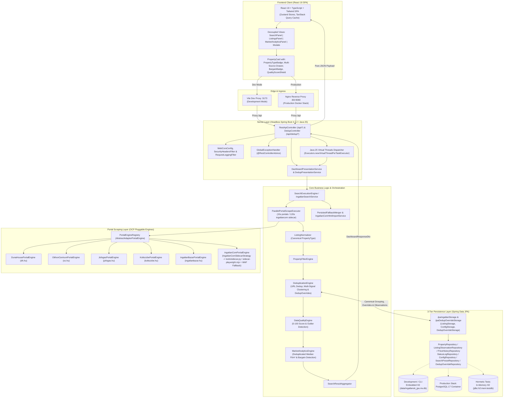

# Ingatlan Kereső — Central System Architecture Reference

**Version**: 1.2.0  
**Status**: Authoritative Reference Specification  
**Tech Stack Baseline**: Java 25 LTS, Spring Boot 4.1.2 (Spring Core 7.0.10), Spring Data JPA, Hibernate, Embedded H2 / PostgreSQL 17, React 19, TypeScript 5.9, Tailwind CSS v4, Vite 8.3.8, Nginx, Docker Compose.

---

## 1. System Vision & High-Level Architecture

**ingatlan-kereso** is a resilient real estate monitoring, market intelligence, and decision-support engine for the Hungarian property market. It aggregates listings across major national portals, normalizes heterogeneous property types into a canonical enum, deduplicates cross-portal listings into canonical physical properties using multi-signal heuristics, tracks time-series price movements and status observations, computes per-square-meter statistical medians, filters out data quality anomalies, and presents an interactive user experience via an autonomous React 19 Single Page Application (SPA).

### 1.1 Architectural Flow



---

## 2. 4-Layer Separation & Component Boundaries

The codebase strictly enforces unidirectional dependencies across four decoupled architectural layers. Reverse dependency imports (layer inversion) are strictly prohibited:

```text
[Layer 1: Presentation & Web]
    │  - presentation: DashboardPresentationService, DedupPresentationService, PresentationMapper,
    │                  DashboardResponseDto, MarketStatsDto, MarketSegmentStatsDto, PriceDropItemDto, PortalStatusDto,
    │                  DedupActionResponseDto, DedupMergeRequestDto, DedupSplitRequestDto, DedupOverrideDto,
    │                  IngatlanComHtmlImportRequestDto, IngatlanComHtmlImportResponseDto
    │  - web: RestApiController, DedupController, GlobalExceptionHandler, HistoryQueryDto,
    │         StatusResponseDto, CitiesResponseDto, ApiErrorResponse, PropertyHideResponseDto,
    │         MarkViewedResponseDto, ClearHistoryResponseDto, ActionSuccessResponseDto,
    │         ClearHistoryRequest, MarkViewedRequest, PropertyBatchActionRequest
    │  - config: WebCorsConfig, SecurityHeadersFilter, RequestLoggingFilter
    ▼
[Layer 2: Core Domain & Business Logic]
    │  - core: SearchExecutionEngine, SearchPersistenceSynchronizer, ParallelPortalScrapeExecutor,
    │          PersistedFallbackMerger, IngatlanComHtmlImportService, SearchResultAggregator,
    │          PropertyFilterEngine, DeduplicationEngine, MarketAnalyticsEngine,
    │          MarketStatisticsCalculator, DataQualityEngine
    │  - core.dedup: ClusterConsolidationHelper, ClusterMatchScorer, DedupOverrides,
    │                LocationConflictDetector, LocationDictionaries, SemanticConflictDetector, TextualSimilarityMatcher
    │  - core.normalization: ListingNormalizer, ListingValidator
    │  - model: IngatlanItem, PriceInfo, PropertyDetails, PortalSource, SearchCriteria, SearchResult,
    │           PropertyType, ListingStatus, PortalId, PortalScrapeStatus, SearchExecutionStatus,
    │           ListingSortOption, CurrencyCode, Property, SourceListing, ListingObservation,
    │           PriceHistoryEntry, StatusLogEntry, SearchPreset, DedupOverride, DedupOverrideType,
    │           MarketStats, MarketSegmentStats, PriceDropItem, MarketSegmentKey,
    │           QualityScore, QualityDeduction, QualityDeductionRule, Money, Area, RoomCount,
    │           CanonicalId, PropertyId, TrackedCityInfo, PredefinedCity, ValidationGroups,
    │           PortalScrapeResult, model.raw.{ExtractionMethod, RawExtractionResult, RawPropertyListing}
    │  - service: IngatlanSearchService
    ▼
[Layer 3: Pluggable Portal Engines (Open/Closed Principle)]
    │  - portal: PortalEngine, AdapterPortalEngine, AbstractAdapterPortalEngine, PortalAdapter,
    │            AbstractPortalAdapter, ExtractionStrategy, AbstractPaginatedExtractionStrategy,
    │            AbstractPaginatedHtmlStrategy, PortalDescriptor, PortalEngineRegistry, PortalSupport,
    │            PortalUrlBuilder, HtmlListingParser, RawListingNormalizer,
    │            PageStepOutcome, PaginationState, PaginationStopReason
    │  - portal.{dh, oc, jofogas, koltozzbe, ingatlanbazar, ingatlancom}
    │  - portal.sidecar: SidecarCliExecutor, SidecarResponse, SidecarStatus (tools/sidecar.py, tools/sidecar-playwright.mjs)
    ▼
[Layer 4: Decoupled Persistence & 3-Tier Storage]
       - persistence: ListingStorage, ConfigStorage, DedupOverrideStorage, JpaIngatlanStorage,
                      JpaDedupOverrideStorage, InMemoryListingStorage, OffsetPageRequest, PropertySearchCriteria
       - persistence.entity: PropertyEntity, PropertyEntityFields, ListingObservationEntity, PriceHistoryEntity,
                             StatusLogEntity, ConfigEntity, SearchPresetEntity, DedupOverrideEntity
       - persistence.repository: PropertyRepository, ListingObservationRepository, PriceHistoryRepository,
                                 StatusLogRepository, ConfigRepository, SearchPresetRepository,
                                 DedupOverrideRepository, PortalCountProjection, CityCountProjection
       - persistence.mapper: JpaEntityMapper, SearchPresetMapper, ListingObservationContext,
                             PriceHistoryContext, PropertyUpdateContext
       - persistence.service: PropertyPersistenceHelper, SearchPresetPersistenceHelper, PriceHistoryTracker, StatusLogTracker
       - persistence.specification: PropertySpecifications
```

### Layer Boundary Invariants:
1. **Layer 1 never enters Layer 2, 3, or 4 (Zero-Exception ArchUnit)**: Neither `core`, `portal`, nor `persistence` may import `@RestController`, `HttpServletRequest`, presentation DTOs (`ingatlanok.presentation.*`), or web-specific types (`ArchitectureRulesTest` enforces `CORE_DOES_NOT_DEPEND_ON_PRESENTATION` with zero exceptions).
2. **Core delegates to Storage Interfaces**: Layer 2 interacts with persistence exclusively through `ListingStorage`, `ConfigStorage`, and `DedupOverrideStorage` interfaces, never raw SQL, Hibernate sessions, or Spring Data repositories directly.
3. **Open/Closed Portal Engines**: New property portals extend `AbstractAdapterPortalEngine` (`PortalEngine`) as Spring `@Component` beans and register automatically in `PortalEngineRegistry` without modifying `SearchExecutionEngine`.
4. **Leaf Utilities (`common`)**: Pure helpers (`HttpFetcher`, `PropertyParser`, `SlugUtils`, `CityUtils`, `BrowserUtils`, `AppLogger`, `JsonSupport`, `common.city.*`, `common.resilience.*`) have zero dependencies on business logic or storage.
5. **Code Generation & Compile-Time Mapping (Lombok & MapStruct)**: Models, presentation DTOs, and JPA entities use Lombok `@Getter`/`@Builder`/`@NoArgsConstructor` (omitting `@Setter` on read-only DTOs and value objects, preferring Java `record` types for immutable DTOs/value carriers, and forbidding `@Data`, `@EqualsAndHashCode`, `@ToString`, and `@SneakyThrows` via Checkstyle). Cross-layer object conversions (`JpaEntityMapper`, `PresentationMapper`, `SearchPresetMapper`) use MapStruct with `componentModel = "spring"` and `unmappedTargetPolicy = ReportingPolicy.ERROR`.
6. **File-Length Modularity & AI Token-Efficiency Tooling**: Production Java files are capped at `FileLength <= 450` lines (2-space indentation, strict whitespace tokens) and frontend TypeScript/React files at `max-lines <= 350` lines (excluding blanks/comments). Each backend package documents its entry points in `package-info.java`, shared Object Mother builders (`TestFixtures.java` and `testFixtures.ts`) eliminate test setup boilerplate, `logback-test.xml` suppresses `INFO` noise during test runs, and `scripts/ai-verify.sh` provides compact verification summaries.

---

## 3. Backend Architecture (Java 25 LTS & Spring Boot 4.1.2)

### 3.1 Pure Headless REST API
Spring Boot operates in 100% headless mode. Monolithic static asset serving is disabled in `application.yml`:
```yaml
spring:
  web:
    resources:
      add-mappings: false
```
The backend exclusively processes and emits JSON. The browser client is served independently.

### 3.2 REST API Endpoint Catalog

All 27 paths (30 HTTP operations) defined in `openapi/api-spec.yaml` and served by `RestApiController` and `DedupController`:

| Endpoint | HTTP Method | Request Body / Query Params | Response Type | Description |
| :--- | :---: | :--- | :--- | :--- |
| `/api/status` | `GET` | None | `StatusResponseDto` | Health check, total listings count, last run timestamp, tracked cities. |
| `/api/portals` | `GET` | None | `List<PortalDescriptor>` | Active portal metadata, engine status, and saved listing counts. |
| `/api/cities` | `GET` | None | `CitiesResponseDto` | Predefined Hungarian cities, regional presets, tracked cities. |
| `/api/config` | `GET` | None | `SearchCriteria` | Retrieves last saved search criteria. |
| `/api/config` | `POST` | `SearchCriteria` (JSON) | `ActionSuccessResponseDto` | Persists user search criteria. |
| `/api/presets` | `GET` | None | `List<SearchPreset>` | Lists saved search presets ordered by usage/update time. |
| `/api/presets` | `POST` | `SearchPreset` (`OnCreate`) | `SearchPreset` | Creates a new named search preset. |
| `/api/presets/{id}` | `PUT` | `id` path + `SearchPreset` (`OnUpdate`) | `SearchPreset` | Updates an existing saved search preset. |
| `/api/presets/{id}` | `DELETE` | `id` path variable | `ActionSuccessResponseDto` | Deletes a saved search preset. |
| `/api/presets/{id}/use` | `POST` | `id` path variable | `SearchPreset` | Marks a saved preset as used and updates last-used timestamp. |
| `/api/history` | `GET` | `HistoryQueryDto` (`city`, `onlyDiscounted`, `portal`, `minPrice`, `maxPrice`, `minArea`, `maxArea`, `minRooms`, `maxRooms`, `excludeViewed`, `onlyNewConstruction`, `sortBy`, `limit`, `offset`) | `List<IngatlanItem>` | Multi-criteria filtered, paginated property search across database. |
| `/api/properties/price-history` | `GET` | `id` or `url` param | `List<PriceHistoryEntry>` | Price change history log for a specific property. |
| `/api/properties/{id}/price-history` | `GET` | `id` path variable | `List<PriceHistoryEntry>` | Path-variable variant for property price history. |
| `/api/properties/status-log` | `GET` | `id` or `url` param | `List<StatusLogEntry>` | Discovery and status audit trail for a property. |
| `/api/properties/{id}/status-log` | `GET` | `id` path variable | `List<StatusLogEntry>` | Path-variable variant for property status log. |
| `/api/properties/observations` | `GET` | `id` or `url` param | `List<ListingObservation>` | Time-series listing observation history snapshots. |
| `/api/properties/{id}/observations` | `GET` | `id` path variable | `List<ListingObservation>` | Path-variable variant for observation history. |
| `/api/properties/hidden` | `GET` | None | `List<IngatlanItem>` | Lists properties hidden by the user. |
| `/api/properties/{id}/hide` | `POST` | `id` path + optional `PropertyBatchActionRequest` | `PropertyHideResponseDto` | Hides a property (and optional batch URLs) from active views. |
| `/api/properties/{id}/restore` | `POST` | `id` path + optional `PropertyBatchActionRequest` | `PropertyHideResponseDto` | Restores a previously hidden property. |
| `/api/properties/discounted` | `GET` | `city` (optional) | `List<IngatlanItem>` | All properties with recorded negative price deltas. |
| `/api/portals/ingatlancom/import-html` | `POST` | `IngatlanComHtmlImportRequestDto` | `IngatlanComHtmlImportResponseDto` | Parses and imports user-supplied Ingatlan.com search result HTML. |
| `/api/search` | `POST` | `SearchCriteria` (optional) | `DashboardResponseDto` | Executes parallel scraping, normalization, deduplication, quality scoring, analytics, and returns aggregated results. |
| `/api/items/viewed` | `POST` | `MarkViewedRequest` | `MarkViewedResponseDto` | Marks a single listing as viewed. |
| `/api/history/clear` | `POST` | `ClearHistoryRequest` / `city` param (optional) | `ClearHistoryResponseDto` | Clears history for a specific city or entire database. |
| `/api/dedup/split` | `POST` | `DedupSplitRequestDto` | `DedupActionResponseDto` | Persists `FORCE_SPLIT` override(s) to split a deduplicated cluster. |
| `/api/dedup/merge` | `POST` | `DedupMergeRequestDto` | `DedupActionResponseDto` | Persists `FORCE_MERGE` override(s) to merge selected listings. |
| `/api/dedup/overrides` | `GET` | `url` query param | `List<DedupOverrideDto>` | Lists persisted manual dedup overrides associated with a URL. |
| `/api/dedup/overrides/{id}` | `DELETE` | `id` path variable | `DedupActionResponseDto` | Deletes a persisted manual dedup override. |

### 3.3 Concurrency Model: Java 25 Virtual Threads
High-throughput parallel I/O is achieved without carrier thread saturation:
- Spring Boot web container uses Virtual Threads: `spring.threads.virtual.enabled=true`.
- Parallel scraping runs via `Executors.newVirtualThreadPerTaskExecutor()` in `ParallelPortalScrapeExecutor`.
- Standard portal engines enforce a 15-second timeout, while `ingatlancom` uses a 120-second timeout budget (`DEFAULT_SIDECAR_TIMEOUT_SECONDS = 120`, with `SidecarCliExecutor` bounding child sidecar process waits to 25–105 seconds). Carrier threads are never blocked by slow network sockets or `synchronized` blocks.

### 3.4 0-Crash Resilience & Global Exception Handling
- `GlobalExceptionHandler` (`@RestControllerAdvice`) intercepts validation (`MethodArgumentNotValidException`, `HandlerMethodValidationException`) and uncaught exceptions, converting them into structured `ApiErrorResponse` JSON payloads with ISO timestamps, HTTP status codes, error messages, and request paths.
- Portal scrapers wrap network and parsing failures inside `PortalScrapeResult.failure(...)` (statuses: `SUCCESS`, `EMPTY`, `BOT_PROTECTED`, `SPA_FALLBACK`, `FAILED`). A failure on one portal never terminates other active scrapers or aborts the search process.

---

## 4. 3-Tier Domain & Persistence Architecture

### 4.1 Three-Tier Domain Model Hierarchy

```text
[ Property ] (Canonical physical property entity)
     │
     └─── (1:N) [ SourceListing ] (Specific portal listing: dh.hu, oc.hu, etc.)
                      │
                      └─── (1:N) [ ListingObservation ] (Time-series periodic observation snapshot)
```

1. **`Property` (Physical Property)**:
   - Canonical identifier / dedup fingerprint.
   - Normalized city, canonical property type (`PropertyType`), living area ($m^2$), room count, street/coordinates.
   - Aggregations: calculated minimum active price (`minActivePriceHuf`), first and last observed timestamps.
2. **`SourceListing` (Portal Source Listing)**:
   - Portal identifier (`portalId`), external listing ID, URL, title, cover image.
   - Lifecycle timestamps: `firstSeenAt`, `lastSeenAt`.
   - Current status: `ACTIVE`, `INACTIVE`.
3. **`ListingObservation` (Time-Series State Snapshot)**:
   - Timestamp (`observedAt`).
   - Price in HUF, price per $m^2$, price delta.
   - Status transition event: `NEW`, `UNCHANGED`, `PRICE_CHANGED`, `RELISTED`.

### 4.2 Storage Abstraction
Persistence is abstracted behind three clean interfaces in `ingatlanok.persistence`:
- `ListingStorage`: Querying, saving, deduplicating, recording observations, price history tracking, status logging, hiding/restoring, and lifecycle operations.
- `ConfigStorage`: Persistence of user `SearchCriteria` and `SearchPreset` CRUD.
- `DedupOverrideStorage`: Persistence of manual `FORCE_SPLIT` / `FORCE_MERGE` deduplication overrides.

`JpaIngatlanStorage` and `JpaDedupOverrideStorage` implement these contracts using standard Spring Data JPA repositories (`PropertyRepository`, `ListingObservationRepository`, `PriceHistoryRepository`, `StatusLogRepository`, `ConfigRepository`, `SearchPresetRepository`, `DedupOverrideRepository`).

### 4.3 Dual-Mode Persistence Strategy

| Mode | Environment | Datasource URL | DDL Policy | Purpose |
| :--- | :--- | :--- | :--- | :--- |
| **Development & CLI** | Local machine / Developer workstation | `jdbc:h2:file:./data/ingatlanok_jpa;AUTO_SERVER=TRUE;DB_CLOSE_DELAY=-1` | `update` | Zero-configuration local development. Persists to `data/ingatlanok_jpa.mv.db`. Auto-server allows external H2 console access. |
| **Production** | Multi-container Docker Compose | `jdbc:postgresql://db:5432/${POSTGRES_DB:-ingatlandb}` | `update` | Robust, enterprise-grade concurrent storage on PostgreSQL 17 Alpine container with persistent named volume `postgres_data`. |
| **Hermetic Testing** | Offline JUnit 5 test runs (`./gradlew check`) | `jdbc:h2:mem:testdb;DB_CLOSE_DELAY=-1;DB_CLOSE_ON_EXIT=FALSE` | `create-drop` | 100% ephemeral, isolated, deterministic in-memory database with zero disk pollution. |

---

## 5. Core Business Logic Engines

### 5.1 Canonical Property Type Normalization (`ListingNormalizer`)
Heterogeneous portal categories and unstructured listing titles are deterministically mapped to the canonical `PropertyType` enum:
- `LAKAS`: Apartments, brick flats, panel flats, studios.
- `HAZ`: Detached houses, family homes, twin houses, row houses, farmsteads (*tanya*), vacation houses (*nyaraló*).
- `TELEK`: Building plots, residential land, agricultural land (*telek*, *építési telek*).
- `GARAZS`: Garages, underground parking spots, carports (*beálló*).
- `IPARI_KERESKEDELMI`: Offices, warehouses, retail shops, commercial premises.
- `EGYEB_ISMERETLEN`: Safe fallback for unclassified or ambiguous listings.

**Normalization Invariants**:
- Unicode and Hungarian accented word-boundary safety (`(?iuU)` flag).
- Accessory precedence: Accessories (e.g. *"lakás garázzsal"* or *"ház parkolóval"*) are classified by the main living property type, using negative lookahead `(?!val|vel)`.

### 5.2 Multi-Signal Cross-Portal Deduplication (`DeduplicationEngine`)
Matches identical physical properties advertised across different portals via a 3-stage pipeline:
1. **$O(1)$ URL Deduplication**: Identical URLs are immediately merged.
2. **Multi-Signal Clustering & Persistent Overrides**:
   - Manual Overrides: Applies persisted `DedupOverrides` (`FORCE_SPLIT` and `FORCE_MERGE` via `DedupOverrideStorage`).
   - Location & Type: Exact normalized city match and canonical `PropertyType` match.
   - Floor Area: Strict tolerance band ($\pm 5\%$, or $\pm 6\%$ `HOUSE_MAX_AREA_TOLERANCE_RATIO` for `HAZ` net/gross variance).
   - Room Count & Price Band: Strict tolerance ($\pm 0.5$ rooms; adaptive for large properties $\ge 120\text{ m}^2$) and $\pm 20\%$ price band ($\pm 1\%$ when area is missing).
   - Conflict Protection: `ClusterMatchScorer`, `LocationConflictDetector`, `SemanticConflictDetector`, and `TextualSimilarityMatcher` in `core.dedup` prevent merging conflicting districts, construction types, or floor levels.
3. **Grouped Card Consolidation**: Multi-source clusters are unified into an `IngatlanItem` containing the lowest active market price (`minActivePriceHuf`), with all individual source listings preserved in `sourceListings`.

### 5.3 Active-Market Median Analytics & Bargain Hunter (`MarketAnalyticsEngine`)
- **Median $Ft/m^2$ (Primary Metric)**: Computed strictly on deduplicated canonical properties. Outliers and distorted listings are eliminated.
- **Strict Area Segregation**: Living area $Ft/m^2$ (`LAKAS`, `HAZ`) and plot/land area $Ft/m^2$ (`TELEK`) are strictly partitioned and never conflated.
- **Sample Size Threshold**: Minimum 5 valid listings required. If sample count $< 5$, the engine indicates `insufficientData = true` rather than presenting misleading statistics.
- **Bargain Detection ("Alkalmi vétel")**:
  - Identifies active listings priced $\ge 20\%$ below the reference median for their city and property type.
  - Generates interactive popover metadata: current $Ft/m^2$, benchmark median, percentage discount, and sample count.

### 5.4 Rule-Based Data Quality Engine (`DataQualityEngine`)
Evaluates every listing on a 0–100 quality scale using 10 deterministic rules:
- **Critical Checks**: Realistic price limits ($1M \le \text{price} \le 5B\text{ HUF}$), floor area bounds ($10 \le \text{area} \le 2000\text{ }m^2$), presence of normalized city and canonical type.
- **Plausibility Checks**: Realistic unit price ($100k \le Ft/m^2 \le 4M\text{ HUF}$), room count to area proportion sanity.
- **Anomaly Detection**: Sudden extreme price changes ($> 50\%$) between consecutive observations.
- **Statistical Outlier Protection**: Listings scoring $< 70$ points are automatically quarantined and excluded from `MarketAnalyticsEngine` median calculations to prevent distortion.

---

## 6. Frontend Architecture (React 19 SPA)

### 6.1 Client Technology Stack
- **Framework**: React 19.0.0 (Functional components, React Hooks).
- **Language**: TypeScript 5.9.3 (Strict type checking, `noEmit: true`).
- **Styling**: Tailwind CSS v4.3.3 with PostCSS and custom dark/light theme tokens.
- **Icons & Charts**: `lucide-react` (^1.72.0), `recharts` (^3.10.1).
- **Build Tool**: Vite ^8.3.8 with `@vitejs/plugin-react` and `vite-plugin-compression2` (Gzip pre-compression).
- **Testing**: Vitest ^5.1.0 with JSDOM and Playwright ^1.65.0 for E2E.

### 6.2 Decoupled View Components & Shared Primitives
The UI is decomposed into distinct, single-responsibility panel views and reusable primitives, avoiding monolithic "god components" and redundant pass-through wrappers:
- `SearchPanel` & `SearchPresetsBar`: Search parameters, city presets, saved search presets, property type tabs, and `AreaStepper` / `PriceStepper` backed by the shared `NumericStepper` primitive.
- `ListingsPanel`: Results grid/list views, sort selector (`SORT_OPTIONS` in `useFilterStore`), `BulkActionBar` (hide/view + Ctrl+click manual merge via `useDedupActions`), pagination, and empty/loading states.
- `MarketAnalyticsPanel`: Autonomous analytics view featuring 6 KPI summary cards, price/sqm distribution histograms (`buildHistogramBins`), city comparison charts, and a paginated price-drop table.
- `DiagnosticsModal` & `IngatlanComImportModal`: Portal status diagnostics and manual Ingatlan.com HTML import workflow.
- **OpenAPI Schema Derivation & Shared Domain Utilities**: Frontend DTO types (`types/property.ts`, `types/api.ts`, `types/portal.ts`) derive directly from `generated-api.ts` (`components['schemas']`). Shared domain calculations (`getEffectivePrice`, `getEffectiveSqmPrice`, `clampQualityScore`, `getQualityConfig`, `normalizePortalKey`, `PORTAL_CHIPS`, and `openExternalUrl`) live in `utils/formatters.ts`.

### 6.3 Specialized Property Card Micro-Interactions
- `<PropertyTypeBadge />`: Color-coded, accessible textual badge indicating canonical property type (WCAG 2.1 SC 1.4.1 compliant).
- **Multi-Source Comparison Drawer** (`PropertyCard` / `PropertyDetailsDrawer`): Accessible expandable drawer displaying all grouped agency sources, individual prices, timestamps, and direct portal links opened safely via `openExternalUrl`.
- `<BargainBadge />`: Prominent discount badge (e.g. *"-27% a városi mediánárhoz képest"*) with floating focus/hover popover managed via `useOutsideDismiss`.
- `<QualityScoreShield />`: 3-tier quality indicator (`EXCELLENT` $\ge 85$, `ACCEPTABLE` $\ge 70$, `SUSPICIOUS` $< 70$) with score deduction breakdown popover managed via `useOutsideDismiss`.

---

## 7. Application Security (AppSec) & Server Hardening

1. **Localhost Default Binding**: Spring Boot binds by default to `127.0.0.1` (`server.address: ${SERVER_HOST:127.0.0.1}`). In containerized environments, `SERVER_HOST=0.0.0.0` is explicitly injected via Docker Compose.
2. **Centralized CORS Policy (`WebCorsConfig` & `SecurityHeadersFilter`)**: Restricts cross-origin access to local loopback interfaces (`localhost`, `127.0.0.1`, `0.0.0.0`, `[::1]`) with exact port-scoped patterns via Spring `CorsFilter`, while `SecurityHeadersFilter` (`OncePerRequestFilter`, `@Order(Ordered.HIGHEST_PRECEDENCE)`) applies defensive headers on every response including `403 Forbidden` CORS preflight rejections.
3. **Security Headers**:
   - `SecurityHeadersFilter` (`OncePerRequestFilter`, `@Order(Ordered.HIGHEST_PRECEDENCE)`) injects `X-Content-Type-Options: nosniff`, `X-Frame-Options: DENY`, `Referrer-Policy: strict-origin-when-cross-origin`, and `Content-Security-Policy` on all backend responses.
   - `frontend/nginx.conf` injects `X-Content-Type-Options: nosniff`, `X-Frame-Options: DENY`, `X-XSS-Protection: 1; mode=block`, and `Referrer-Policy: strict-origin-when-cross-origin` on SPA/static responses.
4. **Content Security Policy (CSP)**:
   - `SecurityHeadersFilter` sets `default-src 'self'; script-src 'self' 'unsafe-inline'; style-src 'self' 'unsafe-inline'; font-src 'self' data:; img-src 'self' data: https:; connect-src 'self' http://localhost:* http://127.0.0.1:*;`.
5. **SSRF Mitigation & HTML Import Validation**: Web scraping engines are restricted to known portal domain endpoints (`dh.hu`, `oc.hu`, `jofogas.hu`, `koltozzbe.hu`, `ingatlanbazar.hu`, `ingatlan.com`) via `HttpFetcher`. `IngatlanComHtmlImportService` enforces a 5 MB payload limit and validates `ingatlan.com` `sourceUrl` hosts without making outbound requests.
6. **Input Sanitization**: Price strings, room counts, and square meters are parsed using defensive regex extractors in `PropertyParser`, and REST payloads are validated with Jakarta Bean Validation (`@Valid`, `@Validated`, `ValidationGroups`), preventing injection and unhandled formatting exceptions.

---

## 8. Quality Assurance & Hermetic Verification

1. **100% Offline Hermetic Testing**: Automated unit and integration tests run entirely offline (`./gradlew test`) with `WARN`-level logging (`src/test/resources/logback-test.xml`) and shared Object Mother builders (`TestFixtures.java`). Live network scraping is forbidden in standard test cycles.
2. **JaCoCo Quality Gate**: Line coverage must meet or exceed the **80.00%** CI gate (`jacocoTestCoverageVerification` bound to `./gradlew check`, with a recommended target of $\ge 82\%$ across core and persistence packages).
3. **Checkstyle Static Analysis**: Checkstyle 10.21.4 verifies compliance with `config/checkstyle/checkstyle.xml` (`FileLength <= 450`, 2-space `Indentation`, strict whitespace tokens, and Clean Code complexity caps; 0 warnings permitted).
4. **Frontend Verification**: TypeScript compilation (`npm run typecheck`), ESLint (`npm run lint` with `--max-warnings 0` and `max-lines: 350`), Vitest unit tests (`npm test` using `testFixtures.ts`), and Playwright E2E browser tests (`npm run test:e2e`).
5. **Business Logic Regression Protection & Regression Test First Protocol**: All business calculation modifications adhere strictly to the 6-step cycle documented in [docs/business-logic-regression.md](business-logic-regression.md), validated against the versioned static Golden Test Dataset (`src/test/resources/fixtures/golden/business-regression-dataset.json`) across unit, fixture, and persistence levels without external network or LLM dependencies.

---

## 9. Architectural Discrepancy Matrix & Evolution Log

| Component / Technology | Original / Historical State | Final Architecture State | Rationalization & Motivation |
| :--- | :--- | :--- | :--- |
| **Property Domain Model** | Flat `IngatlanItem` / `PropertyEntity` hybrid | **3-Tier Hierarchy: `Property` ↔ `SourceListing` ↔ `ListingObservation`** | Decoupled physical property from portal listings and enabled precise time-series price/status tracking. |
| **Deduplication Strategy** | Exact URL-only matching ($O(1)$) | **Multi-Signal Cross-Portal Clustering + Lowest Price Consolidation + `DedupOverrides`** | Groups identical physical properties advertised across different portals, displays the cheapest active offer, and supports persistent manual split/merge overrides. |
| **Property Categorization** | Free-form portal string strings | **Canonical `PropertyType` Enum & Deterministic `ListingNormalizer`** | Standardized search, filtering, and statistical aggregations across heterogeneous portal vocabularies. |
| **Market Analytics** | Naive arithmetic averages | **Median $Ft/m^2$ with Area Separation & Bargain Hunter Engine** | Mitigated luxury outlier skew, separated plot prices from living area, and highlighted genuine deals. |
| **Data Quality & Anomalies** | Unfiltered scraper ingestion | **Rule-Based `DataQualityEngine` (0-100) & Outlier Exclusion** | Quarantines parser errors, unrealistic prices, and suspicious listings from polluting market statistics. |
| **Frontend Page Architecture** | Monolithic `App.tsx` layout | **Decoupled `SearchPanel`, `ListingsPanel`, `MarketAnalyticsPanel`** | Clean separation of concerns, independent testing, and state preservation across tab switches. |
| **SQLite (WAL mode)** | SQLite via JDBC with WAL mode and HikariCP | **Spring Data JPA on Embedded H2 (dev) / PostgreSQL 17 (prod)** | Eliminated native C-library dependencies, aligned SQL semantics between dev and prod, enabled native JPA repositories. |
| **Nitrite NoSQL DB** | Nitrite document store (`data/ingatlanok_nosql.db`) | **Completely Removed** | Eliminated file locking bugs in parallel tests and lack of transactional relational safety. |
| **Maven (`mvn`, `pom.xml`)** | Mentioned in legacy commands and scripts | **Gradle 9.9.1 Kotlin DSL (`build.gradle.kts`)** | Single unified build tool with fast incremental builds. |
| **Monolithic Static Bundle** | HTML/JS packaged in `src/main/resources/static/` | **Autonomous React 19 SPA served via Vite (dev) or Nginx (prod)** | True decoupling of frontend and backend. Enables independent scaling, caching, and modern web development workflow. |
| **Backend Boilerplate & Mapping** | Hand-written getters/setters/constructors & manual DTO/entity field copying | **Lombok `@Getter`/`@Builder`/`@NoArgsConstructor` + MapStruct (`JpaEntityMapper`, `PresentationMapper`, `SearchPresetMapper` with `ReportingPolicy.ERROR`)** | Eliminated accessor/setter-chain boilerplate, made read-only DTOs/value objects immutable after construction, and enforced compile-time verified object mappings. |
| **Frontend Types, Helpers & Primitives** | Hand-duplicated DTO interfaces, repeated domain math, duplicate steppers/popover listeners | **OpenAPI-derived types (`generated-api.ts`), centralized `utils/formatters.ts`, `NumericStepper`, and `useOutsideDismiss`** | Single source of truth for API schemas, domain price/quality calculations, and accessible UI primitives with zero dead wrappers. |

---

## 10. Review Risk Matrix & AI Agent Governance

To safeguard the quality and integrity of changes, the repository enforces a strict Review Risk Matrix. Detailed directives and CI compliance gate specifications are documented in the [PR Compliance Guide](pr-compliance.md).

### 10.1 Review Risk Matrix

| Modification Type | Affected Files & Paths | Expected Verifications | Mandatory Specialist Sign-Off |
| :--- | :--- | :--- | :--- |
| **Backend business logic** | `src/main/java/ingatlanok/core/**`, `src/main/java/ingatlanok/model/**` | Unit & integration tests, JaCoCo $\ge 80\%$, Checkstyle | `fullstack-architect`, `quality-devops-engineer` |
| **API & OpenAPI contract** | `openapi/**`, `src/main/java/ingatlanok/web/**`, `src/main/java/ingatlanok/presentation/**`, `frontend/src/types/generated-api.ts` | OpenAPI drift check (`npm run generate-api`), DTO integrity | `fullstack-architect` |
| **DB & Persistence** | `src/main/java/ingatlanok/persistence/**` | JPA entity & repository tests, storage abstraction verification | `fullstack-architect` |
| **Scraper, parser & external I/O** | `src/main/java/ingatlanok/portal/**`, `HttpFetcher.java`, `PropertyParser.java`, `tools/scrapers/**` | Scraper resilience (0-crash), ReDoS protection, SSRF isolation, timeout handling | `scraper-security-engineer` |
| **Frontend UI & State** | `frontend/**` (except `generated-api.ts`) | ESLint (`--max-warnings 0`), `npm run typecheck`, Vitest suites, Playwright E2E | `fullstack-architect` |
| **CI, testing & Governance** | `.github/**`, `.agents/**`, `scripts/**`, `AGENTS.md`, `gemini.md`, `CONTRIBUTING.md`, `docs/**` | Governance validator (`validate-skills.sh`), PR compliance tests | `quality-devops-engineer` |
| **Architecture & Module boundaries** | `package-info.java`, layer boundaries, `build.gradle.kts` dependencies | ArchUnit (`ArchitectureRulesTest.java`), javac -Werror rules | `fullstack-architect` |

### 10.2 Standard Decision Tokens

Specialist agent reviews use the following four standardized decision tokens:
- **`[NO_FINDING]`**: The review completed successfully with no defect or violation identified.
- **`[NOT_APPLICABLE]`**: The change does not affect the specialist's domain (mandatory 1-sentence rationale required).
- **`[NOT_VERIFIED]`**: Review not completed or unable to verify; fail-closed blocking status.
- **`[FINDING]`**: A violation or defect was identified; blocking until remediated.

Legacy or informal status markers (such as `[OK]`, `[NOK]`, `[PASS]`) are strictly forbidden.

---

## 11. Architecture Regression Gates & Schema Evolution Policy

### 11.1 Automated ArchUnit Rule Catalog (`ArchitectureRulesTest.java`)

Layer integrity and security boundaries are enforced at the bytecode level by `ingatlanok.architecture.ArchitectureRulesTest`:

| ArchUnit Rule | Checked Invariant | Architectural Purpose & Rationale |
| :--- | :--- | :--- |
| `MODEL_AND_COMMON_INDEPENDENT` | `model` and `common` must not depend on higher layers | Ensures foundational domain types and utilities remain strictly independent. |
| `CORE_AND_PERSISTENCE_AND_PORTAL_DO_NOT_DEPEND_ON_WEB_OR_CONFIG` | Lower layers must not depend on `web` or `config` packages | Enforces strict downward unidirectional dependency flow. |
| `PERSISTENCE_AND_PORTAL_DO_NOT_DEPEND_ON_PRESENTATION` | `persistence` and `portal` must not import `presentation` classes | Decouples scrapers and database persistence from presentation DTOs. |
| `CORE_DOES_NOT_DEPEND_ON_PRESENTATION` | `core` business logic must not import `presentation` DTOs | Keeps core analytical engines independent of REST presentation models. |
| `STORAGE_ABSTRACTION_INTEGRITY` | Code outside persistence cannot depend on entity/repository packages | Storage details are accessed exclusively via `ListingStorage`, `ConfigStorage`, and `DedupOverrideStorage`. |
| `PERSISTENCE_INTERNALS_ENCAPSULATION` | Internal persistence services and mappers must not leak | Only public storage contracts are exposed externally. |
| `JPA_STORAGE_IMPLEMENTATION_ENCAPSULATION` | `JpaIngatlanStorage` cannot be referenced directly | Hides concrete storage implementation behind interfaces. |
| `PORTAL_DOES_NOT_DEPEND_ON_PERSISTENCE` | `portal` package must never import `persistence` classes | Isolates portal scraper engines from storage and persistence layers. |
| `PORTAL_DOES_NOT_DEPEND_ON_CORE` | `portal` package must not import `core` classes | Prevents layer inversion and circularity; portal engines use `RawListingNormalizer`. |
| `CORE_AND_MODEL_AND_PORTAL_DO_NOT_DEPEND_ON_SPRING_WEB` | Internal layers must not depend on Spring Web or Servlet APIs | Prevents web framework leaking into domain, persistence, and scrapers. |
| `CONTROLLER_LOCATION_INTEGRITY` | `@RestController` and `@Controller` must reside only in `web` | Centralizes REST endpoints strictly within the web presentation layer. |
| `CONCRETE_PORTAL_ENGINES_MUST_BE_SPRING_COMPONENTS` | Non-abstract `AbstractAdapterPortalEngine` subclasses must have `@Component` or `@Service` | Ensures Spring component scanning auto-discovers all concrete portal engines. |
| `CONTROLLERS_DO_NOT_DEPEND_ON_CORE_ENGINES` | `web` controllers must not directly import `core` engines | Enforces controller orchestration exclusively through presentation facades. |
| `READ_ONLY_DTOS_MUST_NOT_HAVE_SETTERS` | DTO and value object immutability | Forbids `@Setter` on read-only DTOs; prevents post-construction mutation. |
| `MAPSTRUCT_MAPPERS_MUST_ENFORCE_ERROR_REPORTING` | MapStruct `unmappedTargetPolicy = ReportingPolicy.ERROR` | Catches unmapped target fields at compile time. |
| `SINGLE_POINT_SSRF_PROTECTION` | `Jsoup.connect` runs exclusively inside `HttpFetcher` | Centralizes outbound network SSRF and timeout containment. |
| `NO_SYNCHRONIZED_METHODS_IN_VIRTUAL_THREAD_PATHS` | Forbids `synchronized` methods across `src/main/java/ingatlanok/` | Prevents carrier thread pinning on Java 25 virtual threads. |
| `CONTROLLERS_DO_NOT_RETURN_OBJECT_MAPS_OR_WILDCARDS` | `@RestController` methods must not return raw/object `Map` or wildcard `ResponseEntity<?>` | Enforces end-to-end API type safety via typed DTOs. |
| `REPOSITORIES_DO_NOT_RETURN_OBJECT_ARRAYS` | Repository methods must not return `Object[]` projections | Enforces typed record projections (`PortalCountProjection`, `CityCountProjection`). |
| `NO_REFLECTIVE_CLASS_LOADING_IN_PRODUCTION` | Forbids `Class.forName` in `ingatlanok..` production code | Enforces Spring dependency injection and static typing over reflection. |
| `DOMAIN_AND_ENTITY_CLOSED_SETS_USE_ENUMS` | Entity fields `status`, `propertyType`, `statusEvent` must be Java enums, not `String` | Prevents stringly-typed closed sets on JPA entities. |

Deterministic verification of these rules is demonstrated by `ingatlanok.architecture.ArchitectureRulesNegativeTest` using synthetic layer violations.

### 11.2 Contract & Schema Protection

1. **OpenAPI Endpoint Inventory & Drift Protection (`OpenApiSpecIntegrityTest`)**:
   - Every Spring MVC `@RestController` endpoint mapping is reflectively verified against `openapi/api-spec.yaml`.
   - Frontend TypeScript types (`generated-api.ts`) derive exclusively from the generated spec; any schema drift fails CI immediately.
2. **JPA Schema Integrity & Hibernate DDL Evolution (`JpaSchemaIntegrityTest`)**:
   - The application relies on Hibernate `ddl-auto: update` for production and development databases.
   - **Destructive Operation Ban**: Dropping columns, renaming columns, or narrowing data types is prohibited, as Hibernate `update` does not drop columns and type mismatches cause startup failures.
   - **Safe Schema Evolution**: New columns must be nullable (`nullable = true`) or define explicit default values.
   - Metamodel validity across all JPA entities is automatically verified by `JpaSchemaIntegrityTest`.

### 11.3 Issue-Scope Boundaries & Architectural Waiver Process

1. **Strict Scope Containment**:
   - Every commit and diff segment must directly trace back to the target issue's acceptance criteria.
   - Unrequested refactoring, technology upgrades, unsolicited formatting changes, or contract modifications are strictly forbidden.
2. **Supporting Edits**:
   - Permitted only when strictly necessary to fulfill an acceptance criterion (e.g., parameterizing a shared utility).
   - Must be explicitly documented in the PR body under `🛠️ Mit módosít / Mit javít?`.
3. **Out-of-Scope Discoveries**:
   - When an agent or developer discovers an improvement outside the issue scope, document the motivation and propose a separate issue; do not execute it opportunistically.
4. **Architectural Waiver Process**:
   - Exceptions to type-safety or Checkstyle guardrails are never allowed ad-hoc via `@SuppressWarnings` (banned in `src/main/java/`); any unavoidable exception must be narrowly scoped and registered in [docs/architecture/type-safety/allowlist.md](architecture/type-safety/allowlist.md) with explicit owner approval (`@Luxeonn` via `.github/CODEOWNERS`).
   - Any architectural change must keep all 21 `ArchitectureRulesTest` rules green with explicit rationale documented in the PR description.

