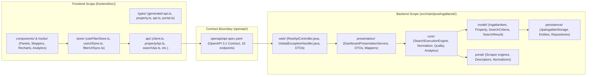
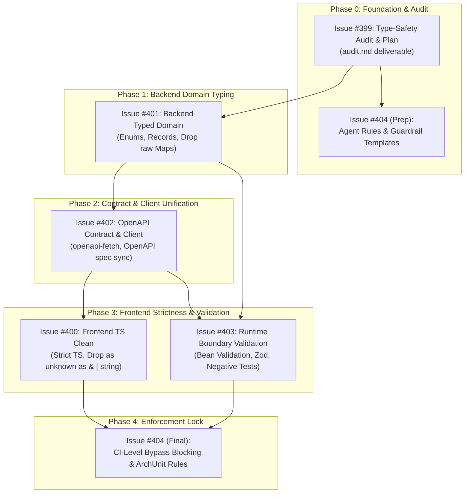

# Comprehensive Fullstack Type-Safety Audit & Downstream Migration Plan

- **Base Commit Hash**: `e0da7f01556a000da9d0c91fd3a4b3801a0ef1f7` (branch `develop`)
- **Document Path**: `docs/architecture/type-safety/audit.md`
- **Audit Date**: 2026-11-08
- **Auditor**: Fullstack Architecture & Documentation Specialist Team
- **Parent Milestone**: GitHub Issue #399 (Umbrella Issue #398 — Fullstack Type Safety & Boundary Hardening)
- **Target Implementation Issues**: GitHub Issues #400, #401, #402, #403, and #404

---

## 1. Executive Summary & Audited Scope

### 1.1 Purpose & Mission
This audit deliverable satisfies GitHub Issue #399 by conducting an exhaustive, evidence-based review of type-safety practices across the entire fullstack codebase of **ingatlan-kereso**. It establishes a single source of truth for all primitive obsession, stringly-typed closed sets, raw/unbounded generics, unsafe type assertions, contract drifts, and missing boundary validations.

The audit identifies **74 distinct findings** across three core surfaces:
1. **Frontend (TypeScript / React 19)**: 32 findings (`TS-001` through `TS-032`).
2. **Backend (Java 25 LTS / Spring Boot 4.1.2)**: 27 findings (`JAVA-001` through `JAVA-027`).
3. **OpenAPI 3.1 & Contract Integration**: 15 findings (`API-001` through `API-015`).

This document provides exact file locations, line numbers, current vs. target constructs, priority rankings (P0–P3), risk assessments, dependencies, an actionable phased downstream migration plan, backward compatibility and rollback strategies, explicit justifications for legitimate free text and technical generics, and verification commands.

### 1.2 Audited Architectural Scope



- **Frontend Scope (`frontend/src/`)**: 42 TypeScript/React files comprising components, state stores (Zustand), queries (TanStack Query), hooks, utilities, and API clients.
- **Backend Scope (`src/main/java/ingatlanok/`)**: 9 packages comprising 58 production Java classes, records, and interfaces, verified against ArchUnit four-layer unidirectional rules (`ArchitectureRulesTest.java`).
- **Contract Boundary (`openapi/api-spec.yaml`)**: 1,348 lines of OpenAPI 3.1 YAML defining 18 HTTP operations and 15 schemas, synchronizing backend DTOs with frontend code-generated TypeScript types (`frontend/src/types/generated-api.ts`).

---

## 2. Structured Inventories of Findings

### 2.1 Frontend Type-Safety Findings (`TS-001` – `TS-032`)

| Finding ID | Category | Component / Location | Priority | Risk | Downstream Issue |
| :--- | :--- | :--- | :---: | :---: | :---: |
| **TS-001** | Domain Defect | `types/property.ts:6-7` (CanonicalPropertyType widened to string) | **P0** | High | #400, #402 |
| **TS-002** | Domain Defect | `types/property.ts:18` (Stringly-typed property type in BargainInfo) | **P1** | Low | #400 |
| **TS-003** | Domain Defect / Boundary | `store/useFilterStore.ts:57,85`, `store/filterUrlSync.ts:11` (Lowercase propertyType) | **P1** | Medium | #401, #402, #400 |
| **TS-004** | Domain Defect | `types/generated-api.ts`, `store/useFilterStore.ts:78` (Portal IDs plain strings) | **P1** | Medium | #400, #402 |
| **TS-005** | Domain Defect / Boundary | `types/generated-api.ts`, `components/modals/DiagnosticsModal.tsx:89` (Status plain string) | **P1** | Low | #401, #402, #400 |
| **TS-006** | Domain Defect | `components/filters/PropertyTypeTabs.tsx:4-7` (Untyped string props) | **P2** | Low | #400 |
| **TS-007** | Domain Defect | `components/listings/PropertyTypeBadge.tsx:6` (Raw string propertyType prop) | **P2** | Low | #400 |
| **TS-008** | Domain Defect | `App.tsx:26` (Raw string subtype in ActiveSliceParams) | **P2** | Low | #400 |
| **TS-009** | Domain Defect | `components/filters/SearchPanel.tsx:17-21` (Untyped Record<string, string>) | **P2** | Low | #400 |
| **TS-010** | Technical Infrastructure | `utils/formatters.ts:293` (PORTAL_COLORS untyped Record<string, ...>) | **P2** | Low | #400 |
| **TS-011** | Domain Defect | `utils/formatters.ts:302` (normalizePortalKey return type loose string) | **P2** | Low | #400 |
| **TS-012** | Domain Defect | `utils/marketAnalyticsMath.ts:172-179` (Artificial category narrowing) | **P2** | Medium | #400 |
| **TS-013** | Primitive Obsession | `types/generated-api.ts`, `utils/formatters.ts:181` (Financial amounts bare number) | **P1** | Medium | #400, #401 |
| **TS-014** | Primitive Obsession | `types/generated-api.ts:508`, `NumericStepper.tsx:6` (Area bare number) | **P2** | Low | #400 |
| **TS-015** | Primitive Obsession | `types/property.ts:14-15` (Percentages bare number without sign convention) | **P2** | Low | #400 |
| **TS-016** | Primitive Obsession | `types/generated-api.ts:650`, `store/useFilterStore.ts:76` (Quality score bare number) | **P2** | Low | #400 |
| **TS-017** | Primitive Obsession | `types/generated-api.ts:620`, `store/useUiStore.ts:38` (URLs bare string) | **P2** | Low | #400 |
| **TS-018** | Primitive Obsession | `types/generated-api.ts:618,400` (Identifiers bare string/number) | **P2** | Low | #400 |
| **TS-019** | Primitive Obsession | `types/generated-api.ts:626-637` (ISO-8601 timestamps bare string) | **P3** | Low | #400 |
| **TS-020** | Technical Infrastructure | `api/client.ts:45` (Double assertion `as unknown as T` in REST client) | **P0** | High | #400, #403 |
| **TS-021** | Technical Infrastructure | `api/client.ts:37,42` (Unchecked generic assertions `{} as T` and `json as T`) | **P1** | Medium | #402, #403 |
| **TS-022** | Technical Infrastructure | `components/analytics/CityComparisonChart.tsx:193` (Double cast on Recharts Bar) | **P1** | Low | #400 |
| **TS-023** | Technical Infrastructure | `components/analytics/PriceScatterCorrelationChart.tsx:43-44` (Unsafe Recharts `as`) | **P2** | Low | #400 |
| **TS-024** | Technical Infrastructure | `store/useFilterStore.ts:42`, `BulkActionBar.tsx:145` (Unchecked `as SortOption`) | **P2** | Low | #400 |
| **TS-025** | External Boundary | `components/filters/CitySelector.tsx:69` (Undiscriminated union index assertion) | **P1** | Low | #400, #402 |
| **TS-026** | Domain Defect / Infra | `utils/listingFilters.ts:160,164`, `marketAnalyticsAggregation.ts:55` (Non-null `!`) | **P1** | Medium | #400 |
| **TS-027** | Domain Defect | `utils/formatters.ts:97-98` (Insecure prototype check with `in` operator) | **P2** | Low | #400 |
| **TS-028** | External Boundary / Redundancy | `api/propertyApi.ts:4,11,31,37,44` (Ad-hoc hand-copied response types) | **P1** | Low | #400, #402 |
| **TS-029** | Domain Defect / Contract | `types/property.ts:21-29` (Frontend IngatlanItem divergence & legacy fields) | **P0** | High | #400, #401, #402 |
| **TS-030** | External Boundary | `types/api.ts:5-11` (Manual `Omit` workaround on SearchCriteria) | **P2** | Low | #402 |
| **TS-031** | Technical Infrastructure | `api/propertyApi.ts`, `searchApi.ts`, etc. (Untyped endpoint string literals) | **P2** | Medium | #402 |
| **TS-032** | Domain Defect | `utils/marketAnalyticsMath.ts:172-179`, `App.tsx:38-61` (Missing exhaustiveness `never`) | **P1** | Low | #400 |

---

### 2.2 Backend Type-Safety Findings (`JAVA-001` – `JAVA-027`)

| Finding ID | Category | Component / Class | Priority | Risk | Downstream Issue |
| :--- | :--- | :--- | :---: | :---: | :---: |
| **JAVA-001** | Stringly-Typed Closed Set | `model/IngatlanItem.java:34`, `PropertyEntity.java:120` (Listing lifecycle status) | **P1** | Medium | #400, #401 |
| **JAVA-002** | Stringly-Typed Closed Set | `model/PortalSource.java:13`, `SearchCriteria.java:26` (Portal identifier string) | **P1** | Medium | #400 |
| **JAVA-003** | Stringly-Typed Closed Set | `model/SearchCriteria.java:20`, `PortalDescriptor.java:11` (Property type string) | **P1** | Low | #400 |
| **JAVA-004** | Stringly-Typed Closed Set | `web/HistoryQueryDto.java:22`, `JpaIngatlanStorage.java:342` (Sort order string) | **P1** | Low | #400 |
| **JAVA-005** | Stringly-Typed Closed Set | `model/PriceInfo.java:16,23` (Currency code raw string "HUF") | **P3** | Low | #400 |
| **JAVA-006** | Stringly-Typed Closed Set | `presentation/PortalStatusDto.java:15`, `PresentationMapper.java:28` (Status downgrade) | **P2** | Low | #402 |
| **JAVA-007** | Stringly-Typed Closed Set | `presentation/DashboardResponseDto.java:30` (Execution status downgrade) | **P2** | Low | #402 |
| **JAVA-008** | Stringly-Typed Closed Set | `persistence/entity/ListingObservationEntity.java:57` (Observation event string) | **P2** | Low | #401 |
| **JAVA-009** | Stringly-Typed Closed Set | `portal/sidecar/SidecarResponse.java:25,34` (Sidecar response status string) | **P2** | Low | #404 |
| **JAVA-010** | Stringly-Typed Closed Set | `core/DataQualityEngine.java:79`, `IngatlanItem.java:50` (Formatted deductions text) | **P2** | Low | #400 |
| **JAVA-011** | Primitive Obsession | All Timestamps & Dates stored as raw `VARCHAR(50)` strings across entities & models | **P1** | High | #401, #402 |
| **JAVA-012** | Primitive Obsession | `model/PriceInfo.java:14,15`, `PropertyEntity.java:77,79` (Monetary mixed units) | **P1** | High | #403 |
| **JAVA-013** | Primitive Obsession | `model/PropertyDetails.java:14,15`, `PropertyEntity.java:86,88` (Area & rooms bare) | **P2** | Medium | #403 |
| **JAVA-014** | Primitive Obsession | `model/IngatlanItem.java:49`, `DataQualityEngine.java:41` (Quality score bare Integer) | **P2** | Low | #400 |
| **JAVA-015** | Primitive Obsession | `model/Property.java:19`, `PropertyEntity.java:51,57` (IDs as raw strings/longs) | **P2** | Medium | #401 |
| **JAVA-016** | Stringly-Typed Composite Key | `core/MarketAnalyticsEngine.java:121,260` (String-delimited bucket key `city#type`) | **P2** | Low | #403 |
| **JAVA-017** | Untyped Generic Map | `web/RestApiController.java:62,101,122,165,261,284,322` (Raw `Map<String, Object>`) | **P0** | High | #402 |
| **JAVA-018** | Unbounded Wildcard | `web/RestApiController.java:204,221,238` (Unbounded `ResponseEntity<?>`) | **P1** | Medium | #402 |
| **JAVA-019** | Unchecked Cast / Inspection | `web/RestApiController.java:266,269-275` (Runtime `instanceof` inspection & casts) | **P1** | Medium | #402 |
| **JAVA-020** | Type Downgrading | `web/RestApiController.java:188-190` (Downcasting `ListingStorage` to `ConfigStorage`) | **P2** | Low | #402 |
| **JAVA-021** | Raw Object Array | `persistence/repository/PropertyRepository.java:80,85` (Raw `List<Object[]>`) | **P1** | Medium | #401 |
| **JAVA-022** | Untyped Generic Map | `persistence/ListingStorage.java:51` (`List<Map<String, Object>> getTrackedCitiesInfo`) | **P1** | Medium | #401 |
| **JAVA-023** | Untyped Generic Map | `common/city/CityPresets.java:14,57-65` (Predefined cities as `List<Map<String, String>>`)| **P2** | Low | #402 |
| **JAVA-024** | Untyped Generic Map | `web/GlobalExceptionHandler.java:130-139` (Untyped `Map<String, Object>` error body) | **P1** | Medium | #402 |
| **JAVA-025** | Stringly-Typed Criteria | `persistence/specification/PropertySpecifications.java:33,47` (Literal string paths) | **P2** | Low | #401 |
| **JAVA-026** | Reflection & Unchecked Cast | `portal/RawListingNormalizer.java:38-39` (Reflective class loading & cast) | **P2** | Low | #404 |
| **JAVA-027** | Dead Code / Duplication | `dto/PriceHistoryDto.java`, `dto/StatusLogDto.java` (Orphaned unreferenced DTOs) | **P3** | Low | #402 |

---

### 2.3 API & Contract Findings (`API-001` – `API-015`)

| Finding ID | Category | Specification / Boundary | Priority | Risk | Downstream Issue |
| :--- | :--- | :--- | :---: | :---: | :---: |
| **API-001** | Contract Incoherence | `openapi/api-spec.yaml:1051-1053` (Stringly-typed propertyType in SearchCriteria) | **P0** | High | #401, #402, #400 |
| **API-002** | Closed Enum Missing | `openapi/api-spec.yaml:869,893,1071` (Portal IDs stored as raw string) | **P1** | Medium | #401, #402, #400 |
| **API-003** | Enum Degraded | `openapi/api-spec.yaml:897-898` (PortalStatusDto.status raw string vs backend enum) | **P1** | Low | #401, #402, #400 |
| **API-004** | Contract Defect | `openapi/api-spec.yaml:860-883` (PortalDescriptor property mismatch: color vs brandColor) | **P0** | Medium | #401, #402, #400 |
| **API-005** | Type-Evasive Client | `frontend/src/api/client.ts:8,45` (Untyped generic `apiClient<T>` with unchecked casts) | **P1** | Medium | #402, #400 |
| **API-006** | Missing Schema | `openapi/api-spec.yaml:503,537,623` (Missing typed request/response DTOs for mutations) | **P1** | Low | #401, #402, #400 |
| **API-007** | Ambiguous Operation | `src/main/java/ingatlanok/web/RestApiController.java:204` (Wildcard `ResponseEntity<?>`) | **P1** | Low | #401, #403 |
| **API-008** | Inconsistent Schema | `openapi/api-spec.yaml:735-742`, `GlobalExceptionHandler.java:130` (Divergent error format) | **P1** | Low | #401, #402, #403, #400 |
| **API-009** | Contract Discrepancy | `openapi/api-spec.yaml:799-803,839-844` (CitiesResponse & StatusResponse loose anyOf) | **P1** | Medium | #401, #402, #400 |
| **API-010** | Closed Enum Missing | `openapi/api-spec.yaml:264-270` (Stringly-typed sort parameter across backend/API) | **P1** | Medium | #401, #402, #400 |
| **API-011** | Missing Metadata | `openapi/api-spec.yaml` (Missing `format: date-time`, `format: uri`, `format: int64`) | **P2** | Low | #402 |
| **API-012** | Contract Precision | `openapi/api-spec.yaml:1086-1145` (Missing `required` lists on presentation DTOs) | **P2** | Low | #402, #400 |
| **API-013** | Validation Gap | `openapi/api-spec.yaml:194-283` (Missing boundary constraints: minimum, maximum) | **P2** | Low | #401, #402, #403 |
| **API-014** | CI Guardrail Gap | `frontend/package.json:12`, `scripts/validate-skills.sh` (Missing freshness check) | **P1** | Low | #402, #404 |
| **API-015** | Missing DTO Record | `src/main/java/ingatlanok/web/RestApiController.java:140` (Missing SearchPresetInput) | **P2** | Low | #401, #402 |

---

## 3. Detailed Finding Breakdown & Concrete Target Designs

### 3.1 Frontend Findings (`TS-001` – `TS-032`)

#### TS-001: CanonicalPropertyType Union Widened to String
- **Location**: `frontend/src/types/property.ts:6-7`
- **Current Construct**:
  ```ts
  export type CanonicalPropertyType = components['schemas']['PropertyType']
  export type PropertyType = CanonicalPropertyType | string
  ```
- **Type Safety Problem**: In TypeScript, when `T extends string`, the union `T | string` collapses to `string`. This completely disables compiler checking on property types across the frontend. Invalid strings (e.g. `"palota"`) are accepted without warnings.
- **Target State**:
  ```ts
  export type PropertyType = CanonicalPropertyType
  ```
- **Priority**: P0 | **Risk**: High | **Dependencies**: #400, #402

#### TS-002: Stringly-Typed Property Type in BargainInfo
- **Location**: `frontend/src/types/property.ts:18`
- **Current Construct**:
  ```ts
  export interface BargainInfo {
    referencePropertyType?: string
  }
  ```
- **Type Safety Problem**: The reference property type is held as raw `string` rather than `CanonicalPropertyType`.
- **Target State**:
  ```ts
  export interface BargainInfo {
    referencePropertyType?: CanonicalPropertyType
  }
  ```
- **Priority**: P1 | **Risk**: Low | **Dependencies**: #400

#### TS-003: Lowercase PropertyType in SearchCriteria
- **Location**: `frontend/src/store/useFilterStore.ts:57,85`, `frontend/src/store/filterUrlSync.ts:11`
- **Current Construct**:
  ```ts
  setPropertyType: (type: string) => void
  type: z.enum(['lakas', 'haz', 'telek']).optional().catch(undefined)
  ```
- **Type Safety Problem**: Search criteria uses lowercase strings (`"lakas"`, `"haz"`), while canonical domain models use uppercase enums (`"LAKAS"`, `"HAZ"`), causing continuous conversions and casing bugs.
- **Target State**: Synchronize OpenAPI schema to canonical enum (`PropertyType`) and support case-insensitive serialization via Jackson `@JsonCreator`.
- **Priority**: P1 | **Risk**: Medium | **Dependencies**: #401, #402, #400

#### TS-004: Closed Portal Identifiers Stored as Raw Strings
- **Location**: `frontend/src/types/generated-api.ts:619`, `frontend/src/store/useFilterStore.ts:78,90`
- **Current Construct**:
  ```ts
  export const DEFAULT_PORTALS = ['dh', 'oc', 'jofogas', 'ingatlancom', 'ingatlanbazar', 'koltozzbe']
  selectedPortalFilter: string
  togglePortal: (portalId: string) => void
  ```
- **Type Safety Problem**: Portals represent a closed set of 6 providers. Free-form `string` prevents compiler verification of portal IDs.
- **Target State**:
  ```ts
  export const PORTAL_IDS = ['dh', 'oc', 'jofogas', 'ingatlancom', 'ingatlanbazar', 'koltozzbe'] as const
  export type PortalId = (typeof PORTAL_IDS)[number]
  export type PortalFilterOption = PortalId | 'all'
  ```
- **Priority**: P1 | **Risk**: Medium | **Dependencies**: #400, #402

#### TS-005: Raw String Types for Portal and Listing Statuses
- **Location**: `frontend/src/types/generated-api.ts:493,545,634`, `frontend/src/components/modals/DiagnosticsModal.tsx:89-91`
- **Current Construct**:
  ```ts
  const isSuccess = p.status === 'SUCCESS'
  const isBot = p.status === 'BOT_PROTECTED'
  ```
- **Type Safety Problem**: Magic string equality checks without compile-time exhaustiveness checking.
- **Target State**:
  ```ts
  export type PortalScrapeStatus = 'SUCCESS' | 'FAILED' | 'BOT_PROTECTED' | 'SPA_FALLBACK'
  export type ListingStatus = 'ACTIVE' | 'INACTIVE' | 'REMOVED' | 'ARCHIVED'
  ```
- **Priority**: P1 | **Risk**: Low | **Dependencies**: #401, #402, #400

#### TS-006: Untyped String Props in PropertyTypeTabs
- **Location**: `frontend/src/components/filters/PropertyTypeTabs.tsx:4-7`
- **Current Construct**:
  ```ts
  interface PropertyTypeTabsProps {
    value: string
    onChange: (type: string) => void
  }
  ```
- **Type Safety Problem**: UI component accepts and emits arbitrary strings instead of allowed filter types.
- **Target State**:
  ```ts
  export type FilterPropertyType = 'lakas' | 'haz' | 'telek'
  interface PropertyTypeTabsProps {
    value: FilterPropertyType
    onChange: (type: FilterPropertyType) => void
  }
  ```
- **Priority**: P2 | **Risk**: Low | **Dependencies**: #400

#### TS-007: Raw String PropertyType Prop in PropertyTypeBadge
- **Location**: `frontend/src/components/listings/PropertyTypeBadge.tsx:6`
- **Current Construct**:
  ```ts
  export interface PropertyTypeBadgeProps {
    propertyType?: string | null
    className?: string
    showIcon?: boolean
  }
  ```
- **Type Safety Problem**: Badge component bypasses `CanonicalPropertyType`.
- **Target State**:
  ```ts
  propertyType?: CanonicalPropertyType | null
  ```
- **Priority**: P2 | **Risk**: Low | **Dependencies**: #400

#### TS-008: Raw String Subtype in ActiveSliceParams in App.tsx
- **Location**: `frontend/src/App.tsx:26`
- **Current Construct**:
  ```ts
  interface ActiveSliceParams {
    listingSubView: string
  }
  ```
- **Type Safety Problem**: Re-declares `listingSubView` as bare `string` despite `ListingSubView = 'listings' | 'favorites' | 'archive'` existing in `useUiStore.ts`.
- **Target State**:
  ```ts
  listingSubView: ListingSubView
  ```
- **Priority**: P2 | **Risk**: Low | **Dependencies**: #400

#### TS-009: Untyped Record<string, string> in Filter and Presets
- **Location**: `frontend/src/components/filters/SearchPanel.tsx:17-21`, `SearchPresetsBar.tsx:29`
- **Current Construct**:
  ```ts
  const PROPERTY_TYPE_LABELS: Record<string, string> = {
    lakas: 'Lakás',
    haz: 'Családi ház',
    telek: 'Telek',
  }
  ```
- **Type Safety Problem**: `Record<string, string>` allows missing keys and typos without compilation errors.
- **Target State**:
  ```ts
  const PROPERTY_TYPE_LABELS: Record<FilterPropertyType, string> = { ... }
  ```
- **Priority**: P2 | **Risk**: Low | **Dependencies**: #400

#### TS-010: Untyped Record<string, ...> in PORTAL_COLORS
- **Location**: `frontend/src/utils/formatters.ts:293`
- **Current Construct**:
  ```ts
  export const PORTAL_COLORS: Record<string, { bg: string; text: string; border: string }> = { ... }
  ```
- **Type Safety Problem**: Keys are unconstrained strings; adding new portal IDs does not trigger missing style compile checks.
- **Target State**:
  ```ts
  export const PORTAL_COLORS: Record<PortalId, { bg: string; text: string; border: string }> = { ... }
  ```
- **Priority**: P2 | **Risk**: Low | **Dependencies**: #400

#### TS-011: normalizePortalKey Return Type Is Loose String
- **Location**: `frontend/src/utils/formatters.ts:302`
- **Current Construct**:
  ```ts
  export function normalizePortalKey(portalOrId?: string | null): string
  ```
- **Type Safety Problem**: Helper identifies canonical portals but returns wide `string`.
- **Target State**:
  ```ts
  export function normalizePortalKey(portalOrId?: string | null): PortalId | 'egyeb'
  ```
- **Priority**: P2 | **Risk**: Low | **Dependencies**: #400

#### TS-012: Artificial Category Narrowing in Market Statistics
- **Location**: `frontend/src/utils/marketAnalyticsMath.ts:172-179`, `useMarketAnalytics.ts:34`
- **Current Construct**:
  ```ts
  export function normalizeCategoryType(type?: string | null): 'lakas' | 'haz' | 'telek' | null { ... }
  ```
- **Type Safety Problem**: Non-residential types (`GARAZS`, `IPARI_KERESKEDELMI`) are silently dropped to `null`.
- **Target State**: Explicit union covering all domain types:
  ```ts
  export type AnalyticsCategory = 'lakas' | 'haz' | 'telek' | 'garazs' | 'ipari' | 'egyeb'
  ```
- **Priority**: P2 | **Risk**: Medium | **Dependencies**: #400

#### TS-013: Monetary Amounts Bare Number
- **Location**: `frontend/src/types/generated-api.ts:503-504`, `frontend/src/utils/formatters.ts:181`
- **Current Construct**: `amountHuf?: number`, `amountMillion?: number`, `pricePerSquareMeter?: number`.
- **Type Safety Problem**: No nominal distinction between HUF (85,000,000), millions (85.0), and HUF/m² (850,000). Accidental math operations across incompatible units are undetected.
- **Target State**: Branded types:
  ```ts
  export type HufAmount = number & { readonly __brand: unique symbol }
  export type MillionHuf = number & { readonly __brand: unique symbol }
  export type SqmPrice = number & { readonly __brand: unique symbol }
  ```
- **Priority**: P1 | **Risk**: Medium | **Dependencies**: #400, #401

#### TS-014: Area and Dimensions Bare Number
- **Location**: `frontend/src/types/generated-api.ts:508`, `NumericStepper.tsx:6`
- **Current Construct**: `areaSquareMeters?: number`, `value: number`.
- **Type Safety Problem**: Square meters and price millions share the same primitive without invariant checks.
- **Target State**:
  ```ts
  export type SquareMeters = number & { readonly __brand: unique symbol }
  ```
- **Priority**: P2 | **Risk**: Low | **Dependencies**: #400

#### TS-015: Percentage Values Bare Number Without Sign Convention
- **Location**: `frontend/src/types/property.ts:14-15`, `frontend/src/types/generated-api.ts:636`
- **Current Construct**: `deltaPercent: number`, `percentageBelowMedian?: number`.
- **Type Safety Problem**: Inconsistent sign handling (negative discounts vs absolute percentages) cannot be tracked by type.
- **Target State**:
  ```ts
  export type Percentage = number & { readonly __brand: unique symbol }
  ```
- **Priority**: P2 | **Risk**: Low | **Dependencies**: #400

#### TS-016: Quality Score Bare Number
- **Location**: `frontend/src/types/generated-api.ts:650`, `store/useFilterStore.ts:76`
- **Current Construct**: `qualityScore?: number | null`.
- **Type Safety Problem**: Unconstrained number can receive values outside $[0, 100]$.
- **Target State**:
  ```ts
  export type QualityScore = number & { readonly __brand: unique symbol }
  ```
- **Priority**: P2 | **Risk**: Low | **Dependencies**: #400

#### TS-017: URLs Bare String
- **Location**: `frontend/src/types/generated-api.ts:620`, `store/useUiStore.ts:38`
- **Current Construct**: `url: string`, `starredUrls: string[]`.
- **Type Safety Problem**: Web URLs, image URLs, and text paths can be mixed up accidentally.
- **Target State**:
  ```ts
  export type ListingUrl = string & { readonly __brand: unique symbol }
  ```
- **Priority**: P2 | **Risk**: Low | **Dependencies**: #400

#### TS-018: Domain Identifiers Bare String / Number
- **Location**: `frontend/src/types/generated-api.ts:618,400`
- **Current Construct**: `IngatlanItem.id: string`, `SearchPreset.id: number`.
- **Type Safety Problem**: Cluster canonical IDs and preset IDs are not differentiated from raw strings/integers.
- **Target State**:
  ```ts
  export type PropertyId = string & { readonly __brand: unique symbol }
  export type PresetId = number & { readonly __brand: unique symbol }
  ```
- **Priority**: P2 | **Risk**: Low | **Dependencies**: #400

#### TS-019: ISO-8601 Timestamps Bare String
- **Location**: `frontend/src/types/generated-api.ts:626-637`
- **Current Construct**: `discoveredAt?: string`, `viewedAt?: string`.
- **Type Safety Problem**: Strings lack ISO-8601 syntax enforcement at the type level.
- **Target State**:
  ```ts
  export type IsoDateTimeString = string & { readonly __brand: unique symbol }
  ```
- **Priority**: P3 | **Risk**: Low | **Dependencies**: #400

#### TS-020: Double Type Assertion `as unknown as T` in REST Client
- **Location**: `frontend/src/api/client.ts:45`
- **Current Construct**:
  ```ts
  return (await response.text()) as unknown as T
  ```
- **Type Safety Problem**: Bypasses TypeScript's type checker entirely; a text error response can be silently coerced into an expected object DTO.
- **Target State**: Explicit branch handling with typed error throw or response type discrimination.
- **Priority**: P0 | **Risk**: High | **Dependencies**: #400, #403

#### TS-021: Unchecked Generic Assertions `{} as T` and `json as T`
- **Location**: `frontend/src/api/client.ts:37,42`
- **Current Construct**:
  ```ts
  if (response.status === 204) return {} as T
  return (await response.json()) as T
  ```
- **Type Safety Problem**: Coerces unvalidated HTTP bodies into type `T` without runtime validation.
- **Target State**: Introduce Zod runtime validation at external boundaries (#403) or strict response schema decoding.
- **Priority**: P1 | **Risk**: Medium | **Dependencies**: #402, #403

#### TS-022: Double Assertion `as unknown as` in Recharts Bar Click Handlers
- **Location**: `frontend/src/components/analytics/CityComparisonChart.tsx:193`, `PriceDistributionChart.tsx:198`
- **Current Construct**:
  ```ts
  onClick={(entry) => handleBarClick((entry as unknown as CityStat).city)}
  ```
- **Type Safety Problem**: Circumvents Recharts event typing with double cast.
- **Target State**: Type guard function:
  ```ts
  function isCityStat(entry: unknown): entry is CityStat {
    return typeof entry === 'object' && entry !== null && 'city' in entry
  }
  ```
- **Priority**: P1 | **Risk**: Low | **Dependencies**: #400

#### TS-023: Unsafe Recharts Tooltip and Scatter Assertions
- **Location**: `frontend/src/components/analytics/PriceScatterCorrelationChart.tsx:43-44,276`
- **Current Construct**:
  ```ts
  const raw = eventData as Record<string, unknown>
  const data = payload[0].payload as ScatterPoint
  ```
- **Type Safety Problem**: Direct downcasting of Recharts payload arrays without runtime guard.
- **Target State**: Typed wrapper helper for Recharts payload extraction.
- **Priority**: P2 | **Risk**: Low | **Dependencies**: #400

#### TS-024: Unchecked `as SortOption` in LocalStorage and Select Events
- **Location**: `frontend/src/store/useFilterStore.ts:42`, `BulkActionBar.tsx:145`
- **Current Construct**:
  ```ts
  const saved = safeGetStorageItem('preferred_sort_option') as SortOption | null
  onChange={(e) => setSortOption(e.target.value as SortOption)}
  ```
- **Type Safety Problem**: Arbitrary strings from storage or DOM select elements are forcefully typed as `SortOption`.
- **Target State**: Type guard:
  ```ts
  function isSortOption(val: unknown): val is SortOption {
    return typeof val === 'string' && VALID_SORT_OPTIONS.includes(val as SortOption)
  }
  ```
- **Priority**: P2 | **Risk**: Low | **Dependencies**: #400

#### TS-025: Undiscriminated Union Dangerous Assertion in CitySelector
- **Location**: `frontend/src/components/filters/CitySelector.tsx:69`
- **Current Construct**:
  ```ts
  const val = (citiesData.trackedCities as Record<string, number>)[city]
  ```
- **Type Safety Problem**: `trackedCities` is a union `TrackedCityInfo[] | { [key: string]: number }`. Forcefully casting to `Record<string, number>` crashes if it is an array.
- **Target State**:
  ```ts
  if (!Array.isArray(citiesData.trackedCities)) {
    const val = citiesData.trackedCities[city]
  }
  ```
- **Priority**: P1 | **Risk**: Low | **Dependencies**: #400, #402

#### TS-026: Non-Null Assertions (`!`) in Filtering and Aggregation
- **Location**: `frontend/src/utils/listingFilters.ts:160,164`, `marketAnalyticsAggregation.ts:55,60,100`
- **Current Construct**:
  ```ts
  item.qualityScore >= options.minQualityScore!
  agg.segmentMap.get(bucketKey)!.push(sqPrice)
  ```
- **Type Safety Problem**: Suppresses TypeScript's nullability checks. Missing Map keys trigger runtime `TypeError: Cannot read properties of undefined`.
- **Target State**: Safe null checks and `Map.getOrCreate()` utility patterns.
- **Priority**: P1 | **Risk**: Medium | **Dependencies**: #400

#### TS-027: Insecure Prototype Check in normalizePropertyType
- **Location**: `frontend/src/utils/formatters.ts:97-98`
- **Current Construct**:
  ```ts
  if (normalized in PROPERTY_TYPE_CONFIGS) {
    return normalized as CanonicalPropertyType
  }
  ```
- **Type Safety Problem**: The `in` operator traverses prototype methods (e.g. `"toString" in obj` is true), followed by unchecked type assertion.
- **Target State**:
  ```ts
  if (Object.prototype.hasOwnProperty.call(PROPERTY_TYPE_CONFIGS, normalized)) {
    return normalized as CanonicalPropertyType
  }
  ```
- **Priority**: P2 | **Risk**: Low | **Dependencies**: #400

#### TS-028: Hand-Copied Ad-Hoc Response Types in propertyApi.ts
- **Location**: `frontend/src/api/propertyApi.ts:4,11,31,37,44`
- **Current Construct**:
  ```ts
  export async function markAsViewed(url: string): Promise<{ success: boolean; marked: boolean; url: string }>
  export async function openUrls(urls: string[]): Promise<{ success: boolean; count: number }>
  ```
- **Type Safety Problem**: Violates OpenAPI single source of truth by re-declaring inline interfaces rather than using generated types.
- **Target State**:
  ```ts
  import type { components } from '../types/generated-api'
  type MarkViewedResponse = components['schemas']['MarkViewedResponse']
  type OpenUrlsResponse = components['schemas']['OpenUrlsResponse']
  ```
- **Priority**: P1 | **Risk**: Low | **Dependencies**: #400, #402

#### TS-029: Frontend IngatlanItem Divergence & Legacy Fields
- **Location**: `frontend/src/types/property.ts:21-29`
- **Current Construct**:
  ```ts
  export type IngatlanItem = Omit<
    components['schemas']['IngatlanItem'],
    'propertyType' | 'sourcesCount'
  > & {
    propertyType?: PropertyType
    sourcesCount?: number
    bargainInfo?: BargainInfo
    new?: boolean
  }
  ```
- **Type Safety Problem**: Hand-modifies generated schema, widens `propertyType` to `string`, and appends duplicate legacy fields (`new?: boolean` vs `isNew?: boolean`).
- **Target State**: Directly derive `IngatlanItem` from `components['schemas']['IngatlanItem']` without `Omit` or legacy aliases.
- **Priority**: P0 | **Risk**: High | **Dependencies**: #400, #401, #402

#### TS-030: Manual Omit Workaround on SearchCriteria
- **Location**: `frontend/src/types/api.ts:5-11`
- **Current Construct**:
  ```ts
  export type SearchCriteria = Omit<
    components['schemas']['SearchCriteria'],
    'onlyDiscounted' | 'onlyNewConstruction'
  > & {
    onlyDiscounted?: boolean
    onlyNewConstruction?: boolean
  }
  ```
- **Type Safety Problem**: OpenAPI specifies these fields as required booleans, forcing frontend `Omit` monkey-patching.
- **Target State**: Update `openapi/api-spec.yaml` to mark optional criteria fields correctly.
- **Priority**: P2 | **Risk**: Low | **Dependencies**: #402

#### TS-031: Untyped API Endpoint String Literals
- **Location**: `frontend/src/api/propertyApi.ts`, `searchApi.ts`, `presetApi.ts`
- **Current Construct**:
  ```ts
  apiClient('/api/search', ...)
  apiClient(`/api/properties/${encodeURIComponent(id)}/hide`, ...)
  ```
- **Type Safety Problem**: Endpoint routes and methods are plain strings, not verified against OpenAPI `paths`.
- **Target State**: Adopt a typed client (e.g. `openapi-fetch`) typed directly against `paths` from `generated-api.ts`.
- **Priority**: P2 | **Risk**: Medium | **Dependencies**: #402

#### TS-032: Missing Exhaustiveness Verification (`never`)
- **Location**: `frontend/src/utils/marketAnalyticsMath.ts:172-179`, `frontend/src/App.tsx:38-61`
- **Current Construct**:
  ```ts
  if (canonical === 'LAKAS') return 'lakas'
  if (canonical === 'HAZ') return 'haz'
  if (canonical === 'TELEK') return 'telek'
  return null
  ```
- **Type Safety Problem**: When adding a new `PropertyType` enum value, the compiler will not warn about missing branches; it falls through silently to `null`.
- **Target State**:
  ```ts
  switch (canonical) {
    case 'LAKAS': return 'lakas'
    case 'HAZ': return 'haz'
    case 'TELEK': return 'telek'
    case 'GARAZS':
    case 'IPARI_KERESKEDELMI':
    case 'EGYEB_ISMERETLEN': return null
    default: {
      const _exhaustive: never = canonical
      return _exhaustive
    }
  }
  ```
- **Priority**: P1 | **Risk**: Low | **Dependencies**: #400

---

### 3.2 Backend Findings (`JAVA-001` – `JAVA-027`)

#### JAVA-001: Listing Lifecycle Status Stringly-Typed Closed Set
- **Location**: `src/main/java/ingatlanok/model/IngatlanItem.java:34`, `SourceListing.java:23,98`, `persistence/entity/PropertyEntity.java:120`, `StatusLogEntity.java:44`
- **Current Construct**:
  ```java
  private String status = "ACTIVE";
  public boolean isActive() { return "ACTIVE".equalsIgnoreCase(status); }
  ```
- **Type Safety Problem**: Closed lifecycle state machine (`ACTIVE`, `INACTIVE`, `REMOVED`, `ARCHIVED`) is stored and compared as raw `String`s. Typos bypass compiler checks.
- **Target State**:
  ```java
  public enum ListingStatus {
    ACTIVE, INACTIVE, REMOVED, ARCHIVED;
  }
  // In PropertyEntity.java
  @Enumerated(EnumType.STRING)
  @Column(length = 50, nullable = false)
  private ListingStatus status = ListingStatus.ACTIVE;
  ```
- **Priority**: P1 | **Risk**: Medium | **Dependencies**: #400, #401

#### JAVA-002: Portal Identifier Stringly-Typed Closed Set
- **Location**: `src/main/java/ingatlanok/model/PortalSource.java:13`, `IngatlanItem.java:19`, `SearchCriteria.java:26`, `persistence/entity/PropertyEntity.java:60`
- **Current Construct**:
  ```java
  private String portalId;
  private List<String> portals = new ArrayList<>();
  @Column(length = 100) private String portal;
  ```
- **Type Safety Problem**: Supported portals (`dh`, `oc`, `jofogas`, `koltozzbe`, `ingatlanbazar`, `ingatlancom`, `unknown`) are manipulated as raw strings with manual lowercase normalization.
- **Target State**:
  ```java
  public enum PortalId {
    DH("dh", "Duna House"),
    OC("oc", "Otthon Centrum"),
    JOFOGAS("jofogas", "Jófogás Ingatlan"),
    KOLTOZZBE("koltozzbe", "Költözzbe"),
    INGATLANBAZAR("ingatlanbazar", "Ingatlanbazár"),
    INGATLANCOM("ingatlancom", "Ingatlan.com"),
    UNKNOWN("unknown", "Ismeretlen");
    ...
    @JsonCreator(mode = JsonCreator.Mode.DELEGATING)
    public static PortalId fromString(String raw) { ... }
    @JsonValue
    public String toValue() { return id; }
  }
  ```
- **Priority**: P1 | **Risk**: Medium | **Dependencies**: #400

#### JAVA-003: Property Type in Search Criteria and Portal Descriptor as Raw String
- **Location**: `src/main/java/ingatlanok/model/SearchCriteria.java:20`, `portal/PortalDescriptor.java:11`
- **Current Construct**:
  ```java
  private String propertyType = "haz";
  List<String> supportedTypes;
  ```
- **Type Safety Problem**: Although `PropertyType` enum exists, `SearchCriteria` uses `String propertyType = "haz"` and `PortalDescriptor` uses `List<String>`.
- **Target State**:
  ```java
  private PropertyType propertyType = PropertyType.HAZ;
  List<PropertyType> supportedTypes;
  ```
- **Priority**: P1 | **Risk**: Low | **Dependencies**: #400

#### JAVA-004: Sort Order and Filter Sorting as Raw String
- **Location**: `src/main/java/ingatlanok/web/HistoryQueryDto.java:22`, `persistence/PropertySearchCriteria.java:18`, `persistence/JpaIngatlanStorage.java:342-350`
- **Current Construct**:
  ```java
  Sort sort = switch (criteria.sortBy() == null ? "" : criteria.sortBy().toUpperCase()) {
    case "PRICE_ASC" -> Sort.by(Sort.Direction.ASC, "priceMillions");
    ...
    default -> Sort.by(Sort.Direction.DESC, "discoveredAt");
  };
  ```
- **Type Safety Problem**: Unconstrained string allows unknown sort parameters to silently degrade to default.
- **Target State**:
  ```java
  public enum ListingSortOption {
    DISCOVERED_DESC, PRICE_ASC, PRICE_DESC, AREA_ASC, AREA_DESC, ROOMS_ASC, ROOMS_DESC, BARGAIN_DESC;
  }
  ```
- **Priority**: P1 | **Risk**: Low | **Dependencies**: #400

#### JAVA-005: Currency Code Stored as Raw String
- **Location**: `src/main/java/ingatlanok/model/PriceInfo.java:16,23`
- **Current Construct**: `private String currency = "HUF";`
- **Type Safety Problem**: Magic literal string permits invalid currencies.
- **Target State**: `CurrencyCode` enum (`HUF`, `EUR`) or `java.util.Currency`.
- **Priority**: P3 | **Risk**: Low | **Dependencies**: #400

#### JAVA-006: Presentation Portal Status Downgraded to Raw String
- **Location**: `src/main/java/ingatlanok/presentation/PortalStatusDto.java:15`, `PresentationMapper.java:28-29`
- **Current Construct**:
  ```java
  @Mapping(target = "status", expression = "java(pr.getStatus() != null ? pr.getStatus().name() : \"UNKNOWN\")")
  PortalStatusDto toPortalStatusDto(PortalScrapeResult pr);
  ```
- **Type Safety Problem**: Strongly typed `PortalScrapeStatus` enum in domain is flattened to raw string for presentation.
- **Target State**:
  ```java
  public record PortalStatusDto(..., PortalScrapeStatus status, ...) {}
  ```
- **Priority**: P2 | **Risk**: Low | **Dependencies**: #402

#### JAVA-007: Presentation Search Execution Status Downgraded to Raw String
- **Location**: `src/main/java/ingatlanok/presentation/DashboardResponseDto.java:30`, `PresentationMapper.java:41-43`
- **Current Construct**: Flattens `SearchExecutionStatus` enum into nullable String.
- **Target State**: `private SearchExecutionStatus executionStatus;` on `DashboardResponseDto`.
- **Priority**: P2 | **Risk**: Low | **Dependencies**: #402

#### JAVA-008: JPA Entity Listing Observation Status Event Stored as Raw String
- **Location**: `src/main/java/ingatlanok/persistence/entity/ListingObservationEntity.java:57`, `ListingObservationContext.java:13`
- **Current Construct**:
  ```java
  @Column(length = 50) private String statusEvent;
  ```
- **Type Safety Problem**: `ListingObservation.StatusEvent` enum is converted to `VARCHAR(50)` and back via MapStruct expressions.
- **Target State**:
  ```java
  @Enumerated(EnumType.STRING)
  @Column(length = 50, nullable = false)
  private ListingObservation.StatusEvent statusEvent;
  ```
- **Priority**: P2 | **Risk**: Low | **Dependencies**: #401

#### JAVA-009: Sidecar Response Status as Raw String
- **Location**: `src/main/java/ingatlanok/portal/sidecar/SidecarResponse.java:25,34-36`
- **Current Construct**: `private String status;` with `"SUCCESS".equalsIgnoreCase(status)`.
- **Target State**: `public enum SidecarStatus { SUCCESS, FAILED, BOT_PROTECTED, TIMEOUT }`.
- **Priority**: P2 | **Risk**: Low | **Dependencies**: #404

#### JAVA-010: Data Quality Deductions Handled as Formatted Free Text
- **Location**: `src/main/java/ingatlanok/core/DataQualityEngine.java:79`, `IngatlanItem.java:50`
- **Current Construct**:
  ```java
  collector.deduct(30, "Érvénytelen vagy irreális ár (1M - 5B Ft tartományon kívül): -30 pont");
  private List<String> qualityDeductions = new ArrayList<>();
  ```
- **Type Safety Problem**: 14 deterministic rules produce concatenated strings, preventing programmatic downstream rule inspection.
- **Target State**:
  ```java
  public enum QualityDeductionRule { INVALID_PRICE, MISSING_AREA, SUSPICIOUS_SQM_PRICE, ... }
  public record QualityDeduction(QualityDeductionRule rule, int penalty, String details) implements Serializable {}
  ```
- **Priority**: P2 | **Risk**: Low | **Dependencies**: #400

#### JAVA-011: All Timestamps and Dates Stored as Raw Strings
- **Location**: `model/IngatlanItem.java`, `persistence/entity/PropertyEntity.java:98,109,116`, `ListingObservationEntity.java:50`, `PriceHistoryEntity.java:44`
- **Current Construct**:
  ```java
  @Column(length = 50) private String discoveredAt;
  ```
- **Type Safety Problem**: Dates are persisted as `VARCHAR(50)` strings. Date math, timezone conversions, and database indexing are compromised.
- **Target State**:
  ```java
  @Column(nullable = false, updatable = false)
  private Instant discoveredAt = Instant.now();
  ```
- **Priority**: P1 | **Risk**: High | **Dependencies**: #401, #402

#### JAVA-012: Monetary Amounts in Disparate Primitives and Mixed Units
- **Location**: `model/PriceInfo.java:14,15`, `PropertyEntity.java:77,79`, `PriceHistoryEntry.java:10,11`
- **Current Construct**: `amountHuf` (Long), `amountMillion` (Double), `minPriceMillion` (Integer), `minPrice` (Double).
- **Type Safety Problem**: Uncontrolled mixing of HUF integers and Million floating-point doubles.
- **Target State**:
  ```java
  public record Money(long amountHuf) implements Comparable<Money>, Serializable {
    public static Money ofHuf(long huf) { return new Money(huf); }
    public static Money ofMillions(double millions) { return new Money(Math.round(millions * 1_000_000L)); }
    public double toMillions() { return amountHuf / 1_000_000.0; }
  }
  ```
- **Priority**: P1 | **Risk**: High | **Dependencies**: #403

#### JAVA-013: Area and Room Count Primitive Obsession
- **Location**: `model/PropertyDetails.java:14,15`, `persistence/entity/PropertyEntity.java:86,88`
- **Current Construct**: `Double areaSquareMeters`, `Double roomCount`.
- **Type Safety Problem**: Allows negative numbers without invariant validation.
- **Target State**:
  ```java
  public record Area(double squareMeters) {
    public Area { if (squareMeters < 0) throw new IllegalArgumentException("Area cannot be negative"); }
  }
  public record RoomCount(double count) { ... }
  ```
- **Priority**: P2 | **Risk**: Medium | **Dependencies**: #403

#### JAVA-014: Quality Score Raw Integer Boundary Obsession
- **Location**: `model/IngatlanItem.java:49`, `core/DataQualityEngine.java:41`
- **Current Construct**: `private Integer qualityScore;`
- **Type Safety Problem**: Bounded range $[0, 100]$ is represented as unbounded `Integer`.
- **Target State**:
  ```java
  public record QualityScore(int value) {
    public QualityScore {
      if (value < 0 || value > 100) throw new IllegalArgumentException("Score must be 0-100: " + value);
    }
  }
  ```
- **Priority**: P2 | **Risk**: Low | **Dependencies**: #400

#### JAVA-015: Identifiers and Foreign Keys as Ambiguous Raw Primitives
- **Location**: `model/Property.java:19`, `persistence/entity/PropertyEntity.java:51,57,138`
- **Current Construct**: `String propertyId`, `String canonicalId`, `Long internalId`.
- **Type Safety Problem**: Identifiers can be passed into wrong method parameters (e.g. passing a portal URL to `findByCanonicalId`).
- **Target State**: Type-safe records: `CanonicalId(String value)`, `PropertyId(String value)`.
- **Priority**: P2 | **Risk**: Medium | **Dependencies**: #401

#### JAVA-016: String-Delimited Composite Key in MarketAnalyticsEngine
- **Location**: `core/MarketAnalyticsEngine.java:121,260-264`
- **Current Construct**:
  ```java
  private String resolveBucketKey(IngatlanItem item) {
    return CityUtils.normalizeCityKey(item.getCity()) + "#" + item.getPropertyType().name();
  }
  ```
- **Type Safety Problem**: String concatenation delimiter collisions and fragile key splitting.
- **Target State**:
  ```java
  public record MarketSegmentKey(String normalizedCity, PropertyType propertyType) implements Serializable {}
  ```
- **Priority**: P2 | **Risk**: Low | **Dependencies**: #403

#### JAVA-017: Extensive Untyped Map<String, Object> in REST Endpoints
- **Location**: `src/main/java/ingatlanok/web/RestApiController.java:62,101,122,165,261,284,322,333,345`
- **Current Construct**:
  ```java
  @GetMapping("/status") public ResponseEntity<Map<String, Object>> getStatus() { ... }
  @GetMapping("/cities") public ResponseEntity<Map<String, Object>> getCities() { ... }
  ```
- **Type Safety Problem**: 9 endpoints return untyped maps, bypassing Java compiler checks and OpenAPI verification.
- **Target State**: Dedicated DTO records: `StatusResponseDto`, `CitiesResponseDto`, `PropertyHideResponseDto`, `ClearHistoryResponseDto`, `OpenUrlsResponseDto`.
- **Priority**: P0 | **Risk**: High | **Dependencies**: #402

#### JAVA-018: Unbounded Wildcard ResponseEntity<?> in REST Controller
- **Location**: `src/main/java/ingatlanok/web/RestApiController.java:204,221,238`
- **Current Construct**:
  ```java
  public ResponseEntity<?> getPriceHistory(...) { ... }
  ```
- **Type Safety Problem**: Erases return type for Jackson, Springdoc, and client generators.
- **Target State**:
  ```java
  public ResponseEntity<List<PriceHistoryEntry>> getPriceHistory(...)
  ```
- **Priority**: P1 | **Risk**: Medium | **Dependencies**: #402

#### JAVA-019: Runtime instanceof Inspection and Downcasting on Request Body
- **Location**: `src/main/java/ingatlanok/web/RestApiController.java:266,269-275`
- **Current Construct**:
  ```java
  if (body.get("urls") instanceof List<?> list) { ... }
  ```
- **Type Safety Problem**: Manual duck-typing and type inspection on untyped `Map<String, Object>`.
- **Target State**:
  ```java
  public record PropertyBatchActionRequest(String url, List<String> urls) {}
  ```
- **Priority**: P1 | **Risk**: Medium | **Dependencies**: #402

#### JAVA-020: Downcasting ListingStorage to ConfigStorage
- **Location**: `src/main/java/ingatlanok/web/RestApiController.java:188-190`
- **Current Construct**:
  ```java
  private ConfigStorage getConfigStorage() {
    return (listingStorage instanceof ConfigStorage cs) ? cs : null;
  }
  ```
- **Type Safety Problem**: Violates Interface Segregation Principle; risks silent NPE if another storage implementation is injected.
- **Target State**: Inject `ConfigStorage` directly into `RestApiController` constructor.
- **Priority**: P2 | **Risk**: Low | **Dependencies**: #402

#### JAVA-021: Raw List<Object[]> in Repository Projections
- **Location**: `persistence/repository/PropertyRepository.java:80,85`, `JpaIngatlanStorage.java:214-222`
- **Current Construct**:
  ```java
  @Query("SELECT p.portal, COUNT(p) FROM PropertyEntity p GROUP BY p.portal")
  List<Object[]> countByPortalGroup();
  ```
- **Type Safety Problem**: Positional indexing `r[0]`, `r[1]` with unchecked casts `(String)` and `((Number) r[2]).longValue()`.
- **Target State**: Spring Data JPA Record Projections:
  ```java
  public record PortalCountProjection(String portal, long count) {}
  public record CityCountProjection(String city, String normalizedCity, long count) {}
  ```
- **Priority**: P1 | **Risk**: Medium | **Dependencies**: #401

#### JAVA-022: Storage Interface Exposes Untyped List<Map<String, Object>>
- **Location**: `persistence/ListingStorage.java:51`, `JpaIngatlanStorage.java:213`
- **Current Construct**:
  ```java
  List<Map<String, Object>> getTrackedCitiesInfo();
  ```
- **Type Safety Problem**: Persistence interface leaks untyped map into web controller layer.
- **Target State**:
  ```java
  public record TrackedCityInfo(String name, String key, long count) implements Serializable {}
  List<TrackedCityInfo> getTrackedCitiesInfo();
  ```
- **Priority**: P1 | **Risk**: Medium | **Dependencies**: #401

#### JAVA-023: Predefined Cities Constructed as List<Map<String, String>>
- **Location**: `common/city/CityPresets.java:14,57-65`
- **Current Construct**: Bundles predefined city metadata into `LinkedHashMap` with string keys `"key"`, `"name"`, `"county"`.
- **Target State**:
  ```java
  public record PredefinedCity(String key, String name, String county, String description) implements Serializable {}
  ```
- **Priority**: P2 | **Risk**: Low | **Dependencies**: #402

#### JAVA-024: Untyped Map<String, Object> in GlobalExceptionHandler
- **Location**: `src/main/java/ingatlanok/web/GlobalExceptionHandler.java:130-139`
- **Current Construct**: Hand-assembles error payload into `LinkedHashMap<String, Object>`.
- **Target State**:
  ```java
  public record ApiErrorResponse(Instant timestamp, int status, String error, String message, String path) implements Serializable {}
  ```
- **Priority**: P1 | **Risk**: Medium | **Dependencies**: #402

#### JAVA-025: Stringly-Typed JPA Criteria Path Access in PropertySpecifications
- **Location**: `persistence/specification/PropertySpecifications.java:33,47,50`
- **Current Construct**: `root.get("normalizedCity")`, `cb.lower(root.get("portal"))`.
- **Type Safety Problem**: Literal string attribute names prevent compile-time checking during entity refactorings.
- **Target State**: Enable `hibernate-jpamodelgen` annotation processing to generate `PropertyEntity_` and use `root.get(PropertyEntity_.normalizedCity)`.
- **Priority**: P2 | **Risk**: Low | **Dependencies**: #401

#### JAVA-026: Reflective Instantiation and Downcast in RawListingNormalizer
- **Location**: `portal/RawListingNormalizer.java:38-39`
- **Current Construct**:
  ```java
  Class<?> clazz = Class.forName("ingatlanok.core.normalization.ListingNormalizer");
  return (RawListingNormalizer) clazz.getDeclaredConstructor().newInstance();
  ```
- **Type Safety Problem**: Reflective instantiation and unchecked casting to bypass package coupling.
- **Target State**: Declare as a standard Spring bean in `CoreEngineConfig` injected via constructor.
- **Priority**: P2 | **Risk**: Low | **Dependencies**: #404

#### JAVA-027: Orphaned Unused DTO Records (PriceHistoryDto, StatusLogDto)
- **Location**: `src/main/java/ingatlanok/dto/PriceHistoryDto.java`, `StatusLogDto.java`
- **Current Construct**: Unreferenced records duplicate domain models `PriceHistoryEntry` and `StatusLogEntry`.
- **Target State**: Safely remove orphaned records from `ingatlanok.dto`.
- **Priority**: P3 | **Risk**: Low | **Dependencies**: #402

---

### 3.3 OpenAPI & Contract Findings (`API-001` – `API-015`)

#### API-001: Stringly-Typed PropertyType in SearchCriteria
- **Location**: `openapi/api-spec.yaml:1051-1053`, `SearchCriteria.java:20`, `frontend/src/types/property.ts:7`
- **Current Construct**: `type: string, default: "haz"`.
- **Type Safety Problem**: Decouples search criteria from the canonical `PropertyType` enum schema (`LAKAS`, `HAZ`, `TELEK`, `GARAZS`, `IPARI_KERESKEDELMI`, `EGYEB_ISMERETLEN`). Forces frontend `CanonicalPropertyType | string`.
- **Target State**: In `openapi/api-spec.yaml`, define `propertyType` as `$ref: '#/components/schemas/PropertyType'`. Support legacy lowercase slugs in Java via `@JsonCreator(mode = JsonCreator.Mode.DELEGATING)`.
- **Priority**: P0 | **Risk**: High | **Dependencies**: #401, #402, #400

#### API-002: Closed Portal Identifiers Stored as Raw Strings
- **Location**: `openapi/api-spec.yaml:869,893,941,991,1071,1159,1330`
- **Current Construct**: `portal`, `portalId`, and `portals` are unconstrained `type: string`.
- **Type Safety Problem**: Portal keys are open to casing errors, typos, and cannot be validated in CI.
- **Target State**: Add `PortalId` enum schema (`dh`, `oc`, `jofogas`, `koltozzbe`, `ingatlanbazar`, `ingatlancom`, `unknown`) to OpenAPI and Java backend.
- **Priority**: P1 | **Risk**: Medium | **Dependencies**: #401, #402, #400

#### API-003: Stringly-Typed PortalStatusDto.status vs Backend PortalScrapeStatus Enum
- **Location**: `openapi/api-spec.yaml:897-898`, `src/main/java/ingatlanok/presentation/PortalStatusDto.java:15`
- **Current Construct**: `status: type: string`.
- **Type Safety Problem**: Degrades backend `PortalScrapeStatus` enum (`SUCCESS`, `EMPTY`, `BOT_PROTECTED`, `SPA_FALLBACK`, `FAILED`) to plain string.
- **Target State**: Define `PortalScrapeStatus` enum schema in OpenAPI and reference it from `PortalStatusDto`.
- **Priority**: P1 | **Risk**: Low | **Dependencies**: #401, #402, #400

#### API-004: PortalDescriptor Property Mismatch Between Java Record and OpenAPI Schema
- **Location**: `openapi/api-spec.yaml:860-883`, `src/main/java/ingatlanok/portal/PortalDescriptor.java:5-13`
- **Current Construct**:
  - Java: `PortalDescriptor(String id, String name, String brandColor, String homepageUrl, boolean enabledByDefault, List<String> supportedTypes, boolean directListingSupported, long savedListingCount)`.
  - OpenAPI: specifies `color`, `searchUrl`, omits `enabledByDefault` and `directListingSupported`.
- **Type Safety Problem**: **Direct runtime contract defect!** Frontend expecting `color` and `searchUrl` from generated TypeScript receives `undefined`.
- **Target State**: Update `openapi/api-spec.yaml` to specify `brandColor`, `homepageUrl`, `enabledByDefault`, and `directListingSupported`. Add `PortalDescriptor` to `OpenApiSpecIntegrityTest.java`.
- **Priority**: P0 | **Risk**: Medium | **Dependencies**: #401, #402, #400

#### API-005: Untyped Generic API Client with Unchecked Type Assertions (`apiClient<T>`)
- **Location**: `frontend/src/api/client.ts:8,45`
- **Current Construct**: `export async function apiClient<T>(endpoint: string, options: RequestInit = {}): Promise<T>` with `as unknown as T`.
- **Type Safety Problem**: Callers provide unchecked inline interfaces; routes and methods are unverified strings.
- **Target State**: Introduce an OpenAPI-driven typed client (e.g. `openapi-fetch`) typed against `paths` from `generated-api.ts`.
- **Priority**: P1 | **Risk**: Medium | **Dependencies**: #402, #400

#### API-006: Missing Typed Request and Response DTOs for Mutations
- **Location**: `openapi/api-spec.yaml:503,537,623,652`, `RestApiController.java:261,284,322`
- **Current Construct**: Endpoints use inline `type: object` or raw `Map<String, Object>`.
- **Type Safety Problem**: Disables client code generation for mutation request bodies and responses.
- **Target State**: Create named schemas in OpenAPI (`PropertyHideRequest`, `PropertyHideResponse`, `MarkViewedRequest`, `MarkViewedResponse`, etc.) and matching Java records.
- **Priority**: P1 | **Risk**: Low | **Dependencies**: #401, #402, #400

#### API-007: Wildcard ResponseEntity<?> Return Types in Property Detail Endpoints
- **Location**: `src/main/java/ingatlanok/web/RestApiController.java:204,221,238`
- **Current Construct**: `public ResponseEntity<?> getPriceHistory(...)` returning `Map.of("error", ...)` on bad request.
- **Type Safety Problem**: Generates ambiguous OpenAPI documentation and disables Java compiler return checking.
- **Target State**: Change return type to `ResponseEntity<List<PriceHistoryEntry>>`; route errors through `GlobalExceptionHandler`.
- **Priority**: P1 | **Risk**: Low | **Dependencies**: #401, #403

#### API-008: Inconsistent Error Response Formats
- **Location**: `openapi/api-spec.yaml:735-742`, `GlobalExceptionHandler.java:130-139`, `RestApiController.java:214`
- **Current Construct**: Controllers return `Map.of("error", ...)`, `GlobalExceptionHandler` returns `{ timestamp, status, error, message, path }`, and OpenAPI defines only `{ error: string }`.
- **Target State**: Standardize `ApiErrorResponse` matching RFC 7807 / RFC 9457 across OpenAPI, backend handlers, and frontend error decoders.
- **Priority**: P1 | **Risk**: Low | **Dependencies**: #401, #402, #403, #400

#### API-009: Contract Discrepancy and Loose anyOf in CitiesResponse & StatusResponse
- **Location**: `openapi/api-spec.yaml:799-803,839-844`, `JpaIngatlanStorage.java:213-222`, `RestApiControllerIntegrationTest.java:56`
- **Current Construct**:
  - `StatusResponse.trackedCities` in OpenAPI is an object dictionary (`additionalProperties: integer`), but backend code and integration tests return a JSON array of `TrackedCityInfo`.
  - `CitiesResponse.trackedCities` has `anyOf: [TrackedCityInfo[], object]`.
  - `CitiesResponse.predefined` has `anyOf: [PredefinedCity, string]`.
- **Type Safety Problem**: Schema contradicts runtime JSON and dilutes typing with unnecessary `anyOf` unions.
- **Target State**: Replace `anyOf` with strict arrays of `TrackedCityInfo` and `PredefinedCity`.
- **Priority**: P1 | **Risk**: Medium | **Dependencies**: #401, #402, #400

#### API-010: Stringly-Typed Sort Parameter Without Enum
- **Location**: `openapi/api-spec.yaml:264-270`, `HistoryQueryDto.java:22`, `useFilterStore.ts:14-20`
- **Current Construct**: `sortBy` is an unconstrained string across all layers. Frontend uses lowercase (`price_asc`), backend expects uppercase (`PRICE_ASC`).
- **Target State**: Define canonical `SortOrder` enum in OpenAPI and bind to `HistoryQueryDto`.
- **Priority**: P1 | **Risk**: Medium | **Dependencies**: #401, #402, #400

#### API-011: Missing Format Annotations for Temporal, URI, and 64-bit Integer Fields
- **Location**: `openapi/api-spec.yaml` across schemas
- **Current Construct**: Timestamps lack `format: date-time`, URLs lack `format: uri`, HUF amounts lack `format: int64`.
- **Type Safety Problem**: OpenAPI generators generate loose `string` and `number` types without precision guarantees.
- **Target State**: Add explicit `format` properties across all matching schema fields.
- **Priority**: P2 | **Risk**: Low | **Dependencies**: #402

#### API-012: Missing Required Constraints and Nullability on Presentation DTOs
- **Location**: `openapi/api-spec.yaml:1086-1145,1287-1348`
- **Current Construct**: `MarketStatsDto`, `MarketSegmentStatsDto`, and `PriceDropItemDto` omit `required` arrays.
- **Type Safety Problem**: Every field becomes optional (`property?: type`) in generated TypeScript, requiring defensive optional chaining.
- **Target State**: Add complete `required` arrays for non-null metrics and `nullable: true` for optional fields.
- **Priority**: P2 | **Risk**: Low | **Dependencies**: #402, #400

#### API-013: Lack of Validation Constraints on API Boundaries
- **Location**: `openapi/api-spec.yaml:194-283,1041-1085`, `HistoryQueryDto.java`, `SearchCriteria.java`
- **Current Construct**: Query parameters and criteria lack boundary metadata (`minimum`, `maximum`, `maxLength`).
- **Type Safety Problem**: Out-of-bounds parameters bypass gateway checks into business logic.
- **Target State**: Add Jakarta Bean Validation annotations (`@Min`, `@Max`, `@Size`) on backend DTOs and mirror constraints in OpenAPI parameters.
- **Priority**: P2 | **Risk**: Low | **Dependencies**: #401, #402, #403

#### API-014: Missing CI Contract Freshness Validation for Generated API Client
- **Location**: `frontend/package.json:12`, `scripts/validate-skills.sh`, `.github/workflows/ci.yml`
- **Current Construct**: `npm run generate-api` updates `generated-api.ts`, but CI does not enforce that the file matches `openapi/api-spec.yaml`.
- **Type Safety Problem**: Developers can alter OpenAPI without regenerating frontend types, causing silent drift.
- **Target State**: Add CI step running `npm run generate-api` and verifying `git diff --exit-code src/types/generated-api.ts`.
- **Priority**: P1 | **Risk**: Low | **Dependencies**: #402, #404

#### API-015: Missing Typed SearchPresetInput Request DTO in Backend Java
- **Location**: `openapi/api-spec.yaml:701-712`, `RestApiController.java:140,154`
- **Current Construct**: OpenAPI defines `SearchPresetInput`, but backend binds to full entity DTO `SearchPreset` (including database IDs and audit dates).
- **Target State**: Create `SearchPresetInput(String name, SearchCriteria criteria)` record in Java.
- **Priority**: P2 | **Risk**: Low | **Dependencies**: #401, #402

---

## 4. Legitimate Free Text & Technical Infrastructure Generics Justifications

A critical requirement of type-safety engineering is distinguishing between real domain defects and legitimate free-text data or technical generics. Banning plain strings universally would lead to brittle over-engineering.

### 4.1 Legitimate Free-Text Domain Fields (Accepted as `String`)

| Field / Construct | Location | Explicit Architectural Justification |
| :--- | :--- | :--- |
| **Listing Title & Description** (`title`, `details`, `descriptionText`) | `IngatlanItem`, `Property`, `RawPropertyListing` | Real estate marketing text, seller remarks, and listing descriptions are unstructured natural language created by external human agents. They cannot be restricted to an enum or closed grammar. |
| **Geographic Free Text** (`city`, `location`, `quarter`, `address`) | `IngatlanItem`, `Property`, `PropertyEntity` | Hungary contains over 3,100 municipalities and thousands of district/street names. While preset cities have standardized keys, listing location strings must remain open text. Normalization is safely delegated to `CityUtils.normalizeCityKey()`. |
| **Raw Scraper Excerpts** (`PriceInfo.rawText`, `PropertyDetails.rawText`, `ListingObservation.priceRaw`) | `PriceInfo`, `PropertyDetails`, `ListingObservation` | Captured verbatim from external portal HTML/JSON for auditability, forensic debugging, and fallback parsing. Preserving raw text as `String` is mandatory for scraping resilience. |
| **Diagnostic & Error Messages** (`PortalStatusDto.message`, `technicalDetails`, `StatusLogEntry.note`, `ApiError.message`) | `PortalStatusDto`, `StatusLogEntity`, `ApiErrorResponse` | Network failure traces, Cloudflare challenge diagnostics, and human audit notes are arbitrary diagnostic text. |
| **User Search Queries** (`quickSearchQuery`) | `useFilterStore.ts` | The interactive search bar allows free-text typing (e.g. `"csendes kertváros garázzsal"`). Filtering logic searches within text tokens. |
| **Custom Preset Profile Names** (`SearchPreset.name`, `SearchPresetInput.name`) | `SearchPreset`, `SearchPresetEntity` | User-defined label assigned to a saved search (e.g. `"Hajdúszoboszló Családi Ház 80-120M"`). |
| **Dynamic Configuration Blobs** (`ConfigEntity.value`) | `ConfigEntity.java:28` | Key-value store holding serialized JSON configuration blobs. Stored appropriately as `@Lob String`. |
| **External URLs** (`url`, `imageUrl`, `homepageUrl`, `fallbackUrl`) | `IngatlanItem`, `SourceListing`, `PortalDescriptor` | External hyperlinks to portals and CDN images. While branded `ListingUrl` is introduced on the frontend to avoid accidental string mixing, the underlying storage type remains `String`. |

### 4.2 Legitimate Technical Infrastructure Generics & Exceptions

| Construct | Location | Explicit Architectural Justification |
| :--- | :--- | :--- |
| **Spring Data JPA Parameterized Repositories & Specifications** | `PropertyRepository extends JpaRepository<PropertyEntity, Long>`, `Specification<PropertyEntity>` | Standard parameterized Spring Data JPA generic infrastructure providing dialect-independent persistence. |
| **Jackson JSON Node** (`tools.jackson.databind.JsonNode`) | `JsonSupport.java`, `IngatlanBazarRawParser.java` | Dynamic AST trees required for navigating variable, nested third-party REST API responses prior to normalization into strongly-typed records. |
| **Spring Cache Abstractions** | `@Cacheable("portals")`, `@Cacheable("cities")` in `RestApiController.java` | Standard declarative Spring framework caching annotations for thread-safe in-memory caching. |
| **MapStruct Mappers** | `JpaEntityMapper`, `PresentationMapper` | Compile-time generated mapping interfaces configured with `componentModel = "spring"` and `unmappedTargetPolicy = ReportingPolicy.ERROR`. |
| **DOM Event Target Narrowing** (`event.target as Node`) | `frontend/src/hooks/useOutsideDismiss.ts:13` | The standard W3C DOM `Event.target` has type `EventTarget`, which does not expose `.contains()`. Narrowing to `Node` is safe, indispensable DOM event handling. |
| **React Composition & Style Props** (`children: ReactNode`, `className?: string`) | React UI components | Universal React idioms for UI composition and Tailwind styling. |
| **React Query Hooks** (`useQuery<DashboardResponseDto>`) | `frontend/src/hooks/useSearch.ts` | Standard TanStack Query generic hooks synchronizing client state with typed backend responses. |
| **Unknown API Error Body** (`data?: unknown`) | `frontend/src/api/client.ts:2` | HTTP error bodies from proxy layers or network interruptions are unknown until narrowed by type guards. |

---

## 5. Complete Downstream Migration Plan (#400–#404)

### 5.1 Downstream Issue Scopes (Transcribed from GitHub CLI)

#### Issue #400: Frontend — Típuskerülő TypeScript konstrukciók megszüntetése és szigorú lintelés
- **Goal**: Enforce compile-time and lint-time type safety across the frontend TypeScript layer without relying on developer discipline.
- **Key Tasks**:
  - Review and tighten TypeScript strict settings (`noUncheckedIndexedAccess`, `exactOptionalPropertyTypes`, `noPropertyAccessFromIndexSignature`).
  - Introduce type-aware ESLint rules blocking unsafe operations (`@typescript-eslint/no-unsafe-*`, `no-explicit-any`).
  - Eliminate `any`, unjustified `as`, `as unknown as`, `@ts-ignore`, `@ts-nocheck`.
  - Eliminate widening of closed domain types with `| string` (`PropertyType = CanonicalPropertyType | string`).
  - Refactor index signatures and dynamic object access.
  - Require mandatory lint, typecheck, test, and build CI gates.
- **Prerequisites**: Merge of #399 audit PR AND merge of #402 OpenAPI/client PR.

#### Issue #401: Backend — Típusos Java domainmodellek és a raw/unchecked konstrukciók felszámolása
- **Goal**: Represent domain concepts with exact, semantic Java types; eliminate raw strings, `Object`, and untyped maps.
- **Key Tasks**:
  - Model closed value sets with enums or sealed hierarchies (`PropertyType`, `PortalId`, `ListingStatus`, `SortOrder`, `StatusEvent`).
  - Model identifiers, monetary values, and quantities with value objects/records (`Money`, `Area`, `CanonicalId`).
  - Eliminate raw `Map<String, Object>`, raw `Object[]`, and untyped `String` fields in domain models and repositories.
  - Eliminate raw types and unchecked casts (`@SuppressWarnings`).
  - Enforce compiler warnings and static analysis as build errors (`-Werror`).
- **Prerequisites**: Merge of #399 audit PR. Must precede the merge of #402 to provide stable backend DTOs.

#### Issue #402: OpenAPI-szerződés és típusos frontend-backend API integráció egységesítése
- **Goal**: Unify frontend-backend contracts into a single machine-verified source of truth. Eliminate arbitrary response generic clients.
- **Key Tasks**:
  - Audit OpenAPI generation workflow and relation to backend DTOs.
  - Explicitly define closed enums, nullables, optionals, dates, IDs, and typed error responses in schemas.
  - Introduce an OpenAPI-based typed frontend client (e.g. `openapi-fetch`).
  - Automatically derive endpoints, HTTP methods, queries, request bodies, and responses.
  - Eliminate arbitrary response generics (`apiClient<T>`).
  - Add CI check ensuring generated API types freshness (`git diff --exit-code`).
  - Contract consistency tests between published OpenAPI and frontend types.
- **Prerequisites**: Merge of #399, preceded by #401. Serves as mandatory prerequisite for #400.

#### Issue #403: Runtime validáció a külső adatforrások és API-határok mentén
- **Goal**: Prevent untrusted or malformed external data (from web scraping, internal portal REST APIs, and user inputs) from entering the internal domain layer without explicit parsing, validation, and normalization.
- **Key Tasks**:
  - Map all external data ingress points on frontend and backend.
  - Explicit parse/validation/normalization step at every boundary.
  - Backend deserialization + domain conversion & validation (Bean Validation, `@Valid`, custom deserializers).
  - Frontend Zod / schema-derived runtime validation at user-input boundaries.
  - Deterministic handling of unknown external enum values (graceful fallback without widening internal enums).
  - Negative tests for malformed inputs.
- **Prerequisites**: Merge of #399, builds on #401 and #402.

#### Issue #404: AI-agent és fejlesztői szabályok: típusbiztonsági bypassok CI-szintű tiltása
- **Goal**: Prevent AI agents and developers from bypassing type-safety rules through simple workarounds or suppressions via machine-enforced repository protection.
- **Key Tasks**:
  - Root `AGENTS.md` with mandatory type-safety principles and banned patterns.
  - Module-specific agent guidance.
  - Automated detection of banned patterns (TS `any`, suppressions; Java raw types, unchecked casts, stringly-typed enums).
  - Architecture tests (ArchUnit) or targeted AST checks.
  - Allowlist-based, strictly scoped exception management.
  - CI merge-blocking checks; branch protection & CODEOWNERS.
- **Prerequisites**: Starts in parallel with #399; finalizes after #399 to incorporate specific banned pattern lists. Protects #400–#403.

---

### 5.2 Mermaid Dependency Graph



---

### 5.3 Phased Milestone Execution Order

1. **Phase 0 — Foundation & Audit Deliverable**:
   - Deliver and merge `docs/architecture/type-safety/audit.md` on `develop` (Issue #399).
   - Establish initial repository type-safety directives in `AGENTS.md` (Issue #404 Prep).
2. **Phase 1 — Backend Domain Typing & DTO Hardening (Issue #401)**:
   - Introduce Java enums: `ListingStatus`, `PortalId`, `PropertyType` in `SearchCriteria`, `ListingSortOption`, `ListingObservation.StatusEvent`.
   - Introduce domain value objects: `Money`, `Area`, `RoomCount`, `QualityScore`, `CanonicalId`.
   - Replace raw `Map<String, Object>` in `RestApiController` and `ListingStorage` with typed records (`TrackedCityInfo`, mutation DTOs).
   - Replace raw `List<Object[]>` with Spring Data JPA record projections (`PortalCountProjection`, `CityCountProjection`).
   - Eliminate wildcard `ResponseEntity<?>`.
3. **Phase 2 — OpenAPI Contract Synchronization & Typed Client (Issue #402)**:
   - Synchronize `openapi/api-spec.yaml` with backend DTOs from #401 (enums, records, formats, nullability, required lists).
   - Fix `PortalDescriptor` property names (`brandColor`, `homepageUrl`) and add missing booleans.
   - Clean up `CitiesResponse` and `StatusResponse` (remove loose `anyOf`).
   - Regenerate `frontend/src/types/generated-api.ts`.
   - Implement type-safe API client (e.g. `openapi-fetch` or typed wrapper) and deprecate `apiClient<T>`.
   - Add CI check enforcing `npm run generate-api` freshness.
4. **Phase 3 — Frontend Strictness (Issue #400) & Boundary Runtime Validation (Issue #403)**:
   - **Frontend (#400)**: Eliminate `PropertyType = CanonicalPropertyType | string`. Eliminate `as unknown as` and non-null `!` assertions. Remove legacy fields from `IngatlanItem`. Enable strict TypeScript flags (`noUncheckedIndexedAccess`).
   - **Validation (#403)**: Add `@Valid` on controller methods, configure Jackson custom deserializers for graceful external enum fallback, apply frontend Zod validation on search inputs, and write comprehensive negative tests.
5. **Phase 4 — CI Enforcement Lock & ArchUnit Protection (Issue #404 Final)**:
   - Add ArchUnit rules blocking raw `Map<String, Object>` in controllers and JPA entity mutations.
   - Add ESLint AST rules forbidding `| string` union widening on domain enums and double assertions.
   - Lock branch protections and review gates.

---

### 5.4 Full Assignment Matrix (All 74 Findings)

| Finding ID | Category | Summary Description | Priority | Risk | Downstream Issue |
| :--- | :--- | :--- | :---: | :---: | :---: |
| **TS-001** | Frontend | CanonicalPropertyType union widened to string | P0 | High | **#400, #402** |
| **TS-002** | Frontend | Stringly-typed property type in BargainInfo | P1 | Low | **#400** |
| **TS-003** | Frontend | Lowercase propertyType in SearchCriteria | P1 | Medium | **#401, #402, #400** |
| **TS-004** | Frontend | Closed portal identifiers stored as raw strings | P1 | Medium | **#400, #402** |
| **TS-005** | Frontend | Raw string types for portal and listing statuses | P1 | Low | **#401, #402, #400** |
| **TS-006** | Frontend | Untyped string props in PropertyTypeTabs | P2 | Low | **#400** |
| **TS-007** | Frontend | Raw string propertyType prop in PropertyTypeBadge | P2 | Low | **#400** |
| **TS-008** | Frontend | Raw string subtype in ActiveSliceParams | P2 | Low | **#400** |
| **TS-009** | Frontend | Untyped Record<string, string> in filters/presets | P2 | Low | **#400** |
| **TS-010** | Frontend | Untyped Record<string, ...> in PORTAL_COLORS | P2 | Low | **#400** |
| **TS-011** | Frontend | normalizePortalKey return type loose string | P2 | Low | **#400** |
| **TS-012** | Frontend | Artificial category narrowing in market statistics | P2 | Medium | **#400** |
| **TS-013** | Frontend | Monetary amounts bare number without nominal units | P1 | Medium | **#400, #401** |
| **TS-014** | Frontend | Area and dimensions bare number | P2 | Low | **#400** |
| **TS-015** | Frontend | Percentage values bare number without sign convention | P2 | Low | **#400** |
| **TS-016** | Frontend | Quality score bare number (0–100) | P2 | Low | **#400** |
| **TS-017** | Frontend | URLs bare string | P2 | Low | **#400** |
| **TS-018** | Frontend | Domain identifiers bare string / number | P2 | Low | **#400** |
| **TS-019** | Frontend | ISO-8601 timestamps bare string | P3 | Low | **#400** |
| **TS-020** | Frontend | Double type assertion `as unknown as T` in REST client | P0 | High | **#400, #403** |
| **TS-021** | Frontend | Unchecked generic assertions `{} as T` in REST client | P1 | Medium | **#402, #403** |
| **TS-022** | Frontend | Double assertion `as unknown as` in Recharts Bar click | P1 | Low | **#400** |
| **TS-023** | Frontend | Unsafe Recharts Tooltip and Scatter `as` assertions | P2 | Low | **#400** |
| **TS-024** | Frontend | Unchecked `as SortOption` in LocalStorage / Select | P2 | Low | **#400** |
| **TS-025** | Frontend | Undiscriminated union dangerous assertion in CitySelector | P1 | Low | **#400, #402** |
| **TS-026** | Frontend | Non-null assertions (`!`) in filtering and aggregation | P1 | Medium | **#400** |
| **TS-027** | Frontend | Insecure prototype check in normalizePropertyType | P2 | Low | **#400** |
| **TS-028** | Frontend | Hand-copied ad-hoc response types in propertyApi.ts | P1 | Low | **#400, #402** |
| **TS-029** | Frontend | IngatlanItem divergence & legacy fields | P0 | High | **#400, #401, #402** |
| **TS-030** | Frontend | Manual Omit workaround on SearchCriteria | P2 | Low | **#402** |
| **TS-031** | Frontend | Untyped API endpoint string literals | P2 | Medium | **#402** |
| **TS-032** | Frontend | Missing exhaustiveness verification (`never`) | P1 | Low | **#400** |
| **JAVA-001** | Backend | Listing lifecycle status stringly-typed closed set | P1 | Medium | **#400, #401** |
| **JAVA-002** | Backend | Portal identifier stringly-typed closed set | P1 | Medium | **#400** |
| **JAVA-003** | Backend | Property type in search criteria & portal descriptor | P1 | Low | **#400** |
| **JAVA-004** | Backend | Sort order and filter sorting as raw string | P1 | Low | **#400** |
| **JAVA-005** | Backend | Currency code stored as raw string "HUF" | P3 | Low | **#400** |
| **JAVA-006** | Backend | Presentation portal status downgraded to raw string | P2 | Low | **#402** |
| **JAVA-007** | Backend | Presentation search execution status downgraded to string | P2 | Low | **#402** |
| **JAVA-008** | Backend | JPA entity listing observation status event as string | P2 | Low | **#401** |
| **JAVA-009** | Backend | Sidecar response status as raw string | P2 | Low | **#404** |
| **JAVA-010** | Backend | Data quality deductions formatted free text | P2 | Low | **#400** |
| **JAVA-011** | Backend | All timestamps & dates stored as raw VARCHAR(50) | P1 | High | **#401, #402** |
| **JAVA-012** | Backend | Monetary amounts in disparate primitives & mixed units | P1 | High | **#403** |
| **JAVA-013** | Backend | Area and room count primitive obsession | P2 | Medium | **#403** |
| **JAVA-014** | Backend | Quality score raw integer boundary obsession | P2 | Low | **#400** |
| **JAVA-015** | Backend | Identifiers & foreign keys as ambiguous raw primitives | P2 | Medium | **#401** |
| **JAVA-016** | Backend | String-delimited composite key in MarketAnalyticsEngine | P2 | Low | **#403** |
| **JAVA-017** | Backend | Untyped Map<String, Object> in REST endpoints | P0 | High | **#402** |
| **JAVA-018** | Backend | Unbounded wildcard ResponseEntity<?> in controller | P1 | Medium | **#402** |
| **JAVA-019** | Backend | Runtime instanceof inspection & casts on request body | P1 | Medium | **#402** |
| **JAVA-020** | Backend | Downcasting ListingStorage to ConfigStorage | P2 | Low | **#402** |
| **JAVA-021** | Backend | Raw List<Object[]> in repository group by queries | P1 | Medium | **#401** |
| **JAVA-022** | Backend | Storage interface exposes List<Map<String, Object>> | P1 | Medium | **#401** |
| **JAVA-023** | Backend | Predefined cities constructed as List<Map<String, String>> | P2 | Low | **#402** |
| **JAVA-024** | Backend | Untyped Map<String, Object> in GlobalExceptionHandler | P1 | Medium | **#402** |
| **JAVA-025** | Backend | Stringly-typed JPA criteria path access in specifications | P2 | Low | **#401** |
| **JAVA-026** | Backend | Reflective instantiation and downcast in normalizer | P2 | Low | **#404** |
| **JAVA-027** | Backend | Orphaned unused DTO records (PriceHistoryDto, etc.) | P3 | Low | **#402** |
| **API-001** | Contract | Stringly-typed PropertyType in SearchCriteria | P0 | High | **#401, #402, #400** |
| **API-002** | Contract | Closed portal identifiers stored as raw strings | P1 | Medium | **#401, #402, #400** |
| **API-003** | Contract | PortalStatusDto.status vs backend PortalScrapeStatus | P1 | Low | **#401, #402, #400** |
| **API-004** | Contract | PortalDescriptor property mismatch (color vs brandColor) | P0 | Medium | **#401, #402, #400** |
| **API-005** | Contract | Untyped generic API client with unchecked assertions | P1 | Medium | **#402, #400** |
| **API-006** | Contract | Missing typed request and response mutation DTOs | P1 | Low | **#401, #402, #400** |
| **API-007** | Contract | Wildcard ResponseEntity<?> in property detail endpoints | P1 | Low | **#401, #403** |
| **API-008** | Contract | Inconsistent error response formats across handlers | P1 | Low | **#401, #402, #403, #400** |
| **API-009** | Contract | Contract discrepancy & loose anyOf in CitiesResponse | P1 | Medium | **#401, #402, #400** |
| **API-010** | Contract | Stringly-typed sort parameter without enum | P1 | Medium | **#401, #402, #400** |
| **API-011** | Contract | Missing format annotations (date-time, uri, int64) | P2 | Low | **#402** |
| **API-012** | Contract | Missing required constraints & nullability in DTOs | P2 | Low | **#402, #400** |
| **API-013** | Contract | Lack of validation constraints on API boundaries | P2 | Low | **#401, #402, #403** |
| **API-014** | Contract | Missing CI contract freshness validation for API client | P1 | Low | **#402, #404** |
| **API-015** | Contract | Missing typed SearchPresetInput request DTO in Java | P2 | Low | **#401, #402** |

---

### 5.5 Backward Compatibility & Rollback Strategy

1. **Jackson Dual-Format Deserialization Resilience**:
   To prevent breaking existing saved presets, database records, and scraper payloads, all newly introduced enums must implement delegating, case-insensitive factory methods:
   ```java
   @JsonCreator(mode = JsonCreator.Mode.DELEGATING)
   public static PropertyType fromJson(String raw) {
     return PropertyType.fromString(raw);
   }

   @JsonValue
   public String toCanonicalString() {
     return name();
   }
   ```
   This ensures that both legacy lowercase values (`"haz"`, `"lakas"`) and uppercase enum tokens (`"HAZ"`, `"LAKAS"`) deserialize seamlessly.
2. **MapStruct Fail-Closed Mapping Invariant**:
   `JpaEntityMapper` and `PresentationMapper` must strictly retain `componentModel = "spring"` and `unmappedTargetPolicy = ReportingPolicy.ERROR`. If any property name changes (e.g. `brandColor` or `status`), MapStruct fails the build immediately rather than producing null fields.
3. **Frontend Client Transition Slices**:
   During migration, API wrapper functions in `frontend/src/api/` (`propertyApi.ts`, `searchApi.ts`) will maintain identical function signatures and return types while transitioning their internal implementations to the typed client. Once callers are updated, redundant wrappers can be deprecated cleanly.
4. **Independent Branch Rollback Strategy**:
   Each downstream issue (#400–#404) must be executed in a dedicated Git branch branched from the merged state of `develop`. Because Jackson converters support legacy slugs and fallback formats, backend and frontend pull requests can be rolled back independently without corrupting persistent database state or crashing running services.

---

## 6. Verification Methods & Commands

### 6.1 Fast Compact Verification
Execute the token-efficient test runner to confirm complete health:
```bash
bash scripts/ai-verify.sh --all
```

### 6.2 Full Backend Verification Suite
Execute the full compiler, architecture, checkstyle, and JaCoCo coverage suite:
```bash
./gradlew checkstyleMain checkstyleTest test jacocoTestReport jacocoTestCoverageVerification check bootJar
```
Targeted OpenAPI architecture test:
```bash
./gradlew test --tests "ingatlanok.web.OpenApiSpecIntegrityTest"
```

### 6.3 Full Frontend Verification Suite
Execute the complete frontend client generation, typecheck, lint, and build:
```bash
cd frontend && npm run generate-api && npm run typecheck && npm run lint && npm run test && npm run build
```

### 6.4 Specialist Skills & Architectural Guardrail Validation
Execute the offline deterministic specialist and link validator (all 7 phases must pass):
```bash
bash scripts/validate-skills.sh -v
```

---
*Deliverable completed and certified against commit `e0da7f01556a000da9d0c91fd3a4b3801a0ef1f7` on `develop`.*
