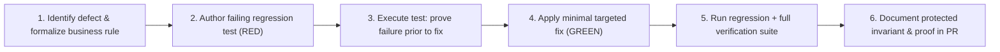

# 🛡️ Business Logic Regression Protection & Regression Test First Protocol

This document defines the business-critical calculations, boundaries, invariants, the structure of the **Golden Test Dataset**, and the mandatory **Regression Test First** engineering workflow for the **ingatlan-kereso** application.

---

## 1. Principles & Business Value

The primary value proposition of the application is not merely ingesting real estate listings, but reliably identifying **relevant properties and genuine "bargain" opportunities relative to the true market median** without skew or bias:
- A broken regular expression, misparsed thousand-separator formatting, or unquarantined extreme outlier directly contaminates market medians, averages, and bargain indicators.
- A misclassified or dropped property attribute (such as losing the new-construction flag during cross-portal clustering) leads to invalid comparisons.
- Therefore, all business-critical domain logic and calculations must be protected by deterministic, reproducible automated tests completely free of live network or external LLM dependencies.

---

## 2. The 6-Step Regression Test First Workflow

Whenever modifying or fixing business logic, engineers and AI specialists **must** follow this strict development cycle:

1. **Defect reproduction & rule formalization:** Pinpoint the flawed behavior and explicitly state the expected business invariant.
2. **Author failing regression test (RED):** Write a focused test case that fails against the current codebase, providing unambiguous proof of the defect.
3. **Execute test prior to implementation:** Run the test to verify and record the failure (claims of fixing a regression cannot be made without prior proof).
4. **Minimal targeted implementation (GREEN):** Implement the smallest possible production code change necessary to resolve the defect.
5. **Run regression and full verification suite:** Verify that the failing test now passes and execute the complete verification pipeline (`checkstyle`, `test`, `jacocoTestCoverageVerification`).
6. **Document invariant and proof in Pull Request:** Document the protected business invariant and the verification commands/results in the PR traceability matrix and testing section.

---

## 3. Map of Business-Critical Calculations & Rules (6 Key Areas)

### 1. Property Identification & Deduplication (`DeduplicationEngine`, `ClusterConsolidationHelper`)
- **Phase 1: O(1) URL Deduplication:** Merges identical trimmed URLs while preserving original iteration order.
- **Phase 2: Cross-Portal Clustering:** Restricted to `LAKAS`, `HAZ`, and `TELEK` categories within the same normalized settlement (`CityUtils.normalizeCityKey`).
- **Living Area Tolerance:** $\lvert A - B \rvert / \max(A, B) \le 0.05$ ($\pm 5.0\%$).
- **Price Band:** $\le 20.0\%$ when area is known; $\le 1.0\%$ when area is missing, requiring corroborating evidence (matching image URL/hash or strong title overlap).
- **Room Count Tolerance:** $\le 0.5$ rooms difference (for large properties $\ge 120\text{ m}^2$ or houses, adaptive differences of $2.5\text{--}3.0$ rooms are allowed when area difference $\le 3.5\%$).
- **Conflict Gates:** Budapest district mismatch (I–XXIII), neighborhood/street conflicts, construction type mismatch (brick vs. panel), floor level conflicts (ground floor vs. penthouse/attic), condition conflicts (new construction vs. renovation/demolition), $> 25\%$ plot size divergence.
- **Consolidation:** The listing with the lowest active price becomes the primary display item; missing area, rooms, thumbnail, and the `newConstruction` flag are inherited across cluster members.

### 2. Price & Price-Per-Square-Meter Calculations (`PropertyParser`, `ListingNormalizer`)
- **Price Parsing:** Million HUF notations (`45.5 M Ft`, `45,5 M Ft`) and full integer Forint notations (spaced, non-breaking space `\u00A0`, or dotted thousand groups: `45.000.000 Ft`).
- **Price per Square Meter ($\text{Ft/m}^2$):** $\text{round}(\text{priceHuf} / \text{areaM2})$, strictly enforced only when $\text{priceHuf} > 0$ and $\text{areaM2} > 0$; zero, negative, or missing prices evaluate to `null` or `0`.
- **Numeric Boundaries:** Floating-point comparison tolerance of $\pm 0.001$ on min/max price and area filtering boundaries.

### 3. Market Statistics & Segment Comparison (`MarketAnalyticsEngine`, `MarketStatisticsCalculator`)
- **Sample Size Threshold:** $N \ge 5$ (`MIN_SAMPLE_SIZE = 5`). If a segment has $N < 5$, `insufficientData = true` and `medianPricePerM2 = null`.
- **Strict Category Segregation:** Residential (`LAKAS`, `HAZ`) and plot (`TELEK`) $\text{Ft/m}^2$ calculations are never blended into a single metric.
- **Even-Sized Medians:** Arithmetic mean of the two middle elements rounded to nearest integer (`Math.round((mid1 + mid2) / 2.0)`).
- **Outlier Quarantine:** Only items meeting the data quality threshold (`qualityScore >= 70`, `isEligibleForMedian`) participate in median, average price (`averagePriceMillion`), average sqm price (`averagePricePerM2`), and min/max aggregations.

### 4. Bargain / Deal Detection (`MarketAnalyticsEngine`)
- **Discount Formula:**
  $$\text{pctBelow} = \frac{\text{refMedian} - \text{itemPriceM2}}{\text{refMedian}} \times 100.0$$
- **Threshold:** $\text{pctBelow} \ge 20.0\%$ $\rightarrow$ `isBargain = true`. A discount of $19.99\%$ is not a bargain.
- **Preconditions:** The relevant market segment must have $N \ge 5$, a valid reference median $> 0$, and the listing itself must satisfy $\text{qualityScore} \ge 70$. If any condition fails, `isBargain = false`.
- **Invariant:** $\sum \text{segment.bargainCount} == \text{stats.bargainCount}$.

### 5. Data Quality & Listing Lifecycle (`DataQualityEngine`, `PriceHistoryTracker`)
- **Quality Scoring (0–100):** Valid price $[1\text{M}, 5\text{B}]$ HUF, residential area $[10, 2000]\text{ m}^2$, plot area $[50, 500\,000]\text{ m}^2$, valid settlement, realistic unit price $[100\text{k}, 4\text{M}]\text{ HUF/m}^2$, room density $[12, 150]\text{ m}^2/\text{room}$, and presence of image/title. Listings with score $< 70$ are quarantined.
- **Price Change Tracking:** $\Delta = \text{new} - \text{prev}$, $\Delta\% = \text{round}((\Delta / \text{prev}) \times 100, 2)$. Classified into `PRICE_DROP`, `PRICE_INCREASE`, or unchanged.
- **Observation Lifecycle Events:** `NEW`, `PRICE_CHANGED`, `UNCHANGED`, and `RELISTED`.

### 6. Scraper Ingestion & Malformed Data Handling (`ListingValidator`, `ListingNormalizer`)
- **ListingValidator:** Rejects null/empty URLs, foreign absolute URLs, invalid area ($< 5\text{ m}^2$ or $> 50\,000\text{ m}^2$), and invalid prices ($\le 0$ or $> 50\text{ Billion HUF}$).
- **ListingNormalizer:** Canonical `PropertyType` resolution via prioritized extraction, and deterministic ID generation when native ID is unavailable.

---

## 4. Golden Test Dataset & Three-Tier Regression Testing

Regression protection is anchored to the versioned static dataset `src/test/resources/fixtures/golden/business-regression-dataset.json` across three testing tiers:

| Tier | Focus & Scope | Implementation |
| :--- | :--- | :--- |
| **1. Unit Regression** | Isolated calculation rules, parsing, medians, and discount boundaries | `BusinessLogicGoldenDatasetRegressionTest` |
| **2. Fixture Pipeline** | End-to-end data pipeline processing across the 7 Golden Dataset scenarios | `BusinessLogicGoldenDatasetRegressionTest` |
| **3. Persistence Integration** | Idempotence of repeated scraper saves, attribute preservation, and change tracking | `ListingObservationPersistenceTest` |

All regression tests execute deterministically offline without network access or LLM token overhead.

Related Documentation:
- System Architecture: [docs/architecture.md](architecture.md)
- PR Compliance & Governance: [docs/pr-compliance.md](pr-compliance.md)
