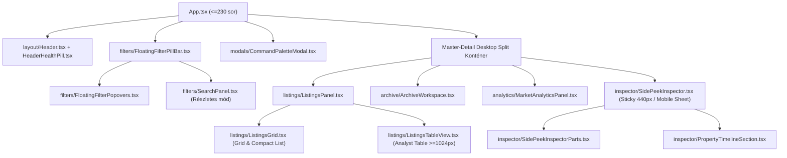
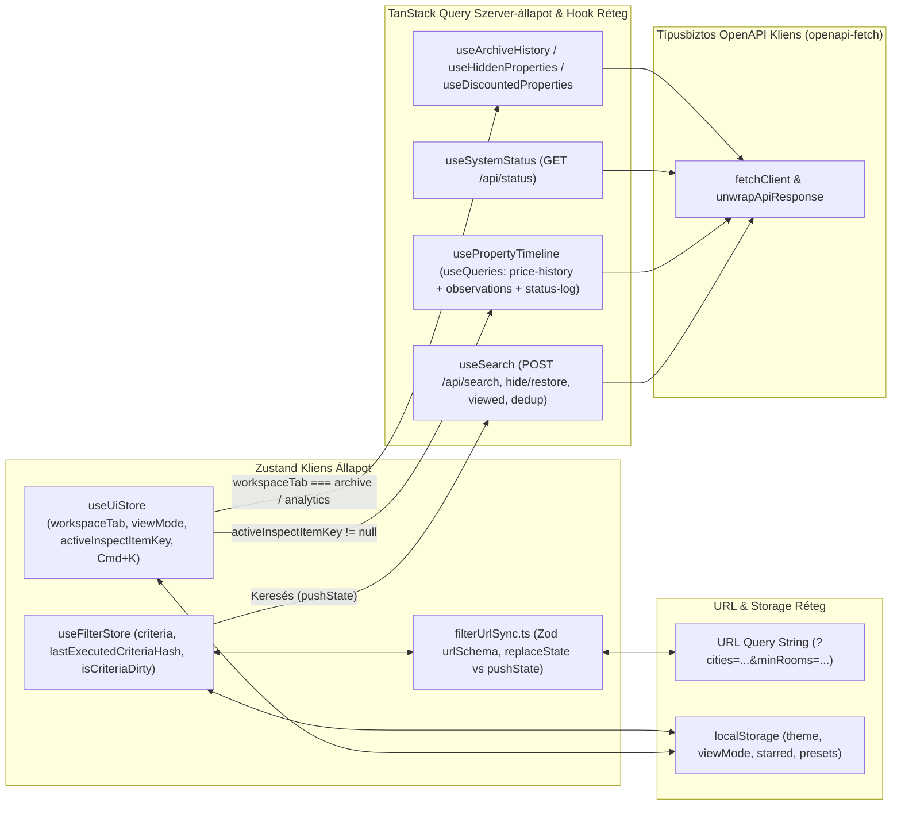

# Ingatlan Kereső — Round 1 UI/UX Újratervezési és Dizájn Terv (v1)

**Dokumentum státusz:** Round 1 Tervezeti Dokumentum (kódmódosítás nélkül)  
**Célkörnyezet:** `ingatlan-kereso` React 19 + TypeScript 5.9 + Tailwind CSS v4 SPA (`frontend/`) & meglévő Spring Boot 4.1.2 REST API (`openapi/api-spec.yaml`)  
**Alapelv:** 100%-os funkcióparitás (0 elveszett funkció), desktop-első nagy sűrűségű átláthatóság, „lebegő” térbeli rétegezés, zéró backend- és API-módosítás.

---

## TL;DR (Összefoglaló)

A jelenlegi `ingatlan-kereso` frontend funkcionálisan erős (többvárosos kereső, mentett sablonok, többforrásos deduplikáció, kliensoldali piaci analitika, WAF diagnosztika + HTML import), ugyanakkor asztali nézetben **~870 px magas függőleges vezérlőtorlaszt** halmoz az első ingatlankártya fölé, nehézkes „doboz a dobozban” keretekkel dolgozik, több komponensben **Light-mód kontraszthibákat** tartalmaz, és rejtve hagy kulcsfontosságú backend-adatokat (ártörténet, észlelési idősor, `QualityScoreShield`, városi×típus szegmens mátrix).

Az új dizájnkoncepció célja egy **„lebegő, letisztult asztali ingatlan-kokpit”** kialakítása a top 10 webes referencia (Airbnb, Zillow, Redfin, Idealista, Hemnet, Booking.com, Linear, Stripe Dashboard, Vercel Dashboard, Notion) bevált mintáira építve:
- **~870 px → ~136 px elsődleges fejléc + szűrősáv (~180–216 px teljes felső vezérlőzóna a találati eszköztárral és kompakt KPI-csíkkal):** Összevont lebegő fejléc (`~56 px`) + munkaterület-tabok (`Találatok | Kedvencek | Archívum | Piaci Elemzés`), kompakt lebegő szűrő-pill sáv (`~64–80 px`) felugró popoverekkel, másodlagos találati eszköztár (`~44 px`) és opcionálisan összecsukható 1-soros piaci KPI-csík (`~36 px`), így `1440×900` képernyőn azonnal az első hajtás fölött láthatóvá válik a teljes első találati sor.
- **Master-Detail + Side-Peek Inspector (`420–460 px`):** A rácsot eltakaró modál és a virtualizált listát széttörő inline harmonika helyett jobboldali ragadós/lebegő Side-Peek fiók mutatja a többforrásos ár-összehasonlítást, minőségi levonásokat, ártörténeti görbét és `FORCE_SPLIT` műveleteket a lista görgetési pozíciójának elvesztése nélkül.
- **Három nézetsűrűség (`Rács` / `Kompakt Lista` / `Elemző Táblázat`) + `tabular-nums`:** Asztali elemző táblázat oszloprendezéssel, kártyákon szigorú 3 soros hierarchia (max. 2–3 jelvény), látható kijelölési jelölőnégyzetek, és teljes értékű sötét/világos szemantikus tokenrendszer.
- **9 látványos új funkció backend-módosítás nélkül:** A már létező OpenAPI végpontokból és DTO-mezőkből nyert keresztportálos árrés-összevető, ártörténeti idővonal, univerzális piaci árpozíció-sáv, kártyára visszaemelt `QualityScoreShield`, szerver-hitelesített Szegmens Mátrix és Archívum/Kuka/Kedvezmény Radar.

---

## 1. Jelenlegi állapot felmérése és UX/UI gyengeségek auditja

A `frontend/src/` teljes forráskódjának tételes átvizsgálása alapján az alábbi strukturális, vizuális és ergonómiai gyengeségek azonosíthatók.

### 1.1 Extrém függőleges „chrome” torlasz a találatok fölött (~870 px)
Az `App.tsx:218-328` egyetlen `max-w-7xl` oszlopban, egymás alá halmozva jeleníti meg az összes vezérlősávot:
1. Ragadós `Header.tsx` (~65 px)
2. Teljes szélességű `SearchPanel.tsx` (~380 px alapértelmezetten nyitott állapotban: `useUiStore.ts:141`)
3. Feltételes figyelmeztető bannerek (`StatusBanners.tsx`, ~55 px)
4. 4 kártyás `MarketStatsBar.tsx` (~85 px)
5. Elsődleges fülváltó (`Találatok` / `Piaci Elemzés` az `App.tsx:248-286`-ban, ~50 px)
6. Másodlagos `ListingsSubViewNav` (`Hirdetések` / `Kedvencek` a `ListingsPanel.tsx:80-125`-ben, ~54 px)
7. `MultiSourceNotice` (`ListingsPanel.tsx:45-70`, ~36 px)
8. 3 soros `BulkActionBar.tsx` + `QuickFilterChipsRow` + `PortalFilterChipsRow` (~145 px)

Ez összesen **~870 px** függőleges vezérlőfelület. Egy átlagos laptop képernyőn (`1440×900` vagy `1366×768`) a felhasználónak az első képernyőt szinte teljes egészében szűrők és sávok töltik ki, mielőtt a tényleges ingatlantalálatokat láthatná. Ráadásul a teljes szélességű `SearchPanel` akkor is elfoglalja a felső sávot, amikor a felhasználó `Piaci Elemzés` vagy `Kedvencek` nézetben dolgozik.

### 1.2 „Doboz a dobozban” lapos esztétika és rétegzési hiány
Az `index.css:4-15` sötét vásznán (`#0b0f19`) minden blokk (`SearchPanel`, `MarketStatsBar`, `ListingsSubViewNav`, `BulkActionBar`, `PropertyCard`) egységes `1px` `#263352` tömör keretet kap `#131b2e` kártyaháttérrel, amelyen belül `#1a2238` keretezett belső chipek ülnek. A `PropertyCard.tsx:33-55` ehhez még `shadow-md`-t és erős színes külső gyűrűket (`ring-yellow-400/40`, `border-amber-500/50`) ad. A felület emiatt optikailag nehézkes, bezárt hatású, és hiányzik belőle a modern szoftverekre jellemző finom tónuslépcső (tonal surface ladder) és lebegő rétegzés.

### 1.3 Súlyos Light-mód (Világos téma) kontraszthibák
Számos komponens hardcoded sötét-módhoz hangolt Tailwind-osztályokat használ a szemantikus CSS-változók helyett, ami világos módban (`html:not(.dark)` — `#f8fafc` háttér, `#ffffff` kártya) alacsony kontrasztot vagy idegen sötét szigeteket eredményez:
- `BargainBadge.tsx:77` és `QualityScoreShield.tsx:92`: `bg-slate-900/95 text-slate-200` (fix sötét popover világos oldalon).
- `StatusBanners.tsx:14, 20, 60`: `text-red-200`, `text-red-200/80`, `text-amber-200`, `text-sky-200`, `text-emerald-200` világos `#f8fafc` alapon szinte olvashatatlan.
- `MarketAnalyticsPanel.tsx:75, 79, 82`: `text-amber-300`, `text-amber-200`, `text-amber-300/80` az `insufficient-data-banner`-en.
- `FloatingSelectionBar.tsx:28, 53`: `text-blue-200`, `text-blue-300` világos `--bg-card/95` sávon.
- `PropertyCard.tsx:88`: `text-emerald-300` fehér kártyán az új, még nem látott hirdetések címén.
- `PropertyDetailsDrawerParts.tsx:198, 253, 264, 299, 329`: `text-rose-200`, `text-indigo-300`, `text-indigo-100`, `text-indigo-200`.
- `DiagnosticsModal.tsx:140, 146`: `text-rose-300`, `text-amber-300`.

### 1.4 Kártyaszintű jelvény-túltengés, levágódás és animáció-zaj
A `PropertyCard.tsx` és `PropertyCardParts.tsx` egyszerre akár 7–9 vizuális jelzést zsúfol egy kártyára: sárga multi-source gyűrű + `property-portal-badge` (a képen) + `new-construction-badge` (a képen) + pulzáló `ÚJ` jelvény (`animate-pulse`, `PropertyCardParts.tsx:261`) + `-X%` áresés jelvény + `BargainBadge` + pulzáló cím (`pulse-title`, `PropertyCard.tsx:88`) + `N forrás` gomb + csillag + kuka.  
Két kritikus hiba következik ebből:
1. A `PropertyCardParts.tsx:259` `flex-nowrap overflow-hidden` osztályt használ a bal oldali jelvénycsoporton, így keskenyebb kártyán az `Alkalmi vétel -X%` jelvény csendben levágódhat.
2. A már elkészült `QualityScoreShield.tsx` nincs bekötve a `PropertyCard`-ra, így a `< 70` pontos, mediánszámításból kizárt gyanús hirdetések csak a Részletek megnyitása után azonosíthatók.

### 1.5 Szélesvásznú asztali tér pazarlása és Modal vs. Drawer aszimmetria
- **Egyoszlopos folyamban rekedt desktop (`App.tsx:223`):** `1440 px` – `1920 px` monitorokon a kétoldali margó kihasználatlan, miközben nincs sem többoszlopos Master-Detail nézet, sem `Analyst Table` (táblázatos összehasonlító) mód.
- **Modal vs. Virtualizált Drawer ellentmondás (`PropertyCard.tsx:327-332`):** Rács módban a `PropertyDetailsModal` teljes képernyős sötétítő fedőréteggel eltakarja a többi találatot (megakadályozva a gyors egymás melletti összevetést). Lista módban a `PropertyDetailsDrawer` a kártyán belül nyílik le, ami felborítja a `ListingsGrid` `@tanstack/react-virtual` (`useWindowVirtualizer`) előre becsült sor-magasságát és görgetési ugrást okozhat.
- **Redundáns navigációs sorok:** A `Találatok | Piaci Elemzés` sáv (`App.tsx:248-286`) és közvetlenül alatta a `Hirdetések | Kedvencek` sáv (`ListingsPanel.tsx:80-125`) két teljes sort foglal el, holott egyetlen egyesített munkaterület-tab sávként tisztábban működne.

### 1.6 Mobil és reszponzív hibák
1. **`QuickFilterChipsRow` tördelési hiba (`BulkFilterChips.tsx:161`):** A konténerben hiányzik a `flex-wrap` (`className="flex flex-1 items-center gap-2 min-w-0"`). Ha a felhasználó 3-nál több (akár mind a 8) gyorsszűrőt kitűzi, keskeny kijelzőn a chipek egy sorba szorulnak és olvashatatlan csonkokká zsugorodnak.
2. **Alsó lebegő elemek ütközése:** A `FloatingSelectionBar.tsx:26` (`fixed bottom-6 left-1/2 -translate-x-1/2 z-40`) és a globális toast (`App.tsx:336`: `fixed bottom-6 right-6 z-50`) ugyanabban a `bottom-6` sávban helyezkedik el, így mobilon/tableten fizikailag egymásra csúsznak.
3. **Alapértelmezetten nyitott `SearchPanel` mobilon:** A `useUiStore.ts:141` (`isFiltersCollapsed: false`) miatt kis képernyőn a teljes keresőűrlap kitölti az első képernyőt.
4. **Hover-függő vezérlők érintőképernyőn és billentyűzeten:** A sablonszerkesztő/törlő ikonok (`SearchPresetsBarParts.tsx:156`) `opacity-0 group-hover:opacity-100` stílusúak `group-focus-within` nélkül; a `SourceThumbnailPreview` (`PropertyDetailsDrawerParts.tsx:76-83`) és a `BargainBadge` popover (`BargainBadge.tsx:166`) mobilon csak korlátozottan fedezhető fel.
5. **Diagnosztika fejléc túlcsordulása (`DiagnosticsModal.tsx:99`):** A portál státusz sor nem használ `flex-wrap`-et.

### 1.7 Ergonómiai súrlódási pontok és kihasználatlan képességek
- **Láthatatlan többkártyás kijelölés (`Ctrl/Cmd+Click`):** A `PropertyCard.tsx:203-205` nem mutat semmilyen kijelölő checkboxot vagy vizuális útmutatót, így a kézi klaszter-összevonás (`POST /api/dedup/merge`) lényegében láthatatlan az átlagos felhasználó számára.
- **Böngésző-előzmény szennyezés & hiányzó „piszkos szűrő” állapot:** A `useFilterStore.ts:169, 361` minden egyes `+`/`-` ár- vagy terület-léptetésnél azonnal `window.history.pushState`-et hív, így 10 finomhangoló kattintás 10 lépéssel eldugítja a böngésző Vissza gombját. Emellett nincs jelzés arról, ha a szűrők megváltoztak az utolsó keresés óta.
- **Félkész diagram kereszt-szűrés (`MarketAnalyticsPanel.tsx:39-50`):** A `PriceDistributionChart.tsx:75` kattintható oszlopszűrést ígér, de alapértelmezett `sqmPrice` módban a kattintás hatástalan (`if (type === 'price')`), `price` módban és `CityComparisonChart`-nál pedig csak a store-t frissíti új keresés vagy nézetváltás nélkül.
- **Megerősítés nélküli sablon-törlés (`SearchPresetsBar.tsx`):** A kuka ikon azonnal törli a mentett keresési sablont az adatbázisból (`DELETE /api/presets/{id}`).
- **Elrejtett/bekötetlen kész funkciók és API-végpontok:**
  - `archive` alnézet támogatott (`useUiStore.ts`, `useSearch.ts`, `App.tsx`, `ListingsGrid.tsx`), de gombja hiányzik a `ListingsSubViewNav`-ból.
  - `onOpenAll` és `onMarkAllViewed` propok átadódnak a `BulkActionBar`-ig (`BulkActionBar.tsx:52-53`), de nincs hozzájuk renderelt gomb.
  - **30 OpenAPI műveletből 10** egyáltalán nincs bekötve a UI-ba (9 végpont hiányzik a `frontend/src/api/*` kliensekből — pl. `/api/status`, `/api/properties/{id}/price-history`, `/status-log`, `/observations`, `/api/properties/discounted` —, 1 pedig, a `GET /api/properties/hidden`, exportált a `propertyApi.ts:79`-ben, de nincs UI hívója), és a `DashboardResponseDto.marketStats.segments` szegmensstatisztikák is parlagon hevernek.

---

## 2. Teljes körű funkcióleltár (Current Feature Inventory)

Az alábbi leltár a `frontend/src/` összes produkciós komponensét, nézetét, szűrőjét, műveletét és modálját tételesen rögzíti (55 azonosított tétel, 8 logikai csoportban: `9 NAV + 13 FLT + 4 PRESET + 9 LST + 4 DEDUP + 8 ANL + 2 MOD + 6 SYS = 55`).

### 2.1 Navigáció, Elrendezés és Globális Vezérlők (`F-NAV-*`)

| ID | Funkció neve | Forrásfájl & Komponens | Jelenlegi viselkedés |
| :--- | :--- | :--- | :--- |
| `F-NAV-01` | Alap HTML, Tipográfia és Témaváltozók | `frontend/index.html`, `tailwind.config.js`, `src/index.css`, `src/main.tsx` | `<html lang="hu" class="dark">`, Plus Jakarta Sans CDN betűtípus, CSS custom properties (`--bg-body`, `--bg-card`, `--border-color`, `--text-primary`, `--accent` stb.), `.animate-shimmer`, `.pulse-title`. `main.tsx`: `StrictMode` → `ErrorBoundary` → `QueryClientProvider` (`refetchOnWindowFocus: false, retry: 1`). |
| `F-NAV-02` | Fő Konténer és Elrendezési Keret | `frontend/src/App.tsx` (`App`, 218–328) | Teljes szélességű `min-h-screen` oldal, középre igazított `max-w-7xl` egyoszlopos vertikális folyamban. |
| `F-NAV-03` | Ragadós Felső Fejléc & Márkajelzés | `frontend/src/components/layout/Header.tsx` (`Header`, 5–68) | `sticky top-0 z-40` áttetsző sáv `Home` ikonnal, `"Ingatlan Kereső"` címmel, `"SPA"` badge-dzsel és `"Valós idejű többportos aggregátor & piaci elemző"` alcímmel. |
| `F-NAV-04` | Globális Szűrő-alaphelyzet Gomb | `Header.tsx` (35–42) → `useFilterStore.resetToDefaults` | `RotateCcw` ikongomb a fejlécben; visszaállítja a `DEFAULT_CRITERIA`-t, az alap rendezést (`price_asc`), törli a kliens szűrőket, `localStorage` preferenciákat és az URL query stringet. |
| `F-NAV-05` | Diagnosztika Modál Nyitógomb | `Header.tsx` (45–53) → `useUiStore.setDiagnosticsModalOpen(true)` | `Activity` ikon + `"Diagnosztika"` felirat (`hidden sm:inline`), megnyitja a `DiagnosticsModal`-t. |
| `F-NAV-06` | Sötét / Világos Témaváltó | `Header.tsx` (56–63) → `useUiStore.toggleTheme` | `Sun`/`Moon` gomb; kapcsolja a `.dark` osztályt a `document.documentElement`-en és menti a `localStorage('theme')` kulcsba (`prefers-color-scheme: light` támogatással). |
| `F-NAV-07` | Elsődleges Fő Nézet Váltófülek | `App.tsx` (248–286, `tab-listings`, `tab-analytics`) | Két fő fül (`Találatok`, `Piaci Elemzés`). A `MarketAnalyticsPanel` `React.lazy` + `Suspense` csomagban töltődik be. |
| `F-NAV-08` | Találati Alnézet Váltó | `ListingsPanel.tsx` (`ListingsSubViewNav`, 80–125) | `Hirdetések (N)` (`subview-listings`) és `⭐ Kedvencek (N)` (`subview-favorites`) gombok. *(Az `archive` alnézet kódja létezik a `useUiStore` / `useSearch` / `ListingsGrid` rétegekben, de gombja hiányzik a sávból.)* |
| `F-NAV-09` | Felső Piaci Gyorsösszegző KPI Sáv | `MarketStatsBar.tsx` (23–85) | Keresés után 4 kártya (`grid-cols-2 lg:grid-cols-4`): `Összes Találat` (`totalFound`), `Új Felfedezés` (`newCount`, pulzáló ikon), `Alkalmi Vételek` (`marketStats.bargainCount` vagy `isItemBargain`), `Medián m² ár` (`medianPricePerM2 ?? residentialMedianPricePerM2 ?? plotMedianPricePerM2`). |

### 2.2 Keresés és Szűrővezérlők (`F-FLT-*`)

| ID | Funkció neve | Forrásfájl & Komponens | Jelenlegi viselkedés |
| :--- | :--- | :--- | :--- |
| `F-FLT-01` | Összecsukható Keresőpanel & Összegző Sáv | `SearchPanel.tsx` (`SearchPanel`, `CollapsedFilterSummary`, 75–286) | Összecsukható fejléc (`useUiStore.isFiltersCollapsed`). Összecsukva `CollapsedFilterSummary` emoji-chipeket mutat (📍 települések, 🏠 típus, 💰 ársáv M Ft, 📐 terület m², 🌐 aktív/összes portál). |
| `F-FLT-02` | Többvárosos Autocomplete & Chip Választó | `CitySelector.tsx` (20–170) | Chip-alapú többvárosos választó eltávolító (`X`) gombbal; `GET /api/cities` + `DEFAULT_CITIES` (24 város) fallback; legördülő listában `trackedCities` találatszámok; `Enter` hozzáadás; `useOutsideDismiss` bezárás. |
| `F-FLT-03` | Településcsoport Gyorssablonok | `PresetButtons.tsx` (9–35) | `"Gyorssablonok:"` gombok (`citiesData.presets` vagy beépített fallback: Debrecen, Budapest, Egyetemvárosok), egy kattintással lecserélik a városlistát. |
| `F-FLT-04` | Ingatlan Típusa Választógombok | `PropertyTypeTabs.tsx` (18–46) | 3 választógomb: `Lakás` (`LAKAS`), `Ház` (`HAZ`), `Telek` (`TELEK`). *(A `GARAZS`, `IPARI_KERESKEDELMI`, `EGYEB_ISMERETLEN` értékek jelenleg nem választhatók itt.)* |
| `F-FLT-05` | Ár- és Alapterület Stepper Mezők | `NumericStepper.tsx`, `PriceStepper.tsx`, `AreaStepper.tsx` | 4 léptetőmező (`minPriceMillion`, `maxPriceMillion` M Ft; `minArea`, `maxArea` m²). `-`/`+` gombok, közvetlen számbevitel `draftValue` pufferrel és `onBlur` véglegesítéssel. |
| `F-FLT-06` | Portálválasztó Kapcsolók & Mind/Törlés | `PortalToggleGroup.tsx` (13–92) | `GET /api/portals` betöltés skeleton fallbackkel (`DEFAULT_PORTALS`); egyedi portál toggle chipek kijelölési számlálóval (`selected/all`) + `"Mind kijelöl"` / `"Összes törlése"`. |
| `F-FLT-07` | Kliensoldali Validáció & Keresés Indítása | `SearchPanel.tsx`, `src/utils/validation.ts` | Ellenőrzi: ár >= 0, `minPrice <= maxPrice`, `minArea >= 1`, `minArea <= maxArea`. Hiba esetén `search-validation-warning` alert és letiltott gomb. Küldéskor `listings/listings` nézetre vált és `POST /api/search`-öt indít. |
| `F-FLT-08` | Gyorskeresés a Találatok Között | `BulkActionBar.tsx` (176–196), `listingFilters.ts` | Élő, ékezet-érzéketlen több-tokenes szövegszűrő (cím, város, lokáció, portál, ár, M Ft, részletek, m², szobaszám, `"uj epitesu"`), törlő (`X`) gombbal. |
| `F-FLT-09` | Találati Rendezés Választó | `BulkActionBar.tsx` (199–222), `useFilterStore.ts`, `listingFilters.ts` | 5 rendezési mód (`SORT_OPTIONS`): `price_asc`, `price_desc`, `area_desc`, `date_desc`, `bargain_desc`. `getEffectivePrice`-t használ; `localStorage('preferred_sort_option')` + `?sort=` URL szinkron. |
| `F-FLT-10` | Testreszabható Kitűzött Gyorsszűrő Chipek | `BulkFilterChips.tsx`, `QuickFilterPopover.tsx`, `quickFilterConstants.ts` | 8 gyorsszűrő élő találatszámmal (`computeQuickFilterCounts`), `"Szűrők (N/8)"` testreszabó popoverrel (`pinned_quick_filters` `localStorage`): `bargain`, `onlyNew` (munkamenetben megnyitottak átmeneti megtartásával), `hidden`, `excludeViewed`, `onlyNewConstruction`, `excludeMultiSource` ↔ `onlyMultiSource` (kizárólagosak), `excludeNoImage`. |
| `F-FLT-11` | Portál Gyorsszűrő Chipek | `BulkFilterChips.tsx` (`PortalFilterChipsRow`, 300–358) | Elsődleges portál (`getPrimaryPortalKey`) szerinti kliensoldali szűrés (`Összes` + 6 portál) találatszámokkal; 1 kijelölt portálnál elrejti az `Összes` chipet. |
| `F-FLT-12` | URL Query Szinkron, `popstate` és Konfig Betöltés | `filterUrlSync.ts`, `useFilterStore.ts`, `App.tsx` (165–181) | Zod (`urlSchema`) query parsing/serializálás. Minden módosítás `history.pushState`-et hív; `popstate` visszatölti. Üres URL esetén induláskor `GET /api/config`. |
| `F-FLT-13` | Háttérben Meglévő, UI Vezérlő Nélküli Szűrők | `useFilterStore.ts`, `filterUrlSync.ts`, `listingFilters.ts`, `useSearch.ts` | `minQualityScore` (`?minQuality=`), `criteria.minRooms`, `criteria.autoOpenBrowser` (max. 10 új fül megnyitása sikeres kereséskor a `useSearch.ts:104-113`-ban), és `criteria.onlyDiscounted` létezik UI vezérlő nélkül. |

### 2.3 Mentett Keresési Sablonok (`F-PRESET-*`)

| ID | Funkció neve | Forrásfájl & Komponens | Jelenlegi viselkedés |
| :--- | :--- | :--- | :--- |
| `F-PRESET-01` | Mentett Keresési Sablonok Sáv | `SearchPresetsBar.tsx`, `usePresets.ts`, `presetApi.ts` | A `SearchPanel`-ben megjelenő sáv; `GET /api/presets` betöltés töltésjelzővel, hibaüzenettel és üres állapottal. |
| `F-PRESET-02` | Sablon Alkalmazása és Használat Naplózása | `SearchPresetsBar.tsx` (114–120), `SearchPresetsBarParts.tsx` | Sablon chipre kattintva beállítja az `activePresetId`-t, betölti a `preset.criteria`-t, hívja a `POST /api/presets/{id}/use`-t és azonnal keres (`onSearch()`). |
| `F-PRESET-03` | Új Sablon Mentése | `SearchPresetsBar.tsx`, `PresetCreateForm` | `"Mentés sablonként"` gomb inline űrlapot nyit automatikus névjavaslattal, Zod validációval (1–100 kar.), `POST /api/presets` mentéssel, siker/hiba bannerrel. |
| `F-PRESET-04` | Sablon Átnevezése és Törlése | `SearchPresetsBar.tsx`, `PresetEditForm`, `PresetChip` | A chipen hoverre megjelenő `Pencil` (inline átnevezés, `PUT /api/presets/{id}`) és `Trash2` (azonnali `DELETE /api/presets/{id}` megerősítés nélkül) gombok. |

### 2.4 Találati Lista, Kártyák, Részletek és Műveletek (`F-LST-*`)

| ID | Funkció neve | Forrásfájl & Komponens | Jelenlegi viselkedés |
| :--- | :--- | :--- | :--- |
| `F-LST-01` | Többforrásos Klaszter Összegző Értesítés | `ListingsPanel.tsx` (`MultiSourceNotice`, 45–70) | Indigó sáv `listings` nézetben összevont duplikátumok vagy `serverFilteredCount > 0` esetén: `"{N} egyedi ingatlan ({M} hirdetésből · {K} összevonva) · {F} szűrt"`. |
| `F-LST-02` | Eredményszámláló és Rács / Lista Nézetváltó | `BulkActionBar.tsx` (62–75, 258–285) | Kiírja a szűrt/nyers darabszámot és forrásszámot; `LayoutGrid` (`grid`) és `List` (`list`) kapcsoló (`useUiStore.viewMode`). |
| `F-LST-03` | Virtualizált Rács/Lista és Progresszív Betöltés | `ListingsGrid.tsx` (151–376) | `@tanstack/react-virtual` `useWindowVirtualizer` + 18-asával növekvő batch-elés (`IntersectionObserver` + kattintható `infinite-scroll-sentinel`). Lapozás-megőrzés `>= 50%` URL-átfedésnél. |
| `F-LST-04` | Ingatlan Kártya Felépítése és Vizuális Állapotai | `PropertyCard.tsx`, `PropertyCardParts.tsx` | Thumbnail + típus-ikon fallback, portál & új építésű badge, felső badge-ek (`ÚJ`, `-X%`, `BargainBadge`), akció gombok (`Részletek`/`N forrás`, `Star`, `Hide`/`Restore`), cím & város/lokáció, paraméter chipek (`m²`, `szoba`, `Ft/m²`), ár szekció (`getEffectivePrice`). Állapotkeretek: kijelölt, kedvenc, látott, többforrásos. |
| `F-LST-05` | Alkalmi Vétel Badge és Piaci Összehasonlító Popover | `BargainBadge.tsx` (1–195) | Megjelenik ha `isBargain && referenceSampleSize >= 5 && percentageBelowMedian > 0`. Popoverben: kínálati m² ár, városi medián m² ár, `-X%`, minta elemszáma. |
| `F-LST-06` | Kedvencek (Csillagozott) Kezelése & Árva Fallback | `useUiStore.ts` (`toggleStarred`), `favoriteItemsHelper.ts` | `localStorage` (`starred_urls`, `starred_items_cache`, kvótatúllépésnél utolsó 30 elem). Összefésüli a keresést, `/api/history`-t és cache-t; hiányzó elemre `buildOrphanItem`. |
| `F-LST-07` | Hirdetés Elrejtése / Visszaállítása & Undo Toast | `PropertyCard.tsx`, `useSearch.ts`, `App.tsx` (331–360) | 150 ms animáció után `POST /api/properties/{id}/hide` (klaszter összes URL-jével), jobb alsó `undo-hide-toast` (`"Visszavonás"` → `POST /api/properties/{id}/restore`). |
| `F-LST-08` | Részletek & Többforrásos Fiók / Modál | `PropertyDetailsDrawer.tsx`, `PropertyDetailsDrawerParts.tsx`, `PropertyDetailsModal.tsx` | Lista módban inline `#drawer-{id}`, rács módban `PropertyDetailsModal`. Tartalma: Besorolás & Kategória, Adatminőségi Értékelés (0–100 + levonások), Elérhető források (`SourceItemRow` + `SourceThumbnailPreview` + Megnyitás + `"Nem ugyanaz"`), `ManualDedupStatusSection`. |
| `F-LST-09` | Különálló `QualityScoreShield` és Bekötetlen Elemkészlet | `QualityScoreShield.tsx`, `BulkActionBar.tsx`, `propertyApi.ts` | `QualityScoreShield` létezik és tesztelt, de nem renderelődik a kártyán; `onOpenAll` és `onMarkAllViewed` átadódik a `BulkActionBar`-ig gomb nélkül; `getHiddenProperties` exportált, de hívatlan. |

### 2.5 Kézi Deduplikációs Vezérlők (`F-DEDUP-*`)

| ID | Funkció neve | Forrásfájl & Komponens | Jelenlegi viselkedés |
| :--- | :--- | :--- | :--- |
| `F-DEDUP-01` | Több Kártya Kijelölése (`Ctrl`/`Cmd+Click`) | `PropertyCard.tsx` (203–218, 289), `BulkActionBar.tsx` (121–130) | `Ctrl+Click` / `Cmd+Click` kijelöli/törli a kártyát (`selectedCardUrls`, kék keret + `card-selected-badge` pipa). `Escape` törli a kijelölést. |
| `F-DEDUP-02` | Lebegő Kijelölési Műveletsor (Kézi Összevonás) | `FloatingSelectionBar.tsx` (12–60), `useDedupActions.ts` | `fixed bottom-6 left-1/2` sáv `selectedCount > 0` esetén: kijelöltek száma, `"Összevonás"` (`>= 2` kijelölésnél, `POST /api/dedup/merge`), `"Kijelölés törlése"`. |
| `F-DEDUP-03` | Forrás Leválasztása Kétlépéses Megerősítéssel | `PropertyDetailsDrawerParts.tsx` (`SplitSourceControl`, 182–226) | Többforrásos klaszterben minden soron `"Nem ugyanaz"` → `"Megerősítés"` / `"Mégse"` → `POST /api/dedup/split` (`FORCE_SPLIT`). |
| `F-DEDUP-04` | Aktív Kézi Override-ok Listázása és Visszavonása | `PropertyDetailsDrawer.tsx`, `ManualDedupStatusSection`, `OverrideRow` | Ha `manuallyMerged || manuallySplit`, lekéri a `GET /api/dedup/overrides?urls=...` listát. Mutatja az override párokat (3 felett lenyitóval) és soronkénti `"Visszavonás"` gombot (`DELETE /api/dedup/overrides/{id}`). |

### 2.6 Piaci Elemzés Panel (`F-ANL-*`)

| ID | Funkció neve | Forrásfájl & Komponens | Jelenlegi viselkedés |
| :--- | :--- | :--- | :--- |
| `F-ANL-01` | Kliensoldali Analitikai Számítómotor | `useMarketAnalytics.ts`, `marketAnalyticsMath.ts`, `marketAnalyticsAggregation.ts` | A jelenlegi `items`-ből számol kategória-mediánokat, átlag/min/max/szórás/percentilist (P25/P50/P75), hisztogramokat, városi statisztikákat, szórásdiagram szegmenseket, top 10 olcsó vételt és áreséseket. |
| `F-ANL-02` | Üres Állapot & Kevés Minta Figyelmeztetés | `MarketAnalyticsPanel.tsx` (54–87) | 0 elemnél `market-analytics-empty-state`; `< 5` találatnál `insufficient-data-banner`. |
| `F-ANL-03` | Analitikai KPI Rács | `MarketAnalyticsKpiSection.tsx` (`MarketKpiGrid`, 98–218) | Kategória-medián m² ár kártyák (`lakas`/`haz`/`telek`), `Átlagos Kínálati Ár`, `Minta Elemszám`, `Árcsökkenések Száma`. |
| `F-ANL-04` | Legnagyobb Árcsökkenések Kiemelt Szekció | `MarketAnalyticsKpiSection.tsx` (`TopPriceDropsSection`, 226–328) | Max. 6 kártya: portál, típus, %-os esés, cím, város, régi/új ár, `-Ft` delta, `Megnyitás` link. |
| `F-ANL-05` | Ár- és Fajlagos Ár Eloszlás Hisztogram | `PriceDistributionChart.tsx` (33–224) | Recharts `BarChart` (`Ft/m²` és `M Ft` váltóval), Átlag/Medián jelvényekkel. Oszlopkattintás `price` módban frissíti a `minPriceMillion`/`maxPriceMillion` értéket (`sqmPrice` módban inaktív). |
| `F-ANL-06` | Település-összehasonlító Oszlopdiagram | `CityComparisonChart.tsx` (27–219) | Recharts `BarChart` (`Ft/m²` vs `M Ft`, `Ár szerint` vs `Kínálat szerint`), tooltippel és városkattintással (`setCities([city])`). |
| `F-ANL-07` | Ár vs. Alapterület Korreláció (Szórásdiagram) | `PriceScatterCorrelationChart.tsx` (28–365) | Recharts `ScatterChart` szegmensszűrőkkel (`Összes`, `Alkalmi`, `Piaci átlag`, `Prémium`), `"Kategória súgó"` popoverrel, tooltippel és pont-kattintásos hirdetésnyitással. |
| `F-ANL-08` | Alkalmi Vétel és Árleszállítás Figyelő | `BargainHunterTable.tsx` (16–245) | 2 füles kártyarács: `Piaci átlag alatt (N)` (top 10 ajánlat) és `Leárazások (N)`, `Megtekintve` jelzéssel és `"Hirdetés megnyitása"` gombbal. |

### 2.7 Modálok (`F-MOD-*`) és Rendszerállapotok (`F-SYS-*`)

| ID | Funkció neve | Forrásfájl & Komponens | Jelenlegi viselkedés |
| :--- | :--- | :--- | :--- |
| `F-MOD-01` | Portál Diagnosztika & Állapotjelentés Modál | `DiagnosticsModal.tsx` (25–236) | Keresés után `portalStatuses` kártyák (`ms`, `foundCount`, státusz badge, `fallbackUrl`, `ingatlancom` import gyorsgomb); keresés előtt `GET /api/portals` DB-darabszámok; `"Export"` vágólapra másolás. |
| `F-MOD-02` | Ingatlan.com Böngészős HTML Import Modál | `IngatlanComImportModal.tsx` (33–305) | Következő 3 oldal (`startPage..startPage+2`) linkek, konzolparancs-másoló, több `.html/.htm` fájl vagy nyers HTML + URL feltöltés (`POST /api/portals/ingatlancom/import-html`), statisztika és automatikus keresésfrissítés. |
| `F-SYS-01` | Globális ErrorBoundary | `ErrorBoundary.tsx` (13–65) | Kezeletlen React hibák elkapása + `"Oldal újratöltése"` gomb. |
| `F-SYS-02` | Keresési API Hiba Banner | `StatusBanners.tsx` (`SearchErrorBanner`, 10–33) | Piros `role="alert"` banner `POST /api/search` hiba esetén, `"Újrapróbálás"` gombbal. |
| `F-SYS-03` | Részleges / Teljes Portálhiba és WAF Banner | `StatusBanners.tsx` (`PartialPortalWarningBanner`, 46–115), `App.tsx` | Borostyán `role="status"` banner `FAILED`/`BOT_PROTECTED` vagy részleges Ingatlan.com esetén: `"Ingatlan.com oldalak importálása"`, `"Összes portál bekapcsolása"`, `"Diagnosztika megtekintése"` gombokkal. |
| `F-SYS-04` | Betöltési Skeletonok és Üres Állapotok | `ListingSkeleton.tsx`, `ListingsGrid.tsx` (51–106, 266–316) | 6 shimmer `ListingSkeleton` kártya; 4 üres állapot: keresés előtti CTA, üres kedvencek, üres archívum, 0 találatos szűrőállapot. |
| `F-SYS-05` | Globális Feedback / Undo Toast | `App.tsx` (331–360) | Jobb alsó (`fixed bottom-6 right-6 z-50`) lebegő értesítés elrejtés-visszavonáshoz (`Visszavonás`) és manuális dedup üzenetekhez. |
| `F-SYS-06` | Archívum Történet Törlése (Kétlépéses) | `BulkActionBar.tsx` (224–256) | Inline `"Előzmények törlése"` → `"Törlés megerősítése"` / `"Mégse"` folyamat `archive` módban (`POST /api/history/clear`). |

---

## 3. Top 10 weboldalas benchmark kutatás és inspirációk

A dizájnkoncepcióhoz **10 egymást kiegészítő referenciát** választottunk (6 nemzetközi ingatlan-/összehasonlító piacteret és 4 nagy tisztaságú SaaS munkaterületet), amelyek közvetlenül lefedik az `ingatlan-kereso` specifikus igényeit (lebegő szűrőpillek, Ft/m² összehasonlítás, többforrásos deduplikáció, analitikai táblázat és kettős téma).

| # | Benchmark | Kategória | Miért releváns az `ingatlan-kereso`-höz? | Átemelt 2024–2026 UI/UX minta |
|---|---|---|---|---|
| **1** | **Airbnb** | Piactér / Térbeli felfedezés | A „lebegő, levegős” pill keresősáv és az egyetlen tartózkodó akcentusszín etalonja. | Ragadós, pill-alakú lebegő keresősáv, amely kattintásra bontódik ki; 4:3 lekerekített (`16px`) képek nehéz külső kártyakeret nélkül; fegyelmezett szürkeárnyalatos tipográfia egyetlen kiemelt akcentussal és izolált félkövér árral. |
| **2** | **Zillow** | Amerikai ingatlanportál | Asztali osztott elrendezés, árcsökkenés-jelölés és szűrő-visszacsatolás. | `>=1280px` Master-Detail nézet; azonnali dinamikus szűrő-visszacsatolás; kontrasztos kép-sarok jelvények (*„Árcsökkenés”*, *„Új”*) + szigorú 3 soros szöveghierarchia (Ár → `m² • szoba` → Lokáció) és jobb felső mentés csillag/szív. |
| **3** | **Redfin** | Analitikai ingatlanportál | A legközelebbi piaci megfelelő az alkalmi vételekhez, Ft/m²-hez és sűrű összehasonlításhoz. | Kettős **Elemző Táblázat (`Table View`)** vs. Vizuális Rács váltó; táblázatban kattintható fejléc-rendezés (*Ár, m², Ft/m², Szoba, Minőség, Források*); kompakt felső piaci pulzus KPI-sáv. |
| **4** | **Idealista** | Európai ingatlanportál | Európai m²-ár fókusz, gyors asztali vízszintes kártya és súrlódásmentes triage. | Asztali vízszintes kártyaosztás (`35%` fotó / `50%` adat / `15%` műveletsáv); a **Ft/m² mint közvetlenül az ár melletti halk pill**; gyors **Elrejtés (`✕`)** akció visszavonással; finom halványítás a már megtekintett hirdetéseknél. |
| **5** | **Hemnet** | Skandináv ingatlanportál | Skandináv szellősség és az egységköltségek (`kr/m²`) első osztályú megjelenítése. | A fajlagos négyzetméterárat elsődleges döntési horgonyként kezeli az alapterület mellett; progresszív felfedéssel a másodlagos szűrőket egy gomb mögé rejti, míg a város, típus, ár és m² egy kattintásra marad. |
| **6** | **Booking.com** | Többajánlatos aggregátor | Közvetlenül megoldja a többforrásos klaszterezés, 0–100 minőségpont és badge-túltengés problémáját. | **2025/2026-os letisztítási fordulat:** a „badge soup” kiváltása egységes **Minőségpontszám** pajzzsal (szám + egyetlen címke); dinamikus szűrő-chipek + mentett nézet pillek; *„Legjobb ár / Megtakarítás”* összevető jelölés több ajánlat között. |
| **7** | **Linear** | Nagy tisztaságú SaaS | Iparági etalon a sötét/világos tónuslépcsőkhöz, hajszálvékony elválasztókhoz és `List + Inspector`-hoz. | **Luminance Ladder** (Vászon → Felület → Lebegő réteg) nehéz árnyékok helyett; `1px` alacsony opacitású hajszálvonalak (`white/[0.07]`); `backdrop-blur(12px)` lebegő parancssáv; `Cmd+K` gyorsugró; jobbra dokkolt **Inspector**. |
| **8** | **Stripe Dashboard** | Pénzügyi & analitikai SaaS | `tabular-nums` fegyelem, 3-részes KPI kártyák és keret nélküli inline sparkline grafikonok. | Szigorú `font-variant-numeric: tabular-nums` minden HUF és Ft/m² értéken a vízszintes ugrálás ellen; 3-elemű KPI kártya (címke + nagy szám + delta mikropill); tiszta inline **sparkline** görbe az ártrendhez. |
| **9** | **Vercel Dashboard** | Fejlesztői SaaS / Telemetria | „Quiet Chrome”, lebegő almenük és nem tolakodó rendszer-egészség pillek. | Kalibrált sötét paletta és tiszta világos tónusok; áttetsző ragadós alnavigáció (`backdrop-blur-md`); `1px` finom elválasztók; kompakt fejléc-státusz pill (zöld/borostyán/piros pont), amely a portálhibákat kiabáló bannerek nélkül jelzi. |
| **10** | **Notion** | Moduláris munkaterület | Az asztali **Side Peek** részletező fiók és a zökkenőmentes nézetfülek mintája. | **Side Peek** jobboldali részletező panel (a bal oldali lista látható és görgethető marad, a fiók tetején `↑ / ↓` léptetőnyilakkal bezárás nélkül váltható az ingatlan); egységes **View Tabs**; tiszta szűrő-pill sáv. |

### 3.1 Adopt Blueprint (8 átvett alapelv)
1. **3-lépcsős tónuslépcső + hajszálvékony keretek** (Linear, Vercel, Airbnb) a nehéz `#263352` dobozok helyett.
2. **Összevont lebegő szűrő-pill sáv + `Cmd/Ctrl+K` parancspaletta** (Airbnb, Linear, Notion) a ~380 px-es nyitott `SearchPanel` kiváltására.
3. **Asztali Master-Detail Split + `420–460 px` Side-Peek Inspector** (Notion, Linear, Zillow) `↑ / ↓` léptetéssel a `PropertyDetailsModal` és az inline harmonika helyett.
4. **Három nézetsűrűség (`Rács`, `Kompakt Lista`, `Elemző Táblázat`)** (Redfin, Idealista, Notion).
5. **Globális `tabular-nums` és szigorú 3 soros kártyahierarchia** (Stripe, Hemnet, Idealista).
6. **„Anti-Badge-Soup” fegyelem (max. 2–3 jelvény / kártya)** (Booking.com, Airbnb) + kártyán megjelenített kompakt `QualityScoreShield`.
7. **Súrlódásmentes Idealista-triage** (közvetlen hover/jobb felső Kedvenc + Elrejtés, finomított megtekintett állapot).
8. **Halk fejléc-telemetria + Stripe-ritmusú KPI-sáv** (Vercel, Stripe).

### 3.2 Anti-Patterns to Avoid (5 szigorúan kerülendő hiba)
1. **Áttetsző szöveg fotók fölött scrimmed háttér nélkül:** Sérti a WCAG 2.2 AA kontrasztot és elbukik a *„No-Blur”* olvashatósági teszten; a képsarki badge-ek mindig kapjanak nagy kontrasztú szilárd/fél-opák scrimmed hátteret.
2. **`backdrop-blur` használata virtualizált kártyákon belül:** A `@tanstack/react-virtual` listában kártyánként ismételt `backdrop-blur-md` GPU-kompozitálási akadást (INP/scroll lag) okoz; a `backdrop-blur` szigorúan csak a **felső szintű lebegő chrome-ra** (fejléc, lebegő szűrősáv, Side Peek, lebegő akció-pill, toast) korlátozandó, és minden áttetsző felületnek minimum ~82–88%-os alapszín-opacitással `backdrop-filter` nélkül is olvashatónak kell maradnia (*No-Blur* szabály).
3. **Pre-2025 Booking.com „Badge Soup”:** Tilos 5–6 rikító jelvényt és sárga/arany világító külső gyűrűket halmozni a kártyákra; a részletes levonások és kézi dedup override-ok a Side-Peek Inspectorba kerülnek.
4. **Tiszta `#000000` fekete háttér vagy emoji-prefixek:** A `#000` halációt okoz sötét módban; az összefoglaló chipekben és fülekben a `📍 🏠 💰 📐 🌐 ⭐` emojikat egységes monokróm Lucide ikonok váltják fel.
5. **Kötelező térkép-panel feltételezése:** A 6 magyar portál nem ad egységes lat/lng koordinátát minden hirdetéshez, ezért az osztott asztali jobb panelt nem térképre, hanem a **Side-Peek Többforrásos & Ártörténeti Inspectorra** használjuk.

---

## 4. Új „lebegősebb, modernebb” UX/UI koncepció és Design System

### 4.1 Térbeli rétegezés és 3-szintű tónuslépcső (Light + Dark szemantikus tokenek)
A jelenlegi `frontend/src/index.css` tokenjeit kibővítve egy valódi 3-szintű tónuslépcsőt és **szemantikus állapot-tokeneket** vezetünk be, megszüntetve a hardcoded `slate-900`, `text-red-200`, `text-emerald-300`, `text-indigo-200` típusú világos-módú kontraszthibákat:

| Token szerep | Dark mód (`html.dark`) | Light mód (`html:not(.dark)`) | Felhasználási szint |
| :--- | :--- | :--- | :--- |
| `--bg-canvas` | `#090d16` | `#f6f8fb` | Oldal alapszint (vászon) |
| `--bg-surface` | `#101726` | `#ffffff` | Kártyák, táblázat, fő panelek |
| `--bg-surface-hover` | `#162033` | `#f8fafc` | Kártya/sor hover állapot |
| `--bg-elevated` | `#162033` | `#ffffff` | Side-Peek, Popover, Modál, Parancspaletta |
| `--bg-chrome` | `rgba(16, 23, 38, 0.84)` | `rgba(255, 255, 255, 0.86)` | Lebegő fejléc, szűrő-pill, alsó akció-pill (*No-Blur kompatibilis*) |
| `--bg-input` | `#151e30` | `#f1f5f9` | Beviteli mezők, halk chipek |
| `--border-hairline` | `rgba(255, 255, 255, 0.07)` | `rgba(15, 23, 42, 0.08)` | Alapértelmezett 1px hajszálkeret |
| `--border-strong` | `rgba(255, 255, 255, 0.14)` | `rgba(15, 23, 42, 0.16)` | Aktív/fókuszált elemek |
| `--text-primary` | `#f8fafc` | `#0f172a` | Címek, árak, fő értékek |
| `--text-secondary` | `#94a3b8` | `#475569` | Alcímek, paraméter-címkék |
| `--text-muted` | `#64748b` | `#64748b` | Segédszöveg, időbélyeg |
| `--accent` / `--accent-soft` | `#3b82f6` / `rgba(59,130,246,0.14)` | `#2563eb` / `rgba(37,99,235,0.10)` | Elsődleges CTA, kijelölés |
| `--status-bargain-fg` / `-bg` | `#34d399` / `rgba(16,185,129,0.14)` | `#047857` / `rgba(5,150,105,0.10)` | Alkalmi vétel, jó minőség, siker |
| `--status-warn-fg` / `-bg` | `#fbbf24` / `rgba(245,158,11,0.14)` | `#b45309` / `rgba(217,119,6,0.10)` | Kedvenc, részleges hiba, kevés minta |
| `--status-danger-fg` / `-bg` | `#fb7185` / `rgba(244,63,94,0.14)` | `#be123c` / `rgba(225,29,72,0.10)` | Áresés, `<70` outlier, hiba, törlés |
| `--status-info-fg` / `-bg` | `#818cf8` / `rgba(99,102,241,0.14)` | `#4338ca` / `rgba(79,70,229,0.10)` | Többforrásos klaszter, kézi override |

### 4.2 Eleváció, hajszálkeretek és `backdrop-blur` szabályok
- **Felső szintű lebegő chrome:** `backdrop-blur-md` + `bg-[var(--bg-chrome)]` + `border border-[var(--border-hairline)]` + finom lebegő árnyék (`shadow-[0_10px_30px_-10px_rgba(2,6,23,0.45)]` dark / `0_10px_28px_-10px_rgba(15,23,42,0.09)` light).
- **Kártyák és listaelemek:** Nullázott blur; a lebegést `1px` `--border-hairline` + finom tónusváltás (`--bg-surface` → `--bg-surface-hover`) + visszafogott `-translate-y-0.5` hover emelés adja.
- **Állapotjelzés zajos külső gyűrűk nélkül:** A többforrásos kártyák sárga `ring-yellow-400/40` és a kedvencek borostyán `ring-amber-500/30` világító keretei megszűnnek. Helyettük:
  - Kijelölt (`isSelected`): `border-[var(--accent)]` + látható bepipált checkbox + halvány `--accent-soft` háttér-árnyalat.
  - Többforrásos: finom 3 px-es bal oldali indigó/arany jelzőcsík vagy a fejlécben elhelyezett tiszta `"3 portál"` pill.
  - Megtekintett (`viewed`): a korábbi fakó `grayscale-[15%] opacity-70` helyett csak a cím színe halkul (`text-[var(--text-secondary)]`) és megjelenik egy apró `"Látott"` mikrocímke, így a fotó és az ár továbbra is tisztán összevethető marad.

### 4.3 Tipográfia és `tabular-nums` fegyelem
- **Betűtípus:** Megmarad a `Plus Jakarta Sans`, kiegészítve kötelező `tabular-nums` (`font-variant-numeric: tabular-nums`) szabályozással minden áron (`M Ft`, pontos `Ft`), fajlagos áron (`Ft/m²`), területen (`m²`), szobaszámon, százalékos eltérésen, KPI-számlálón és táblázatcellán.
- **Lokalizált magyar számformátum:** Konzisztens vékony szóközös ezrestagolás (`985 000 Ft/m²`), egy tizedesjegyű milliós árak (`74,9 M Ft`).

### 4.4 Átlátható 3-soros kártyahierarchia és „Anti-Badge-Soup” korlát
Minden ingatlankártya (`Grid` és `Compact List`) szigorúan 3 vizuális sávra tagolódik, **maximum 2–3 jelvénnyel** a kártyafelületen:
1. **Fotó réteg (4:3, `14px` lekerekítés, keret nélkül):**
   - Bal felső sarok: egységes nagy kontrasztú sötétített portál-pill (`Duna House`, stb. a `PortalDescriptor.brandColor` finom pontjával).
   - Bal alsó sarok (csak ha igaz): kompakt `"Új építésű"` pill.
   - Jobb felső sarok: **látható Kijelölés checkbox** (hoverre/fókuszra és kijelölt állapotban mindig látható) + **Kedvenc csillag** + **Elrejtés (`✕` / kuka)** gyorsgomb.
2. **Adat-horgony sor (1. szövegsor — Azonnali ár-ítélet):**
   - Félkövér `18px` **`74,9 M Ft`** (`getEffectivePrice`) + közvetlenül mellette halk **`985 e Ft/m²`** pill (`getEffectiveSqmPrice`) + kompakt **`QualityScoreShield`** (`92/100` vagy `<70` piros figyelmeztető ikon).
3. **Specifikáció & Kontextus sorok (2–3. szövegsor):**
   - **2. sor (Specifikáció):** `120 m² · 4 szoba · Családi ház` + **inline Piaci Pozíció mikropill** (pl. `-22% medián alatt` zölddel ha alkalmi vétel, vagy `-11%` / `+6%` semleges tónussal ha `referenceSampleSize >= 5`) + áresés esetén `-8% áresés` pill.
   - **3. sor (Cím & Lokáció):** 2 sorba tördelhető cím + város/részlet + jobb oldalon a **`3 portál · -4,5 M` / `Részletek →`** Side-Peek nyitó gomb.
- **Megszűnő animáció-zaj:** A pulzáló `pulse-title` és `animate-pulse` eltűnik a kártyákról; az `ÚJ` státuszt egy nyugodt smaragdzöld pont + `ÚJ` felirat jelzi, hogy több tucat új hirdetésnél se vibráljon a képernyő.

### 4.5 Interakciós minták és ergonómiai javítások
- **`Cmd/Ctrl+K` Parancspaletta:** Gyorsugrás mentett sablonokra, városokra, gyorskeresésre, nézetekre (`Találatok`, `Kedvencek`, `Archívum`, `Piaci Elemzés`) és a Diagnosztika/Import modálokra.
- **Látható kártya-kijelölés:** Minden kártya és táblázat-sor rendelkezik látható/fókuszálható jelölőnégyzettel (`checkbox`), miközben a `Ctrl/Cmd+Click` gyorsbillentyű továbbra is működik teljes visszafelé kompatibilitással.
- **Debounced `replaceState` + „Szűrők módosultak” indikátor:** A stepper és checkbox módosítások `history.replaceState`-tel szinkronizálódnak (nem szemetelve tele a Vissza gombot; csak az explicit `Keresés` indítás vagy nézetváltás ír `pushState`-et). Ha a jelenlegi `criteria` eltér az utolsó sikeres keresés paramétereitől, a lebegő szűrősáv `"Keresés frissítése"` gombja kiemelt jelzést kap.
- **Megerősített sablontörlés:** A mentett sablon törlése kétlépéses inline megerősítést vagy 5 másodperces visszavonható toastot kap.
- **Side-Peek billentyűs navigáció:** Nyitott Side-Peek mellett `↑ / ↓` nyílgombokkal (és fejléc-léptetővel) görgetés nélkül lépkedhetünk az ingatlanok között; `Escape` zárja a fiókot.
- **Valódi diagram kereszt-szűrés:** A `PriceDistributionChart` (`M Ft` és `Ft/m²` módban is!) és a `CityComparisonChart` oszlopkattintása látható szűrő-pillt aktivál, vagy egy kattintással a szűrt `Találatok` nézetre ugrik.

---

## 5. Desktop-fókuszú elrendezési terv, drótvázak (Wireframes) és Reszponzív mobilos igazítás

### 5.1 Asztali architektúra (`>=1280px` / `>=1440px` és `1024–1279px`)

1. **Lebegő Fejléc & Egységes Munkaterület Sáv (~56 px):**
   - Bal: Kompakt márka (`Ingatlan Kereső`), mellette közvetlenül az **egységes 4-füles munkaterület-váltó**: `Találatok (N) | Kedvencek (N) | Archívum (N) | Piaci Elemzés`. (Kiváltja a régi két külön soros navigációt!)
   - Jobb: `Cmd+K` gomb, **Rendszer & Portál Health Pill** (`GET /api/status` + `portalStatuses` alapján: zöld/borostyán pont + `"1 240 DB · 6/6 portál"`, kattintásra `DiagnosticsModal`), `Szűrők alaphelyzetbe` (`RotateCcw`), Témaváltó (`Sun/Moon`).
   - *Banner-fegyelem:* Részleges portálhiba esetén nem tolja le a képernyőt egy vastag sárga sáv minden esetben; a fejléc Health Pill borostyánra vált és egy kompakt, összecsukható 1 soros értesítő sáv kínálja fel az `"Ingatlan.com import"` / `"Összes portál"` / `"Diagnosztika"` gombokat (`TOTAL_FAILURE` esetén továbbra is kiemelt alert marad).
2. **Lebegő Kompakt Szűrő-Pill Sáv (~64–80 px):**
   - `SearchPanel` alapértelmezésben kompakt lebegő parancssorrá alakul (`backdrop-blur-md`):
     - `[ Települések: Hajdúszoboszló +1 ▾ ]` (megnyitja a megyék szerint csoportosított `CitySelector` + `PresetButtons` popovert)
     - `[ Típus: Ház ▾ ]` (támogatja a teljes `PropertyType` halmazt: Lakás, Ház, Telek, Garázs, Ipari)
     - `[ Ár: 70–120 M Ft ▾ ]` (popover `PriceStepper`-ekkel)
     - `[ Terület: 90–200 m² · Szoba: Mind ▾ ]` (popover `AreaStepper`-ekkel + `minRooms` + `autoOpenBrowser`)
     - `[ Portálok: 6/6 ▾ ]` (popover `PortalToggleGroup` + kompatibilitási jelzéssel)
     - `[ Sablonok ▾ ]` (mentett keresések popover CRUD-dal, `lastUsedAt` rendezéssel)
     - `[ Keresés ]` elsődleges CTA (piszkos-szűrő jelzéssel) + `Részletes` teljes kibontó kapcsoló.
   - Eredmény: Az elsődleges lebegő fejléc és szűrő-pill sáv mindössze **~136 px** (`56 px + 80 px`), a másodlagos találati eszköztárral (`~44 px`) együtt **~180 px** (a kompakt 1-soros `~36 px` `MarketStatsBar` KPI-csíkkal kibontva **~216 px** a régi **~870 px** helyett), így a `1440×900`-as kijelző **~76–80%-a az adatoké**.
3. **Kompakt 1-Soros Piaci KPI Csík (`MarketStatsBar` — `~36 px`, összecsukható) + Másodlagos Találati Eszköztár (`~44 px`):**
   - A `MarketStatsBar` (`F-NAV-09`) a régi 85 px-es 4-dobozos kártyasor helyett egyetlen `~36 px` magas, Stripe-ritmusú inline telemetria-csíkként jelenik meg keresés után (`Összes találat: 48` · `Új felfedezés: 4` · `Alkalmi vételek: 6` · `Medián m² ár: 845 000 Ft/m²`), amely egyetlen gombbal összecsukható.
   - Közvetlenül alatta a Másodlagos Találati Eszköztár bal oldalon mutatja a találatszámot (`48 ingatlan · 63 forrásból · 15 összevonva · 12 szűrve`) — integrálva a régi `MultiSourceNotice`-t!
   - Középen `Gyorskeresés` input + testreszabható `Gyorsszűrő` chipek (`flex-wrap` engedélyezve!) + `Portál` szűrőchipek + új `Min. minőség (>=70)` / `Csak leárazott` chipek a `"Szűrők (N/10)"` popoverből.
   - Jobb oldalon: `Mind megtekintettnek jelöl` + `Mind megnyitása` gyorsmenü, `Rendezés` select, és 3-állású nézetváltó: **`Rács` | `Lista` | `Táblázat`**.
4. **Master-Detail Desktop Split + Ragadós Side-Peek Inspector (`420–460 px`):**
   - Alapértelmezésben a bal/fő tartalom 100% szélességű (`Rács` 3–4 oszlop `1440px+`-on, vagy `Táblázat`).
   - Amint a felhasználó rákattint egy kártya `"Részletek / N forrás"` gombjára vagy egy táblázat-sorra, a jobb oldalon kinyílik a ragadós (`sticky top-20 h-[calc(100vh-6.5rem)]`) **`SidePeekInspector`**:
     - `↑ / ↓` léptetés a találatok között, `Külső megnyitás`, `Kedvenc`, `Elrejtés`, `Bezárás`.
     - **Többforrásos ár-összevető mátrix** (minden `sourceListings` sor + `pricePerM2` + árrés kiemelés + `"Nem ugyanaz"` `FORCE_SPLIT`).
     - **Ártörténet & Észlelési Idővonal** (sparkline + eseménylista a `/price-history`, `/observations`, `/status-log` végpontokból).
     - **Adatminőségi Részletező** (`QualityScoreShield` + `qualityDeductions`) és **Kézi Dedup Override-ok** (`ManualDedupStatusSection` + visszavonás).
5. **Koordinált Alsó Lebegő Réteg (Ütközésmentes Stack):**
   - Ha `selectedCount > 0`, a **`FloatingSelectionBar`** alul középen jelenik meg (kibővítve: `Kijelöltek megnyitása`, `Megtekintettnek jelölés`, `Összevonás`, `Kijelölés törlése`).
   - A globális Toast (`undo-hide-toast`, dedup visszajelzés) jobb alul, dinamikus `bottom` eltolással (`bottom-20`, ha a `FloatingSelectionBar` aktív kis/közepes nézeten, `bottom-6` egyébként), így **soha nem takarják egymást**.

---

### 5.2 Drótvázak (Wireframes)

#### (a) Desktop (`>=1280px`) — Lebegő Rács + Nyitott Side-Peek Inspector

```text
+---------------------------------------------------------------------------------------------------+
| [Logo] Ingatlan Kereső  |  (Találatok 48)  Kedvencek 6   Archívum   Piaci Elemzés  | [Cmd+K] [● 6/6 · 1240 DB] [↺] [☀] |
+---------------------------------------------------------------------------------------------------+
|  [📍 Hajdúszoboszló +1 ▾] [🏠 Ház ▾] [💰 70–120 M ▾] [📐 90–200 m² ▾] [🌐 6/6 ▾] [🔖 Sablonok ▾]  [ Keresés ] |
+---------------------------------------------------------------------------------------------------+
| Piaci KPI-csík (F-NAV-09): Összes: 48 | Új felfedezés: 4 | Alkalmi vételek: 6 | Medián m² ár: 845 000 Ft/m²  [▴] |
+---------------------------------------------------------------------------------------------------+
| 48 ingatlan (63 hirdetés · 15 összevonva) | [🔍 Gyorskeresés...] | [Alkalmi] [Új] [Minőség>=70] [+7] | [Rács|Lista|Tábla] |
+---------------------------------------------------------------------------------------------------+
| TALÁLATI RÁCS (~64% szélesség)                             | SIDE-PEEK INSPECTOR (440px, sticky)  |
| +--------------------------+ +--------------------------+  | [↑] [↓]  3/48     [Megnyit] [★] [✕]  |
| | [dh.hu]      [✓] [★] [✕] | | [oc.hu]      [ ] [★] [✕] |  | ------------------------------------ |
| |        4:3 Fotó          | |        4:3 Fotó          |  | Családi ház csendes utcában          |
| | [Új építésű]             | |                          |  | Hajdúszoboszló (Fürdőövezet)         |
| +--------------------------+ +--------------------------+  | 84,5 M Ft  |  704 e Ft/m²  | 120 m²   |
| | 84,5 M Ft [704e/m²] [94] | | 98,0 M Ft [890e/m²] [62!]|  | Piaci pozíció: [====|---] -22% medián |
| | 120 m² · 4 sz · [-22%]   | | 110 m² · 3 sz · [+8%]    |  | ------------------------------------ |
| | Családi ház csendes...   | | Kertes ház felújítandó   |  | TÖBBFORRÁSOS ÖSSZEHASONLÍTÁS (3)     |
| | Hajdúszoboszló · [3 forr]| | Hajdúszoboszló · [Részl.]|  | * Megtakarítás: akár 4,5 M Ft        |
| +--------------------------+ +--------------------------+  |  oc.hu  Aktív  84,5M (704e/m²) [Nyit][Split]|
| +--------------------------+ +--------------------------+  |  dh.hu  Aktív  86,0M (716e/m²) [Nyit][Split]|
| | ...                      | | ...                      |  |  ing.com Inaktív 89,0M (741e/m²)      |
| +--------------------------+ +--------------------------+  | ------------------------------------ |
|                                                            | ÁRTÖRTÉNET & ÉSZLELÉSEK (sparkline)  |
|                                                            |  89M ──╲── 86M ──╲── 84,5M           |
|                                                            |  • 11.20 Áresés (-1,5 M Ft / -1.7%)   |
|                                                            |  • 11.04 Új észlelés (89,0 M Ft)      |
|                                                            | ------------------------------------ |
|                                                            | ADATMINŐSÉG (94/100) & DEDUP OVERRIDE|
+---------------------------------------------------------------------------------------------------+
          [ 2 kijelölve · [Összevonás] · [Megnyitás] · [Megtekintett] · [Törlés] ]   <-- Bottom Pill
```

#### (b) Desktop (`>=1280px`) — Nagy sűrűségű Elemző Táblázat (`Analyst Table`) + Side-Peek

```text
+---------------------------------------------------------------------------------------------------+
| 48 ingatlan · 12 szűrve  | [🔍 Gyorskeresés...] | [Portálok: Összes | DH | OC | JF | ...] | [Rács|Lista|■Tábla] |
+---------------------------------------------------------------------------------------------------+
| [✓] | Ingatlan & Lokáció        | Típus | Ár (M Ft) ▴ | Ft/m²      | Méret | Szoba | Medián | Min. | Forr. | Akciók  |
|-----+---------------------------+-------+-------------+------------+-------+-------+--------+------+-------+---------|
| [✓] | ● Családi ház fürdőövezet | Ház   |  84,5 M Ft  | 704 e/m²   | 120m² |   4   |  -22%  |  94  |  3 ▾  | [★][✕][↗]|
| [ ] |   Kertvárosi ikerház      | Ház   |  89,9 M Ft  | 817 e/m²   | 110m² |   4   |   -9%  |  88  |  1    | [★][✕][↗]|
| [ ] |   Felújítandó tégla ház   | Ház   |  72,0 M Ft  | 600 e/m²   | 120m² |   3   |  -33%  | 62 ⚠ |  2 ▾  | [★][✕][↗]|
| [ ] | (Látott) Kádár-kocka      | Ház   |  76,5 M Ft  | 765 e/m²   | 100m² |   3   |  -15%  |  81  |  1    | [★][✕][↗]|
+---------------------------------------------------------------------------------------------------+
*(Jobb oldalon ugyanúgy megnyitható a Side-Peek Inspector bármelyik sorra kattintva; minden szám tabular-nums.)*
```

#### (c) Desktop — Újragondolt `Piaci Elemzés` Bento Munkaterület (`>=1280px`)

```text
+---------------------------------------------------------------------------------------------------+
| [Logo] Ingatlan Kereső  |  Találatok 48   Kedvencek 6   Archívum   (Piaci Elemzés) | [● 6/6] [↺] [☀] |
+---------------------------------------------------------------------------------------------------+
| Aktív elemzési bázis: Debrecen, Hajdúszoboszló · Ház · Tiszta minta (minőség >=70): 44 / 48 ingatlan |
+---------------------------------------------------------------------------------------------------+
| +-----------------------+ +-----------------------+ +-----------------------+ +-----------------+ |
| | Lakóingatlan medián   | | Telek medián          | | Átlagos kínálati ár   | | Piaci dinamika  | |
| | 885 000 Ft/m²         | | 95 000 Ft/m²          | | 91,4 M Ft             | | 18% áresés      | |
| | Lakás: 940e | Ház:845e| | (12 telek minta)      | | 71,0 – 119,5 M Ft     | | Átlag esés:-4,2M| |
| +-----------------------+ +-----------------------+ +-----------------------+ +-----------------+ |
| VÁROS × INGATLANTÍPUS SZEGMENS MÁTRIX (Szerver MarketStatsDto.segments[] — tiszta bázis)           |
| Város          | Típus | Minta | Medián Ft/m² | Átlag M Ft | Min–Max M Ft  | Alkalmi db | Akció   |
| Hajdúszoboszló | Ház   |  28   |  845 000     |  89,2 M    | 71,0 – 119,0  |    6 db    | [Szűrés]|
| Debrecen       | Ház   |  16   |  965 000     | 104,5 M    | 79,5 – 120,0  |    2 db    | [Szűrés]|
+---------------------------------------------------------------------------------------------------+
| +---------------------------------------------+ +-----------------------------------------------+ |
| | Ár & Ft/m² Eloszlás Hisztogram              | | Település-összehasonlító Diagram              | |
| | [Ft/m² | M Ft]  Kattints a szűréshez →      | | [Ft/m² | M Ft] [Ár szerint | Kínálat szerint] | |
| +---------------------------------------------+ +-----------------------------------------------+ |
| +-----------------------------------------------------------------------------------------------+ |
| | Ár vs. Alapterület Korreláció (Scatter) — [Összes | Alkalmi | Piaci átlag | Prémium] [Súgó]   | |
| +-----------------------------------------------------------------------------------------------+ |
| | [Piaci átlag alatt (Top 10)]  [Legnagyobb áresések (TopPriceDrops)]  [Globális Leárazás Radar]| |
+---------------------------------------------------------------------------------------------------+
```

#### (d) Mobil (`<768px`) és Tablet (`768–1023px`) Reszponzív Viselkedés

```text
MOBIL (<768px, pl. 375×812)
+-----------------------------------+
| [🏠] Ingatlan Kereső  [●][🔍][☀]  |  <- Kompakt 52px fejléc
| [Találatok][Kedv.][Arch.][Elemzés]|  <- Vízszintesen görgethető tabok
+-----------------------------------+
| [📍 Debrecen +1 · Ház · 70-120M ▾]|  <- Alapértelmezetten összecsukott pill!
|   (Kattintásra teljes Bottom Sheet|     vagy kibontott szűrőlap nyílik)
+-----------------------------------+
| 48 db · [Gyorskeresés...] [Rend.▾]|
| [Alkalmi 6] [Új 4] [Minőség>=70]  |  <- flex-wrap engedélyezve! (Nincs csonkolás)
| [Szűrők ▾]                        |
+-----------------------------------+
| +-------------------------------+ |
| | [dh.hu]          [✓] [★] [✕]  | |  <- Mindig elérhető akciók (nem hover-only)
| |          4:3 Fotó             | |
| +-------------------------------+ |
| | 84,5 M Ft [704e/m²] [94/100]  | |
| | 120 m² · 4 sz · [-22% medián] | |
| | Családi ház fürdőövezet       | |
| | Hajdúszoboszló · [3 portál ▾] | |  <- Kattintásra Teljes képernyős Sheet
| +-------------------------------+ |
+-----------------------------------+
| (Ha aktív kijelölés: bottom-4 pill)|
| (Toast dinamikusan bottom-20-ra ül)|
+-----------------------------------+
```

- **Mobil & Tablet (`<1024px`) kulcsszabályok:**
  1. A `SearchPanel` mobilon alapértelmezetten összecsukott állapotban indul (`CollapsedPill`), egy koppintásra teljes képernyős szűrő-sheetet nyit.
  2. `Table` (Elemző Táblázat) nézet csak `>=1024px`-en aktív; keskeny képernyőn automatikusan `Compact List` / `Grid` módra vált.
  3. A Side-Peek Inspector mobilon (`<1024px`) teljes képernyős `Bottom Sheet / Drawer`-ként jelenik meg; a `PresetChip` szerkesztő/törlő gombjai touch-eszközön (`@media (hover: none)` vagy `group-focus-within`) mindig láthatók vagy menüből elérhetők.
  4. A `QuickFilterChipsRow` és a `DiagnosticsModal` státusz sora szigorúan `flex-wrap`-et használ.
  5. A globális toast eltolódik (`bottom-20`), amikor a `FloatingSelectionBar` látható, elkerülve az ütközést.

---

## 6. 100%-os Funkció-visszakövetési Mátrix (Traceability Matrix)

Az alábbi táblázat a 2. fejezet mind az **55 meglévő `F-*` funkcióját** (`9 NAV + 13 FLT + 4 PRESET + 9 LST + 4 DEDUP + 8 ANL + 2 MOD + 6 SYS = 55`) tételesen leképezi az új UI struktúrába. **Elveszett funkció: 0.**

| Régi ID | Meglévő funkció | Új helye az újratervezett UI-ban | Új vizuális forma és interakció |
| :--- | :--- | :--- | :--- |
| `F-NAV-01` | Alap HTML, Tipográfia, CSS tokenek | `index.html`, `src/index.css` | Kibővített 3-szintű Light/Dark szemantikus tokenek + globális `tabular-nums`. |
| `F-NAV-02` | Fő konténer | `App.tsx` fő munkaterület | `max-w-[1600px]` adaptív konténer asztali Master-Detail osztással. |
| `F-NAV-03` | Ragadós fejléc & márka | Lebegő Fejléc (`Header`) | Kompakt `56px` áttetsző ragadós fejléc, `SPA` helyett halk DB/Portál pill. |
| `F-NAV-04` | Szűrő-alaphelyzet gomb | Lebegő Fejléc jobb ikonok | `RotateCcw` ikongomb (`resetToDefaults`), megerősített/tiszta visszajelzéssel. |
| `F-NAV-05` | Diagnosztika gomb | Fejléc Health Pill (`● 6/6 portál`) | Kattintásra megnyitja a `DiagnosticsModal`-t; színes pont jelzi a portálstátuszt. |
| `F-NAV-06` | Sötét / Világos témaváltó | Lebegő Fejléc jobb ikonok | `Sun`/`Moon` gomb, minden komponensen javított Light-mód kontraszttal. |
| `F-NAV-07` | Fő nézet váltófülek | Fejléc Egységes Munkaterület Tabok | `Találatok | Kedvencek | Archívum | Piaci Elemzés` egyetlen sorban. |
| `F-NAV-08` | Találati alnézet váltó (`Hirdetések`, `Kedvencek`, `Archívum`) | Fejléc Egységes Munkaterület Tabok | Az összevont felső tab-sávban jelenik meg, végre látható **`Archívum`** füllel is! |
| `F-NAV-09` | Felső KPI sáv (`MarketStatsBar`) | `Találatok` nézet felső kompakt Stripe-ritmusú KPI csík | 4 kompakt egy-soros kártya (összecsukható vagy elemzésben bővített). |
| `F-FLT-01` | Összecsukható keresőpanel & összegző | Lebegő Szűrő-Pill Sáv | Alapból kompakt pill sáv Lucide ikonokkal; `"Részletes"` gombbal teljes űrlapként is kibontható. |
| `F-FLT-02` | Többvárosos autocomplete & chipek | Szűrő-Pill `Települések ▾` Popover | Megyék (`county`) szerint csoportosított `CitySelector` + `trackedCities` találatszámok. |
| `F-FLT-03` | Településcsoport gyorssablonok | Szűrő-Pill `Települések ▾` Popover teteje | Gyorsválasztó gombok a város-popover felső zónájában. |
| `F-FLT-04` | Ingatlantípus választógombok | Szűrő-Pill `Típus ▾` Popover / szegmens | `Lakás`, `Ház`, `Telek` + opcionális `Garázs`, `Ipari` (`PropertyType` teljes támogatás). |
| `F-FLT-05` | Ár- és Alapterület stepper mezők | Szűrő-Pill `Ár ▾` és `Méret ▾` Popoverek | `NumericStepper` párok + kibővítve `minRooms` (`Szobaszám >=`) léptetővel. |
| `F-FLT-06` | Portálválasztó & Mind/Törlés | Szűrő-Pill `Portálok ▾` Popover | Portál kapcsolók + `PortalDescriptor.supportedTypes` kompatibilitási jelzéssel. |
| `F-FLT-07` | Validáció & Keresés indítása | Szűrő-Pill `[Keresés]` gomb + figyelmeztetés | Validációs alert + piszkos-szűrő állapotjelzés, ha a paraméterek módosultak. |
| `F-FLT-08` | Gyorskeresés a találatok között | Másodlagos Találati Eszköztár + `Cmd+K` | Azonnali keresőmező a találati sávban + `Cmd+K` fókusz-gyorsparancs. |
| `F-FLT-09` | Találati rendezés választó | Másodlagos Találati Eszköztár + Táblázat fejlécek | `Rendezés` legördülő + Táblázat módban kattintható oszlopfejlécek. |
| `F-FLT-10` | 8 testreszabható gyorsszűrő chip | Keresztszűrő Chip Sáv (`flex-wrap`) | Mind a 8 meglévő chip + `Min. minőség (>=70)` és `Csak leárazott` a `"Szűrők"` popoverben. |
| `F-FLT-11` | Portál gyorsszűrő chipek | Keresztszűrő Chip Sáv alsor / tömör pill | Változatlan logika (`Összes` elrejtése 1 portálnál), tiszta hairline stílussal. |
| `F-FLT-12` | URL query szinkron, `popstate`, `/api/config` | `useFilterStore` + `filterUrlSync` | Debounced `replaceState` finomhangolásnál, `pushState` kereséskor/tabváltáskor; `/api/config` megmarad. |
| `F-FLT-13` | Rejtett store-szűrők (`minQualityScore`, `minRooms`, `onlyDiscounted`, `autoOpenBrowser`) | Szűrő-Pill Popoverek + Chip Popover | Végre valódi UI vezérlőt kapnak (`minRooms` a Méret popoverben, `minQuality` a chipeknél, `onlyDiscounted` & `autoOpenBrowser` a További szűrőknél). |
| `F-PRESET-01` | Mentett keresési sablonok sáv | Szűrő-Pill `Sablonok ▾` Popover | Helytakarékos popover `lastUsedAt` rendezéssel + üres/hiba/betöltő állapot. |
| `F-PRESET-02` | Sablon alkalmazása & használat naplózás | `Sablonok ▾` Popover lista-elem | Kattintásra betölti a szűrőket, hívja a `POST /api/presets/{id}/use`-t és keres. |
| `F-PRESET-03` | Új sablon mentése | `Sablonok ▾` Popover `"Aktuális mentése"` | Inline űrlap névjavaslattal, Zod validációval, siker/hiba visszajelzéssel. |
| `F-PRESET-04` | Sablon átnevezése és törlése | `Sablonok ▾` Popover sor-akciók | `group-focus-within` + mobilon is látható Szerkesztés / Kétlépéses Törlés gombok. |
| `F-LST-01` | Többforrásos klaszter értesítés | Találati Eszköztár bal számlálója | Kompakt inline szöveg (`48 ingatlan · 63 hirdetés · 15 összevonva · 12 szűrve`). |
| `F-LST-02` | Eredményszámláló & Rács/Lista váltó | Találati Eszköztár jobb oldala | `Rács | Lista | Táblázat` 3-állású szegmensváltó. |
| `F-LST-03` | Virtualizált lista & progresszív betöltés | `ListingsGrid` (`@tanstack/react-virtual`) | Blur-mentes kártyák + külső Side-Peek (nincs belső magasság-ugrás!). |
| `F-LST-04` | Ingatlankártya felépítése & állapotai | Új 3-soros `PropertyCard` (`Grid` / `List` / `Table`) | Zajmentes 3-soros adat-horgonyok, max. 2–3 badge, látható kijelölő checkbox, finomított látott állapot. |
| `F-LST-05` | `BargainBadge` & összehasonlító popover | Kártya 2. sor + Side-Peek piaci blokk | Light/Dark tokenesített popover + kiterjesztett piaci pozíció sáv minden minősített hirdetésen. |
| `F-LST-06` | Kedvencek & árva fallback | Felső `Kedvencek` munkaterület-fül | Megőrzi a `localStorage` cache-t, `/api/history` összefésülést és `buildOrphanItem`-et. |
| `F-LST-07` | Elrejtés / Visszaállítás & Undo Toast | Kártya/Sor jobb felső gyorsgomb + jobb alsó Toast | Idealista-stílusú azonnali elrejtés + visszavonás toast + globális Kuka kezelő. |
| `F-LST-08` | Részletek & Többforrásos Fiók / Modál | Jobboldali `SidePeekInspector` (mobilon Sheet) | Megtartja az összes szekciót + bővíti Ártörténettel, Árréssel és `↑/↓` léptetéssel. |
| `F-LST-09` | `QualityScoreShield` + `onOpenAll` + `onMarkAllViewed` | Kártya ár-sor (`QualityScoreShield`) + Eszköztár menü | Mindhárom bekötésre kerül: `QualityScoreShield` a kártyán; `"Összes megnyitása"` és `"Mind megtekintettnek jelöl"` a lista fejlécében. |
| `F-DEDUP-01` | Több kártya kijelölése (`Ctrl/Cmd+Click`) | Kártya/Sor látható Checkbox + `Ctrl/Cmd+Click` | Felfedezhető checkbox minden kártyán/soron + `Escape` törlés. |
| `F-DEDUP-02` | `FloatingSelectionBar` (Összevonás) | Alsó középső Lebegő Akció-Pill | Megőrzi a `POST /api/dedup/merge` akciót + opcionális tömeges Megnyitás/Megtekintett/Elrejtés. |
| `F-DEDUP-03` | Forrás leválasztása (`Nem ugyanaz`) | Side-Peek `Források` tábla sor-akció | Kétlépéses `"Nem ugyanaz"` → `"Megerősítés"` → `POST /api/dedup/split`. |
| `F-DEDUP-04` | Aktív override-ok listázása & visszavonása | Side-Peek `Kézi Dedup Kapcsolatok` blokk | Light/Dark tokenesített lista, 3 felett lenyitóval és `DELETE /api/dedup/overrides/{id}` visszavonással. |
| `F-ANL-01` | Analitikai számítómotor | `Piaci Elemzés` munkaterület | Kliensoldali statisztikák kiegészítve a szerver `data.marketStats` szegmenseivel (és `qualityScore >= 70` konzisztenciával). |
| `F-ANL-02` | Üres állapot & kevés minta banner | `Piaci Elemzés` munkaterület | Tokenesített figyelmeztető sáv (Light/Dark kontraszttal javítva). |
| `F-ANL-03` | Analitikai KPI rács | `Piaci Elemzés` felső Bento sor | Stripe-ritmusú kártyák + átlagos áresés mértéke (`averagePriceDropAmountHuf`). |
| `F-ANL-04` | Legnagyobb árcsökkenések | `Piaci Elemzés` alsó szekció | Megmarad `TopPriceDropsSection`, kiegészítve a globális Leárazás Radarral. |
| `F-ANL-05` | Ár- és Fajlagos ár hisztogram | `Piaci Elemzés` diagram rács | Mind `M Ft`, mind `Ft/m²` módban működő interaktív szűrés + `Találatok` átugrás opció. |
| `F-ANL-06` | Település-összehasonlító diagram | `Piaci Elemzés` diagram rács | Oszlopkattintásra szűrő aktiválása + azonnali eredmény-visszacsatolás. |
| `F-ANL-07` | Ár vs. Alapterület szórásdiagram | `Piaci Elemzés` teljes szélességű sor | Teljes funkcionalitás (szegmensek, súgó, tooltip, pont-kattintás → Side-Peek vagy nyitás). |
| `F-ANL-08` | Alkalmi vétel & Leárazás figyelő | `Piaci Elemzés` alsó fülrendszer | `Piaci átlag alatt`, `Leárazások`, + új `Globális Kedvezmények` fül. |
| `F-MOD-01` | Portál Diagnosztika Modál | Fejléc Health Pill → `DiagnosticsModal` | Megtartja a státuszkártyákat, Exportot, `ingatlancom` gyorsgombot; bővül `httpStatusCode` és `technicalDetails` lenyitóval + `flex-wrap`-pel. |
| `F-MOD-02` | Ingatlan.com HTML Import Modál | Diagnosztika + Health figyelmeztető gomb | Változatlan több-fájlos/nyers HTML import flow, letisztult tokenekkel. |
| `F-SYS-01` | Globális `ErrorBoundary` | `main.tsx` gyökér | Változatlan hibavédelem tokenesített megjelenéssel. |
| `F-SYS-02` | Keresési API Hiba Banner | Lebegő sáv alatti hiba-értesítő | Tokenesített (Light-kompatibilis) piros `role="alert"` banner `"Újrapróbálás"` gombbal. |
| `F-SYS-03` | Részleges / Teljes Portálhiba & WAF Banner | Fejléc Health Pill + kompakt összecsukható sáv | Kisebb vizuális zaj részleges hibánál; `TOTAL_FAILURE` esetén teljes banner; megőrzi mind a 3 akció-gombot. |
| `F-SYS-04` | Skeletonok és 4 Üres Állapot | `ListingsGrid` | Megtartja mind a 4 üres állapotot, plusz 1-kattintásos `"Gyorsszűrők törlése"` gombot 0 találatnál. |
| `F-SYS-05` | Globális Feedback / Undo Toast | Jobb alsó `aside` toast | Dinamikus `bottom` pozícióval elkerüli a `FloatingSelectionBar` takarását. |
| `F-SYS-06` | Archívum történet törlése | `Archívum` fül eszköztára | Végre közvetlenül elérhető a kétlépéses `"Előzmények törlése"` (`POST /api/history/clear`). |

---

## 7. Új, látványos UI/UX funkciójavaslatok — kizárólag meglévő API-ra építve (Zero Backend Changes)

Az alábbi 9 fejlesztés **kizárólag az `openapi/api-spec.yaml` már meglévő végpontjaira és DTO-mezőire** támaszkodik — zéró backend-módosítással. Mindegyiknél feltüntetjük a pontos műszaki korlátokat (runtime caveat-eket) is, hogy Round 2-ben ne keletkezzen félreértés.

### 7.1 Keresztportálos Árrés-összehasonlító („Megtakarítás portálválasztással”)
- **Látványos érték és átláthatósági nyereség:** Az aggregátor legnagyobb erőssége azonnal láthatóvá válik: ha ugyanaz az ingatlan több portálon eltérő áron szerepel (pl. `dh.hu` 89,0 M Ft vs. `oc.hu` 84,5 M Ft), a kártyán egyetlen pill jelzi a **`-4,5 M Ft` portálkülönbséget**, a Side-Peekben pedig sorbarendezett összehasonlító táblázat mutatja forrásonként a Ft/m² árat, az azonosítót (`externalListingId`) és a státuszt.
- **Meglévő API & DTO mezők:** `POST /api/search` → `DashboardResponseDto.items[]` (`IngatlanItem.sourceListings[]`: `portal`, `priceHuf`, `pricePerM2`, `status`, `firstSeenAt`, `lastSeenAt`, `externalListingId`, `viewed`, `hidden`, `manuallySplit`, `url`).
- **Backend caveat:** A `sourceListings` elemei a `priceHuf` szerint növekvő sorrendben érkeznek, de tartalmazhatnak `INACTIVE`/`REMOVED` forrásokat is; a frontendnek az árrést (`maxActivePrice - minActivePrice`) kizárólag az aktív (`status === 'ACTIVE'` vagy null) és érvényes `priceHuf > 0` forrásokra kell számolnia (`getEffectivePrice` elvvel összhangban).

### 7.2 Ingatlan Ártörténeti Görbe és Észlelési Idővonal (Sparkline + Eseménynapló)
- **Látványos érték és átláthatósági nyereség:** A Side-Peek Inspector megmutatja, hány napja van piacon az ingatlan (`discoveredAt`), hányszor csökkent vagy nőtt az ára, és hányszor látta a rendszer változatlan áron (`UNCHANGED` = alkupozíció indikátor!). A felhasználó nem vakon hívja fel az eladót, hanem konkrét ártörténeti görbével a kezében.
- **Meglévő API & DTO mezők:**
  - `GET /api/properties/price-history?url=...` (vagy `?id=...` / `GET /api/properties/{id}/price-history`) → `PriceHistoryEntry[]` (`id`, `recordedAt`, `priceAmount`, `priceMillions`, `pricePerSqm`, `previousPriceAmount`, `priceDelta`, `changePercent`).
  - `GET /api/properties/observations?url=...` (vagy `?id=...` / `GET /api/properties/{id}/observations`) → `ListingObservation[]` (`observedAt`, `priceHuf`, `pricePerM2`, `statusEvent`: `'NEW' | 'UNCHANGED' | 'PRICE_CHANGED' | 'RELISTED'`, `priceDelta`, `changePercent`).
  - `GET /api/properties/status-log?url=...` (vagy `?id=...` / `GET /api/properties/{id}/status-log`) → `StatusLogEntry[]` (`status`, `changedAt`, `note`).
  - Kártyaszinten előzetesen: `IngatlanItem.status` (`PRICE_DROP`, `PRICE_INCREASE`, stb.), `priceDelta`, `priceChangePercent`, `lastPriceChangeAt`.
- **Backend caveat:** A Side-Peek csak az épp megnyitott ingatlanra hívja le ezt a 3 végpontot (TanStack Query cache + `staleTime`), elkerülve az N+1 hálózati terhelést. Round 2-ben a query-paraméteres változatot (`?url=...` vagy `?id=...`) érdemes előnyben részesíteni a path-paraméteres `/{id}/...` helyett, hogy a perjeleket tartalmazó URL/azonosító kulcsok se okozzanak URL-kódolási problémát. Ha a kulcs hiányzik vagy `> 1000` karakter, a backend HTTP 400 `ApiErrorResponse`-t dob; ismeretlen, de formailag érvényes `id`/`url` esetén `[]` tömböt ad.

### 7.3 Univerzális Piaci Árpozíció-sáv *minden* hirdetésen
- **Látványos érték és átláthatósági nyereség:** Jelenleg csak a `>= 20%` alatti „Alkalmi vételek” kapnak eltérési jelzést (`BargainBadge`), holott a vevőnek ugyanannyira hasznos látnia, hogy egy lakás `-14%`-kal olcsóbb vagy épp `+18%`-kal drágább a helyi városi mediánnál.
- **Meglévő API & DTO mezők:** `POST /api/search` → `IngatlanItem`: `percentageBelowMedian`, `referenceMedianPricePerSquareMeter`, `referenceSampleSize`, `isBargain`.
- **Backend caveat:** A `MarketAnalyticsEngine.evaluateItemBargain()` akkor is kitölti a `percentageBelowMedian` és `referenceMedianPricePerSquareMeter` mezőket, ha `isBargain === false` — feltéve, hogy `qualityScore >= 70` és a szegmens legalább `5` minősített elemet tartalmaz (`percentageBelowMedian` pozitív = medián alatt, negatív = medián felett). Ha `referenceSampleSize < 5` vagy `qualityScore < 70`, a mezők `null` értékűek, ilyenkor a sáv nem jelenik meg.

### 7.4 Kártyára visszaemelt `QualityScoreShield` + Minimum Adatminőség Szűrő
- **Látványos érték és átláthatósági nyereség:** A gyanús (`< 70` pontos, pl. hiányzó m² vagy irreális ár) hirdetések már a kártyán és táblázat-sorban azonnal kiszúrhatók, és egy kattintással kiszűrhetők a listából (`minQualityScore >= 70`).
- **Meglévő API & DTO mezők:** `IngatlanItem.qualityScore` (0–100), `IngatlanItem.qualityDeductions[]`; a frontend `useFilterStore.minQualityScore` és `filterUrlSync.ts` (`?minQuality=`) már készen áll.
- **Backend caveat:** A `/api/history`, `/api/properties/hidden`, `/api/properties/discounted` végpontok közvetlenül a DB-ből térnek vissza a `DataQualityEngine` futtatása nélkül, így ezeknél `qualityScore` értéke `null`! Az erre épülő UI szűrőnek csak az élő `/api/search` találatoknál szabad szigorítania, vagy a `qualityScore == null` elemeket archív módban át kell engednie.

### 7.5 Szerver-hitelesített Város × Típus Szegmens Mátrix (`MarketStatsDto.segments[]`)
- **Látványos érték és átláthatósági nyereség:** A `Piaci Elemzés` fülön a kliensoldali szűréstől független, tiszta (`qualityScore >= 70`) statisztikai alapvonalat ad városonként és ingatlantípusonként (különválasztva a `residential` lakóingatlan és `plot` telek mediánokat, megjelenítve az átlagos áresés mértékét is).
- **Meglévő API & DTO mezők:** `POST /api/search` → `DashboardResponseDto.marketStats` (`MarketStatsDto`):
  - `segments[]` (`MarketSegmentStatsDto`: `city`, `propertyType`, `propertyTypeName`, `residential`, `plot`, `sampleSize`, `insufficientData`, `medianPricePerM2`, `averagePricePerM2`, `medianPriceMillion`, `averagePriceMillion`, `minPriceMillion`, `maxPriceMillion`, `bargainCount`),
  - `residentialMedianPricePerM2`, `residentialAveragePricePerM2`, `plotMedianPricePerM2`, `plotAveragePricePerM2`,
  - `priceDropCount`, `priceDropRatePercent`, `averagePriceDropAmountHuf`, `averagePriceDropPercent`, `bargainRatePercent`, `topPriceDrops[]`.
- **Backend caveat:** Az `App.tsx:318` jelenleg csak a kliensoldalon szűrt `items`-et adja át a `MarketAnalyticsPanel`-nek; Round 2-ben a `data?.marketStats`-ot is át kell adni, hogy a szegmens-mátrix a szerver tiszta statisztikáját tükrözze, míg a diagramok a szűrt `items`-re reagálnak. (Emellett a kliensoldali `useMarketAnalytics.ts`-t is célszerű összhangba hozni a `qualityScore >= 70` medián-szabállyal vagy jelezni a különbséget.)

### 7.6 Teljes értékű Archívum, Globális Kuka-kezelő és Árcsökkenés Radar
- **Látványos érték és átláthatósági nyereség:** A felhasználó végre a keresés lefuttatása nélkül is böngészheti a teljes mentett adatbázist szerveroldali lapozással (`Archívum`), kezelheti a globálisan elrejtett/kukázott hirdetéseket (`Elrejtettek`), és áttekintheti az összes valaha árcsökkentett ingatlant (`Leárazás Radar`).
- **Meglévő API & DTO mezők:**
  - `GET /api/history` (`HistoryQueryDto` mind a 14 query paramétere: `city`, `onlyDiscounted`, `portal`, `minPrice`, `maxPrice`, `minArea`, `maxArea`, `minRooms`, `maxRooms`, `excludeViewed`, `onlyNewConstruction`, `sortBy`, `limit`, `offset`) → `IngatlanItem[]` + `POST /api/history/clear`.
  - `GET /api/properties/hidden` → `IngatlanItem[]` (globális elrejtett hirdetések `discoveredAt DESC`).
  - `GET /api/properties/discounted?city=...` → `IngatlanItem[]` (max. 1000 árcsökkentett hirdetés).
- **Backend caveat (kritikus):**
  1. Mindhárom végpont `mapper.toItems(...)`-t ad vissza `DeduplicationEngine`, `DataQualityEngine` és `MarketAnalyticsEngine` nélkül (`sourcesCount=1`, `qualityScore=null`, `isBargain=false`, `percentageBelowMedian=null`). A UI-ban ezt egy halk információs sávval jelezni kell („Adatbázis-nézet: összevonás és minőségpontszám nélkül”).
  2. A `/api/history` `limit` maximuma `200`, az alapértelmezett `50`.
  3. Bár az OpenAPI leírásban szerepel példaként a `PRICE_PER_M2_ASC`, a `ListingSortOption` enum (`DISCOVERED_DESC`, `PRICE_ASC`, `PRICE_DESC`, `AREA_ASC`, `AREA_DESC`, `ROOMS_ASC`, `ROOMS_DESC`, `BARGAIN_DESC`) **nem támogatja** a `PRICE_PER_M2_ASC`-t (400-as hibát adna!), a `BARGAIN_DESC` pedig a szerveren `discoveredAt DESC`-re esik vissza — ezért csak az érvényes enum értékeket szabad küldeni.

### 7.7 Első futási alapállapot magyarázat (`newCitiesInitialized`) és Fejléc Telemetria Pill
- **Látványos érték és átláthatósági nyereség:** Megszünteti a felhasználói bizonytalanságot, amikor egy új város első lekérdezésekor 0 „ÚJ” jelvény jelenik meg; emellett a fejlécben mindig látható, hány mentett ingatlan van a helyi/PostgreSQL adatbázisban és mikor futott az utolsó keresés.
- **Meglévő API & DTO mezők:**
  - `GET /api/status` → `StatusResponseDto` (`status`, `port`, `totalInDb`, `lastRunTime`, `trackedCities[]`).
  - `POST /api/search` → `DashboardResponseDto`: `executedAt`, `executionStatus` (`SUCCESS` | `PARTIAL_SUCCESS` | `TOTAL_FAILURE`), `newCitiesInitialized[]`, `cityCounts`, `portalCounts`.
- **Backend caveat:** Ha egy várost most keresnek először, a `DeduplicationEngine` szándékosan `isNew = false`-ra állít minden elemet és beteszi a várost a `newCitiesInitialized` tömbbe. Ekkor egy barátságos kék onboarding banner magyarázza el: *„Új város alapállapot rögzítve (N település) — a következő kereséstől automatikusan jelöljük az újonnan megjelenő hirdetéseket.”*

### 7.8 Megye szerint csoportosított Városválasztó & Portál Kompatibilitási Jelzések
- **Látványos érték és átláthatósági nyereség:** A 24+ előre definiált város nem ömlesztett listában jelenik meg, hanem megyék/régiók szerint csoportosítva (`PredefinedCity.county`) rövid leírással (`description`). A portálválasztóban pedig ha valaki pl. `GARAZS` vagy `TELEK` típust választ, a UI jelzi, ha valamelyik portál motorja nem támogatja azt (`supportedTypes`).
- **Meglévő API & DTO mezők:**
  - `GET /api/cities` → `CitiesResponseDto.predefined[]` (`key`, `name`, `county`, `description`), `trackedCities[]`.
  - `GET /api/portals` → `PortalDescriptor[]` (`id`, `name`, `brandColor`, `homepageUrl`, `enabledByDefault`, `supportedTypes[]`, `directListingSupported`, `savedListingCount`).
  - `POST /api/search` → `PortalStatusDto.httpStatusCode`, `PortalStatusDto.technicalDetails`.

### 7.9 Asztali Elemző Táblázat (`Analyst Table`) & `Cmd/Ctrl+K` Parancspaletta
- **Látványos érték és átláthatósági nyereség:** `>=1024px` asztali kijelzőn 15–20 ingatlan egyidejű összehasonlítása egy képernyőn, `tabular-nums` oszlopokkal, kattintható fejléc-rendezéssel, azonnali Side-Peek megnyitással és billentyűzetes gyorsugróval (`Cmd/Ctrl+K`).
- **Meglévő API & DTO mezők:** Kizárólag a meglévő `IngatlanItem`, `SearchPreset`, `CitiesResponseDto` és UI store műveletek (`openExternalUrl`, `markAsViewed`, `toggleStarred`, `hideProperty`, `mergeListings`).

---

## 8. Következő körös (Round 2) megvalósítási ütemterv és technikai guardrail-ek

### 8.1 Javasolt implementációs szeletek (Round 2)
1. **1. szelet — Design Tokenek & Téma-kontraszt javítás:** `index.css` szemantikus Light/Dark tokenek bevezetése + összes hardcoded szín (`StatusBanners`, `BargainBadge`, `QualityScoreShield`, `FloatingSelectionBar`, `PropertyCard`, `PropertyDetailsDrawerParts`, `DiagnosticsModal`, `MarketAnalyticsPanel`) átállítása, `tabular-nums` segédosztályok.
2. **2. szelet — Lebegő Felső Chrome & Parancspaletta:** Kompakt lebegő `Header` (egységes 4 füllel + Health Pill-lel), lebegő `SearchFilterBar` popoverekkel (`CitySelector` megyésítve, `minRooms`/`minQuality`/`onlyDiscounted`/`autoOpenBrowser` vezérlők, `SearchPresetsBar` kétlépéses törléssel), debounced `replaceState` + dirty-filter jelzés, `Cmd/Ctrl+K` paletta.
3. **3. szelet — 3-Soros Kártyák, Analyst Table & Side-Peek Inspector:** Új `PropertyCard` (`QualityScoreShield` + piaci pozíció sáv + árrés pill + látható checkbox), `ListingsTableView` (asztali táblázat), `SidePeekInspector` (többforrásos tábla + `/price-history` / `/observations` / `/status-log` idővonal + `↑/↓` léptetés + mobilos Sheet), `flex-wrap` javítás + ütközésmentes bottom toast/selection bar + `onOpenAll`/`onMarkAllViewed` bekötése.
4. **4. szelet — Archívum, Kuka/Leárazás Radar & Szerver-analitika:** `Archívum` fül szerveroldali szűrőkkel/lapozással (`/api/history`), Globális Elrejtettek (`/api/properties/hidden`), `MarketAnalyticsPanel` kiegészítése a `data.marketStats.segments[]` mátrixszal és működő diagram kereszt-szűréssel.

### 8.2 Kötelező technikai guardrail-ek (`AGENTS.md` & `frontend/AGENTS.md`)
Minden Round 2 módosításnál szigorúan be kell tartani az alábbi automatizált kapukat:
- **OpenAPI Single Source of Truth:** Minden DTO-típust a `src/types/generated-api.ts`-ből (`components['schemas']`) kell származtatni; nem szabad kézzel duplikálni interfészeket, és az `npm run generate-api` futtatása után nem maradhat drift.
- **Multi-Source Domain Invariáns (ESLint AST):** Kártyákon, táblázatban, szűrőkben és diagramokban tilos a `item.priceInfo.amountHuf` vagy `item.detailsInfo.pricePerSquareMeter` közvetlen olvasása — kötelező a `getEffectivePrice(item)` és `getEffectiveSqmPrice(item)` használata (`frontend/src/utils/formatters.ts`).
- **Biztonságos külső linkek (ESLint AST):** Tilos a közvetlen `window.open` hívás; kizárólag az `openExternalUrl(url)` használható.
- **Szigorú TypeScript & ESLint Clean Code korlátok:**
  - `eslint . --max-warnings 0`
  - `max-lines: 350` (üres sorok és kommentek nélkül — a komplex komponenseket, mint a `SidePeekInspector` vagy `ListingsTableView`, idejében `*Parts.tsx` / `*Hooks.ts` fájlokba kell bontani!)
  - `complexity: 15`, `max-depth: 4`, `max-params: 5`, `eqeqeq`
  - Tilos: `any`, `@ts-ignore`/`@ts-expect-error`, `as unknown as T`, zárt union bővítése `| string`-gel, és új jóváhagyatlan `eslint-disable` kommentek.
- **Teljesítményszabály virtualizált listában:** A `backdrop-blur` kizárólag a lebegő chrome elemeken használható, a `ListingsGrid` sorain belül szigorúan tilos.
- **Tesztelés és ellenőrzési lánc:**
  - Minden új/módosított nézetet Light és Dark témában is tesztelni kell (`testFixtures.ts` Object Mother gyárak bővítésével).
  - Figyelembe kell venni a meglévő `frontend/src/test/` és `frontend/e2e/` szelektorokat (`data-testid` attribútumok megőrzése vagy összehangolt frissítése, pl. `tab-listings`, `tab-analytics`, `subview-listings`, `subview-favorites`, `property-card`, `selection-action-bar`, `undo-hide-toast`).
  - Végső validációs parancsok Round 2-ben:
    - `cd frontend && npm run generate-api && npm run typecheck && npm run lint && npm run test && npm run build`
    - `cd frontend && npm run test:e2e`
    - `bash scripts/ai-verify.sh --frontend` és `bash scripts/validate-skills.sh -v`.


---

## 9. Részletes Komponens-anatómia, Mikro-interakciók és Fájl-modularizációs Terv (Argon Deep-Dive)

Ez a fejezet a Round 2 implementáció közvetlen mérnöki kiviteli terve: meghatározza az ESLint `max-lines: 350` (`skipBlankLines: true, skipComments: true`) és `complexity: 15` korlátoknak megfelelő fájl-modularizációt, a teljes billentyűzetes gyorsnavigációs mátrixot, a GPU-barát animációs és `CLS = 0` szabályokat, valamint a 8 érintett komponens pontos Light/Dark kontraszt-javítási osztály-leképezését.

---

### 9.1 Új és átalakított komponensfa & Fájl-bontási terv (`max-lines <= 350` garancia)

Az ESLint zero-warning kapu (`max-lines: 350`, `complexity: 15`, `max-depth: 4`, `max-params: 5`) miatt egyetlen komplex új vagy átalakított nézet sem kerülhet monolitikus fájlba. Minden összetett funkciót **vezérlő konténerre (`~140–210` kódsor)**, **prezentációs részegységekre (`*Parts.tsx`, `~150–230` kódsor)** és **állapot-/adat-hookra (`use*.ts`, `~90–160` kódsor)** bontunk, hogy minden fájl biztonságosan **`<= 240` effektív kódsor** alatt maradjon.

#### (a) Architekturális komponensfa (Mermaid áttekintés)



#### (b) Tételes fájl-bontási és sor-büdzsé táblázat (`frontend/src/`)

| Modul / Funkciócsoport | Pontos fájlelérési út (`frontend/src/...`) | Fő felelősségi kör és belső komponensek / függvények | Becsült effektív sor (`max: 350`) |
| :--- | :--- | :--- | :--- |
| **1. `SidePeekInspector`** *(Jobboldali ragadós részletező & mobilos Bottom Sheet)* | `components/inspector/SidePeekInspector.tsx` | Konténer (`sticky top-20` desktopon, `fixed inset-x-0 bottom-0` sheet `<1024px`-en), `↑/↓` léptető fejléc, fókusz- és `Escape` kezelés, szekciók összefűzése. | ~175 sor |
| | `components/inspector/SidePeekInspectorParts.tsx` | `InspectorHeaderBar` (`↑/↓` léptető, `N/M` számláló, `Megnyitás`, `Star`, `Hide`, `Close`), `InspectorPriceHero` (`getEffectivePrice`, `getEffectiveSqmPrice`, `MarketPositionBar`), `CrossPortalSpreadMatrix` (aktív források árrés-számítása, `SourceItemRow` + `SplitSourceControl`). | ~225 sor |
| | `components/inspector/PropertyTimelineSection.tsx` | SVG alapú, keret nélküli inline **Ártörténeti Sparkline** + egyesített észlelési és státusz idővonal (`PriceHistoryEntry[]`, `ListingObservation[]`, `StatusLogEntry[]`), üres és skeleton állapotokkal. | ~185 sor |
| | `hooks/usePropertyTimeline.ts` | TanStack Query alapú lusta (lazy) lekérdezés kizárólag a nyitott `inspectedItem` URL/ID kulcsára (`/api/properties/price-history`, `/observations`, `/status-log`), `staleTime: 60_000`, hibatűrő üres tömb fallbackkel. | ~115 sor |
| **2. `ListingsTableView`** *(Asztali nagy sűrűségű Elemző Táblázat)* | `components/listings/ListingsTableView.tsx` | `@tanstack/react-virtual` (`useWindowVirtualizer`, fix `48px` sormagasság) alapú táblázat-konténer `>=1024px` nézetre; billentyűzetes sor-fókusz, `selectedCardUrls` és `inspectedItemUrl` szinkron. | ~190 sor |
| | `components/listings/ListingsTableParts.tsx` | `ListingsTableHeader` (kattintható rendező fejlécek: *Ár, Ft/m², Méret, Szoba, Medián eltérés, Minőség, Források*), `ListingsTableRow` (`tabular-nums` cellák, látható checkbox, `QualityScoreShield`, `MarketPositionPill`, sor-akciók). | ~215 sor |
| **3. `FloatingFilterPillBar`** *(Kompakt lebegő szűrő-pill sáv & popoverek)* | `components/filters/FloatingFilterPillBar.tsx` | Ragadós lebegő parancssor (`~64–80px`): 6 összegző pill (*Települések, Típus, Ár, Terület+Szoba, Portálok, Sablonok*), piszkos-szűrő (`isDirty`) indikátorral ellátott `[Keresés]` CTA, és `"Részletes"` kibontó kapcsoló. | ~180 sor |
| | `components/filters/FloatingFilterPopovers.tsx` | `useOutsideDismiss`-szel védett lebegő popover burkolók a meglévő `CitySelector` (megyék szerint csoportosítva), `PropertyTypeTabs` (teljes `CanonicalPropertyType`), `PriceStepper`, `AreaStepper` (+ `minRooms`, `autoOpenBrowser`), `PortalToggleGroup` (+ `supportedTypes` jelzés) és `SearchPresetsBar` köré. | ~230 sor |
| | `hooks/useDirtyFilterSync.ts` | Összehasonlítja az aktuális `useFilterStore.criteria` állapotot az utolsó sikeres keresés paramétereivel (`isFilterDirty`), valamint kezeli a 250 ms-os debounced `window.history.replaceState` URL-szinkront (és az explicit kereséskori `pushState`-et). | ~110 sor |
| **4. `CommandPaletteModal`** *(`Cmd/Ctrl+K` gyorsugró és parancspaletta)* | `components/modals/CommandPaletteModal.tsx` | Globális `Cmd/Ctrl+K` modál keresőmezővel, billentyűzetes (`↑/↓/Enter/Escape`) elemnavigációval és szekciókra bontott találati listával. | ~165 sor |
| | `components/modals/CommandPaletteParts.tsx` | Tiszta parancs-regiszter és szűrő függvények + `CommandGroupList` és `CommandItemRow` (1. Munkaterület-váltás, 2. Mentett sablonok indítása, 3. Város gyorshozzáadás, 4. Gyorsszűrő kapcsolók, 5. Diagnosztika / HTML import megnyitása). | ~170 sor |
| **5. `ArchiveWorkspace`** *(Dedikált Archívum, Globális Kuka és Leárazás Radar)* | `components/archive/ArchiveWorkspace.tsx` | Az `Archívum` munkaterület-fül fő konténere 3 belső alnézettel: `Mentett Előzmények` (`/api/history`), `Globális Elrejtettek / Kuka` (`/api/properties/hidden`), és `Globális Leárazás Radar` (`/api/properties/discounted`), plusz az adatbázis-nézet (`qualityScore = null`) információs sávja. | ~185 sor |
| | `components/archive/ArchiveFilterBarParts.tsx` | Szerveroldali `HistoryQueryDto` szűrősáv (város, portál, ár/m²/szoba tartomány, csak leárazott, érvényes `ListingSortOption` enum választó, `limit`/`offset` lapozó és kétlépéses `"Előzmények törlése"`). | ~210 sor |
| | `hooks/useArchiveQueries.ts` | TanStack Query hookok a `GET /api/history`, `GET /api/properties/hidden` és `GET /api/properties/discounted` végpontokhoz, egyedi kulcs-kezeléssel és visszaállítási (`restoreProperty`) invalidációval. | ~130 sor |
| **6. Átalakított Kártya & Fejléc Részegységek** | `components/listings/PropertyCard.tsx` + `PropertyCardParts.tsx` | 3-soros kártyahierarchia: látható kijelölő checkbox, ár-sorban `QualityScoreShield`, 2. sorban `MarketPositionPill` és keresztportálos árrés pill (`-4,5 M Ft`), `SidePeekInspector` nyitása. | ~220 / ~240 sor |
| | `components/layout/Header.tsx` + `HeaderHealthPill.tsx` | Egységes 4-füles munkaterület-navigáció (`Találatok | Kedvencek | Archívum | Piaci Elemzés`) + `GET /api/status` és `portalStatuses` alapú rendszer-egészség pill (`● 6/6 portál · 1 240 DB`). | ~140 / ~120 sor |
| | `components/analytics/MarketSegmentMatrixTable.tsx` | A `MarketAnalyticsPanel`-ből kiszervezett, szerver-hitelesített (`MarketStatsDto.segments[]`) Város × Ingatlantípus szegmens mátrix táblázat 1-kattintásos szűrőugrással. | ~155 sor |

---

### 9.2 Billentyűzetes Gyorsnavigáció (Power-User Hotkey Map)

A gyors asztali triage (napi 50–150 hirdetés átfésülése, kézi deduplikációja és kukázása) érdekében teljes körű, fókusz-biztos billentyűzetes vezérlést vezetünk be.

#### (a) Fókusz-védelmi szabály (`shouldIgnoreHotkey`)
Egyetlen egybetűs gyorsbillentyű (`j`, `k`, `s`, `h`, `x`, `/`, `Space`, `Delete`) sem aktiválódhat, ha az `event.target` szerkeszthető elem (`HTMLInputElement`, `HTMLTextAreaElement`, `HTMLSelectElement`, vagy `isContentEditable === true`), illetve ha nyitva van egy szövegbeviteli modál (`CommandPaletteModal`, `IngatlanComImportModal`, sablon-átnevező input). A `Cmd/Ctrl+K` és az `Escape` globálisan működik.

#### (b) Teljes gyorsbillentyű-mátrix

| Billentyű / Kombináció | Érvényességi kontextus | Pontos művelet és UI visszajelzés | Kapcsolódó Store / Handler |
| :--- | :--- | :--- | :--- |
| **`Cmd+K` / `Ctrl+K`** | Globális (bármely nézetben) | Megnyitja vagy bezárja a **`CommandPaletteModal`** gyorsugrót, és azonnal a keresőmezőbe helyezi a fókuszt. | `useUiStore.setCommandPaletteOpen(prev => !prev)` |
| **`/`** | Találatok / Kedvencek / Archívum (inputon kívül) | `event.preventDefault()` mellett azonnal a Másodlagos Találati Eszköztár **Gyorskeresés** (`quickSearchQuery`) mezőjébe fókuszál. | `quickSearchInputRef.current?.focus()` |
| **`↓` vagy `j`** | Nyitott `SidePeekInspector` **vagy** `ListingsTableView` / kártyalista | A következő (`index + 1`) látható ingatlanra lépteti az aktív fókuszt és a `SidePeekInspector` tartalmát; ha az elem a viewport szélén túl van, `scrollToIndex({ align: 'auto' })` hívással finoman utána görget. | `useUiStore.stepInspectedItem(+1, visibleUrls)` |
| **`↑` vagy `k`** | Nyitott `SidePeekInspector` **vagy** `ListingsTableView` / kártyalista | Az előző (`index - 1`) látható ingatlanra lépteti az aktív fókuszt és a `SidePeekInspector` tartalmát. | `useUiStore.stepInspectedItem(-1, visibleUrls)` |
| **`Enter` vagy `Space`** | Fókuszált kártya / táblázat-sor | Megnyitja (vagy ha már azon az elemen áll, bezárja) a jobboldali **`SidePeekInspector`** panelt az adott ingatlan részleteivel, ártörténetével és forrásaival. | `useUiStore.setInspectedItemUrl(item.url)` |
| **`Shift+Enter` vagy `o`** | Fókuszált / Side-Peekben megnyitott ingatlan | Megnyitja az elsődleges (legolcsóbb aktív) hirdetési forrást új böngészőfülön (`openExternalUrl(item.url)`) és megtekintettnek jelöli. | `openExternalUrl(item.url)` + `markAsViewed(item.url)` |
| **`s`** | Fókuszált / Side-Peekben megnyitott ingatlan | Hozzáadja az ingatlant a **Kedvencekhez** vagy eltávolítja onnan (`⭐` csillag állapotváltás azonnali vizuális visszajelzéssel). | `useUiStore.toggleStarred(activeItem)` |
| **`h` vagy `Delete`** | Fókuszált / Side-Peekben megnyitott ingatlan | **Elrejti (kukázza)** az ingatlant (`150ms` zsugorodási animációval), megjeleníti a jobb alsó `"Visszavonás"` (`undo-hide-toast`) értesítést, és nyitott Side-Peek esetén automatikusan a következő találatra lép. | `hideProperty(activeItem)` + `stepInspectedItem(+1)` |
| **`x`** | Fókuszált kártya / táblázat-sor / Side-Peek | Kijelöli vagy megszünteti a kártya kijelölését a kézi deduplikációs összevonáshoz (`selectedCardUrls`), megjelenítve az alsó `FloatingSelectionBar` sávot. | `useUiStore.toggleCardSelection(activeItem.url)` |
| **`Escape`** | Többszintű prioritási lánc (1 → 4) | **1.** Ha nyitva van egy Popover vagy Modál (`CommandPalette`, `Diagnostics`, `Import`, `BargainPopover`, `FilterPopover`), azt zárja be.<br>**2.** Ha nincs nyitott popover/modál, de a `SidePeekInspector` nyitva van, bezárja a Side-Peeket.<br>**3.** Ha a Side-Peek is zárva van, de `selectedCardUrls.length > 0`, törli a kártyakijelölést (`clearCardSelection()`).<br>**4.** Ha `quickSearchQuery` nem üres és a keresőmező fókuszált, üríti a gyorskeresőt. | Prioritási stack handler (`useGlobalHotkeys.ts`) |

---

### 9.3 Mikro-interakciók, Animációs Időzítések és GPU-barát Teljesítmény

A nagy találati sűrűségű (`50–500+` kártya/sor) ingatlan-munkaterületen minden animációnak **célzottnak, rövidnek (`120–180ms`) és kizárólag GPU-kompozitált tulajdonságokra (`transform`, `opacity`)** épülőnek kell lennie.

#### (a) Pontos animációs és időzítési specifikációk

| UI elem / Interakció | Időtartam & Easing görbe | Kompozitált CSS tulajdonságok | Viselkedési és ergonomikus részletek |
| :--- | :--- | :--- | :--- |
| **`SidePeekInspector` belépés / kilépés** | `150ms cubic-bezier(0.22, 1, 0.36, 1)` | `transform: translate3d(16px, 0, 0) → translate3d(0, 0, 0)`, `opacity: 0 → 1` | Asztali (`>=1024px`) nézetben jobbról csúszik be; mobilon (`<1024px`) alulról (`translate3d(0, 24px, 0)`). Ingatlanok közötti `↑/↓` léptetéskor a panel kerete **nem** animál újra, csak a belső tartalom vált azonnal. |
| **Szűrő, Minőség és Alkalmi vétel Popoverek** | `150ms cubic-bezier(0.22, 1, 0.36, 1)` | `transform: scale(0.96) translateY(-4px) → scale(1) translateY(0)`, `opacity: 0 → 1` | `transform-origin: top left` (vagy jobb szélen `top right`). Bezáráskor azonnali (`100ms ease-in`) eltűnés a gyors fókuszváltás érdekében. |
| **Kártya hover & Kijelölési állapotváltás** | `140ms cubic-bezier(0.22, 1, 0.36, 1)` | `transform: translateY(-2px)`, `border-color`, `background-color` | Megszűnik a régi `transition-all duration-200` (amely minden layout-tulajdonságot figyelt); csak `transition-[transform,border-color,background-color]` engedélyezett. |
| **Hirdetés elrejtése (`isHiding`)** | `150ms cubic-bezier(0.4, 0, 1, 1)` | `transform: scale(0.96)`, `opacity: 1 → 0` | `pointer-events-none` mellett fut le, mielőtt a `hideProperty(item)` eltávolítja az elemet a listából. |
| **`FloatingSelectionBar` & Undo Toast** | `160ms cubic-bezier(0.22, 1, 0.36, 1)` | `transform: translate3d(0, 12px, 0) → translate3d(0, 0, 0)`, `opacity: 0 → 1` | Amikor a `FloatingSelectionBar` aktív (`selectedCount > 0`), a jobb alsó Toast `transition-[bottom,transform] duration-150` segítségével `bottom-6`-ról `bottom-20`-ra emelkedik. |
| **Megszüntetett végtelen animációk** | `0ms` (Statikus) | Nincs végtelen `animation` a kártyákon | A `.pulse-title` (`pulse-title-anim 2.2s infinite`) és az `ÚJ` badge `animate-pulse` osztálya **törlésre kerül**; helyettük statikus smaragdzöld pont (`bg-[var(--status-bargain-fg)]`) jelzi az új találatot, nullázva az üresjárati GPU-fogyasztást. |
| **`prefers-reduced-motion: reduce`** | `<10ms` (Azonnali) | `transition-duration: 0.01ms !important` | Globális `@media (prefers-reduced-motion: reduce)` szabály az `index.css`-ben, amely kikapcsolja a shimmer és slide mozgásokat mozgásérzékeny felhasználóknak. |

#### (b) GPU-barát virtualizáció: Zéró `backdrop-blur` a `@tanstack/react-virtual` sorokban
1. **Tilalom a virtualizált listában:** A `ListingsGrid.tsx` és `ListingsTableView.tsx` által renderelt `PropertyCard` és `ListingsTableRow` komponensekben — beleértve a `PropertyThumbnail` képsarki jelvényeit (`property-portal-badge`, `new-construction-badge`) is — **szigorúan tilos a `backdrop-blur-*` (`backdrop-filter`) használata**.
   - *Indoklás:* Görgetés közben 18–30 egyidejűleg látható kártyán a `backdrop-filter` külön GPU offscreen textúra-mintavételezést kényszerít ki minden képkockán, ami 60/120 Hz-es monitorokon görgetési akadást (frame drop) okoz.
   - *Megoldás:* A fotón ülő képsarki pillek `backdrop-blur` helyett nagy kontrasztú, ~90–92%-os opacitású szilárd scrimmed hátteret (`bg-slate-950/90 text-slate-100 border-white/15`) kapnak, amely minden fotó felett garantálja a WCAG AA kontrasztot és 0 kompozitálási költséggel jár.
2. **Hol engedélyezett a `backdrop-blur-md`?** Kizárólag a **maximum 4–5 fix/ragadós felső szintű lebegő chrome elemen**:
   - `Header` (`sticky top-0`)
   - `FloatingFilterPillBar` (`sticky top-14`)
   - `SidePeekInspector` / aktív nyitott Popover / Modál (egyszerre max. 1 nyitva)
   - `FloatingSelectionBar` és `undo-hide-toast` (`fixed bottom-*`)

#### (c) Skeleton Shimmer folytonosság és Layout-Shift megelőzés (`CLS = 0`)
1. **Szinkronizált Shimmer fázis:** A `.animate-shimmer` (`index.css:65-75`) `background-attachment: fixed` (vagy közös CSS animációs időzítés) mellett fut, így a `ListingSkeleton` kártyák és a Side-Peek ártörténeti betöltő csíkjai egységes hullámban csillannak fel, nem töredezetten.
2. **Szigorú geometriai egyezés (`CLS = 0` garancia):**
   - **Fotó helyfoglalás:** A `PropertyThumbnail` és a `ListingSkeleton` képdoboza azonos fix magasságot / képarányt (`aspect-[4/3]` vagy `h-40 w-full` rácsban, `h-28 w-44` kompakt listában) és `14px` (`rounded-xl`) lekerekítést használ a kép betöltődése előtt és után is.
   - **3-soros kártyaváz egyezés:** A `ListingSkeleton` pontosan a 3-soros `PropertyCard` sormagasságait (`h-7` ár-sor + `h-5` specifikáció sor + `h-10` két-soros cím/lokáció blokk) foglalja le (`min-h-[308px]` rácsban, `min-h-[136px]` listában).
   - **Stabil felső vezérlőzóna:** A `Header` (`h-14` / `56px`), a `FloatingFilterPillBar` (`min-h-[68px]`), a kompakt 1-soros `MarketStatsBar` (`h-9` / `36px`) és a találati eszköztár (`min-h-[44px]`) fix helyfoglalással rendelkezik.
   - **Külső Side-Peek a belső harmonika helyett:** Mivel a `PropertyDetailsDrawer` kikerül a `PropertyCard` belsejéből a jobboldali `SidePeekInspector` panelbe, a `@tanstack/react-virtual` sorainak magassága **soha többé nem ugrik meg** részletek megnyitásakor (`CLS = 0.000`).

---

### 9.4 Light/Dark Kontraszt-javítási Ellenőrzőlista (Komponensről Komponensre)

Az 1.3 fejezetben azonosított **8 komponens** jelenleg hardcoded sötét-módú Tailwind osztályokat (`bg-slate-900/95`, `text-red-200`, `text-amber-200`, `text-emerald-300`, `text-indigo-200`, `text-blue-200`, `bg-black/20`) használ, amelyek világos témában (`html:not(.dark)`) olvashatatlanok vagy idegen sötét foltként jelennek meg. Az alábbi táblázat a Round 2, 1. szeletében végrehajtandó **1:1 osztály-cseréket** tartalmazza a 4.1 fejezet szemantikus CSS tokenjeire (`--bg-elevated`, `--status-bargain-fg/-bg`, `--status-warn-fg/-bg`, `--status-danger-fg/-bg`, `--status-info-fg/-bg`).

| # | Komponens & Fájl (Pontos sorok) | Jelenlegi hibás (hardcoded) Tailwind osztályok | Új szemantikus token-alapú osztályok (Light + Dark WCAG AA) | Kontraszt eredmény Light módban (`#ffffff` / `#f6f8fb` alapon) |
| :--- | :--- | :--- | :--- | :--- |
| **1** | **`BargainBadge`**<br>`components/listings/BargainBadge.tsx`<br>*(77, 80–120, 171, 177. sor)* | **Popover (77):** `bg-slate-900/95 dark:bg-slate-900/95 text-slate-200 border-emerald-500/30`<br>**Belső szövegek (80–120):** `text-emerald-400`, `text-slate-400`, `text-slate-300`, `border-slate-700/50`, `border-slate-800`<br>**Gomb & Pill (171, 177):** `bg-emerald-500/15 text-emerald-400`, `bg-emerald-500/25 text-emerald-300` | **Popover:** `bg-[var(--bg-elevated)] text-[var(--text-primary)] border-[var(--status-bargain-fg)]/30 shadow-xl`<br>**Belső szövegek:** `text-[var(--status-bargain-fg)]`, `text-[var(--text-secondary)]`, `text-[var(--text-primary)]`, `border-[var(--border-hairline)]`<br>**Gomb & Pill:** `bg-[var(--status-bargain-bg)] text-[var(--status-bargain-fg)] border-[var(--status-bargain-fg)]/30` | Megszűnik a fekete popover-sziget világos oldalon; a `#047857` (`--status-bargain-fg`) fehér és halványzöld alapon **> 5.4:1** kontrasztot ad. |
| **2** | **`QualityScoreShield`** *(+ `getQualityConfig` a `formatters.ts`-ben)*<br>`components/listings/QualityScoreShield.tsx`<br>*(92–158. sor)* | **Popover (92):** `bg-slate-900/95 dark:bg-slate-900/95 text-slate-200`<br>**Progress sáv (114):** `bg-slate-800`<br>**Levonások & Outlier (123–157):** `text-slate-300`, `text-slate-400`, `text-rose-300/90`, `text-emerald-400`, `border-slate-800` | **Popover:** `bg-[var(--bg-elevated)] text-[var(--text-primary)] border-[var(--border-strong)] shadow-xl`<br>**Progress sáv:** `bg-[var(--bg-input)]`<br>**Levonások & Outlier:** `text-[var(--text-primary)]`, `text-[var(--text-secondary)]`, `text-[var(--status-danger-fg)]`, `text-[var(--status-bargain-fg)]`, `border-[var(--border-hairline)]` | A minőségi popover világos módban tiszta `#ffffff` felületen `#0f172a` szöveggel és `#be123c` (`--status-danger-fg`, **> 5.8:1**) levonási tételekkel jelenik meg. |
| **3** | **`StatusBanners`**<br>`components/layout/StatusBanners.tsx`<br>*(14–21, 60–110. sor)* | **`SearchErrorBanner` (14–21):** `border-red-500/40 bg-red-500/10 text-red-200`, `text-red-300`, `text-red-200/80`<br>**`PartialPortalWarningBanner` (60–110):** `border-amber-500/40 bg-amber-500/10 text-amber-200`, `bg-sky-500/20 text-sky-200`, `bg-emerald-500/20 text-emerald-200`, `text-amber-300` | **`SearchErrorBanner`:** `bg-[var(--status-danger-bg)] text-[var(--status-danger-fg)] border-[var(--status-danger-fg)]/35`<br>**`PartialPortalWarningBanner`:** `bg-[var(--status-warn-bg)] text-[var(--status-warn-fg)] border-[var(--status-warn-fg)]/35`; akció gombok: `bg-[var(--status-info-bg)] text-[var(--status-info-fg)]` és `bg-[var(--status-bargain-bg)] text-[var(--status-bargain-fg)]` | A világos `#f6f8fb` háttéren olvashatatlan pasztell `text-red-200` / `text-amber-200` helyett mély `#be123c` és `#b45309` (**> 5.0:1**) szöveg jelenik meg. |
| **4** | **`MarketAnalyticsPanel`**<br>`components/analytics/MarketAnalyticsPanel.tsx`<br>*(75, 77, 79, 82. sor)* | **`insufficient-data-banner` (75–82):** `border-amber-500/30 bg-amber-500/10 text-amber-300`, ikon: `text-amber-400`, cím: `text-amber-200`, leírás: `text-amber-300/80` | **`insufficient-data-banner`:** `bg-[var(--status-warn-bg)] text-[var(--status-warn-fg)] border-[var(--status-warn-fg)]/30`, ikon & cím: `text-[var(--status-warn-fg)]`, leírás: `text-[var(--text-secondary)]` | A kevés minta figyelmeztetés világos módban is éles, magas kontrasztú borostyán/palaszürke szöveget kap. |
| **5** | **`FloatingSelectionBar`**<br>`components/listings/FloatingSelectionBar.tsx`<br>*(26, 28, 53. sor)* | **Konténer (26):** `border-blue-500/40 bg-[var(--bg-card)]/95 ring-1 ring-blue-500/20`<br>**Szöveg (28):** `text-blue-200`<br>**Törlés gomb (53):** `border-blue-400/30 text-blue-300 hover:bg-blue-500/20` | **Konténer:** `bg-[var(--bg-chrome)] border-[var(--border-strong)] shadow-2xl backdrop-blur-md`<br>**Szöveg:** `text-[var(--text-primary)]`<br>**Törlés gomb:** `border-[var(--border-strong)] bg-[var(--bg-input)] text-[var(--text-secondary)] hover:text-[var(--text-primary)]` | A fehér lebegő sávon olvashatatlan világoskék `text-blue-200`/`text-blue-300` feliratokat tiszta `--text-primary` (`#0f172a`) és `--text-secondary` váltja. |
| **6** | **`PropertyCard` & `PropertyCardParts`**<br>`components/listings/PropertyCard.tsx` *(43–53, 88. sor)* & `PropertyCardParts.tsx` *(188, 223, 261, 267, 341. sor)* | **Kártya keretek (43–53):** `ring-amber-500/30`, `border-yellow-400`, `opacity-70 grayscale-[15%]`<br>**Új cím (88):** `pulse-title text-emerald-300`<br>**Parts (188–341):** `text-blue-300`, `text-purple-300`, `text-emerald-400 animate-pulse`, `text-rose-400`, `text-blue-400` | **Kártya keretek:** `border-[var(--border-hairline)] bg-[var(--bg-surface)] hover:bg-[var(--bg-surface-hover)]` (kijelölve: `border-[var(--accent)] bg-[var(--accent-soft)]`)<br>**Új cím:** `text-[var(--text-primary)]` + statikus `bg-[var(--status-bargain-fg)]` pont<br>**Parts:** `--status-bargain-fg/-bg`, `--status-danger-fg/-bg`, `--status-info-fg/-bg`, ár: `text-[var(--text-primary)]` | Fehér kártyán a világoszöld `text-emerald-300` cím olvashatatlan volt (**1.8:1**); az új `--text-primary` (`#0f172a`) + `--status-bargain-fg` badge **> 14:1 / 5.4:1** kontrasztot biztosít. |
| **7** | **`PropertyDetailsDrawerParts`** *(és `SidePeekInspectorParts`)*<br>`components/listings/PropertyDetailsDrawerParts.tsx`<br>*(110, 198, 253, 264, 299, 329. sor)* | **Státusz badge (110):** `text-emerald-400` / `text-slate-400`<br>**Split megerősítés (198):** `bg-rose-500/20 text-rose-200`<br>**Dedup Override blokk (253–329):** `bg-indigo-500/10 text-indigo-200`, `text-indigo-300`, `bg-indigo-500/20 text-indigo-100` | **Státusz badge:** `bg-[var(--status-bargain-bg)] text-[var(--status-bargain-fg)]` / `bg-[var(--bg-input)] text-[var(--text-secondary)]`<br>**Split megerősítés:** `bg-[var(--status-danger-bg)] text-[var(--status-danger-fg)] border-[var(--status-danger-fg)]/40`<br>**Dedup Override blokk:** `bg-[var(--status-info-bg)] text-[var(--status-info-fg)] border-[var(--status-info-fg)]/30` | A világos fiókban korábban tejfehérbe olvadó `text-rose-200` és `text-indigo-100`/`200` gombok helyett `#be123c` (bordó) és `#4338ca` (mély indigó, **> 6.2:1**) jelenik meg. |
| **8** | **`DiagnosticsModal`**<br>`components/modals/DiagnosticsModal.tsx`<br>*(48, 99, 127–130, 140, 146, 155, 162, 200. sor)* | **Modál felület (48):** `bg-[var(--bg-card)]`<br>**Státusz sor (99):** `flex items-center justify-between` *(hiányzó `flex-wrap`)*<br>**Hiba/WAF dobozok (140–162):** `bg-black/20 text-rose-300`, `bg-amber-500/10 text-amber-300`, `text-amber-200/80`, `text-amber-200`, `text-sky-300` | **Modál felület:** `bg-[var(--bg-elevated)] border-[var(--border-hairline)]`<br>**Státusz sor (99):** `flex flex-wrap items-center justify-between gap-2`<br>**Hiba/WAF dobozok:** `bg-[var(--status-danger-bg)] text-[var(--status-danger-fg)]`, `bg-[var(--status-warn-bg)] text-[var(--status-warn-fg)]`, `bg-[var(--status-info-bg)] text-[var(--status-info-fg)]` | Világos módban a `bg-black/20 text-rose-300` szürkés folton halványrózsaszín szöveget adott; az új `--status-danger-bg/-fg` és `--status-warn-bg/-fg` tiszta, olvasható diagnosztikai kártyákat ad. |


---

## 10. Állapotkezelési, Hook és TanStack Query Adatfolyam Specifikáció (Argon Deep-Dive)

Ez a fejezet a Round 1 UI/UX koncepció (4–7. fejezet) **zéró backend-módosítással** megvalósítható frontend adatfolyam-architektúráját rögzíti. A terv szigorúan betartja a `frontend/AGENTS.md` és a `scripts/validate-skills.sh` (`[6/7]`) kapuit: minden DTO-típus közvetlenül az `openapi/api-spec.yaml`-ből generált `frontend/src/types/generated-api.ts` (`components['schemas']` és `operations`) definíciókból származik, tilos az `any`, a dupla típuskonverzió (`as unknown as T`), a zárt domain-uniók `| string` tágítása, valamint minden fájl a `max-lines: 350` (üres sorok és kommentek nélkül) ESLint korlát alatt marad.



---

### 10.1 OpenAPI Típus-származtatási Terv (`generated-api.ts` Single Source of Truth)

A `scripts/validate-skills.sh` `6.1`-es ellenőrzése előírja, hogy a `frontend/src/types/*.ts` minden fájljának (a `generated-api.ts` kivételével) tartalmaznia kell a `components['schemas']` hivatkozást, az `eslint.config.js:128-145` pedig tiltja a zárt domain-uniók `| string`-gel történő feloldását (`TS-001`). Az új UI funkciókhoz szükséges összes típus már jelen van a `frontend/src/types/generated-api.ts`-ben, így kézi interfész-duplikáció nélkül az alábbi pontos típus-exportokkal kell bővíteni a `src/types/` modulokat.

#### 1. `frontend/src/types/property.ts` (Ingatlan entitás, idősoros naplók és zárt státusz-uniók)

```typescript
import type { components } from './generated-api'

export type PriceInfo = components['schemas']['PriceInfo']
export type PropertyDetails = components['schemas']['PropertyDetails']
export type PortalSource = components['schemas']['PortalSource']
export type CanonicalPropertyType = components['schemas']['PropertyType']
export type PropertyType = CanonicalPropertyType
export type SourceListing = components['schemas']['SourceListing']
export type IngatlanItem = components['schemas']['IngatlanItem']

// ÚJ: Side-Peek Inspector idővonal és életciklus típusok (7.2 & 7.6)
export type PriceHistoryEntry = components['schemas']['PriceHistoryEntry']
export type ListingObservation = components['schemas']['ListingObservation']
export type ListingObservationEvent = NonNullable<ListingObservation['statusEvent']>
export type StatusLogEntry = components['schemas']['StatusLogEntry']
export type ListingStatus = components['schemas']['ListingStatus']
export type ListingSortOption = components['schemas']['ListingSortOption']

export interface BargainInfo {
  isBargain: boolean
  currentPricePerSqm: number
  referenceMedianPricePerSqm: number
  deltaPercent: number
  percentageBelowMedian?: number
  sampleSize: number
  referenceCity?: string
  referencePropertyType?: CanonicalPropertyType
}

/**
 * Keresztportálos árrés-összehasonlító eredménytípus (7.1).
 * Kizárólag aktív (status === 'ACTIVE' vagy üres) és priceHuf > 0 forrásokból számolva.
 */
export interface CrossPortalSpreadInfo {
  activeSourcesCount: number
  minActivePriceHuf: number
  maxActivePriceHuf: number
  spreadAmountHuf: number
  spreadPercent: number
  cheapestPortal: string
}
```

#### 2. `frontend/src/types/api.ts` (Rendszerállapot, szegmens-analitika és archívum lekérdezés)

A `GET /api/history` 14 query paraméterét az OpenAPI specifikáció az `operations['getHistory']['parameters']['query']` alatt definiálja. A `HistoryQuery` típust közvetlenül ebből származtatjuk, így a `sortBy` mező automatikusan a zárt `components['schemas']['ListingSortOption']` (`"DISCOVERED_DESC" | "PRICE_ASC" | "PRICE_DESC" | "AREA_ASC" | "AREA_DESC" | "ROOMS_ASC" | "ROOMS_DESC" | "BARGAIN_DESC"`) unióra szűkül:

```typescript
import type { components, operations } from './generated-api'

export type SearchCriteria = components['schemas']['SearchCriteria']
export type SearchExecutionStatus = components['schemas']['SearchExecutionStatus']
export type MarketStatsDto = components['schemas']['MarketStatsDto']
export type MarketSegmentStatsDto = components['schemas']['MarketSegmentStatsDto']
export type PriceDropItemDto = components['schemas']['PriceDropItemDto']
export type DashboardResponseDto = components['schemas']['DashboardResponseDto']

// ÚJ: Fejléc Telemetria Pill (/api/status) és egységes hibaválasz
export type StatusResponse = components['schemas']['StatusResponse']
export type ApiErrorResponse = components['schemas']['ApiErrorResponse']

// ÚJ: Szerveroldali Archívum (/api/history) lekérdezési paraméterek (14 mező)
export type HistoryQuery = NonNullable<operations['getHistory']['parameters']['query']>

export type PredefinedCity = components['schemas']['PredefinedCity']
export type TrackedCityInfo = components['schemas']['TrackedCityInfo']
export type CitiesResponse = components['schemas']['CitiesResponse']
export type SearchPreset = components['schemas']['SearchPreset']
export type SearchPresetInput = components['schemas']['SearchPresetInput']
```

#### 3. `frontend/src/types/portal.ts` (Portál leírók és diagnosztika)

A `portal.ts` jelenlegi exportjai (`PortalId`, `PortalFilterOption`, `PortalDescriptor`, `PortalStatusDto`, `PortalScrapeStatus`, `IngatlanComHtmlImportRequest`, `IngatlanComHtmlImportResponse`) változatlanul megmaradnak; a `PortalDescriptor.supportedTypes` (`CanonicalPropertyType[]`) és `PortalStatusDto.httpStatusCode` / `technicalDetails` mezők már most is típusbiztosan elérhetők rajtuk keresztül.

| Típusnév | Célfájl | OpenAPI Forrás (`generated-api.ts`) | Felhasználási hely a UI-ban |
| :--- | :--- | :--- | :--- |
| `PriceHistoryEntry` | `src/types/property.ts` | `components['schemas']['PriceHistoryEntry']` | `SidePeekInspector` ártörténeti sparkline és árváltozási lista |
| `ListingObservation` | `src/types/property.ts` | `components['schemas']['ListingObservation']` | `SidePeekInspector` észlelési idősor (`NEW`, `UNCHANGED`, `PRICE_CHANGED`, `RELISTED`) |
| `StatusLogEntry` | `src/types/property.ts` | `components['schemas']['StatusLogEntry']` | `SidePeekInspector` életciklus-váltási napló (`ACTIVE` → `PRICE_DROP` / `INACTIVE`) |
| `ListingStatus` | `src/types/property.ts` | `components['schemas']['ListingStatus']` | Forrás-sorok és idővonal események zárt státusz-színezése |
| `ListingSortOption` | `src/types/property.ts` | `components['schemas']['ListingSortOption']` | `Archívum` szerveroldali rendezés-választó (`PRICE_PER_M2_ASC` kizárásával) |
| `StatusResponse` | `src/types/api.ts` | `components['schemas']['StatusResponse']` | Lebegő fejléc `HealthTelemetryPill` (`totalInDb`, `lastRunTime`, `trackedCities`) |
| `MarketStatsDto` | `src/types/api.ts` | `components['schemas']['MarketStatsDto']` | `MarketStatsBar` és `MarketAnalyticsPanel` szerver-hitelesített KPI-ok |
| `MarketSegmentStatsDto` | `src/types/api.ts` | `components['schemas']['MarketSegmentStatsDto']` | `Piaci Elemzés` Város × Ingatlantípus Szegmens Mátrix táblázat |
| `PriceDropItemDto` | `src/types/api.ts` | `components['schemas']['PriceDropItemDto']` | `MarketStatsDto.topPriceDrops` szerveroldali áresés-kiemelések |
| `HistoryQuery` | `src/types/api.ts` | `NonNullable<operations['getHistory']['parameters']['query']>` | `useArchiveHistory` szűrő- és lapozó (`limit`, `offset`) paraméter-struktúra |

---

### 10.2 Új API Kliens Függvények és TanStack Query Hookok (Lusta betöltés & Cache stratégia)

#### 10.2.1 API Kliens Bővítések (`frontend/src/api/propertyApi.ts` és `searchApi.ts`)

A `RestApiController.java:208-250` az ártörténeti, megfigyelési és állapotnapló végpontokat két útvonalon is kiszolgálja (`/api/properties/price-history?url=...` és `/api/properties/{id}/price-history`).
- **Architekturális döntés:** A kliensben **kizárólag a query-paraméteres végpontokat** (`/api/properties/price-history`, `/api/properties/observations`, `/api/properties/status-log`) hívjuk. Mivel az ingatlanok azonosítója és URL-je perjeleket (`https://...`) tartalmazhat, a path-paraméteres `/{id}/...` forma reverse proxyk (Nginx) vagy URL-dekódolók előtt `%2F` elutasítást okozhat, míg a query paraméter (`?url=...` vagy `?id=...`) 100%-ig biztonságos.
- **Bemeneti korlátok (`resolveListingKey`):** A backend `IllegalArgumentException` (HTTP 400 `ApiErrorResponse`) hibát dob, ha az `id` és `url` egyaránt üres, vagy a kiválasztott kulcs hossza `> 1000` karakter. A kliensfüggvények ezért hálózat előtt ellenőrzik a kulcs érvényességét.

```typescript
// frontend/src/api/propertyApi.ts — Új és bővített típusbiztos végpontok
import { fetchClient, unwrapApiResponse } from './client'
import type {
  IngatlanItem,
  PriceHistoryEntry,
  ListingObservation,
  StatusLogEntry,
} from '../types/property'
import type { HistoryQuery, StatusResponse } from '../types/api'

export interface PropertyLookupKey {
  id?: string
  url?: string
}

function normalizeLookupQuery(lookup: PropertyLookupKey): { id?: string; url?: string } | null {
  const url = lookup.url?.trim()
  const id = lookup.id?.trim()
  if (url && url.length <= 1000) return { url }
  if (id && id.length <= 1000) return { id }
  return null
}

export async function getSystemStatus(): Promise<StatusResponse> {
  return unwrapApiResponse(fetchClient.GET('/api/status'))
}

export async function getPriceHistory(lookup: PropertyLookupKey): Promise<PriceHistoryEntry[]> {
  const query = normalizeLookupQuery(lookup)
  if (!query) return []
  return unwrapApiResponse(
    fetchClient.GET('/api/properties/price-history', {
      params: { query },
    }),
  )
}

export async function getListingObservations(lookup: PropertyLookupKey): Promise<ListingObservation[]> {
  const query = normalizeLookupQuery(lookup)
  if (!query) return []
  return unwrapApiResponse(
    fetchClient.GET('/api/properties/observations', {
      params: { query },
    }),
  )
}

export async function getStatusLog(lookup: PropertyLookupKey): Promise<StatusLogEntry[]> {
  const query = normalizeLookupQuery(lookup)
  if (!query) return []
  return unwrapApiResponse(
    fetchClient.GET('/api/properties/status-log', {
      params: { query },
    }),
  )
}

/**
 * Bővített /api/history kliens: elfogadja a teljes 14-mezős HistoryQuery objektumot,
 * miközben megtartja a visszafelé kompatibilis (city, onlyDiscounted, onlyNewConstruction) hívhatóságot.
 */
export async function getHistory(
  queryOrCity?: HistoryQuery | string,
  onlyDiscounted?: boolean,
  onlyNewConstruction?: boolean,
): Promise<IngatlanItem[]> {
  const query: HistoryQuery =
    typeof queryOrCity === 'string' || queryOrCity === undefined
      ? {
          city: queryOrCity,
          onlyDiscounted,
          onlyNewConstruction,
        }
      : queryOrCity

  return unwrapApiResponse(
    fetchClient.GET('/api/history', {
      params: { query },
    }),
  )
}

export async function getDiscountedProperties(city?: string): Promise<IngatlanItem[]> {
  const trimmedCity = city?.trim()
  return unwrapApiResponse(
    fetchClient.GET('/api/properties/discounted', {
      params: {
        query: trimmedCity ? { city: trimmedCity } : undefined,
      },
    }),
  )
}
```

---

#### 10.2.2 TanStack Query Hookok, Query Key Konvenciók és Lusta Betöltési Szabályok

Az ESLint `max-lines: 350` korlátja miatt a `useSearch.ts` (jelenleg 344 sor) **nem hízlalható tovább** új hookokkal. Az új szerver-állapot hookokat dedikált, egyetlen felelősségű fájlokba kell szervezni a `frontend/src/hooks/` alatt:

| Hook neve & Fájl | Meghívott REST Végpont(ok) | Pontos `queryKey` | `staleTime` / `gcTime` | `enabled` (Lusta betöltési feltétel) |
| :--- | :--- | :--- | :--- | :--- |
| **`usePropertyTimeline`**<br>`src/hooks/usePropertyTimeline.ts` | `GET /api/properties/price-history`<br>`GET /api/properties/observations`<br>`GET /api/properties/status-log`<br>*(párhuzamos `useQueries`)* | `['property-timeline', 'price-history', targetKey]`<br>`['property-timeline', 'observations', targetKey]`<br>`['property-timeline', 'status-log', targetKey]` | `staleTime: 60_000`<br>`gcTime: 300_000` | `Boolean(activeInspectItemKey && targetKey && targetKey.length <= 1000)` — **Kizárólag** nyitott `SidePeekInspector` esetén! |
| **`useSystemStatus`**<br>`src/hooks/useSystemStatus.ts` | `GET /api/status` | `['system-status']` | `staleTime: 30_000`<br>`gcTime: 300_000` | `true` (induláskor 1×, majd keresés/import/törlés/elrejtés után invalidálva) |
| **`useArchiveHistory`**<br>`src/hooks/useArchiveHistory.ts` | `GET /api/history` | `['history', 'archive', sanitizedQuery]` | `staleTime: 30_000`<br>`gcTime: 300_000` | `workspaceTab === 'archive' \|\| workspaceTab === 'favorites'` |
| **`useHiddenProperties`**<br>`src/hooks/useHiddenProperties.ts` | `GET /api/properties/hidden` | `['properties', 'hidden']` | `staleTime: 15_000`<br>`gcTime: 180_000` | `workspaceTab === 'archive' && archiveViewMode === 'hidden'` (vagy aktív Globális Kuka fiók) |
| **`useDiscountedProperties`**<br>`src/hooks/useDiscountedProperties.ts` | `GET /api/properties/discounted` | `['properties', 'discounted', city ?? 'ALL']` | `staleTime: 60_000`<br>`gcTime: 300_000` | `(workspaceTab === 'analytics' && bargainTab === 'global-discounts') \|\| (workspaceTab === 'archive' && archiveViewMode === 'discounted')` |

##### 1. `usePropertyTimeline(selectedItem, activeSourceUrl?)` — Párhuzamos `useQueries` és Zero N+1 Garancia

- **Működés:** Amikor a felhasználó a találati rácsot vagy az elemző táblázatot görgeti (`activeInspectItemKey === null`), **0 idővonal-kérés** indul. Amint rákattint egy kártya `"Részletek / N forrás"` gombjára vagy egy táblázatsorra, a `SidePeekInspector` megnyílik, és a `usePropertyTimeline` egyetlen `useQueries` hívással párhuzamosan lekéri a 3 idősoros végpontot.
- **Többforrásos klaszter támogatás:** Többforrásos ingatlannál (`selectedItem.sourceListings.length > 1`) a felhasználó a Side-Peekben forrást (`sourceUrl`) is válthat; a `targetKey` alapértelmezett értéke `activeSourceUrl ?? selectedItem?.url ?? selectedItem?.id ?? ''`. Mivel a `queryKey` tartalmazza a `targetKey`-t, a már megtekintett ingatlanok vagy források közötti `↑ / ↓` léptetés `60 másodpercen` belül azonnal, hálózati késleltetés nélkül szolgálódik ki a TanStack Query memóriájából.
- **Hibakezelés (Fail-Safe):** Ha egy kérés `ApiError(400)`-zal tér vissza, a hook nem próbálkozik újra (`retry: false`), és a Side-Peek többi szekciója (Többforrásos ár-összevető, Adatminőség, Dedup Override-ok) zavartalanul renderelődik, míg az idővonal blokk lokális `"Ártörténet nem érhető el"` üzenetet és `"Újrapróbálás"` (`refetchAll`) gombot jelenít meg.

```typescript
// frontend/src/hooks/usePropertyTimeline.ts — Specifikációs váz
import { useMemo } from 'react'
import { useQueries } from '@tanstack/react-query'
import { ApiError } from '../api/client'
import {
  getPriceHistory,
  getListingObservations,
  getStatusLog,
} from '../api/propertyApi'
import type {
  IngatlanItem,
  PriceHistoryEntry,
  ListingObservation,
  StatusLogEntry,
} from '../types/property'

export interface PropertyTimelineResult {
  priceHistory: PriceHistoryEntry[]
  observations: ListingObservation[]
  statusLog: StatusLogEntry[]
  unchangedCount: number
  isLoading: boolean
  isError: boolean
  error: Error | null
  refetchAll: () => void
}

function shouldRetryTimelineQuery(failureCount: number, error: unknown): boolean {
  if (error instanceof ApiError && error.status >= 400 && error.status < 500) {
    return false
  }
  return failureCount < 1
}

export function usePropertyTimeline(
  selectedItem: IngatlanItem | null,
  isOpen: boolean,
  overrideSourceUrl?: string,
): PropertyTimelineResult {
  const targetUrl = (overrideSourceUrl ?? selectedItem?.url ?? '').trim()
  const targetId = (selectedItem?.id ?? '').trim()
  const targetKey = targetUrl || targetId
  const isEnabled = Boolean(isOpen && selectedItem && targetKey.length > 0 && targetKey.length <= 1000)

  const lookup = useMemo(
    () => (targetUrl ? { url: targetUrl } : { id: targetId }),
    [targetUrl, targetId],
  )

  const [priceHistoryQuery, observationsQuery, statusLogQuery] = useQueries({
    queries: [
      {
        queryKey: ['property-timeline', 'price-history', targetKey] as const,
        queryFn: () => getPriceHistory(lookup),
        enabled: isEnabled,
        staleTime: 60_000,
        gcTime: 300_000,
        retry: shouldRetryTimelineQuery,
      },
      {
        queryKey: ['property-timeline', 'observations', targetKey] as const,
        queryFn: () => getListingObservations(lookup),
        enabled: isEnabled,
        staleTime: 60_000,
        gcTime: 300_000,
        retry: shouldRetryTimelineQuery,
      },
      {
        queryKey: ['property-timeline', 'status-log', targetKey] as const,
        queryFn: () => getStatusLog(lookup),
        enabled: isEnabled,
        staleTime: 60_000,
        gcTime: 300_000,
        retry: shouldRetryTimelineQuery,
      },
    ],
  })

  const observations = observationsQuery.data ?? []
  const unchangedCount = useMemo(
    () => observations.filter((obs) => obs.statusEvent === 'UNCHANGED').length,
    [observations],
  )

  return {
    priceHistory: priceHistoryQuery.data ?? [],
    observations,
    statusLog: statusLogQuery.data ?? [],
    unchangedCount,
    isLoading:
      isEnabled &&
      (priceHistoryQuery.isLoading || observationsQuery.isLoading || statusLogQuery.isLoading),
    isError: priceHistoryQuery.isError || observationsQuery.isError || statusLogQuery.isError,
    error:
      (priceHistoryQuery.error as Error | null) ??
      (observationsQuery.error as Error | null) ??
      (statusLogQuery.error as Error | null) ??
      null,
    refetchAll: () => {
      void priceHistoryQuery.refetch()
      void observationsQuery.refetch()
      void statusLogQuery.refetch()
    },
  }
}
```

##### 2. `useSystemStatus()` — Fejléc Telemetria Pill (`GET /api/status`)

- **Cél:** A lebegő fejléc jobb oldalán található **Rendszer & Portál Health Pill** (`"1 240 DB · 6/6 portál"`) és a `DiagnosticsModal` keresés előtti alapállapotának kiszolgálása (`totalInDb`, `lastRunTime`, `trackedCities`, `status`, `port`).
- **Invalidációs bekötés:** A `useSearch.ts`-ben lévő `invalidateDashboardQueries()` függvényt ki kell egészíteni a `queryClient.invalidateQueries({ queryKey: ['system-status'] })` hívással, így minden élő keresés (`POST /api/search`), HTML import (`POST /api/portals/ingatlancom/import-html`), archívum-törlés (`POST /api/history/clear`) és elrejtés/visszaállítás után a fejléc DB-számlálója és az utolsó futási időbélyeg azonnal frissül.

##### 3. `useArchiveHistory(historyQuery)`, `useHiddenProperties()` és `useDiscountedProperties(city)`

- **Szerveroldali validáció előtti kliens-szanitizálás (`sanitizeHistoryQuery`):** A backend `HistoryQueryDto.java:67-88` `@AssertTrue` annotációkkal ellenőrzi a tartományokat, és HTTP 400-at dob, ha `minPrice > maxPrice`, `minArea > maxArea`, `minRooms > maxRooms`, ha a `portal` nem ismert `PortalId`, vagy ha a `limit <= 0`. A `useArchiveHistory` hook a lekérdezés előtt normalizálja a paramétereket:
  - Ha `minPrice > maxPrice`, felcseréli vagy elhagyja a felső korlátot; ugyanígy `minArea`/`maxArea` és `minRooms`/`maxRooms` esetén.
  - A `limit` értékét `[1, 200]` közé szorítja (alapértelmezett: `50`), az `offset` minimuma `0`.
  - A kliensoldali `SortOption` (`price_asc`, `price_desc`, `area_desc`, `date_desc`, `bargain_desc`) értékeket típusbiztosan képezi le a backend `ListingSortOption` enumra (`PRICE_ASC`, `PRICE_DESC`, `AREA_DESC`, `DISCOVERED_DESC`, `BARGAIN_DESC` — soha nem küldve a nem létező `PRICE_PER_M2_ASC` értéket).
- **Lapozási UX:** A `useArchiveHistory` a TanStack Query v5 `placeholderData: keepPreviousData` opcióját használja, így `offset` léptetésekor az előző oldal kártyái nem villannak üres skeletonra.
- **DB-közvetlen végpontok `qualityScore: null` kezelése:** Mivel a `/api/history`, `/api/properties/hidden` és `/api/properties/discounted` nem futtatja újra a `DataQualityEngine`-t (`qualityScore === undefined || qualityScore === null`), a `listingFilters.ts` `matchesFilters` függvényében a `minQualityScore > 0` szűrőt úgy kell alkalmazni, hogy `item.qualityScore != null && item.qualityScore < minQualityScore` esetén zárjon csak ki elemet (vagy csak élő keresési találatokon szűrjön), így az Archívum, Kuka és Leárazás Radar nézetekben egyetlen mentett hirdetés sem tűnik el véletlenül.

---

### 10.3 Zustand Store (`useUiStore` & `useFilterStore`) és URL Szinkron (`filterUrlSync.ts`) Bővítési Terv

#### 10.3.1 `useUiStore` (`frontend/src/store/useUiStore.ts`) — Munkaterület Tabok, 3-állású Nézet, Side-Peek és Parancspaletta

A jelenlegi kétlépcsős navigációt (`dashboardTab: 'listings' | 'analytics'` + `listingSubView: 'listings' | 'favorites' | 'archive'`) egyetlen elsődleges **`WorkspaceTab`** unió váltja fel, miközben a meglévő `dashboardTab` és `listingSubView` mezőket szinkronban tartjuk a visszafelé kompatibilitás és a meglévő Vitest/Playwright tesztek (`tab-listings`, `tab-analytics`, `subview-listings`, `subview-favorites`) zavartalan működése érdekében:

```typescript
export type WorkspaceTab = 'listings' | 'favorites' | 'archive' | 'analytics'
export type DashboardTab = 'listings' | 'analytics'
export type ListingSubView = 'listings' | 'favorites' | 'archive'
export type ViewMode = 'grid' | 'list' | 'table'
export type ArchiveSubMode = 'all' | 'hidden' | 'discounted'
```

**Új és módosított `UiState` szeletek a `useUiStore.ts`-ben:**

| Állapotmező / Akció | Típus & Alapérték | Perzisztencia & Szinkronizációs Szabály |
| :--- | :--- | :--- |
| `viewMode` / `setViewMode` | `'grid' \| 'list' \| 'table'` (alapértelmezett: `'grid'`) | Mentés `localStorage('preferred_view_mode')` alá. `< 1024px` viewporton a `'table'` nézet a renderelési rétegben automatikusan `'list'` módra esik vissza. |
| `workspaceTab` / `setWorkspaceTab` | `'listings' \| 'favorites' \| 'archive' \| 'analytics'` (alapértelmezett: `'listings'`) | `setWorkspaceTab('analytics')` → `{ workspaceTab: 'analytics', dashboardTab: 'analytics' }`.<br>`setWorkspaceTab('favorites' \| 'archive' \| 'listings')` → `{ workspaceTab: tab, dashboardTab: 'listings', listingSubView: tab }`.<br>A régi `setDashboardTab` és `setListingSubView` meghívása is kölcsönösen frissíti a `workspaceTab`-ot. |
| `archiveSubMode` / `setArchiveSubMode` | `'all' \| 'hidden' \| 'discounted'` (alapértelmezett: `'all'`) | Az `Archívum` fülön belül vált a teljes mentett történet (`/api/history`), a globális Kuka (`/api/properties/hidden`) és a globális Leárazás Radar (`/api/properties/discounted`) között. |
| `activeInspectItemKey` / `setActiveInspectItemKey` | `string \| null` (alapértelmezett: `null`) | A `SidePeekInspector`-ban megnyitott ingatlan egyedi kulcsa (`item.url || item.id`). `Escape` billentyűre vagy bezáró gombra `null`-ra áll. |
| `inspectStep` | `(orderedKeys: readonly string[], direction: 1 \| -1) => void` | Nyitott Side-Peek mellett az `↑` (`-1`) és `↓` (`+1`) gombokkal a jelenleg szűrt találati lista (`orderedKeys`) következő/előző elemére lépteti az `activeInspectItemKey`-t az oldal görgetési pozíciójának elvesztése nélkül. |
| `isCommandPaletteOpen` / `setCommandPaletteOpen` / `toggleCommandPalette` | `boolean` (alapértelmezett: `false`) | Globális `Cmd/Ctrl+K` gyorsugró paletta állapota. Megnyitáskor bezárja az aktív szűrő-popovereket. |
| `isKpiStripCollapsed` / `setKpiStripCollapsed` / `toggleKpiStrip` | `boolean` (alapértelmezett: `false`) | A kompakt 1-soros `MarketStatsBar` (`~36 px`) összecsukott állapota, `localStorage('kpi_strip_collapsed')` kulcsban perzisztálva. |
| `isFiltersCollapsed` | `boolean` (alapértelmezett: `true`) | **Változás a régi `false`-hoz képest:** Az új lebegő szűrő-pill sáv alapértelmezetten kompakt (`true`), és csak a `"Részletes"` gombra kattintva nyitja le a teljes szélességű űrlapot. |

---

#### 10.3.2 `useFilterStore` & `filterUrlSync.ts` — `replaceState` vs. `pushState`, Dirty-Filter Detektálás és Új Szűrőmezők

##### 1. Böngésző-előzmény Szennyezés Megszüntetése (`replaceState` vs. `pushState` stratégia)

Jelenleg a `useFilterStore.ts:361` minden egyes stepper-kattintásnál `window.history.pushState`-et hív. Ezt egy kétszintű URL-szinkronizáció váltja fel:
- **`syncToUrl(historyMode: 'replace' | 'push' = 'replace')`:**
  - **Mikro-módosítások (`historyMode = 'replace'` → `window.history.replaceState`):** Ár-, alapterület- és szobaszám-léptetők (`setMinPriceMillion`, `setMaxPriceMillion`, `setMinArea`, `setMaxArea`, `setMinRooms`), portál-kapcsolók (`togglePortal`), gyorsszűrő chipek (`setOnlyNew`, `setOnlyBargain`, `setMinQualityScore`, `setOnlyDiscounted`, `setExcludeViewed`, `setOnlyNewConstruction`), és rendezésváltás (`setSortOption`). Az URL azonnal frissül (megosztható marad a link!), de nem keletkezik új előzmény-bejegyzés minden kattintásra.
  - **Makro-tranzíciók (`historyMode = 'push'` → `window.history.pushState`):** Kizárólag explicit keresésindításkor (`markCriteriaExecuted` / `triggerSearch`), mentett keresési sablon alkalmazásakor (`SearchPresetsBar`), vagy diagram kereszt-szűrő ugráskor hívódik. Így a böngésző `Vissza` (`popstate`) gombja pontosan a ténylegesen lefuttatott keresési állapotok között léptet.

##### 2. `lastExecutedCriteriaHash` és Piszkos-szűrő (`isCriteriaDirty`) Detektálás

Annak érdekében, hogy a felhasználó azonnal lássa, ha a lebegő szűrő-pillekben módosított egy szerveroldali keresési paramétert (de még nem nyomott a `"Keresés"` gombra), a `filterUrlSync.ts`-ben definiálunk egy determinisztikus kanonikus hash-függvényt:

```typescript
// frontend/src/store/filterUrlSync.ts — Kanonikus keresési-feltétel ujjlenyomat
export function computeCriteriaHash(criteria: SearchCriteria): string {
  const cities = [...(criteria.cities ?? [])].map((c) => c.trim().toLowerCase()).sort().join(',')
  const portals = [...(criteria.portals ?? [])].map((p) => p.trim().toLowerCase()).sort().join(',')
  return [
    cities,
    criteria.propertyType ?? 'HAZ',
    criteria.minPriceMillion ?? 0,
    criteria.maxPriceMillion ?? 0,
    criteria.minArea ?? 0,
    criteria.maxArea ?? 0,
    criteria.minRooms ?? 0,
    portals,
    Boolean(criteria.onlyDiscounted),
    Boolean(criteria.onlyNewConstruction),
  ].join('|')
}
```

- **Tárolás és frissítés a `useFilterStore`-ban:**
  - `lastExecutedCriteriaHash: string | null` (kezdeti értéke `null` az első keresés lefuttatásáig).
  - `markCriteriaExecuted: (executedCriteria?: SearchCriteria) => void`: a `useSearch.triggerSearch` hívja meg a keresés indításakor:
    `set({ lastExecutedCriteriaHash: computeCriteriaHash(executedCriteria ?? get().criteria) })`, majd `get().syncToUrl('push')`.
  - **Származtatott állapot a UI számára:**
    `const isCriteriaDirty = lastExecutedCriteriaHash !== null && computeCriteriaHash(criteria) !== lastExecutedCriteriaHash`
  - Ha `isCriteriaDirty === true`, a lebegő szűrősáv elsődleges CTA gombja `"Keresés frissítése"` feliratra és kiemelt `--accent` gyűrűre vált, vizuális ponttal jelezve az eltérést.

##### 3. Rejtett Szűrők (`minRooms`, `minQualityScore`, `onlyDiscounted`, `autoOpenBrowser`) Teljes Bekötése

A `SearchCriteria` (`openapi/api-spec.yaml:1325-1374`) és a `useFilterStore` már tartalmazza a `minRooms`, `minQualityScore`, `onlyDiscounted` és `autoOpenBrowser` mezőket, de a setterek és az URL-szinkron kiegészítésre szorulnak:

1. **Zod `urlSchema` bővítése (`frontend/src/store/filterUrlSync.ts`):**
   ```typescript
   export const urlSchema = z.object({
     // ...meglévő mezők...
     minRooms: z.coerce.number().int().min(0).max(50).optional().catch(undefined),
     onlyDiscounted: z.enum(['true', 'false']).optional().catch(undefined),
     minQuality: z.coerce.number().finite().min(0).max(100).optional().catch(undefined),
     autoOpen: z.enum(['true', 'false']).optional().catch(undefined),
   })
   ```
2. **URL olvasás és írás (`parseUrlParams` & `appendCriteriaParams` a `filterUrlSync.ts`-ben):**
   - `parseNumericRanges`: ha `params.minRooms !== undefined && params.minRooms > 0`, beállítja a `result.minRooms = params.minRooms` értéket.
   - `parseBooleanFlags`: ha `params.onlyDiscounted !== undefined`, beállítja a `result.onlyDiscounted = params.onlyDiscounted === 'true'` értéket.
   - `appendNumericRangeParams`: ha `criteria.minRooms !== undefined && criteria.minRooms > 0`, beállítja a `params.set('minRooms', String(criteria.minRooms))` paramétert.
   - `appendFilterCategoryParams`: ha `criteria.onlyDiscounted === true`, beállítja a `params.set('onlyDiscounted', 'true')` paramétert.
3. **Új akciók a `useFilterStore.ts`-ben:**
   - `setMinRooms: (minRooms: number | undefined) => void` → `updateCriteria({ minRooms: minRooms && minRooms > 0 ? Math.floor(minRooms) : undefined })` (a `Terület & Szoba ▾` popover `NumericStepper` vezérlőjéhez).
   - `setOnlyDiscounted: (onlyDiscounted: boolean) => void` → `updateCriteria({ onlyDiscounted })` (a gyorsszűrő chipek `"Csak leárazott"` kapcsolójához és az `Archívum` szűrőhöz).
   - `setMinQualityScore: (score: number) => void` → `set({ minQualityScore: Math.max(0, Math.min(100, Math.round(score))) }); get().syncToUrl('replace')` (a `"Min. minőség >= 70"` gyorsszűrő chiphez és popover csúszkához).
   - `setAutoOpen: (autoOpenBrowser: boolean) => void` → már létezik (`useFilterStore.ts:228`), közvetlenül bekötendő a `Terület & További ▾` popover `"Új találatok automatikus megnyitása (max. 10 fül)"` kapcsolójába.
4. **Kliensoldali szűrési paritás (`frontend/src/utils/listingFilters.ts`):**
   - A `FilterAndSortOptions` interfész kiegészül a `minRooms?: number` és `onlyDiscounted?: boolean` opciókkal, így ha a felhasználó már lefuttatott egy keresést, a `minRooms` (`(item.detailsInfo?.roomCount ?? 0) >= minRooms`) és az `onlyDiscounted` (`hasPriceDrop(item)`) szűrők a memóriában lévő találatokat is azonnal, késleltetés nélkül szűrik, miközben az `isCriteriaDirty` jelzi, hogy a következő szerveroldali keresésnél is érvényesülni fognak.
