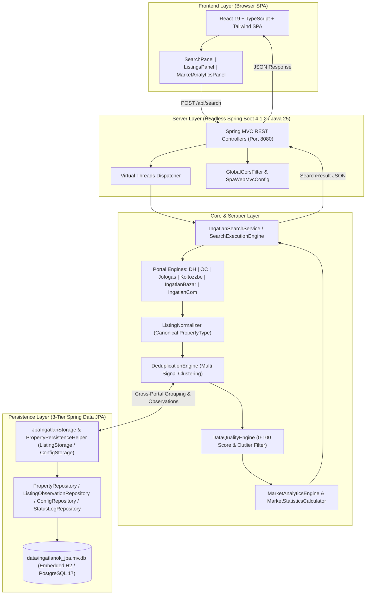

# Ingatlan Kereső - System Architecture & AI Workflow Directives (GEMINI.md)

This document establishes the technical system architecture, 4-layer component boundaries, persistence design, web scraping specifications, and mandatory AI development and version control guidelines for **ingatlan-kereso**.

---

## 1. System Architecture & High-Level Flow

**ingatlan-kereso** is built on Java 25 LTS with Spring Boot 4.1.2, Virtual Threads, Spring Data JPA persistence (embedded H2 for dev/CLI, PostgreSQL 17 for production), a pure headless JSON REST API, and an autonomous modern React 19 SPA frontend served via Vite (dev) or Nginx reverse proxy (Docker Compose). Authoritative architecture reference: [docs/architecture.md](docs/architecture.md).



---

## 2. Package Structure & Layer Responsibilities

Each Java package includes a `package-info.java` module map documenting public entry points and ArchUnit layer boundaries.

```text
ingatlan-kereso/
├── .github/
│   ├── pull_request_template.md                 # PR checklist
│   └── workflows/                               # ci.yml, dependency-submission.yml, pr-build.yml, release.yml, images.yml
├── config/checkstyle/checkstyle.xml             # Checkstyle 10.21.4 ruleset (FileLength <= 450, 2-space Indentation)
├── scripts/
│   ├── ai-verify.sh                             # Compact, token-efficient verification runner (--backend, --frontend, --all)
│   ├── start-docker.bat                         # Windows launcher (local build, GHCR latest, or custom tag)
│   ├── smoke-test-docker-compose.sh             # Manual Compose integration smoke test
│   └── validate-skills.sh                       # Offline specialist-skill & architectural guardrail validator (6 checks)
├── build.gradle.kts                             # Gradle Kotlin DSL (Java 25, Spring Boot 4.1.2, -Werror, JaCoCo >=80%)
├── Dockerfile & docker-compose.yml              # Multi-stage Temurin JRE 25 & 3-tier stack (Postgres, Backend, Nginx UI)
├── docs/architecture.md                         # Authoritative system architecture reference
├── frontend/                                    # Decoupled React 19 + TypeScript + Vite SPA (ESLint max-lines <= 350)
│   ├── src/
│   │   ├── components/
│   │   │   ├── analytics/                       # MarketAnalyticsPanel.tsx, MarketAnalyticsKpiSection.tsx, charts & tables
│   │   │   ├── filters/                         # SearchPanel.tsx, NumericStepper.tsx (shared AreaStepper/PriceStepper)
│   │   │   └── listings/                        # ListingsPanel.tsx, BulkActionBar.tsx, BulkFilterChips.tsx, PropertyCard.tsx, PropertyCardParts.tsx, QualityScoreShield.tsx
│   │   ├── hooks/                               # useMarketAnalytics.ts, useSearch.ts, useOutsideDismiss.ts
│   │   ├── test/                                # Vitest suites & testFixtures.ts (Object Mother mock factories)
│   │   ├── types/generated-api.ts               # Single-source-of-truth OpenAPI TypeScript schemas
│   │   └── utils/                               # formatters.ts, marketAnalyticsMath.ts, marketAnalyticsAggregation.ts
│   └── eslint.config.js & vite.config.ts        # Zero-warning ESLint & Vite config
├── src/main/java/ingatlanok/
│   ├── IngatlanApplication.java & Main.java     # Spring Boot & CLI hybrid entry points
│   ├── common/                                  # HttpFetcher (SSRF sink), PropertyParser, CityUtils, SlugUtils, BrowserUtils
│   ├── core/                                    # Layer 2: SearchExecutionEngine, SearchPersistenceSynchronizer, ListingNormalizer, PropertyFilterEngine, DeduplicationEngine, DataQualityEngine, MarketAnalyticsEngine, MarketStatisticsCalculator
│   ├── model/                                   # Canonical PropertyType, Property, SourceListing, ListingObservation, IngatlanItem, MarketStats, MarketSegmentStats, PriceDropItem, PriceInfo, PropertyDetails, PortalSource, SearchCriteria, SearchResult
│   ├── persistence/                             # Layer 4: ListingStorage, ConfigStorage, JpaIngatlanStorage, service/PropertyPersistenceHelper, mapper/JpaEntityMapper, entity/*, repository/*
│   ├── portal/                                  # Layer 3: PortalEngine, PortalEngineRegistry, dh/, oc/, jofogas/, koltozzbe/, ingatlanbazar/, ingatlancom/
│   ├── presentation/                            # Layer 1a: DashboardPresentationService, PresentationMapper, DashboardResponseDto, MarketStatsDto, MarketSegmentStatsDto, PriceDropItemDto, PortalStatusDto
│   ├── config/                                  # Layer 1b: CoreEngineConfig, GlobalCorsFilter, SpaWebMvcConfig
│   └── web/                                     # Layer 1b: RestApiController, GlobalExceptionHandler
└── src/test/
    ├── java/ingatlanok/testsupport/TestFixtures.java # Shared Object Mother builder factory for deterministic tests
    └── resources/logback-test.xml               # Quiet WARN-level test logging to prevent console token bloat
```

---

## 3. Core Architectural Principles

1. **Spring Boot 4.1.2 & Java 25 Virtual Threads:** Headless REST service with `spring.threads.virtual.enabled=true`. Scraping I/O and REST requests never block carrier threads.
2. **0-Crash Resilience:** Network failures, DOM changes, or WAF challenges on one portal never crash the server; portal engines return structured status cards (`BOT_PROTECTED`, `FAILED`, `SPA_FALLBACK`).
3. **Decoupled 3-Tier Persistence (Dual-Mode):** Hidden behind `ListingStorage` and `ConfigStorage`. `JpaIngatlanStorage` and `PropertyPersistenceHelper` use Spring Data JPA with embedded H2 (`data/ingatlanok_jpa.mv.db`) for dev/CLI, PostgreSQL 17 for Docker Compose, and in-memory H2 for hermetic tests.
4. **Modern Decoupled Frontend & Clean Versioning:** Autonomous React 19 + TypeScript + Vite SPA served by Nginx in production. GHCR images use clean numeric SemVer tags (`1.0.0`, `1.0.0-<sha>`) without a `v` prefix.
5. **Canonical Normalization, Multi-Signal Deduplication & 3-Tier Analytics:** Portal categories map to `PropertyType`. Identical physical properties across portals cluster into a single card showing the lowest active price and a multi-source drawer. `MarketAnalyticsEngine` and `MarketStatisticsCalculator` compute domain `MarketStats` (living vs. land area medians, bargains $\ge 20\%$ below median), while `DataQualityEngine` (0–100 score) quarantines outliers ($< 70$).
6. **Mandatory Boilerplate Elimination & Single-Source-of-Truth Patterns:**
   - **Backend (Lombok & MapStruct):** Use `@Getter`, `@Builder` (`@Builder.Default`, `toBuilder = true`), and `@NoArgsConstructor` (`@Setter` only where post-construction mutation is needed; read-only DTOs/value objects omit `@Setter`). `@Data`, `@EqualsAndHashCode`, `@ToString`, and `@SneakyThrows` are forbidden. Use MapStruct (`JpaEntityMapper`, `PresentationMapper`) with `componentModel = "spring"` and `unmappedTargetPolicy = ReportingPolicy.ERROR`.
   - **Frontend (OpenAPI Derivation & Deduplication):** Derive all frontend DTO types (`types/property.ts`, `types/api.ts`, `types/portal.ts`) from `generated-api.ts` (`components['schemas']`). Centralize helpers in `utils/formatters.ts` (`normalizePortalKey`, `PORTAL_CHIPS`, `clampQualityScore`, `getQualityConfig`, `getEffectivePrice`, `getEffectiveSqmPrice`, `openExternalUrl`) and reuse `NumericStepper`, `useOutsideDismiss`, and `SORT_OPTIONS`.
7. **Fail-Closed Compiler, Exception-Free ArchUnit & Strict Modularity Gates:**
   - **Backend Javac & ArchUnit:** Javac enforces `-Werror` and `-Xlint:unchecked,deprecation,rawtypes,fallthrough,cast,overrides,divzero,empty`. `ArchitectureRulesTest.java` enforces 4-layer unidirectional flow with **zero exceptions** (`core`, `persistence`, and `portal` never depend on `presentation`, `web`, or `config`), storage encapsulation, read-only DTO/model immutability, single-point SSRF isolation in `HttpFetcher`, and virtual thread non-pinning (no `synchronized` in `core/`, `portal/`, `service/`, `web/`).
   - **Checkstyle 10.21.4:** Enforces `FileLength` <= 450, 2-space `Indentation`, `WhitespaceAround`, `WhitespaceAfter`, `NoWhitespaceBefore`, `GenericWhitespace`, `EmptyLineSeparator`, `MethodLength` <= 80, `ParameterNumber` <= 6, `CyclomaticComplexity` <= 12, `BooleanExpressionComplexity` <= 4, `NestedIfDepth` <= 3, `NestedTryDepth` <= 2, and `DeclarationOrder`.
   - **Frontend TypeScript & ESLint:** Enforces `noImplicitReturns`, `noImplicitOverride`, `forceConsistentCasingInFileNames`, ESLint `--max-warnings 0`, `max-lines: 350` (`skipBlankLines: true, skipComments: true`), `complexity: 15`, `max-depth: 4`, `max-params: 5`, `eqeqeq`, `@typescript-eslint/consistent-type-imports`, `@typescript-eslint/no-explicit-any: error`, and AST ban on direct `window.open`.
8. **AI Token-Efficiency & High-Signal Tooling:**
   - **Shared Test Fixtures (Object Mother):** Use `TestFixtures.java` (`src/test/java/ingatlanok/testsupport/TestFixtures.java`) in backend tests and `testFixtures.ts` (`frontend/src/test/testFixtures.ts`) in frontend tests instead of repeating 25-line item setup blocks.
   - **Quiet Test Logging & Compact Verification:** `src/test/resources/logback-test.xml` restricts test logs to `WARN`. Use `bash scripts/ai-verify.sh [--backend|--frontend|--all]` for compact, single-line PASS summaries or focused error excerpts.
9. **Business Logic Regression Protection & Regression Test First Protocol:**
   - Adhere strictly to the **Regression Test First** cycle documented in [docs/business-logic-regression.md](docs/business-logic-regression.md): identify and reproduce the defect, write a failing regression test (Red) proving the defect prior to implementation, apply the minimal targeted fix (Green), and verify against the versioned static Golden Test Dataset (`src/test/resources/fixtures/golden/business-regression-dataset.json`) without external network or LLM dependencies.

---

## 4. Web Scraping Specifications

| Portal | Domain | Method | Specifics & Challenge |
| :--- | :--- | :--- | :--- |
| **Duna House** | `dh.hu` | Live Jsoup DOM | Pattern: `/elado-ingatlan/<type>/<county>/<city>/<price>-mFt` |
| **Otthon Centrum** | `oc.hu` | Live Jsoup DOM | Rich card parsing with Chrome 133 `Sec-Ch-Ua` headers |
| **Jófogás Ingatlan** | `jofogas.hu` | Live Jsoup DOM | Query-based parsing with price and location regex cleaning |
| **Költözzbe** | `koltozzbe.hu` | Live DOM & JSON-LD | Dual strategy: HTML cards and Schema.org JSON-LD |
| **Ingatlanbazár** | `ingatlanbazar.hu` | Live Internal REST API | High-speed JSON endpoints (`/api/property-search`) with cached location codes |
| **Ingatlan.com** | `ingatlan.com` | Graceful Fallback | Cloudflare WAF protected. Generates direct search link fallback without blocking |

---

## 5. AI Developer & Workflow Rules (Mandatory)

> [!IMPORTANT]
> 1. **Direct Pushes Prohibited:** Never push directly to `main` or `develop`.
> 2. **Git Worktrees & Branch Naming:** Start all branches from `develop` (`feature/<short-desc>`, `fix/<short-desc>`, `docs/<short-desc>`, `refactor/<short-desc>`, `chore/<short-desc>`), using dedicated worktrees (`git worktree add -b <branch-name> ../worktrees/<branch-name> develop`) when isolating concurrent work.
> 3. **Atomic Commits:** Commit each coherent logical increment with a Conventional Commits message (`feat: ...`, `fix: ...`, `docs: ...`). Never squash unrelated work or push mechanical fixup chains.
> 4. **Pipeline Concurrency:** Cancel obsolete workflow runs (`gh run cancel <run-id>`).
> 5. **PR Conventions & UTF-8 Encoding:**
>    - **Title & Labels:** English Conventional Commit title; apply labels (`enhancement`, `bug`, `documentation`) and request `@copilot` review (`gh pr edit <id> --add-reviewer "@copilot"`).
>    - **Hungarian 5-Section Body:** Write concise, high-signal Hungarian descriptions strictly with: **🎯 Miért készült?**, **🛠️ Mit módosít / Mit javít?**, **📋 Acceptance Criteria Traceability**, **🧪 Tesztelés és Ellenőrzés**, and **🛡️ Thematic Agent Approval Gate**, ending with `Closes #<id>` / `Fixes #<id>`. Always pass `--body-file` encoded in clean UTF-8 without BOM.
>    - **Direct PR Link:** Always include a clickable GitHub PR link in the final response.
> 6. **Thematic Agent Approval Gate & Review Risk Matrix:** Require sign-off from `fullstack-architect`, `scraper-security-engineer`, and `quality-devops-engineer` adhering to the Review Risk Matrix (`docs/pr-compliance.md`) using standard tokens (`[NO_FINDING]`, `[FINDING]`, `[NOT_APPLICABLE]`, `[NOT_VERIFIED]`) with one concise sentence rationale. Legacy tokens like `[OK]` are strictly forbidden. Refer to [docs/architecture.md](docs/architecture.md) and [docs/pr-compliance.md](docs/pr-compliance.md).
> 7. **Green Gate & Never Auto-Merge:** PRs are mergeable only when 100% of CI checks are green. Never run `gh pr merge`; merging is reserved for the human repository owner.
> 8. **Standardized Issue Templates:** Always follow `.github/ISSUE_TEMPLATE/bug_report.yml` (`fix: <summary>`, `bug` label) and `.github/ISSUE_TEMPLATE/feature_request.yml` (`feat: <summary>`, `enhancement` label) as the single source of truth.
> 9. **Regression Test First Discipline:** Follow the 6-step cycle in [docs/business-logic-regression.md](docs/business-logic-regression.md); prove the defect with a failing test (Red) before fixing the implementation (Green).
> 10. **Issue-Scope Boundary & Anti-Scope-Creep Guardrails:** Modifications must be strictly confined to the issue's stated goals and acceptance criteria. Unsolicited refactoring, technology version bumps, package reorganizations, or API/DB contract shifts are prohibited. Out-of-scope improvements must be documented as separate proposed issues; never execute them opportunistically. Any supporting change required to meet acceptance criteria must be explicitly justified in the Hungarian PR body.
> 11. **Adversarial Self-Review Protocol (Anti-Tunnel-Vision & Confirmation-Bias Gate):** Before opening any PR, agents must systematically audit their own implementation against four critical invariants: (1) **Multi-Source Domain Invariant** (no direct `item.priceInfo.amountHuf` / `item.detailsInfo.pricePerSquareMeter` access, use `getEffectivePrice`/`getEffectiveSqmPrice` from `src/utils/formatters.ts`), (2) **Multi-City & Partial Failure Invariant** (proper handling of mixed portal/city statuses), (3) **End-to-End Contract Traceability** (DTO -> `api-spec.yaml` -> `generated-api.ts` -> UI components; all referenced test files in the PR table physically exist), and (4) **Hermetic Test Isolation** (no production `app.test-mode` branching, zero `synchronized` carrier-pinning in Java 25).
> 11. **Adversarial Self-Review Protocol (Anti-Tunnel-Vision & Confirmation-Bias Gate):** Before opening any PR, agents must systematically audit their own implementation against four critical invariants: (1) **Multi-Source Domain Invariant** (no direct `item.priceInfo.amountHuf` / `item.detailsInfo.pricePerSquareMeter` access, use `getEffectivePrice`/`getEffectiveSqmPrice` from `src/utils/formatters.ts`), (2) **Multi-City & Partial Failure Invariant** (proper handling of mixed portal/city statuses), (3) **End-to-End Contract Traceability** (DTO -> `api-spec.yaml` -> `generated-api.ts` -> UI components; all referenced test files in the PR table physically exist), and (4) **Hermetic Test Isolation** (no production `app.test-mode` branching, zero `synchronized` carrier-pinning in Java 25).

---

## 6. Local Pre-Push Verification & CI Hygiene

Never push unverified code to remote. Run fast iterative checks via `bash scripts/ai-verify.sh --all`, and execute the full pre-push gates before pushing:

- **Backend full gate (keep JaCoCo line coverage safely $\ge 82\%$, CI minimum $80.00\%$):**
  ```bash
  ./gradlew checkstyleMain checkstyleTest test jacocoTestReport jacocoTestCoverageVerification check bootJar
  ```
- **Frontend full gate:**
  ```bash
  cd frontend && npm run generate-api && npm run typecheck && npm run lint && npm run test && npm run build
  ```
- **Skills & architectural guardrails gate:**
  ```bash
  bash scripts/validate-skills.sh -v
  ```
- **AppSec & Spring CLI:** Route all external scraping HTTP calls through `HttpFetcher` (SSRF protection) and keep `@ConditionalOnProperty(name = "cli")` synchronized via `System.setProperty("cli", "true")` in `main()`.
