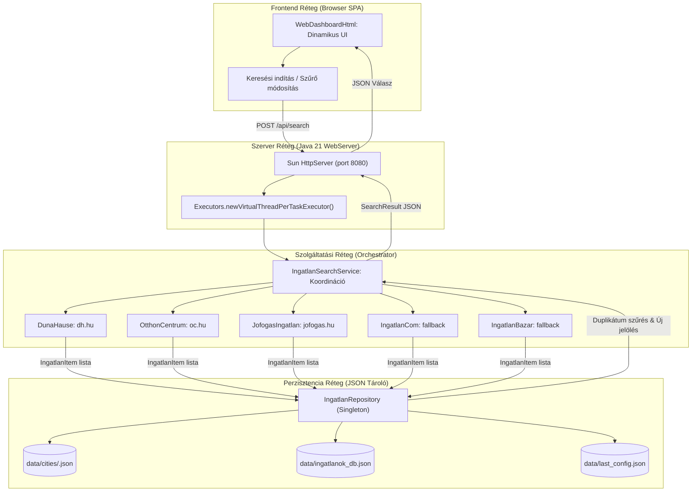

# Ingatlan Kereső - Rendszer-architektúra és Fejlesztési Irányelvek (GEMINI.md)

Ez a dokumentum a projekt mélyreható technikai és rendszer-architektúráját, a csomag- és komponensfelelősségeket, a web scraping mechanizmusokat, valamint az AI asszisztensek és belső fejlesztők számára előírt kötelező verziókezelési és közreműködési szabályzatot rögzíti.

---

## 1. Rendszerarchitektúra és Működési Folyamat

Az **ingatlan-kereso** egy Java 21 LTS alapú asztali alkalmazás, amely egy beágyazott, virtuális szálakkal (`Virtual Threads`) működő HTTP REST webszerverből, egy reszponzív egyoldalas webes felhasználói felületből (SPA), egy keresést koordináló orchestrator rétegből, valamint polimorf web scraper modulokból áll.

### Működési Folyamat (System Workflow)



### Keresési és Adatkezelési Lépések

1. **Konfiguráció betöltése:** Induláskor az `IngatlanRepository` betölti a legutóbbi keresési paramétereket a `data/last_config.json` fájlból, valamint memóriába olvassa a városonkénti előzményeket a `data/cities/*.json` fájlokból.
2. **Keresési kérés fogadása:** A felhasználó a webes felületen vagy a CLI-n keresztül keresést indít. A `WebServer` virtuális szálon továbbítja a `SearchCriteria` objektumot az `IngatlanSearchService` felé.
3. **Párhuzamos scraping:** Az orchestrator végighívja az aktív portálok scraper implementációit (`Ingatlan` interfész). A scraperek a Jsoup segítségével letöltik a HTML tartalmat, feldolgozzák a hirdetéskártyákat, és kinyerik az árat, alapterületet, szobaszámot és a közvetlen linket.
4. **Duplikátumszűrés és frissesség megállapítása:** Az `IngatlanRepository` ellenőrzi, hogy a talált URL szerepel-e már az adott város vagy a globális adatbázis ismert linkjei között.
   - Ha a link korábban nem volt ismert, megkapja a `✨ ÚJ TALÁLAT` jelölést (`newItem = true`), és rögzítésre kerül az adatbázisban a felfedezés időpontjával.
5. **Kliens értesítés és asztali böngészés:** Az aggregált `SearchResult` JSON válaszként visszakerül a frontendhez. Amennyiben a felhasználó engedélyezte a lapmegnyitást, az `IngatlanHelper.openNewUrls()` megnyitja a friss linkeket az operációs rendszer alapértelmezett böngészőjében (biztonsági limitekkel védve a tab-túlcsordulás ellen).

---

## 2. Csomagstruktúra és Komponens Felelősségek

```text
ingatlan-kereso/
├── src/main/java/
│   ├── Main.java                                # Belépési pont (Web Dashboard szerver és CLI mód vezérlő)
│   └── ingatlanok/
│       ├── helper/
│       │   ├── CityUtils.java                   # Településnevek normalizálása, előre definiált városlista, presetek
│       │   └── IngatlanHelper.java              # Asztali böngészőkezelés (Desktop API / process fallback), I/O
│       ├── model/
│       │   ├── IngatlanItem.java                # Hirdetés adatmodell (ár, méret, szobaszám, link, cím, új státusz)
│       │   ├── SearchCriteria.java              # Keresési paraméterek (városok, árhatárok, típus, aktív portálok)
│       │   └── SearchResult.java                # Keresési aggregáció és portálstatisztikák modellje
│       ├── persistence/
│       │   ├── IngatlanRepository.java          # Fájlalapú thread-safe JSON adatbázis és beállításkezelő
│       │   └── IngatlanDataBaseMock.java        # Visszafelé kompatibilitási réteg a korábbi memóriakezeléshez
│       ├── service/
│       │   ├── Ingatlan.java                    # Általános scraper interfész (search és getUrls)
│       │   ├── IngatlanSearchService.java       # Keresést vezérlő és portálokat összesítő orchestrator
│       │   └── impl/
│       │       ├── IngatlanStart.java           # Jsoup bázisosztály: timeout, User-Agent mimic, hibakezelés
│       │       ├── DunaHause.java               # dh.hu scraper (élő találatok és kártya metaadatok)
│       │       ├── OtthonCentrum.java           # oc.hu scraper (élő találatok és paraméteres szűrés)
│       │       ├── JofogasIngatlan.java         # jofogas.hu scraper (élő találatok és kártyainformációk)
│       │       ├── IngatlanCom.java             # ingatlan.com scraper (Cloudflare bot-védelem graceful fallback)
│       │       └── IngatlanBazar.java           # ingatlanbazar.hu scraper (Angular SPA graceful fallback)
│       └── web/
│           ├── WebServer.java                   # Beágyazott REST API szerver Java 21 Virtual Threads alapon
│           └── WebDashboardHtml.java            # Beágyazott reszponzív SPA sablon (HTML5, Tailwind-stílus, JS)
```

### Főbb Komponensek és Szerepkörök

* **`WebServer` (`ingatlanok.web`):**
  * Beépített `com.sun.net.httpserver.HttpServer` használata külső függőségek (Tomcat, Jetty, Spring) nélkül.
  * Párhuzamos kéréskezelés `Executors.newVirtualThreadPerTaskExecutor()` segítségével.
  * REST API végpontok:
    * `GET /`: Reszponzív egyoldalas HTML dashboard kiszolgálása.
    * `GET /api/config`: Legutóbbi keresési konfiguráció lekérdezése.
    * `POST /api/search`: Keresés indítása a megadott feltételekkel.
    * `GET /api/items`: Tárolt hirdetések lekérdezése város szerinti szűréssel.
    * `POST /api/clear`: Keresési előzmények és adatbázis törlése.
    * `POST /api/open-all`: Megadott találati URL-ek megnyitása a helyi böngészőben.
    * `GET /api/cities`: Előre definiált magyarországi települések listája.
    * `GET /api/presets`: Gyorsválasztó régiós sablonok (pl. agglomerációk, egyetemvárosok).

* **`IngatlanRepository` (`ingatlanok.persistence`):**
  * Thread-safe Singleton mintát követ (`ConcurrentHashMap`, `newKeySet`).
  * Kétszintű tárolási architektúra:
    1. Városonkénti adatfájlok: `data/cities/<cityKey>.json` a pontos településszintű szegmentáláshoz.
    2. Globális adatbázis: `data/ingatlanok_db.json` az összesített lekérdezésekhez.
  * Automatikus adatmigráció régebbi adatbázis- és szöveges naplóformátumokból (`2017_06_06.txt`, `ingatlanok_history.txt`).

* **`IngatlanSearchService` (`ingatlanok.service`):**
  * Felelős a scraper példányok életciklusáért és párhuzamos lekérdezéséért.
  * Felügyeli a duplikátumszűrést az `IngatlanRepository`-n keresztül.
  * Rendezi a találatokat ár és dátum szerint, valamint előállítja a portálonkénti találati statisztikákat.

---

## 3. Főbb Tervezési Minták és Technikai Döntések

1. **Java 21 Virtual Threads:**
   * A webkiszolgáló és a hálózati I/O műveletek könnyűsúlyú szálakon futnak, így a web scraping hálózati késleltetése nem blokkolja a rendszert.
2. **Polimorf Web Scraping (`Strategy / Template Method` minta):**
   * Minden portál scraper az `Ingatlan` interfészt valósítja meg és az `IngatlanStart` ősosztályból öröklődik.
   * Az `IngatlanStart` központosítja a HTTP letöltési paramétereket: realisztikus Chrome User-Agent, referer fejlécek, 15 másodperces hálózati időkorlát és SSL tanúsítványkezelés.
3. **0-Crash és Robusztus Graceful Degradation:**
   * Egyetlen weboldal hálózati hibája vagy DOM struktúra-változása sem okozhatja az alkalmazás leállását. A scraperek elkapják a helyi kivételeket, és hibaüzenettel kísért üres találati listát vagy fallback linket szolgáltatnak.
4. **Zéró Külső Frontend Függőség:**
   * A webes felület teljesen önálló, offline is működő Single Page Applicationként van beágyazva a `WebDashboardHtml` osztályba, elkerülve a Node.js/NPM és külső frontend build lépések szükségességét.

---

## 4. Web Scraping Részletek és Portál Kihívások

| Portál | Scraping Módszer | Technikai Részletek és Kihívások |
| :--- | :--- | :--- |
| **Duna House** (`dh.hu`) | Élő Jsoup DOM parsing | URL mintázat: `/elado-ingatlan/<tipus>/<megye>/<varos>/<ar>-mFt`. A hirdetési kártyákból a cím, kikiáltási ár, méret ($m^2$) és szobaszám megbízhatóan kinyerhető. |
| **Otthon Centrum** (`oc.hu`) | Élő Jsoup DOM parsing | URL mintázat query paraméterekkel: `?realestate[ertekesites]=elado&...&<varos>=on`. Modern kártya layout, az árak és paraméterek span elemekből kerülnek feldolgozásra. |
| **Jófogás Ingatlan** (`jofogas.hu`) | Élő Jsoup DOM parsing | Keresési paraméterezés: `?q=<varos>+elado+<tipus>&min_price=...`. A hirdetési listaelemekből regex segítségével tisztítjuk az árat és a címet. |
| **Ingatlan.com** (`ingatlan.com`) | Graceful Bot Fallback | Erős Cloudflare WAF bot-védelem (403 Forbidden / JS challenge). Közvetlen hirdetési keresőlinket generálunk fallbackként, elkerülve a szerver blokkolását. |
| **Ingatlanbazár** (`ingatlanbazar.hu`) | Graceful SPA Fallback | Kliensoldali Angular CSR alkalmazás; a hirdetések HTML-ben nincsenek jelen SSR hiányában. Közvetlen portállinkkel kezelve. |

---

## 5. Fejlesztési Irányok és Ütemterv (Roadmap)

### Megvalósult Fejlesztések
- [x] Java 21 LTS környezet és modern függőségek (Maven 3.9+, Jsoup 1.23.2, Gson 2.11.0).
- [x] Modern Web Dashboard beágyazott szerverrel és Virtual Threads kiszolgálással.
- [x] Többvárosos (Multi-city) szűrőrendszer 35+ előre definiált magyar várossal és sablonokkal.
- [x] Kétszintű, városonként szeparált és aggregált JSON hirdetésperzisztencia.
- [x] Vizuális hirdetéskártyák: ár szerinti dinamikus rendezés, szűrés kizárólag az új találatokra.
- [x] Egykattintásos Windows asztali indítók (`start-ui.bat`, `start-ui.ps1`).

### Tervezett Fejlesztések
- [ ] **Értesítési csatornák:** Telegram Bot API és Discord Webhook integráció az új találatok azonnali továbbításához.
- [ ] **Headless böngésző driver (opcionális modul):** Playwright vagy Selenium integráció a Cloudflare és SPA portálok teljes körű kinyeréséhez.
- [ ] **Időzített háttérfigyelés:** Háttérben futó periodikus ellenőrző szolgáltatás konfigurálható időközökkel.

---

## 6. Munkafolyamat és Verziókezelési Szabályzat (Workflow Rule)

> [!IMPORTANT]
> **Kötelező GitHub PR és Verziókezelési Szabályzat az AI Asszisztens számára:**
>
> 1. **Közvetlen `main` és `develop` ágra commitolás és pusholás szigorúan TILOS:**
>    - A `main` a védett, stabil kiadási ág.
>    - A `develop` a védett integrációs ág.
>    - Minden feladatot új munkavégző ágon (`feature/*`, `fix/*`, `docs/*`, stb.) kell elvégezni, amely a `develop` ágból indul ki.
>
> 2. **Strukturált branch elnevezés (`feature/`, `fix/`, stb.):**
>    - Az ágak neve kötelezően kövesse a típus szerinti struktúrát és angol leírást:
>      - `feature/<rovid-angol-leiras>` – új funkció, felületi vagy logikai fejlesztés
>      - `fix/<rovid-angol-leiras>` – hibajavítás, rendellenesség elhárítása
>      - `docs/<rovid-angol-leiras>` – dokumentáció, szabályzat vagy README módosítása
>      - `refactor/<rovid-angol-leiras>` – kódstruktúra tisztítása, refaktorálás viselkedésváltozás nélkül
>      - `chore/<rovid-angol-leiras>` – build beállítások, függőségek, CI/CD karbantartás
>
> 3. **Mindig új commit a PR-ba:**
>    - Minden változtatáshoz külön, leíró üzenetű új commitot kell készíteni (`git commit -m "..."`).
>    - Tilos már pusholt commitokat felülírni (`--amend` tilos push után); minden módosítás vagy javítás új committal bővítse a branch történetét.
>
> 4. **Angol nyelvű, beszédes PR elnevezés (Title):**
>    - A Pull Request neve **mindig kötelezően angol nyelvű** legyen, és pontosan mutassa be a feladat típusát és tartalmát Conventional Commits formátumban:
>      - Pl.: `feat: add stepper controls and portal counters to dashboard`
>      - Pl.: `fix: resolve timeout issue in jofogas scraper`
>      - Pl.: `docs: update workflow rules with branch structure and label requirements`
>
> 5. **Kötelező GitHub Label (Címke) a PR-on:**
>    - A PR-t kötelező címkével ellátva létrehozni (`gh pr create --label "<label>"`).
>    - Használandó címkék:
>      - `enhancement` – új funkcionalitás vagy UI bővítés esetén
>      - `bug` – hibajavítás esetén
>      - `documentation` – leírások, dokumentáció és szabályzat esetén
>      - Ha a címke még nem létezik a repóban, a `gh label create` paranccsal azonnal létre kell hozni.
>
> 6. **Beszédes, részletes magyar nyelvű összefoglaló (Summary / Description):**
>    - A PR törzse (`--body`) és a chat-válasz záró összefoglalója magyar nyelvű legyen.
>    - Az összefoglalónak kifejezetten **beszédesnek és részletesnek** kell lennie (nem 1 mondatos összegzés), hogy világosan érthető legyen:
>      - **Mi a cél és kontextus:** Miért készült a módosítás?
>      - **Részletes technikai változtatások:** Mely fájlok, komponensek és logikák változtak és hogyan?
>      - **Felhasználói és működési hatás:** Mit tapasztal a felhasználó, hogyan változik a működés?
>      - **Verifikáció és tesztelés:** Hogyan lett ellenőrizve a módosítás helyessége?
>
> 7. **Közvetlen PR Link a válaszban:**
>    - A feladat befejezésekor a beszélgetésben **mindig kötelező közvetlen kattintható linket adni az elkészült GitHub Pull Request-re**.
