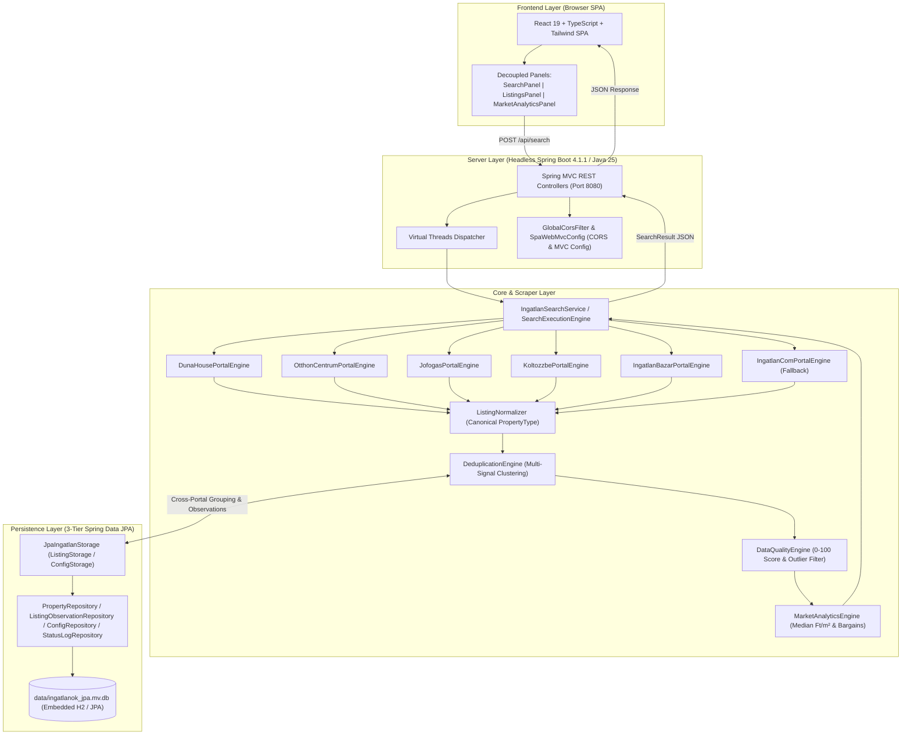

# Ingatlan Kereső - System Architecture & AI Workflow Directives (GEMINI.md)

This document establishes the technical system architecture, 4-layer component boundaries, persistence design, web scraping specifications, and mandatory AI development and version control guidelines for **ingatlan-kereso**.

---

## 1. System Architecture & High-Level Flow

**ingatlan-kereso** is built on Java 25 LTS with Spring Boot 4.1.1, Virtual Threads, Spring Data JPA persistence (embedded H2 for dev/CLI, PostgreSQL 17 for production), a pure headless JSON REST API, and an autonomous modern React 19 SPA frontend served independently via Vite (dev) or Nginx reverse proxy (Docker Compose). Authoritative architecture reference: [docs/architecture.md](docs/architecture.md).

### Workflow Architecture



---

## 2. Package Structure & Layer Responsibilities

```text
ingatlan-kereso/
├── .github/
│   ├── pull_request_template.md                 # PR checklist
│   └── workflows/
│       ├── ci.yml                               # CI Build: backend, frontend, and minimal result gate
│       ├── dependency-submission.yml            # Gradle dependency graph submission with scoped cache policy
│       ├── pr-build.yml                         # Required Conventional Commit PR title check
│       ├── release.yml                          # Docker Release with tag-derived SemVer
│       └── images.yml                           # Automatic develop push and latest image publication
├── config/
│   └── checkstyle/checkstyle.xml                # Checkstyle 10.21.4 ruleset
├── scripts/
│   ├── start-docker.bat                         # Windows launcher (local build, GHCR latest, or custom tag)
│   ├── smoke-test-docker-compose.sh             # Manual Compose integration smoke test
│   └── validate-skills.sh                       # Offline specialist-skill validation used by CI
├── build.gradle.kts                             # Gradle Kotlin DSL (Java 25, Spring Boot 4.1.1, 1.0.0)
├── settings.gradle.kts                          # Gradle root project settings
├── gradlew / gradlew.bat                        # Gradle Wrapper binaries
├── Dockerfile                                   # Multi-stage Temurin JRE 25 runtime container
├── docker-compose.yml                           # 3-tier production stack (Postgres, Backend, Nginx UI)
├── README.md                                    # Comprehensive user and developer guide
├── gemini.md                                    # Technical architecture & AI workflow directives
├── docs/
│   └── architecture.md                          # Authoritative system architecture reference
├── data/
│   └── ingatlanok_jpa.mv.db                     # Embedded H2 / JPA database
├── frontend/                                    # Modern Decoupled React 19 SPA client
│   ├── src/                                     # React 19, TypeScript, Zustand, TanStack Query
│   │   ├── components/
│   │   │   ├── analytics/MarketAnalyticsPanel.tsx # Dedicated market analysis view & price drop table
│   │   │   ├── filters/SearchPanel.tsx          # Decoupled search criteria and filter controls
│   │   │   ├── listings/ListingsPanel.tsx       # Decoupled listing stream, sort, and bulk actions
│   │   │   ├── listings/PropertyCard.tsx        # Card with PropertyTypeBadge, BargainBadge, MultiSourceDrawer
│   │   │   └── listings/QualityScoreShield.tsx  # 3-tier data quality shield with score deductions popover
│   ├── package.json                             # Frontend dependencies, Vitest, Playwright scripts
│   ├── nginx.conf                               # Production SPA reverse proxy configuration
│   ├── Dockerfile                               # Production Nginx frontend container
│   └── vite.config.ts                           # Vite configuration with API proxy and Vitest
└── src/main/java/ingatlanok/
    ├── IngatlanApplication.java                 # Spring Boot application entry point (@SpringBootApplication)
    ├── Main.java                                # Hybrid entry point (Spring Boot delegate & CLI mode)
    ├── common/                                  # Shared cross-cutting utilities
    │   ├── BrowserUtils.java                    # Desktop browser launcher with limits
    │   ├── CityUtils.java                       # Hungarian city normalization and presets
    │   ├── HttpFetcher.java                     # Jsoup HTTP client (User-Agent, headers, timeouts)
    │   ├── PropertyParser.java                  # Price, floor area, and room regex parsing
    │   └── SlugUtils.java                       # Diacritic removal and search slug builder
    ├── core/                                    # Layer 2: Pure business logic engines
    │   ├── ListingNormalizer.java               # Canonical PropertyType normalizer
    │   ├── PropertyFilterEngine.java            # Search criteria filtering (price, area, type)
    │   ├── DeduplicationEngine.java             # Multi-signal cross-portal clustering & lowest price selection
    │   ├── DataQualityEngine.java               # 0-100 deterministic scoring engine & outlier filter
    │   ├── MarketAnalyticsEngine.java           # Deduplicated median Ft/m² analytics & bargain detection
    │   └── SearchExecutionEngine.java           # Parallel scraping coordinator (Virtual Threads, 15s timeout)
    ├── model/                                   # Domain models and value objects
    │   ├── PropertyType.java                    # Canonical property type enum (LAKAS, HAZ, TELEK, etc.)
    │   ├── Property.java                        # Physical canonical property entity
    │   ├── SourceListing.java                   # Portal-specific listing instance
    │   ├── ListingObservation.java              # Time-series periodic observation snapshot
    │   ├── DataQualityScore.java                # Quality score, tier, and rule deductions
    │   ├── IngatlanItem.java                    # Rich listing data model with sourceListings
    │   ├── PortalSource.java                    # Portal metadata (id, badge color, direct link)
    │   ├── PriceInfo.java                       # Structured price (raw, numeric HUF & Million HUF)
    │   ├── PropertyDetails.java                 # Floor area m², room count, calculated price/m²
    │   ├── SearchCriteria.java                  # Multi-city search criteria
    │   └── SearchResult.java                    # Aggregated search results and metrics
    ├── persistence/                             # Layer 4: Storage Abstraction & Spring Data JPA
    │   ├── ListingStorage.java                  # Storage interface for listings and observations
    │   ├── ConfigStorage.java                   # Storage interface for configuration
    │   ├── entity/                              # JPA Entities (PropertyEntity, ListingObservationEntity, etc.)
    │   ├── repository/                          # Repositories (PropertyRepository, ListingObservationRepository)
    │   ├── JpaIngatlanStorage.java              # Primary Spring Data JPA implementation
    │   ├── InMemoryListingStorage.java          # In-memory storage fallback implementation
    │   └── IngatlanRepository.java              # Thread-safe Singleton & IoC bridge facade
    ├── portal/                                  # Layer 3: Pluggable portal engines (OCP)
    │   ├── PortalEngine.java                    # Uniform portal engine interface
    │   ├── PortalDescriptor.java                # Portal metadata record
    │   ├── PortalEngineRegistry.java            # Dynamic portal provider registry
    │   ├── dh/                                  # Duna House engine (DOM parsing)
    │   ├── oc/                                  # Otthon Centrum engine (DOM + client hints)
    │   ├── jofogas/                             # Jófogás engine (DOM parsing)
    │   ├── koltozzbe/                           # Költözzbe engine (DOM & Schema.org JSON-LD)
    │   ├── ingatlanbazar/                       # Ingatlanbazár engine (Internal REST API)
    │   └── ingatlancom/                         # Ingatlan.com fallback engine (Cloudflare WAF)
    ├── presentation/                            # Layer 1a: Presentation and DTO models
    │   ├── DashboardPresentationService.java    # Presentation facade (KPIs, portal health)
    │   ├── DashboardResponseDto.java            # Enriched client response payload
    │   ├── MarketStatsDto.java                  # Market analytics KPIs
    │   ├── MarketSegmentStatsDto.java           # Segment-level median metrics & bargain counts
    │   ├── PriceDropItemDto.java                # Price drop records
    │   └── PortalStatusDto.java                 # Portal health status cards
    ├── scraper/                                 # Portal scraping data models and resolvers
    ├── config/                                  # Layer 1b: Application & Web MVC Configuration
    │   ├── CoreEngineConfig.java                # Core bean definitions
    │   ├── GlobalCorsFilter.java                # Global CORS & Preflight Filter (@Order HIGHEST)
    │   └── SpaWebMvcConfig.java                 # Spring WebMvcConfigurer (CORS & headless MVC configuration)
    └── web/                                     # Layer 1b: Embedded Web Server & REST API
        ├── RestApiController.java              # Spring MVC REST Controller (@RestController)
        └── GlobalExceptionHandler.java          # Structured JSON REST Exception Handler (@RestControllerAdvice)
```

---

## 3. Core Architectural Principles

1. **Spring Boot 4.1.1 on the JVM:** Headless REST service packaged as an executable Spring Boot JAR.
2. **Java 25 Virtual Threads:** High concurrency with lightweight virtual threads (`spring.threads.virtual.enabled=true`). Scraping I/O and REST requests never block carrier threads.
3. **0-Crash Resilience:** Network failures, DOM alterations, or bot protection triggers on one portal never crash the server. Portal engines handle exceptions gracefully and return structured status cards (`BOT_PROTECTED`, `ERROR`).
4. **Decoupled Persistence & Spring Data JPA (Dual-Mode):** Storage logic is hidden behind `ListingStorage` and `ConfigStorage`. The primary implementation is `JpaIngatlanStorage` utilizing Spring Data JPA with embedded H2 (`data/ingatlanok_jpa.mv.db`) for dev/CLI, PostgreSQL 17 for production Docker Compose, and in-memory H2 for hermetic tests, maintaining deduplication and fast queries without relational lock-in.
5. **Modern Decoupled Frontend:** Autonomous React 19 + TypeScript + Vite SPA client with online Google Fonts CDN typography, served by Nginx in containerized environments with reverse proxy routing to the headless Spring Boot REST API.
6. **Containerization & Clean Numeric Versioning:** Multi-stage Temurin JRE 25 Docker image and Docker Compose 3-tier architecture. Container images published to GHCR strictly follow clean numeric SemVer tags (`1.0.0`, `1.0.0-<sha>`) without redundant `v` prefix.
7. **Canonical Property Type Normalization & Multi-Signal Deduplication:** Free-form portal categories and listing titles are deterministically mapped to the canonical `PropertyType` enum. Identical physical properties advertised across different portals are clustered using location, property type, area, and room signals, consolidating into a single card that presents the lowest active market price alongside an expandable multi-source drawer.
8. **3-Tier Domain Separation, Median Analytics & Data Quality Scoring:** Physical properties (`Property`), portal source listings (`SourceListing`), and time-series periodic snapshots (`ListingObservation`) are decoupled. The market engine computes robust median $Ft/m^2$ metrics (strictly partitioning living area from land area) and identifies genuine bargains ($\ge 20\%$ below median). An autonomous 10-rule `DataQualityEngine` (0–100 score) quarantines corrupted or anomalous listings ($< 70$) from skewing statistical medians.

---

## 4. Web Scraping Specifications

| Portal | Domain | Method | Specifics & Challenge |
| :--- | :--- | :--- | :--- |
| **Duna House** | `dh.hu` | Live Jsoup DOM | Pattern: `/elado-ingatlan/<type>/<county>/<city>/<price>-mFt` |
| **Otthon Centrum** | `oc.hu` | Live Jsoup DOM | Rich card parsing with Chrome 133 `Sec-Ch-Ua` headers |
| **Jófogás Ingatlan** | `jofogas.hu` | Live Jsoup DOM | Query-based parsing with price and location regex cleaning |
| **Költözzbe** | `koltozzbe.hu` | Live DOM & JSON-LD | Dual strategy: HTML cards and Schema.org JSON-LD |
| **Ingatlanbazár** | `ingatlanbazar.hu` | Live Internal REST API | High-speed JSON endpoints (`/api/property-search`) with cached location codes |
| **Ingatlan.com** | `ingatlan.com` | Graceful Fallback | Cloudflare WAF protected. Generates direct search link fallback without blocking |

---

## 5. AI Developer & Workflow Rules (Mandatory)

> [!IMPORTANT]
> **Strict Git, PR, and Pipeline Rules for AI Assistants:**
>
> 1. **Direct Pushes Prohibited:** Pushing directly to `main` or `develop` is strictly forbidden.
> 2. **Git Worktrees for Issue Work:** When working on an issue, **always work inside a dedicated `git worktree`** to ensure clean isolation of working directories and branches:
>    ```bash
>    git worktree add -b <branch-name> ../worktrees/<branch-name> develop
>    ```
> 3. **Branch Naming Convention:** All branches must start from `develop` and follow the prefix format:
>    `feature/<short-desc>`, `fix/<short-desc>`, `docs/<short-desc>`, `refactor/<short-desc>`, `chore/<short-desc>`.
> 4. **Atomic Commits – No Squash During Development:**
>    - NEVER combine unrelated changes or squash work in progress.
>    - Commit each logical increment as a separate, discrete commit with a Conventional Commits message (`feat: ...`, `fix: ...`, `docs: ...`).
> 5. **Pipeline Concurrency & Cancellation:**
>    - Only the current, active pipeline run should execute.
>    - Obsolete runs must be automatically canceled (`concurrency: cancel-in-progress: true`) or manually terminated via GitHub CLI (`gh run cancel <run-id>`).
> 6. **English PR Titles:** The Pull Request title must be in English following Conventional Commits (e.g., `feat: implement market analytics dashboard`).
> 7. **Mandatory PR Labels:** Apply appropriate labels (`enhancement`, `bug`, `documentation`) upon PR creation.
> 8. **Concise Hungarian PR Descriptions & UTF-8 Encoding:**
>    - Pull Request descriptions must be written in **concise, high-signal Hungarian**, strictly limited to 4 essential sections: **🎯 Miért készült?** (Context & Goal), **🛠️ Mit módosít / Mit javít?** (Key technical changes), **🧪 Tesztelés és Ellenőrzés** (Verification commands & checks), and **🛡️ Thematic Agent Approval Gate**, concluded with the closing issue keyword (`Closes #<id>` / `Fixes #<id>`).
>    - Always enforce clean UTF-8 encoding without BOM when creating or editing PR descriptions (`gh pr create --body-file ...`) to prevent mojibake and character corruption on Windows/PowerShell.
> 9. **Direct PR Link:** Always output a clickable GitHub PR link in the final conversation response.
> 10. **Thematic Agent Approval Gate:**
>     - Every PR requires sign-off from designated specialist agents (`fullstack-architect`, `scraper-security-engineer`, `quality-devops-engineer`).
>     - Each agent must provide the standard status token (`[NO_FINDING]`, `[FINDING]`, `[NOT_APPLICABLE]`, or `[NOT_VERIFIED]`; shorthand `[OK]`, `[NOK]`, `[N/A]` also supported) and exactly **one concise sentence explaining** the rationale. Refer to [docs/architecture.md](docs/architecture.md) for domain specifications.
> 11. **ONLY MERGE WHEN ALL CHECKS ARE GREEN:**
>     - Pull requests are strictly mergeable **ONLY IF 100% OF CI AND PR GUARD CHECKS PASS (GREEN)**.
>     - If any check fails, immediately execute the **Fix Loop** (diagnose, commit fix, push, re-verify).
> 12. **Never Auto-Merge:** The AI assistant must never run `gh pr merge` or merge branches. Merging is strictly reserved for the human repository owner.
> 13. **Auto-Closing Linked Issues:** Always include official GitHub issue keywords (`Closes #<id>`, `Fixes #<id>`) in the PR description.
> 14. **Docker Release & Build:**
>     - `Docker Release` runs manually from a branch, calculates a semantic version from the latest Git tag plus a requested bump/custom input, publishes both images, and only then creates the `vX.Y.Z` Git tag and GitHub Release.
>     - `Docker Build` runs automatically on pushes to `develop` and publishes backend and frontend `latest` images; it has no manual trigger.
> 15. **Standardized Issue Templates as Single Source of Truth:**
>     - Whenever creating new issues (manually or via `gh issue create`), always use the repository issue templates in `.github/ISSUE_TEMPLATE/` as the foundational baseline.
>     - **Bugs:** Adhere strictly to `.github/ISSUE_TEMPLATE/bug_report.yml` (`fix: <summary>` title, `bug` label, problem, expected vs actual behavior, reproduction steps, affected component, environment, logs).
>     - **Features / Enhancements:** Adhere strictly to `.github/ISSUE_TEMPLATE/feature_request.yml` (`feat: <summary>` title, `enhancement` label, user problem/need, proposed solution, specialist component/agent, alternatives).
>     - In non-interactive environments, CLI-generated markdown bodies must explicitly structure and mirror all required template sections.

---

## 6. Lessons Learned & CI/CD Efficiency Rules (Preventing Multi-Step Cycles)

To prevent iterative trial-and-error fix cycles and minimize redundant commits on PR branches:

### 1. Mandatory Local Pre-Push Verification (Zero CI Guesswork)
- **Never push unverified code to remote to let CI perform preliminary checks.**
- **Backend check suite:** Before pushing any Java change, execute locally:
  ```bash
  ./gradlew checkstyleMain checkstyleTest test jacocoTestReport
  ```
  Ensure all tests pass, zero Checkstyle violations occur, and line coverage satisfies the threshold.
- **Frontend check suite:** Before pushing any UI change, execute locally:
  ```bash
  cd frontend && npm run lint && npm run typecheck && npm run test && npm run build
  ```

### 2. JaCoCo Coverage Safety Buffer (Target ≥82%)
- CI enforces a strict, non-negotiable **80.00%** minimum line coverage threshold (`ci.yml`).
- Maintain at least an **82.00%** local JaCoCo coverage buffer on touched modules.

### 3. AppSec & CodeQL SSRF (CWE-918) Elimination
- Route external portal network requests through the pre-vetted, resilient `HttpFetcher` abstraction, which integrates `PortalRateLimiter`, `PortalCircuitBreaker`, and strict domain validation.

### 4. Spring Boot CLI & Switch Arguments
- Always use `@ConditionalOnProperty(name = "cli")` (checking only presence) and synchronize early flags via `System.setProperty("cli", "true")` in `main()` before context bootstrap.

### 5. Clean Local Commit Hygiene
- In accordance with the "Atomic Commits" rule, each commit should represent a coherent, discrete logical change.
