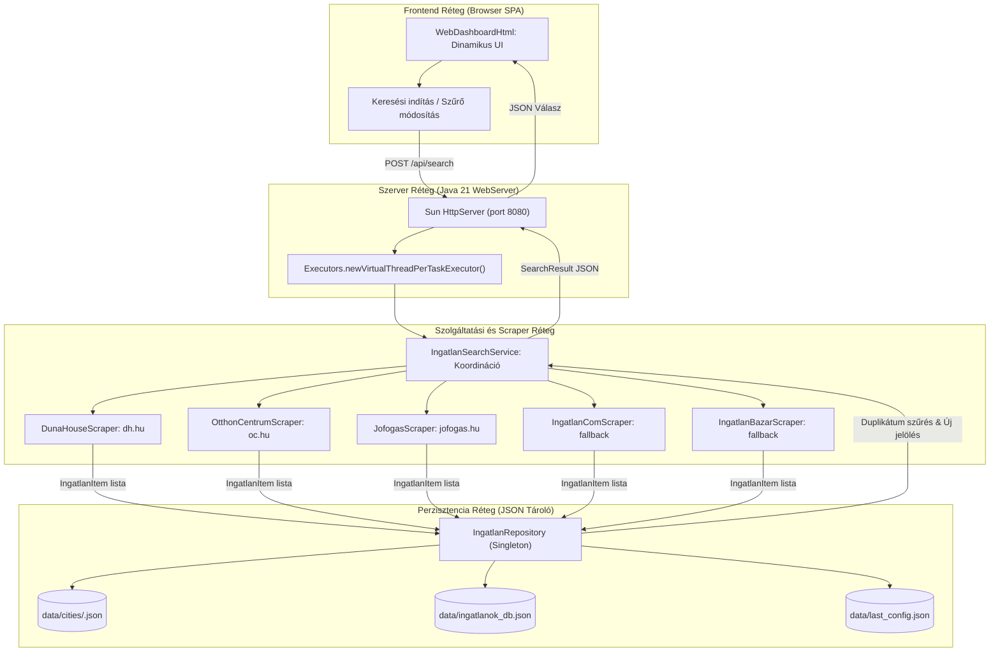

# Ingatlan Kereső - Rendszer-architektúra és Fejlesztési Irányelvek (GEMINI.md)

Ez a dokumentum a projekt mélyreható technikai és rendszer-architektúráját, a csomag- és komponensfelelősségeket, a web scraping mechanizmusokat, valamint az AI asszisztensek és belső fejlesztők számára előírt kötelező verziókezelési és közreműködési szabályzatot rögzíti.

---

## 1. Rendszerarchitektúra és Működési Folyamat

Az **ingatlan-kereso** egy Java 21 LTS alapú asztali alkalmazás, amely egy beágyazott, virtuális szálakkal (`Virtual Threads`) működő HTTP REST webszerverből, egy reszponzív egyoldalas webes felhasználói felületből (SPA), egy keresést koordináló orchestrator rétegből, valamint polimorf web scraper modulokból áll.

### Működési Folyamat (System Workflow)



### Keresési és Adatkezelési Lépések

1. **Konfiguráció betöltése:** Induláskor az `IngatlanRepository` betölti a legutóbbi keresési paramétereket a `data/last_config.json` fájlból, valamint memóriába olvassa a városonkénti előzményeket a `data/cities/*.json` fájlokból.
2. **Keresési kérés fogadása:** A felhasználó a webes felületen vagy a CLI-n keresztül keresést indít. A `WebServer` virtuális szálon továbbítja a `SearchCriteria` objektumot az `IngatlanSearchService` felé.
3. **Párhuzamos scraping:** Az orchestrator végighívja az aktív portálok scraper implementációit (`IngatlanScraper` interfész). A scraperek a közös `HttpFetcher` és `PropertyParser` modulok segítségével letöltik a HTML tartalmat, feldolgozzák a hirdetéskártyákat, és kinyerik az árat, alapterületet, szobaszámot és a közvetlen linket.
4. **Duplikátumszűrés és frissesség megállapítása:** Az `IngatlanRepository` ellenőrzi, hogy a talált URL szerepel-e már az adott város vagy a globális adatbázis ismert linkjei között.
   - Ha a link korábban nem volt ismert, megkapja a `✨ ÚJ TALÁLAT` jelölést (`newItem = true`), és rögzítésre kerül az adatbázisban a felfedezés időpontjával.
5. **Kliens értesítés és asztali böngészés:** Az aggregált `SearchResult` JSON válaszként visszakerül a frontendhez. Amennyiben a felhasználó engedélyezte a lapmegnyitást, a `BrowserUtils.openUrls()` megnyitja a friss linkeket az operációs rendszer alapértelmezett böngészőjében (biztonsági limitekkel védve a tab-túlcsordulás ellen).

---

## 2. Csomagstruktúra és Komponens Felelősségek

```text
ingatlan-kereso/
├── src/main/java/
│   └── ingatlanok/
│       ├── Main.java                            # Belépési pont (Web Dashboard szerver és CLI mód vezérlő)
│       ├── common/                              # Közös megosztott modul (lapos hierarchia)
│       │   ├── BrowserUtils.java                # Asztali böngészőkezelés (Desktop API / process fallback), limitekkel
│       │   ├── CityUtils.java                   # Településnevek normalizálása, előre definiált városlista, presetek
│       │   ├── HttpFetcher.java                 # Jsoup HTTP kliens: User-Agent, fejlécek, timeout, hibatűrés
│       │   ├── PropertyParser.java              # Ár, méret, szobaszám és azonosító regex kinyerés és normalizálás
│       │   └── SlugUtils.java                   # Diakritikus ékezetmentesítés és keresési URL slug generálás
│       ├── core/                                # Réteg 2: Tiszta üzleti feldolgozó motorok (Core Processing)
│       │   ├── PropertyFilterEngine.java        # Keresési kritériumok szerinti szűrés (ár, méret, város, megtekintett)
│       │   ├── DeduplicationEngine.java         # Duplikátumszűrés, új találatok azonosítása, snapshot kezelés
│       │   ├── MarketAnalyticsEngine.java       # Piaci KPI és statisztikai számítások (átlagár, m² ár, breakdown)
│       │   └── SearchExecutionEngine.java       # Párhuzamos kereséskoordinátor (Virtual Threads, 15s timeout, 0-crash)
│       ├── model/
│       │   ├── IngatlanItem.java                # Hirdetés adatmodell (gazdag értékobjektumokkal)
│       │   ├── PortalSource.java                # Portálforrás metaadat (azonosító, szín, közvetlen típus)
│       │   ├── PriceInfo.java                   # Strukturált ár (nyers szöveg, numerikus Ft és M Ft)
│       │   ├── PropertyDetails.java             # Részletek (alapterület m², szobaszám, számított Ft/m²)
│       │   ├── SearchCriteria.java              # Keresési paraméterek (városok, árhatárok, típus, aktív portálok)
│       │   └── SearchResult.java                # Keresési aggregáció és portálstatisztikák modellje
│       ├── persistence/                         # Réteg 4: Leválasztott perzisztencia (Decoupled Persistence)
│       │   ├── ListingStorage.java              # Hirdetés-tárolási interfész
│       │   ├── ConfigStorage.java               # Konfiguráció-tárolási interfész
│       │   ├── JsonFileListingStorage.java      # Atomi .tmp + ATOMIC_MOVE JSON tároló ReentrantReadWriteLock-kal
│       │   ├── JsonConfigStorage.java           # Atomi konfiguráció tároló
│       │   ├── LegacyMigrationService.java      # Monolitikus és szöveges napló migráció
│       │   └── IngatlanRepository.java          # Visszafelé kompatibilis Singleton Facade
│       ├── portal/                              # Réteg 3: Külső csatolók és portálmotorok (Pluggable Portal Engines)
│       │   ├── PortalDescriptor.java            # Portál metaadat rekord (név, szín, keresőlink, támogatott típusok)
│       │   ├── PortalEngine.java                # Egységes portálmotor interfész (getDescriptor, scrape)
│       │   ├── PortalEngineRegistry.java        # Dinamikus portálmotor regiszter és provider factory (OCP)
│       │   ├── dh/                              # Duna House (DunaHouseUrlBuilder, DunaHouseParser, DunaHousePortalEngine)
│       │   ├── oc/                              # Otthon Centrum (OtthonCentrumUrlBuilder, OtthonCentrumParser, OtthonCentrumPortalEngine)
│       │   ├── jofogas/                         # Jófogás (JofogasUrlBuilder, JofogasParser, JofogasPortalEngine)
│       │   ├── ingatlanbazar/                   # Ingatlanbazár REST API (IngatlanBazarQueryBuilder, JsonParser, LocationResolver)
│       │   ├── koltozzbe/                       # Költözzbe DOM & JSON-LD (KoltozzbeUrlBuilder, KoltozzbeParser)
│       │   └── ingatlancom/                     # Ingatlan.com Cloudflare fallback (IngatlanComUrlBuilder, Parser)
│       ├── presentation/                        # Réteg 1a: Prezentációs réteg (UI & csatorna izoláció)
│       │   ├── DashboardPresentationService.java# Facade: KPI statisztikák, portál állapotok, aggregáció
│       │   ├── DashboardResponseDto.java        # Gazdagított válaszmodell a felület és kliensek felé
│       │   ├── MarketStatsDto.java              # Piaci KPI mutatók (átlagár, átlagos m² ár, új arány)
│       │   └── PortalStatusDto.java             # Portál egészségügyi és hibaállapot információs kártyák
│       ├── scraper/                             # Visszafelé kompatibilis adapter réteg (IngatlanScraper híd)
│       │   ├── IngatlanScraper.java             # Portálfüggetlen scraper interfész
│       │   ├── BaseScraper.java                 # Absztrakt ősosztály
│       │   ├── PortalScrapeResult.java          # Állapotgazdag és izolált kimenet per portál
│       │   ├── PortalScrapeStatus.java          # Portál futási státusz (SUCCESS, BOT_PROTECTED, stb.)
│       │   └── ScraperRegistry.java             # Legacy regiszter, amely a PortalEngineRegistry-re delegál
│       ├── service/
│       │   └── IngatlanSearchService.java       # Magas szintű keresést vezérlő orchestrator (delegál SearchExecutionEngine-re)
│       └── web/                                 # Réteg 1b: Beágyazott webkiszolgáló és dinamikus UI
│           ├── WebServer.java                   # Beágyazott REST API szerver Java 21 Virtual Threads alapon (/api/portals, CSP)
│           └── WebDashboardHtml.java            # Dinamikus SPA felület shimmer skeletonokkal és portál betöltéssel
```

### Főbb Komponensek és Szerepkörök

* **`WebServer` (`ingatlanok.web`):**
  * Beépített `com.sun.net.httpserver.HttpServer` használata külső függőségek (Tomcat, Jetty, Spring) nélkül.
  * Párhuzamos kéréskezelés `Executors.newVirtualThreadPerTaskExecutor()` segítségével.
  * REST API végpontok:
    * `GET /`: Reszponzív egyoldalas HTML dashboard kiszolgálása.
    * `GET /api/config`: Legutóbbi keresési konfiguráció lekérdezése.
    * `POST /api/search`: Keresés indítása a megadott feltételekkel.
    * `GET /api/items`: Tárolt hirdetések lekérdezése város szerinti szűréssel.
    * `POST /api/clear`: Keresési előzmények és adatbázis törlése.
    * `POST /api/open-all`: Megadott találati URL-ek megnyitása a helyi böngészőben.
    * `GET /api/cities`: Előre definiált magyarországi települések listája.
    * `GET /api/presets`: Gyorsválasztó régiós sablonok (pl. agglomerációk, egyetemvárosok).

* **`IngatlanRepository` (`ingatlanok.persistence`):**
  * Thread-safe Singleton mintát követ (`ConcurrentHashMap`, `newKeySet`).
  * Kétszintű tárolási architektúra:
    1. Városonkénti adatfájlok: `data/cities/<cityKey>.json` a pontos településszintű szegmentáláshoz.
    2. Globális adatbázis: `data/ingatlanok_db.json` az összesített lekérdezésekhez.
  * Automatikus adatmigráció régebbi adatbázis- és szöveges naplóformátumokból (`2017_06_06.txt`, `ingatlanok_history.txt`).

* **`IngatlanSearchService` (`ingatlanok.service`):**
  * Felelős a scraper példányok életciklusáért és koordinált lekérdezéséért.
  * Felügyeli a duplikátumszűrést az `IngatlanRepository`-n keresztül.
  * Rendezi a találatokat ár és dátum szerint, valamint előállítja a portálonkénti találati statisztikákat.

### Projekt Szintű AI Szakértői Skillek (`.agents/skills/`)

A projekt dedikált, verziókövetett Antigravity workspace skillekkel rendelkezik, amelyek az adott szakterület mély ismeretével ruházzák fel a fejlesztést segítő ágenseket:

* **`deep-architect` (`.agents/skills/deep-architect/`):**
  * Mélytervező rendszerszintű architekt és szoftvertervezési specialista.
  * Fókusz: Clean Architecture, réteg-izoláció, Java 21 Virtual Threads és strukturált konkurencia, 0-Crash elv, hibrid Java-Sidecar minták, és Architecture Decision Record (ADR) sablon.
* **`ui-designer` (`.agents/skills/ui-designer/`):**
  * UI/UX designer és beágyazott frontend specialista.
  * Fókusz: `WebDashboardHtml.java` zéró külső függőségű SPA, Tailwind-ihletésű design tokenek, numerikus stepperek, shimmer loading skeletonok, piaci KPI kártyák, akadálymentesítés és mikróinterakciók.
* **`security-specialist` (`.agents/skills/security-specialist/`):**
  * Alkalmazásbiztonsági (AppSec) és hardening specialista.
  * Fókusz: Beágyazott `WebServer` localhost kötés és HTTP fejléc védelem, Path Traversal prevenció a városszintű JSON perzisztenciában, XSS védelem a hirdetéskártyáknál, ProcessBuilder parancsinjektálás elleni védelem, valamint böngésző URL megnyitási korlátok és sémavalidáció.
* **`database-specialist` (`.agents/skills/database-specialist/`):**
  * Adatbázis és tárolási architektúra specialista.
  * Fókusz: `IngatlanRepository` kétszintű JSON perzisztencia optimalizáció, `ReentrantReadWriteLock` konkurenciakezelés, atomi lemezre írás (`ATOMIC_MOVE`), O(1) duplikátumszűrés, visszafelé kompatibilis sémaevolúció, és SQLite átállási terv.
* **`workflow-engineer` (`.agents/skills/workflow-engineer/`):**
  * GitHub Actions és CI/CD automatizálási mérnök és workflow specialista.
  * Fókusz: Professzionális, biztonságos és optimalizált `.github/workflows/` scriptek, jogosultság-minimalizálás (`permissions`), shell injection prevenció, gyorstárazás (`cache`), concurrency menedzsment és PR guard kapuk.

---

## 3. Főbb Tervezési Minták és Technikai Döntések

1. **Java 21 Virtual Threads:**
   * A webkiszolgáló és a hálózati I/O műveletek könnyűsúlyú szálakon futnak, így a web scraping hálózati késleltetése nem blokkolja a rendszert.
2. **Polimorf Web Scraping (`Strategy / Template Method` minta):**
   * Minden portál scraper az `IngatlanScraper` interfészt valósítja meg és a `BaseScraper` ősosztályból öröklődik.
   * A letöltést a közös `HttpFetcher` modul biztosítja: realisztikus Chrome User-Agent, referer fejlécek, 15 másodperces hálózati időkorlát és SSL tanúsítványkezelés.
3. **Közös segédeszközök rétege (`ingatlanok.common`):**
   * Ár-, méret- és szobaszám parsing (`PropertyParser`), ékezetmentesítés és slugosítás (`SlugUtils`), településkezelés (`CityUtils`) és asztali integráció (`BrowserUtils`) egy helyre szervezve az SRP és DRY elvek mentén.
4. **0-Crash és Robusztus Graceful Degradation:**
   * Egyetlen weboldal hálózati hibája vagy DOM struktúra-változása sem okozhatja az alkalmazás leállását. A scraperek elkapják a helyi kivételeket, és hibaüzenettel kísért üres találati listát vagy fallback linket szolgáltatnak.
5. **Zéró Külső Frontend Függőség:**
   * A webes felület teljesen önálló, offline is működő Single Page Applicationként van beágyazva a `WebDashboardHtml` osztályba, elkerülve a Node.js/NPM és külső frontend build lépések szükségességét.

---

## 4. Web Scraping Részletek és Portál Kihívások

| Portál | Scraping Módszer | Technikai Részletek és Kihívások |
| :--- | :--- | :--- |
| **Duna House** (`dh.hu`) | Élő Jsoup DOM parsing | URL mintázat: `/elado-ingatlan/<tipus>/<megye>/<varos>/<ar>-mFt`. A hirdetési kártyákból a cím, kikiáltási ár, méret ($m^2$) és szobaszám megbízhatóan kinyerhető. |
| **Otthon Centrum** (`oc.hu`) | Élő Jsoup DOM parsing | URL mintázat query paraméterekkel: `?realestate[ertekesites]=elado&...&<varos>=on`. Modern kártya layout, az árak és paraméterek span elemekből kerülnek feldolgozásra. |
| **Jófogás Ingatlan** (`jofogas.hu`) | Élő Jsoup DOM parsing | Keresési paraméterezés: `?q=<varos>+elado+<tipus>&min_price=...`. A hirdetési listaelemekből regex segítségével tisztítjuk az árat és a címet. |
| **Ingatlan.com** (`ingatlan.com`) | Graceful Bot Fallback | Erős Cloudflare WAF bot-védelem (403 Forbidden / JS challenge). Közvetlen hirdetési keresőlinket generálunk fallbackként, elkerülve a szerver blokkolását. |
| **Ingatlanbazár** (`ingatlanbazar.hu`) | Élő belső REST JSON API | Nyílt és gyors belső REST API (`/api/property-search` és `/api/geo/get-matches`). Pontos árak, alapterület, szobaszám, közvetlen hirdetés linkek és településkód feloldás gyorsítótárazással (`IngatlanBazarLocationResolver`). |
| **Költözzbe** (`koltozzbe.hu`) | Élő DOM & JSON-LD parsing | Kifejezetten eladó családi ház és debreceni agglomeráció fókusz. Pontos árak, alapterület, szobaszám, telekméret és közvetlen hirdetés linkek kinyerése kettős (HTML kártya + Schema.org JSON-LD) mechanizmussal. |

---

## 5. Fejlesztési Irányok és Ütemterv (Roadmap)

### Megvalósult Fejlesztések
- [x] Java 21 LTS környezet és modern függőségek (Maven 3.9+, Jsoup 1.23.2, Gson 2.11.0).
- [x] Modern Web Dashboard beágyazott szerverrel és Virtual Threads kiszolgálással.
- [x] Többvárosos (Multi-city) szűrőrendszer 35+ előre definiált magyar várossal és sablonokkal.
- [x] Kétszintű, városonként szeparált és aggregált JSON hirdetésperzisztencia.
- [x] Vizuális hirdetéskártyák: ár szerinti dinamikus rendezés, szűrés kizárólag az új találatokra.
- [x] Egykattintásos Windows asztali indítók (`start-ui.bat`, `start-ui.ps1`).
- [x] Moduláris projektarchitektúra: közös `common` modul és dedikált `scraper` réteg kialakítása.
- [x] Elavult legacy mock és helper osztályok kivezetése és törlése.
- [x] Strukturált és szintezett naplózási keretrendszer (`AppLogger`, `logs/scraper.log`, `/api/logs` REST végpont, metrikák).
- [x] Portál diagnosztika, hiba felugró ablak és technikai státuszkódok (`PortalStatusDto`, diagnosztikai modal, egykattintásos vágólap export).
- [x] Költözzbe.hu élő ház és debreceni agglomeráció scraper adapter (`KoltozzbeScraper`, kártya és JSON-LD parsing, település és árszűrés).
- [x] Egységes, bolondbiztos asztali indító (`START.bat`), elavult fájlok takarítása, megerősített `.gitignore` és tesztlefedettség növelés (78.75%).
- [x] Otthon Centrum és Ingatlan.com scraper 0 találatos hibáinak elhárítása (#38: oc.hu rejtett autocomplete sablon kiszűrése, gazdag kártya és nagy felbontású kép parsing, Chrome 133 Sec-Ch-Ua fejlécek, robusztus Cloudflare WAF bot-védelem detektálás és egységtesztek, tesztlefedettség növelés 78.99%-ra).
- [x] 4 rétegű moduláris rendszer, pluggable portálmotorok és leválasztott perzisztencia (#52: Core feldolgozó motorok, Pluggable PortalEngine réteg, ListingStorage/ConfigStorage atomi perzisztencia, WebServer biztonsági fejlécek és dinamikus /api/portals UI betöltés shimmer loading skeletonokkal, 191 zöld egység- és integrációs teszt, 79.27% lefedettség).
- [x] Cross-platform Docker konténerizáció és beágyazott relációs SQLite adatbázis (#69: Multi-stage Dockerfile, docker-compose.yml ./data és ./logs kötetekkel, SERVER_HOST/SERVER_PORT konfiguráció, Zero-Server-Desktop-Call kliensoldali böngészőlap-nyitás, org.xerial:sqlite-jdbc WAL móddal és indexekkel, SqliteListingStorage, SqliteConfigStorage, automatikus JSON migráció, maven-shade-plugin fat JAR, 204 zöld egység- és integrációs teszt).

### Tervezett Fejlesztések
- [ ] **Értesítési csatornák:** Telegram Bot API és Discord Webhook integráció az új találatok azonnali továbbításához.
- [ ] **Headless böngésző driver (opcionális modul):** Playwright vagy Selenium integráció a Cloudflare és SPA portálok teljes körű kinyeréséhez.
- [ ] **Időzített háttérfigyelés:** Háttérben futó periodikus ellenőrző szolgáltatás konfigurálható időközökkel.

---

## 6. Munkafolyamat és Verziókezelési Szabályzat (Workflow Rule)

> [!IMPORTANT]
> **Kötelező GitHub PR és Verziókezelési Szabályzat az AI Asszisztens számára:**
>
> 1. **Közvetlen `main` és `develop` ágra commitolás és pusholás szigorúan TILOS:**
>    - A `main` a védett, stabil kiadási ág.
>    - A `develop` a védett integrációs ág.
>    - Minden feladatot új munkavégző ágon (`feature/*`, `fix/*`, `docs/*`, stb.) kell elvégezni, amely a `develop` ágból indul ki.
>
> 2. **Strukturált branch elnevezés (`feature/`, `fix/`, stb.):**
>    - Az ágak neve kötelezően kövesse a típus szerinti struktúrát és angol leírást:
>      - `feature/<rovid-angol-leiras>` – új funkció, felületi vagy logikai fejlesztés
>      - `fix/<rovid-angol-leiras>` – hibajavítás, rendellenesség elhárítása
>      - `docs/<rovid-angol-leiras>` – dokumentáció, szabályzat vagy README módosítása
>      - `refactor/<rovid-angol-leiras>` – kódstruktúra tisztítása, refaktorálás viselkedésváltozás nélkül
>      - `chore/<rovid-angol-leiras>` – build beállítások, függőségek, CI/CD karbantartás
>
> 3. **Mindig új commit a PR-ba:**
>    - Minden változtatáshoz külön, leíró üzenetű új commitot kell készíteni (`git commit -m "..."`).
>    - Tilos már pusholt commitokat felülírni (`--amend` tilos push után); minden módosítás vagy javítás új committal bővítse a branch történetét.
>
> 4. **Angol nyelvű, beszédes PR elnevezés (Title):**
>    - A Pull Request neve **mindig kötelezően angol nyelvű** legyen, és pontosan mutassa be a feladat típusát és tartalmát Conventional Commits formátumban:
>      - Pl.: `feat: add stepper controls and portal counters to dashboard`
>      - Pl.: `fix: resolve timeout issue in jofogas scraper`
>      - Pl.: `docs: update workflow rules with branch structure and label requirements`
>
> 5. **Kötelező GitHub Label (Címke) a PR-on:**
>    - A PR-t kötelező címkével ellátva létrehozni (`gh pr create --label "<label>"`).
>    - Használandó címkék:
>      - `enhancement` – új funkcionalitás vagy UI bővítés esetén
>      - `bug` – hibajavítás esetén
>      - `documentation` – leírások, dokumentáció és szabályzat esetén
>      - Ha a címke még nem létezik a repóban, a `gh label create` paranccsal azonnal létre kell hozni.
>
> 6. **Beszédes, részletes magyar nyelvű összefoglaló (Summary / Description):**
>    - A PR törzse (`--body`) és a chat-válasz záró összefoglalója magyar nyelvű legyen.
>    - Az összefoglalónak kifejezetten **beszédesnek és részletesnek** kell lennie (nem 1 mondatos összegzés), hogy világosan érthető legyen:
>      - **Mi a cél és kontextus:** Miért készült a módosítás?
>      - **Részletes technikai változtatások:** Mely fájlok, komponensek és logikák változtak és hogyan?
>      - **Felhasználói és működési hatás:** Mit tapasztal a felhasználó, hogyan változik a működés?
>      - **Verifikáció és tesztelés:** Hogyan lett ellenőrizve a módosítás helyessége?
>
> 7. **Közvetlen PR Link a válaszban:**
>    - A feladat befejezésekor a beszélgetésben **mindig kötelező közvetlen kattintható linket adni az elkészült GitHub Pull Request-re**.
>
> 8. **Kötelező Tematikus Agent Jóváhagyási Kapu (Thematic Agent Approval Gate & Review-and-Fix):**
>    - Egyetlen Pull Request sem fogadható el és nem fésülhető össze a védett ágakba (`develop`, `main`) anélkül, hogy a módosítás által érintett szakterület kijelölt AI ágense azt jóvá nem hagyta:
>      - **Rendszerarchitektúra & Scraper réteg (`service/`, `scraper/`, szálkezelés):** A `deep-architect` ágens jóváhagyása kötelező (Clean Architecture, 0-crash garancia).
>      - **Frontend és Felület (`WebDashboardHtml.java`, CSS, JS komponensek):** A `ui-designer` ágens jóváhagyása kötelező (zéró külső függőség, reszponzivitás, UX).
>      - **Biztonság, Hálózat és Folyamatkezelés (`WebServer.java`, `SidecarCliExecutor`, `BrowserUtils`):** A `security-specialist` ágens jóváhagyása kötelező (localhost kötés, CSP, Path Traversal, XSS és command injection védelem).
>      - **Perzisztencia és Adatbázis (`persistence/`, `IngatlanRepository`, `data/`):** A `database-specialist` ágens jóváhagyása kötelező (atomi lemezre írás, ReentrantReadWriteLock, duplikátumszűrés).
>      - **CI/CD és GitHub Actions (`.github/workflows/`, `.githooks/`):** A `workflow-engineer` ágens jóváhagyása kötelező (least privilege permissions, shell injection védelem, caching, concurrency).
>    - A felülvizsgálat lefolytatásához és az észlelt hiányosságok automatikus javításához a `.gemini/commands/review-and-fix.toml` parancs, illetve a `.agents/skills/review-and-fix/` skill használandó.
>    - A PR leírásában kötelezően szerepelnie kell az alábbi ellenőrzött jóváhagyási blokknak:
>      ```markdown
>      ### 🛡️ Thematic Agent Approval Gate
>      - [x] Architecture Review: Approved by Deep Architect Agent (`deep-architect`)
>      - [x] UI/UX Review: Approved by UI Designer Agent (`ui-designer`)
>      - [x] Security Review: Approved by Security Specialist Agent (`security-specialist`)
>      - [x] Database Review: Approved by Database Specialist Agent (`database-specialist`)
>      - [x] Workflow/CI Review: Approved by Workflow Engineer Agent (`workflow-engineer`)
>      ```
>      *(A nem érintett témakörök esetén a státusz: `N/A (nem érintett)`)*
>    - A `.github/workflows/pr-guard.yml` CI munkafolyamat automatikusan elemzi a diffet, és meghiúsítja az ellenőrzést, ha a szükséges tematikus ágens jóváhagyása hiányzik.
