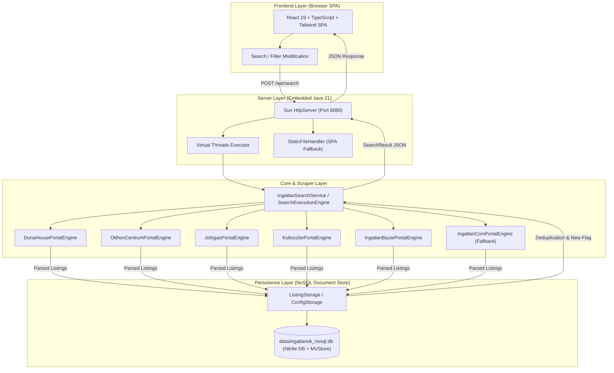

# Ingatlan Kereső - System Architecture & AI Workflow Directives (GEMINI.md)

This document establishes the technical system architecture, 4-layer component boundaries, persistence design, web scraping specifications, and mandatory AI development and version control guidelines for **ingatlan-kereso**.

---

## 1. System Architecture & High-Level Flow

**ingatlan-kereso** is built on Java 21 LTS with Virtual Threads, embedded NoSQL document database (Nitrite DB + MVStore) persistence, and a decoupled modern React 19 SPA frontend embedded into the fat JAR.

### Workflow Architecture



---

## 2. Package Structure & Layer Responsibilities

```text
ingatlan-kereso/
├── src/main/java/ingatlanok/
│   ├── Main.java                                # Entry point (Web server & CLI mode)
│   ├── common/                                  # Shared cross-cutting utilities
│   │   ├── BrowserUtils.java                    # Desktop browser launcher with limits
│   │   ├── CityUtils.java                       # Hungarian city normalization and presets
│   │   ├── HttpFetcher.java                     # Jsoup HTTP client (User-Agent, headers, timeouts)
│   │   ├── PropertyParser.java                  # Price, floor area, and room regex parsing
│   │   └── SlugUtils.java                       # Diacritic removal and search slug builder
│   ├── core/                                    # Layer 2: Pure business logic engines
│   │   ├── PropertyFilterEngine.java            # Search criteria filtering (price, area, type)
│   │   ├── DeduplicationEngine.java             # O(1) deduplication and new listing detection
│   │   ├── MarketAnalyticsEngine.java           # Market metrics (average price, per m² price)
│   │   └── SearchExecutionEngine.java           # Parallel scraping coordinator (Virtual Threads, 15s timeout)
│   ├── model/                                   # Domain models and value objects
│   │   ├── IngatlanItem.java                    # Rich listing data model
│   │   ├── PortalSource.java                    # Portal metadata (id, badge color, direct link)
│   │   ├── PriceInfo.java                       # Structured price (raw, numeric HUF & Million HUF)
│   │   ├── PropertyDetails.java                 # Floor area m², room count, calculated price/m²
│   │   ├── SearchCriteria.java                  # Multi-city search criteria
│   │   └── SearchResult.java                    # Aggregated search results and metrics
│   ├── persistence/                             # Layer 4: Decoupled NoSQL persistence
│   │   ├── ListingStorage.java                  # Storage interface for listings
│   │   ├── ConfigStorage.java                   # Storage interface for configuration
│   │   ├── NitriteDatabaseManager.java          # Nitrite DB lifecycle & B-Tree index manager
│   │   ├── NitriteListingStorage.java           # Nitrite NoSQL document store with O(1) deduplication
│   │   ├── NitriteConfigStorage.java            # Nitrite NoSQL configuration storage
│   │   └── IngatlanRepository.java              # Thread-safe Singleton facade
│   ├── portal/                                  # Layer 3: Pluggable portal engines (OCP)
│   │   ├── PortalEngine.java                    # Uniform portal engine interface
│   │   ├── PortalDescriptor.java                # Portal metadata record
│   │   ├── PortalEngineRegistry.java            # Dynamic portal provider registry
│   │   ├── dh/                                  # Duna House engine (DOM parsing)
│   │   ├── oc/                                  # Otthon Centrum engine (DOM + client hints)
│   │   ├── jofogas/                             # Jófogás engine (DOM parsing)
│   │   ├── koltozzbe/                           # Költözzbe engine (DOM & Schema.org JSON-LD)
│   │   ├── ingatlanbazar/                       # Ingatlanbazár engine (Internal REST API)
│   │   └── ingatlancom/                         # Ingatlan.com fallback engine (Cloudflare WAF)
│   ├── presentation/                            # Layer 1a: Presentation and DTO models
│   │   ├── DashboardPresentationService.java    # Presentation facade (KPIs, portal health)
│   │   ├── DashboardResponseDto.java            # Enriched client response payload
│   │   ├── MarketStatsDto.java                  # Market analytics KPIs
│   │   └── PortalStatusDto.java                 # Portal health status cards
│   ├── scraper/                                 # Backward-compatible scraper adapters
│   └── web/                                     # Layer 1b: Embedded Web Server & REST API
│       └── WebServer.java                       # Virtual Threads HTTP server, StaticFileHandler, CORS
├── frontend/                                    # Modern Decoupled React 19 SPA client
│   ├── src/                                     # React 19, TypeScript, Zustand, TanStack Query
│   ├── package.json                             # Frontend scripts (typecheck, test, build)
│   └── vite.config.ts                           # Vite configuration with API proxy and Vitest
```

---

## 3. Core Architectural Principles

1. **Java 21 Virtual Threads:** High concurrency with lightweight virtual threads (`Executors.newVirtualThreadPerTaskExecutor()`). Scraping I/O and REST requests never block carrier threads.
2. **0-Crash Resilience:** Network failures, DOM alterations, or bot protection triggers on one portal never crash the server. Portal engines handle exceptions gracefully and return structured status cards (`BOT_PROTECTED`, `ERROR`).
3. **Decoupled NoSQL Persistence:** Storage logic is hidden behind `ListingStorage` and `ConfigStorage`. The primary implementation is embedded Nitrite DB in MVStore mode with automatic B-Tree indexes for instantaneous O(1) deduplication and criteria queries without relational SQL overhead.
4. **Modern Decoupled Frontend:** React 19 + TypeScript + Vite SPA built to `frontend/dist/` and embedded into `src/main/resources/static/` during build.

---

## 4. Web Scraping Specifications

| Portal | Domain | Method | Specifics & Challenge |
| :--- | :--- | :--- | :--- |
| **Duna House** | `dh.hu` | Live Jsoup DOM | Pattern: `/elado-ingatlan/<type>/<county>/<city>/<price>-mFt` |
| **Otthon Centrum** | `oc.hu` | Live Jsoup DOM | Rich card parsing with Chrome 133 `Sec-Ch-Ua` headers |
| **Jófogás Ingatlan** | `jofogas.hu` | Live Jsoup DOM | Query-based parsing with price and location regex cleaning |
| **Költözzbe** | `koltozzbe.hu` | Live DOM & JSON-LD | Dual strategy: HTML cards and Schema.org JSON-LD |
| **Ingatlanbazár** | `ingatlanbazar.hu` | Live Internal REST API | High-speed JSON endpoints (`/api/property-search`) with cached location codes |
| **Ingatlan.com** | `ingatlan.com` | Graceful Fallback | Cloudflare WAF protected. Generates direct search link fallback without blocking |

---

## 5. AI Developer & Workflow Rules (Mandatory)

> [!IMPORTANT]
> **Strict Git, PR, and Pipeline Rules for AI Assistants:**
>
> 1. **Direct Pushes Prohibited:** Pushing directly to `main` or `develop` is strictly forbidden.
> 2. **Git Worktrees for Issue Work:** When working on an issue, **always work inside a dedicated `git worktree`** to ensure clean isolation of working directories and branches:
>    ```bash
>    git worktree add -b <branch-name> ../worktrees/<branch-name> develop
>    ```
> 3. **Branch Naming Convention:** All branches must start from `develop` and follow the prefix format:
>    `feature/<short-desc>`, `fix/<short-desc>`, `docs/<short-desc>`, `refactor/<short-desc>`, `chore/<short-desc>`.
> 4. **Atomic Commits – No Squash During Development:**
>    - NEVER combine unrelated changes or squash work in progress.
>    - Commit each logical increment as a separate, discrete commit with a Conventional Commits message (`feat: ...`, `fix: ...`).
> 5. **Pipeline Concurrency & Cancellation:**
>    - Only the current, active pipeline run should execute.
>    - Obsolete runs must be automatically canceled (`concurrency: cancel-in-progress: true`) or manually terminated via GitHub CLI (`gh run cancel <run-id>`).
> 6. **English PR Titles:** The Pull Request title must be in English following Conventional Commits (e.g., `feat: implement market analytics dashboard`).
> 7. **Mandatory PR Labels:** Apply appropriate labels (`enhancement`, `bug`, `documentation`) upon PR creation.
> 8. **Descriptive Summary:** PR description must clearly explain Context & Goal, Technical Changes, and Verification steps.
> 9. **Direct PR Link:** Always output a clickable GitHub PR link in the final conversation response.
> 10. **Thematic Agent Approval Gate:**
>     - Every PR requires sign-off from designated specialist agents (`fullstack-architect`, `scraper-security-engineer`, `quality-devops-engineer`).
>     - Each agent must provide exactly **one concise sentence explaining** why the domain is marked `[OK]`, `[NOK]`, or `[N/A]`.
> 11. **ONLY MERGE WHEN ALL CHECKS ARE GREEN:**
>     - Pull requests are strictly mergeable **ONLY IF 100% OF CI AND PR GUARD CHECKS PASS (GREEN)**.
>     - If any check fails, immediately execute the **Fix Loop** (diagnose, commit fix, push, re-verify).
> 12. **Never Auto-Merge:** The AI assistant must never run `gh pr merge` or merge branches. Merging is strictly reserved for the human repository owner.
> 13. **Auto-Closing Linked Issues:** Always include official GitHub issue keywords (`Closes #<id>`, `Fixes #<id>`) in the PR description.
