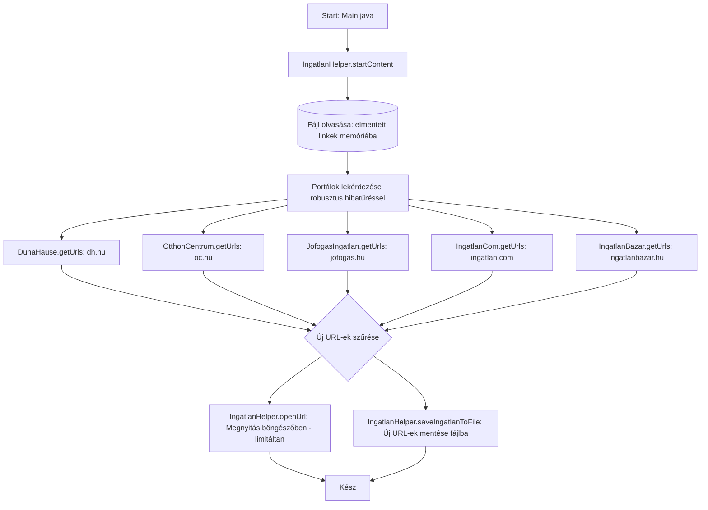

# Ingatlan Kereső - Projekt Dokumentáció és Kontextus (gemini.md)

## 1. Projekt Áttekintés

Az **ingatlan-kereso** egy Java alapú segédprogram, amelynek célja meghatározott ingatlanhirdetési portálok (Debrecen környéki eladó lakások) automatizált figyelése.
A program periodikusan vagy igény szerint lekéri a keresési találati listákat, kiszűri a már korábban látott hirdetéseket, az új linkeket automatikusan megnyitja a felhasználó alapértelmezett böngészőjében, valamint rögzíti azokat egy helyi naplófájlban.

* **Eredeti szerző:** Pusinszky Viktor (2017)
* **Kezelt portálok:**
  * Duna House (`dh.hu`) – *Működik (élő adatokkal)*
  * Otthon Centrum (`oc.hu`) – *Működik (élő adatokkal)*
  * Jófogás Ingatlan (`ingatlan.jofogas.hu`) – *Működik (élő adatokkal)*
  * Ingatlan.com (`ingatlan.com`) – *Cloudflare bot-védelem alatt*
  * Ingatlanbazár (`ingatlanbazar.hu`) – *Kliensoldali Angular SPA*

---

## 2. Technológiai Stack

* **Nyelv & Keretrendszer:** Java 21 LTS
* **Build rendszer:** Apache Maven (`pom.xml`)
  * `org.jsoup:jsoup:1.23.2` – HTML letöltés, DOM parszer és CSS szelektálás
  * `commons-io:commons-io:2.22.0` – Fájlműveletek és I/O segédeszközök
  * `org.codehaus.mojo:exec-maven-plugin:3.6.4` – Parancssori futtatás támogatása
* **Rendszerszintű integráció:** Modern `java.awt.Desktop` böngészőhívás `ProcessBuilder` fallbackkel

---

## 3. Könyvtárstruktúra és Komponensek

```text
ingatlan-kereso/
├── pom.xml                                      # Maven konfiguráció és függőségek (Java 21, Gson, Jsoup)
├── README.md                                    # Részletes felhasználói és fejlesztői dokumentáció
├── gemini.md                                    # Rendszer- és architektúra leírás
├── start-ui.bat                                 # Egykattintásos indító Windowsra
├── start-ui.ps1                                 # PowerShell indító script
├── data/                                        # Helyi perzisztens JSON adatbázis mappa (.gitignore)
│   ├── ingatlanok_db.json                       # Hirdetés adatok, ár, alapterület, időpont
│   └── last_config.json                         # Mentett keresési szűrők
├── .gitignore
├── LICENSE                                      # GPL licenc
└── src/main/java/
    ├── Main.java                                # Belépési pont (Web Dashboard & CLI fallback)
    └── ingatlanok/
        ├── helper/
        │   └── IngatlanHelper.java              # Böngészőkezelés, fájlkezelés
        ├── model/
        │   ├── IngatlanItem.java                # Hirdetés adatmodell (ár, méret, szobák, link)
        │   ├── SearchCriteria.java              # Keresési paraméterek (város, típus, portálok)
        │   └── SearchResult.java                # Találati aggregáció modell
        ├── persistence/
        │   ├── IngatlanRepository.java          # Fájlalapú JSON adatbázis és beállításkezelő
        │   └── IngatlanDataBaseMock.java        # Visszafelé kompatibilitási réteg
        ├── service/
        │   ├── Ingatlan.java                    # Scraper interfész (`search` és `getUrls`)
        │   ├── IngatlanSearchService.java       # Központi keresési orchestrator
        │   └── impl/
        │       ├── IngatlanStart.java           # Jsoup bázisosztály, biztonságos letöltés
        │       ├── DunaHause.java               # dh.hu scraper (élő találatok + metaadatok)
        │       ├── OtthonCentrum.java           # oc.hu scraper (élő találatok + metaadatok)
        │       ├── JofogasIngatlan.java         # jofogas.hu scraper (élő találatok + metaadatok)
        │       ├── IngatlanCom.java             # ingatlan.com scraper (Cloudflare fallback)
        │       └── IngatlanBazar.java           # ingatlanbazar.hu scraper (Angular SPA fallback)
        └── web/
            ├── WebServer.java                   # Beágyazott Java 21 REST API szerver
            └── WebDashboardHtml.java            # Modern reszponzív SPA HTML/CSS/JS sablon
```

---

## 4. Működési Folyamat (Workflow)



1. **Adatbázis inicializálás:** `IngatlanHelper.startContent()` beolvassa a lokális fájlban tárolt korábbi URL-eket a `IngatlanDataBaseMock` in-memory halmazába (`Set<String>`).
2. **Keresési eredmények letöltése:** A scraper osztályok (`IngatlanStart` leszármazottak) Jsoup segítségével letöltik a keresési URL-ek első oldalát a találatszám megállapításához, majd végiglapozzák a találatokat.
3. **Duplikátum-szűrés:** A megtalált hirdetés-linkeket összeveti a memóriában lévő linkekkel.
4. **Értesítés és Mentés:**
   * Ha új link érkezett, a rendszer a Windows beépített `rundll32` parancsával közvetlenül megnyitja azt a böngészőben.
   * Az új linkek listája hozzáfűzésre kerül a helyi fájlhoz.

---

## 5. Azonosított Technikai Adósságok és Kihívások

1. **Elavult HTML szelekció & Bot védelem (Web Scraping törékenység):**
   * A weboldalak (különösen az ingatlan.com és az oc.hu) 2017 óta többször megújultak, modern frontend technológiákra (Next.js/React, SSR/CSR) és erős bot-védelemre (pl. Cloudflare, PerimeterX, Datadome) váltottak.
   * A régi CSS osztályok (`span.results__number__count`, `div.listing__card`, stb.) jelenlegi formájukban nagy valószínűséggel nem működnek.
2. **Bedrótozott konfigurációk:**
   * A mentési fájlnév mereven kódolt (`2017_06_06.txt`).
   * A keresési paraméterek (Debrecen, 9-11 mFt, 35+ m2) az osztályok forráskódjába vannak égetve ahelyett, hogy külső konfigurációból (pl. `application.properties`, JSON, CLI paraméterek) olvasná őket.
3. **Platformfüggőség:**
   * `rundll32 url.dll,FileProtocolHandler` kizárólag Windowson működik; érdemes a standard `java.awt.Desktop.getDesktop().browse(uri)` hívásra cserélni.
4. **Függőségek és Java verzió:**
   * A `pom.xml` nem rögzít Java fordítási verziót (`maven.compiler.source` / `target`).
   * A Jsoup 1.10.3 (2017-es) és a Commons IO 2.5 elavultak, frissítésük javasolt.
5. **Kivételkezelés:**
   * Több helyen üres `catch (Exception e) {}` blokkok találhatók, ami megnehezíti a hibakeresést és a hálózati hibák detektálását.

---

## 6. Javasolt Fejlesztési Irányok (Roadmap)

* [x] **Modernizáció és Függőségfrissítés (Elkészült):**
  * Java 21 LTS beállítása a `pom.xml`-ben (`maven.compiler.source`/`target`).
  * Jsoup frissítve `1.23.2`-re, Commons IO `2.22.0`-ra, Gson `2.11.0` integrálva, Exec Maven Plugin `3.6.4`-re.
  * Modern böngészési metódus (`java.awt.Desktop`) bevezetése `ProcessBuilder` fallbackkel és megnyitási korlátozással.
* [x] **Scraper réteg felülvizsgálata és működőképessé tétele (Elkészült):**
  * **Duna House (`dh.hu`):** Frissítve modern DOM keresésre és metaadat-kinyerésre (ár, méret, szobák, cím).
  * **Otthon Centrum (`oc.hu`):** Frissítve a legújabb keresési paraméterezésre és kártyaszelektorokra.
  * **Jófogás Ingatlan (`jofogas.hu`):** Új scraper modul bevezetve élő hirdetésekkel és metaadat-kinyeréssel.
  * **Robusztus hibakezelés:** Az Ingatlan.com (Cloudflare bot-védelem) és Ingatlanbazár (Angular SPA) esetén graceful fallback.
* [x] **Modern Web Dashboard & REST API (Elkészült):**
  * Beágyazott Java 21 `HttpServer` (Virtual Threads).
  * Reszponzív SPA (Tailwind-ihlette sötét/világos mód, kártyás megjelenítés, azonnali gépelés közbeni gyorskereső).
  * Egykattintásos indító Windowsra (`start-ui.bat`, `start-ui.ps1`).
* [x] **Dinamikus Konfigurációs Réteg (Elkészült):**
  * Keresési szűrők (település, lakás/ház, aktív portálok, böngészőfül megnyitási kapcsoló) a webes felületen.
* [x] **Strukturált Adatperzisztencia (Elkészült):**
  * Fájlalapú JSON adatbázis (`data/ingatlanok_db.json`), automatikus legacy txt import, duplikátumszűrés, előzmények megtekintése és törlése.
* [ ] **Értesítési csatornák bővítése:**
  * Opcionálisan Telegram bot, Discord webhook vagy e-mail értesítés küldése.

---

## 7. Munkafolyamat és Verziókezelési Szabályzat (Workflow Rule)

> [!IMPORTANT]
> **Kötelező GitHub PR Szabályzat az AI Asszisztens számára:**
> 1. **Közvetlen `master`/`main` ágra commitolás és pusholás TILOS.** Minden módosítást új munkavégző ágon (`git checkout -b <branch-name>`) kell elvégezni.
> 2. **Pull Request automatikus létrehozása:** A változtatásokat fel kell tölteni a GitHub-ra (`git push -u origin <branch-name>`), majd Pull Request-et kell nyitni (`gh pr create`).
> 3. **PR Link a válaszban:** A beszélgetésben a feladat befejezésekor **mindig kötelező közvetlen linket adni az elkészült GitHub Pull Request-re**.

